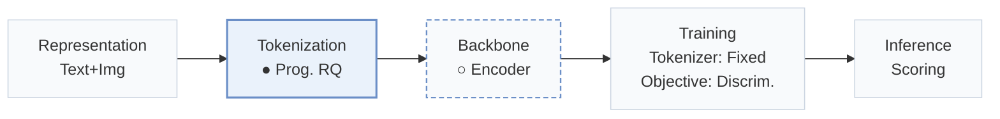
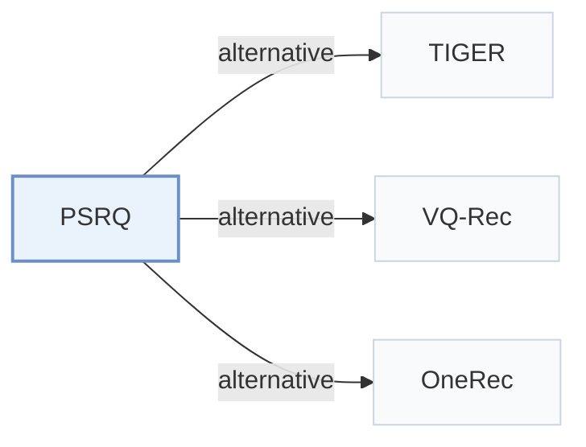

# PSRQ

[← Problem × Stage Matrix](../../README.md#i--tokenization) · [Papers by Stage](../index/stages.md) · [Papers by Modality](../index/modality.md) · [Papers by Domain](../index/domain.md) · English | [中文](../zh/papers/psrq.md)

| **Title** | *Progressive Semantic Residual Quantization for Multimodal-Joint Interest Modeling in Music Recommendation* |
| :-- | :-- |
| **Authors** | Wang et al. |
| **Venue** | CIKM’25 |
| **Problem × Stage** | `I. Informativeness` · `Tokenization` |
| **Changes** | ● Tokenization · ○ Backbone |
| **SID inputs** | text: `Text` · image: `Img` · audio: `Audio` · joint_Amazon: `Text` + `Img` · joint_Music: `Text` + `Audio` |
| **Domain** | `E-commerce` · `Music` |
| **Scenario** | `Ranking and Reranking`; `Online Experiment or Deployment` |
| **Links** | [Paper](https://arxiv.org/abs/2508.20359) |
| **Reading level** | Overview (Level 1) |

**On this page**: [TL;DR](#tldr) · [3. Experiments](#3-experimental-findings) · [5. Related Work](#5-connections-to-related-work)

- `Text+Img`: Text and visual item representations.
- `Prog. RQ`: Progressive RQ variant.
- `Encoder`: Bidirectional encoder backbone without autoregressive token generation.
- `Fixed`: SIDs are built first and not changed while the generator trains.
- `Discrim.`: Scores items; does not generate SIDs.
- `Scoring`: Direct candidate scoring without step-by-step SID generation.

### TL;DR

> [!NOTE]
> PSRQ generates modality-specific and modality-joint Semantic IDs that preserve prefix semantic features and models music interests with multi-codebook cross-attention, to reduce semantic drift in residual quantization.

---

### 3. Experimental Findings

Experimental setup

- **Datasets**: Amazon Baby (81,423 users / 33,652 items; ratings of 4 or more are positives), an industrial music-streaming dataset from one week of logs (4,926,656 users / 1,387,247 songs; collections are positives, played-but-not-collected are negatives), and Music4all (14,127 users / 99,596 songs; repeated plays are positives). Items with fewer than 30 interactions are marked cold-start. Further filtering: not reported.
  - Source: Datasets and labels: [S5.SS1.SSS1.p1](https://arxiv.org/html/2508.20359v1#S5.SS1.SSS1.p1), [S5.I2.i1.p1](https://arxiv.org/html/2508.20359v1#S5.I2.i1.p1), [S5.I2.i2.p1](https://arxiv.org/html/2508.20359v1#S5.I2.i2.p1), [S5.I2.i3.p1](https://arxiv.org/html/2508.20359v1#S5.I2.i3.p1); statistics: [S5.T1](https://arxiv.org/html/2508.20359v1#S5.T1).
- **Split**: not reported (sequences are built by timestamp and trained for one epoch, but the train/test division is not described). Online: A/B test in February 2025 on the music platform against a DLRM ranker.
  - Source: Timestamp-ordered sequences, no split rule: [S5.I2.i1.p1](https://arxiv.org/html/2508.20359v1#S5.I2.i1.p1) and [S5.SS1.SSS2.p1](https://arxiv.org/html/2508.20359v1#S5.SS1.SSS2.p1); online test: [S5.SS3.p1](https://arxiv.org/html/2508.20359v1#S5.SS3.p1).
- **Candidates**: n/a for ranking candidates: evaluation is pointwise AUC and Logloss on labeled positive and negative samples; how negatives relate to user history is defined by the labels above.
  - Source: Pointwise AUC on labeled samples: [S5.SS1.SSS3.p1](https://arxiv.org/html/2508.20359v1#S5.SS1.SSS3.p1).
- **Visibility**: warm; no unseen-item protocol is defined. 'Cold AUC' covers items with fewer than 30 interactions, which are low-frequency, not unseen.
  - Source: Cold-start = fewer than 30 interactions, not unseen: [S5.SS1.SSS1.p1](https://arxiv.org/html/2508.20359v1#S5.SS1.SSS1.p1).
- **SID**: Progressive Semantic Residual Quantization (PSRQ): layer-wise K-means over modality embeddings (text, image or audio) that preserves the prefix semantic feature, producing modal-specific and modal-joint semantic IDs; clusters per layer k = 64 (Amazon Baby), 256 (Industrial), 128 (Music4all), 3 layers. Collision handling: not reported.
  - Source: Clusters k and layers l per dataset: [S5.SS1.SSS2.p1](https://arxiv.org/html/2508.20359v1#S5.SS1.SSS2.p1); PSRQ name and modal-specific/modal-joint IDs: [abstract1](https://arxiv.org/html/2508.20359v1#abstract1) and [S4.SS1.p1](https://arxiv.org/html/2508.20359v1#S4.SS1.p1).
- **Inference budget**: n/a for generation (SIDs feed a DIN-style ranker with cross-attention, MCCA). MLLM feature extractors run on NVIDIA A100 GPUs; ranker inference batch size and latency: not reported.
  - Source: Discriminative ranker, hardware for feature extraction: [S5.SS1.SSS2.p1](https://arxiv.org/html/2508.20359v1#S5.SS1.SSS2.p1).
- **Results from**: Table 2 (All AUC, Cold AUC, Logloss versus multimodal and quantization-based rankers); Table 3 (quantizers added to DIN with text only); Table 4 (MCCA ablation); Section 5.3 (online A/B: collect +2.81%, full play +0.95%).
  - Source: Main: [S5.T2](https://arxiv.org/html/2508.20359v1#S5.T2); quantizers in DIN: [S5.T3](https://arxiv.org/html/2508.20359v1#S5.T3); ablation: [S5.T4](https://arxiv.org/html/2508.20359v1#S5.T4); online: [S5.SS3.p1](https://arxiv.org/html/2508.20359v1#S5.SS3.p1).

---

### 5. Connections to Related Work

- **Alternative** · [TIGER](tiger.md): TIGER introduced RQ-VAE semantic IDs for generative retrieval; PSRQ quantizes multimodal embeddings with progressive semantic residual K-means and uses the IDs as ranking features for cold-start items.
  - Source: PSRQ v1, Section 1 and Section 2.2 cite Rajput et al. (2023): [S1.p3](https://arxiv.org/html/2508.20359v1#S1.p3) and [S2.SS2.p1](https://arxiv.org/html/2508.20359v1#S2.SS2.p1); RQ-VAE is a quantizer baseline in Table 3: [S5.T3](https://arxiv.org/html/2508.20359v1#S5.T3).
- **Alternative** · [VQ-Rec](vq-rec.md): VQ-Rec framed vector quantization for transferable recommenders; PSRQ adds modal-specific and modal-joint codebooks for multimodal cold-start ranking.
  - Source: PSRQ v1, Section 1 and Section 2.2: [S1.p3](https://arxiv.org/html/2508.20359v1#S1.p3) and [S2.SS2.p1](https://arxiv.org/html/2508.20359v1#S2.SS2.p1).
- **Alternative** · [OneRec](onerec.md): OneRec uses residual K-means SIDs inside an end-to-end generator; PSRQ keeps a discriminative ranker and feeds it multimodal SID embeddings.
  - Source: PSRQ v1, contribution list and Section 2.2 cite OneRec: [S1.I1.i2.p1](https://arxiv.org/html/2508.20359v1#S1.I1.i2.p1) and [S2.SS2.p1](https://arxiv.org/html/2508.20359v1#S2.SS2.p1).

[View all papers in this cell](../../README.md#i--tokenization)
