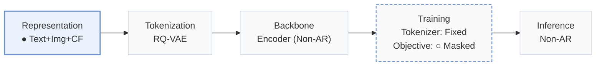
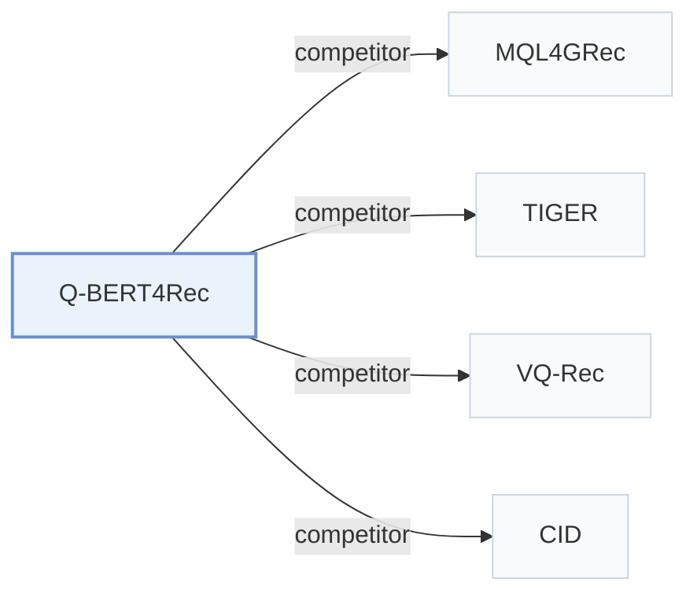

# Q-BERT4Rec

[← Problem × Stage Matrix](../../README.md#i--representation) · [Papers by Stage](../index/stages.md) · [Papers by Modality](../index/modality.md) · [Papers by Domain](../index/domain.md) · English | [中文](../zh/papers/q-bert4rec.md)

| **Title** | *Quantized Semantic-ID Representation Learning for Multimodal Recommendation* |
| :-- | :-- |
| **Authors** | Huang and Gai |
| **Venue** | arXiv’25 |
| **Problem × Stage** | `I. Informativeness` · `Representation` |
| **Changes** | ● Representation · ○ Objective |
| **SID inputs** | `Text` + `Img` |
| **Domain** | `E-commerce` |
| **Settings** | `cross-domain` |
| **Links** | [Paper](https://arxiv.org/abs/2512.02474) |
| **Reading level** | Overview (Level 1) |

**On this page**: [TL;DR](#tldr) · [3. Experiments](#3-experimental-findings) · [5. Related Work](#5-connections-to-related-work)

- `Text+Img+CF`: Text and image representations combined with collaborative signals.
- `RQ-VAE`: Residual-Quantized Variational AutoEncoder.
- `Encoder (Non-AR)`: Bidirectional encoder trained for non-autoregressive parallel prediction.
- `Fixed`: SIDs are built first and not changed while the generator trains.
- `Masked`: Masks part of the codes and reconstructs them (includes masked diffusion).
- `Non-AR`: Single-pass non-autoregressive parallel decoding.

### TL;DR

> [!NOTE]
> Q-BERT4Rec fuses text, image, and structural features into item embeddings, quantizes them into Semantic ID tokens by residual vector quantization, and pre-trains a bidirectional encoder with several masking strategies.

---

### 3. Experimental Findings

Experimental setup

- **Datasets**: Amazon Reviews 2018: pre-training on six source domains (Pet, Cell, Automotive, Tools, Toys, Sports) and fine-tuning on Musical Instruments, Arts Crafts and Sewing, Video Games (same statistics table as MQL4GRec). Filtering rules: not restated.
  - Source: Source and target domains: [S4.SS1.p1](https://arxiv.org/html/2512.02474v2#S4.SS1.p1), [S4.SS1.p2](https://arxiv.org/html/2512.02474v2#S4.SS1.p2), [S4.SS1.p3](https://arxiv.org/html/2512.02474v2#S4.SS1.p3); statistics: [S3.T1](https://arxiv.org/html/2512.02474v2#S3.T1).
- **Split**: Leave-one-out: most recent interaction for test, second most recent for validation, the rest for training.
  - Source: Leave-one-out allocation: [S4.SS1.p4](https://arxiv.org/html/2512.02474v2#S4.SS1.p4).
- **Candidates**: not reported explicitly; at inference the masked last position is filled with the most probable semantic ID over the item set (HR and NDCG at 1, 5, 10).
  - Source: Argmax over item semantic IDs: [S3.SS6.p2](https://arxiv.org/html/2512.02474v2#S3.SS6.p2); metrics: [S4.SS1.p4](https://arxiv.org/html/2512.02474v2#S4.SS1.p4).
- **Visibility**: warm; no unseen-item protocol is defined.
  - Source: Standard split with no unseen-item protocol: [S4.SS1.p4](https://arxiv.org/html/2512.02474v2#S4.SS1.p4).
- **SID**: 4-level RQ-VAE x 256 codewords (dimension 32) over LLaMA text and CLIP-ViT image features fused by a cross-modal semantic injection module. Collisions are resolved by MQL4GRec's distance-based token reallocation.
  - Source: 4 levels x 256 x 32, MQL4GRec reallocation for collisions: [S4.SS1.p6](https://arxiv.org/html/2512.02474v2#S4.SS1.p6) and [S3.SS4.p7](https://arxiv.org/html/2512.02474v2#S3.SS4.p7).
- **Inference budget**: Bidirectional masked prediction of the last position (no beam search); 4-layer Transformer encoder. NVIDIA RTX 4090 GPUs (four for pre-training, one for fine-tuning). Table 6 reports per-sample inference latency of about 2.66-2.67 ms with under 6M parameters.
  - Source: Masked prediction at inference: [S3.SS6.p2](https://arxiv.org/html/2512.02474v2#S3.SS6.p2); hardware: [S4.SS1.p8](https://arxiv.org/html/2512.02474v2#S4.SS1.p8); latency: [A2.T6](https://arxiv.org/html/2512.02474v2#A2.T6).
- **Results from**: Table 2 (Instruments, Arts, Games versus traditional, Transformer, multimodal, prompt-LLM, and semantic-ID baselines); Tables 3-4 (modalities and pre-training strategies); Figures 3-5 (layers, mask ratio, dropout); Table 6 (complexity and latency).
  - Source: Main: [S3.T2](https://arxiv.org/html/2512.02474v2#S3.T2); ablations: [S3.T3](https://arxiv.org/html/2512.02474v2#S3.T3) and [S4.T4](https://arxiv.org/html/2512.02474v2#S4.T4); sensitivity: [S4.SS4.p1](https://arxiv.org/html/2512.02474v2#S4.SS4.p1); complexity: [A2.T6](https://arxiv.org/html/2512.02474v2#A2.T6).

---

### 5. Connections to Related Work

- **Competitor** · [MQL4GRec](mql4grec.md): MQL4GRec generates multimodal quantitative language autoregressively; Q-BERT4Rec reuses its collision reallocation but fuses modalities before quantization and predicts masked SIDs bidirectionally.
  - Source: Q-BERT4Rec v2, collision handling follows Zhai et al. (2025): [S3.SS4.p7](https://arxiv.org/html/2512.02474v2#S3.SS4.p7); Table 2 baseline: [S3.T2](https://arxiv.org/html/2512.02474v2#S3.T2).
- **Competitor** · [TIGER](tiger.md): TIGER decodes SIDs left to right with an encoder-decoder; Q-BERT4Rec uses a BERT-style encoder with multi-mask pre-training.
  - Source: Q-BERT4Rec v2, Table 2 semantic-ID baseline: [S3.T2](https://arxiv.org/html/2512.02474v2#S3.T2); Appendix A baselines: [A1.I5.i1.p1](https://arxiv.org/html/2512.02474v2#A1.I5.i1.p1).
- **Competitor** · [VQ-Rec](vq-rec.md): VQ-Rec uses product-quantized text codes for transfer; Q-BERT4Rec quantizes fused text-image features with RQ-VAE and pre-trains on six source domains.
  - Source: Q-BERT4Rec v2, Table 2 VQ/multimodal baseline: [S3.T2](https://arxiv.org/html/2512.02474v2#S3.T2).
- **Competitor** · [CID](cid.md): P5-CID uses collaborative IDs in a prompt-based LLM; Q-BERT4Rec uses multimodal semantic IDs in a small masked Transformer.
  - Source: Q-BERT4Rec v2, Table 2 prompt-LLM baseline: [S3.T2](https://arxiv.org/html/2512.02474v2#S3.T2); Appendix A: [A1.I4.i1.p1](https://arxiv.org/html/2512.02474v2#A1.I4.i1.p1).

[View all papers in this cell](../../README.md#i--representation)
