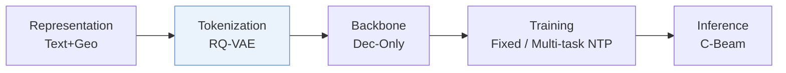
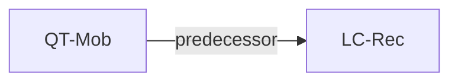

# QT-Mob

*Enhancing Large Language Models for Mobility Analytics with Semantic Location Tokenization* — Chen et al. · KDD’25

`I. Informativeness` · `Tokenization` · `POI` · [Paper](https://arxiv.org/abs/2506.11109) · [Code](https://github.com/shadowfall09/QT-Mob) · [Matrix](../../README.md#i--tokenization) · [中文](../zh/papers/qt-mob.md)

Reading level: Overview (Level 1) · On this page: [TL;DR](#tldr) · [At a Glance](#at-a-glance) · [3. Experiments](#3-experimental-findings) · [5. Related Work](#5-connections-to-related-work)

- `Dec-Only`: Decoder-only.
- `Fixed`: SIDs are built first and not changed while the generator trains.
- `Multi-task NTP`: The same NTP loss over several tasks.
- `C-Beam`: Constrained beam search.

### TL;DR

> [!NOTE]

> QT-Mob tokenizes locations into compact semantic tokens and fine-tunes an LLM with complementary objectives that align the tokens with its representations, for next-location prediction and mobility recovery.

### At a Glance

| Aspect | Summary |
| :-- | :-- |
| Research Problem | I. Informativeness: Do the SIDs, or the model reading them, carry the collaborative and multimodal signals recommendation needs? |
| Key Contribution | QT-Mob tokenizes locations into compact semantic tokens and fine-tunes an LLM with complementary objectives that align the tokens with its representations, for next-location prediction and mobility recovery. |
| Modified Stage | Tokenization |

### 3. Experimental Findings

Experimental setup

- **Datasets**: Foursquare NYC/SG, April 2012-February 2013; Singapore cellular trajectories, November 2022, using 400m grids. Remove locations with <5 visits; group records into 24h trajectories and discard trajectories with <3 records.
  - Source: Section 5.1.1: [S5.SS1.SSS1.p1](https://arxiv.org/html/2506.11109v1#S5.SS1.SSS1.p1)
- **Split**: Per-user chronological trajectories: first 70% train, next 10% validation, last 20% test.
  - Source: Section 5.1.1: [S5.SS1.SSS1.p1](https://arxiv.org/html/2506.11109v1#S5.SS1.SSS1.p1)
- **Candidates**: not reported; the unseen-location experiment follows LLM-Move's zero-shot ranking setting without detailing its candidate pool.
  - Source: Section 5.1 and Appendix D.4 do not specify catalog enumeration or candidate sampling: [S5.SS1](https://arxiv.org/html/2506.11109v1#S5.SS1) and [A4.SS4.p1](https://arxiv.org/html/2506.11109v1#A4.SS4.p1)
- **Visibility**: Unseen-location probe: sample 100 test locations and remove all training trajectories containing them. Unseen by generator; whether unseen by tokenizer too: not reported.
  - Source: Appendix D.4: [A4.SS4.p1](https://arxiv.org/html/2506.11109v1#A4.SS4.p1)
- **SID**: 4 RQ-VAE levels x 256 codes, code dimension 32; collision handling not reported.
  - Source: Section 5.1.4: [S5.SS1.SSS4.p1](https://arxiv.org/html/2506.11109v1#S5.SS1.SSS4.p1)
- **Inference budget**: Constrained beam 15; Hit/NDCG@1/5/10. Inference hardware, batch size and latency not reported; four V100 GPUs are specified for training.
  - Source: Sections 5.1.3/5.1.4: [S5.SS1.SSS3.p1](https://arxiv.org/html/2506.11109v1#S5.SS1.SSS3.p1) and [S5.SS1.SSS4.p1](https://arxiv.org/html/2506.11109v1#S5.SS1.SSS4.p1)
- **Results from**: Original Tables 2/3: next-location prediction/mobility recovery; Table 10: unseen locations. Five-run averages; compared baselines use their papers' default parameter settings.
  - Source: Section 5.1.3/5.1.4 and Tables 2/3/10: [S5.SS1.SSS3.p1](https://arxiv.org/html/2506.11109v1#S5.SS1.SSS3.p1) and [S5.SS1.SSS4.p1](https://arxiv.org/html/2506.11109v1#S5.SS1.SSS4.p1) and [S5.T2](https://arxiv.org/html/2506.11109v1#S5.T2) and [S5.T3](https://arxiv.org/html/2506.11109v1#S5.T3) and [A4.T10](https://arxiv.org/html/2506.11109v1#A4.T10)

### 5. Connections to Related Work

- **前序工作** · [LC-Rec](lc-rec.md): Its cited RQ-VAE tokenization approach informs QT-Mob's hierarchical location tokens.
  - Source: QT-Mob v1, Section 4.2, citing Zheng et al. (2024): https://arxiv.org/html/2506.11109v1#S4.SS2.p1; https://arxiv.org/html/2506.11109v1#S4.SS2.p4.

[查看同格全部论文](../../README.md#i--tokenization)
