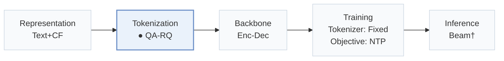
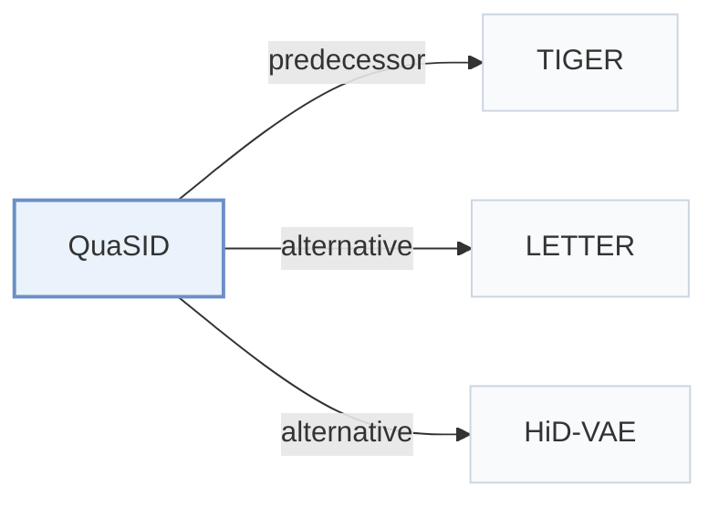

# QuaSID

[← Problem × Stage Matrix](../../README.md#ii--tokenization) · [Papers by Stage](../index/stages.md) · [Papers by Modality](../index/modality.md) · [Papers by Domain](../index/domain.md) · English | [中文](../zh/papers/quasid.md)

| **Title** | *Stop Treating Collisions Equally: Qualification-Aware Semantic ID Learning for Recommendation at Industrial Scale* |
| :-- | :-- |
| **Authors** | Hu et al. |
| **Venue** | KDD’26 ADS |
| **Problem × Stage** | `II. Uniqueness and Validity` · `Tokenization` |
| **Changes** | ● Tokenization |
| **SID inputs** | `Text` + `Img` + `CF` |
| **Domain** | `E-commerce` |
| **Scenario** | `General Item Recommendation`; `Online Experiment or Deployment` |
| **Links** | [Paper](https://arxiv.org/abs/2603.00632) |
| **Reading level** | Overview (Level 1) |

**On this page**: [TL;DR](#tldr) · [3. Experiments](#3-experimental-findings) · [5. Related Work](#5-connections-to-related-work)

- `Text+CF`: Text representations combined with collaborative signals.
- `QA-RQ`: Qualification-Aware RQ-VAE.
- `Enc-Dec`: Encoder-decoder.
- `Fixed`: SIDs are built first and not changed while the generator trains.
- `NTP`: Next-token prediction loss only; continuing from a pretrained LLM (SFT) also counts as NTP.
- `Beam†`: Autoregressive beam search (inferred).

### TL;DR

> [!NOTE]
> QuaSID repels only qualified conflicting Semantic ID pairs with Hamming-scaled margins, masks benign overlaps, and adds a dual-tower contrastive objective, instead of treating all collisions equally.

---

### 3. Experimental Findings

Experimental setup

- **Datasets**: Amazon Reviews 2018 Beauty and Toys & Games, user/item 5-core; Kuaishou e-commerce industrial logs with multimodal item features.
  - Source: Section 5.1.1: [S5.SS1.SSS1.p1](https://arxiv.org/html/2603.00632v1#S5.SS1.SSS1.p1)
- **Split**: Public: leave-one-out train/validation/test, exact held-out positions not reported. Online A/B: 5 days, about 5% randomized treatment traffic covering >20M users.
  - Source: Sections 5.1.1/5.4: [S5.SS1.SSS1.p1](https://arxiv.org/html/2603.00632v1#S5.SS1.SSS1.p1) and [S5.SS4.p1](https://arxiv.org/html/2603.00632v1#S5.SS4.p1)
- **Candidates**: not reported
  - Source: Sections 5.1.3/5.1.4 and Appendix A.2 do not specify candidate enumeration or sampling: [S5.SS1.SSS3.p1](https://arxiv.org/html/2603.00632v1#S5.SS1.SSS3.p1) and [S5.SS1.SSS4.p1](https://arxiv.org/html/2603.00632v1#S5.SS1.SSS4.p1) and [A1.SS2](https://arxiv.org/html/2603.00632v1#A1.SS2)
- **Visibility**: warm; no unseen-item protocol is defined. Industrial cold-start subsets have <100 or <600 video views within the first 48h; strict generator/tokenizer unseen status not reported.
  - Source: Section 5.4: [S5.SS4.p1](https://arxiv.org/html/2603.00632v1#S5.SS4.p1)
- **SID**: Public: 3 x 256; industrial: 4 x 1024. HaMR repels qualified full/partial collisions; additional inference-time collision resolution not reported.
  - Source: Sections 4.2/5.1.4: [S4.SS2](https://arxiv.org/html/2603.00632v1#S4.SS2) and [S5.SS1.SSS4.p1](https://arxiv.org/html/2603.00632v1#S5.SS1.SSS4.p1)
- **Inference budget**: Offline HitRate/NDCG@5/10; beam width, inference hardware, serving batch size and latency not reported. Appendix A.2 batches 256/1024 concern SID learning.
  - Source: Section 5.1.3 and Appendix A.2: [S5.SS1.SSS3.p1](https://arxiv.org/html/2603.00632v1#S5.SS1.SSS3.p1) and [A1.SS2](https://arxiv.org/html/2603.00632v1#A1.SS2)
- **Results from**: Original Table 2: matched-TIGER tokenizer comparison, five-seed means; Table 3: HaMR added to baselines; Table 4: online retrieval/ranking and low-view subsets.
  - Source: Tables 2/3/4 and Section 5.1.4: [S4.T2](https://arxiv.org/html/2603.00632v1#S4.T2) and [S4.T3](https://arxiv.org/html/2603.00632v1#S4.T3) and [S5.T4](https://arxiv.org/html/2603.00632v1#S5.T4) and [S5.SS1.SSS4.p1](https://arxiv.org/html/2603.00632v1#S5.SS1.SSS4.p1)

---

### 5. Connections to Related Work

- **Predecessor** · [TIGER](tiger.md): Supplies the shared downstream backbone for tokenizer comparisons.
  - Source: QuaSID v1, Section 5.1.4: [S5.SS1.SSS4.p1](https://arxiv.org/html/2603.00632v1#S5.SS1.SSS4.p1).
- **Alternative** · [LETTER](letter.md): Assignment balancing contrasts with QuaSID's qualified, severity-scaled collision repulsion.
  - Source: QuaSID v1, Section 2.2: [S2.SS2.p2](https://arxiv.org/html/2603.00632v1#S2.SS2.p2).
- **Alternative** · [HiD-VAE](hid-vae.md): Overlap regularization is contrasted with selectively repelling qualified conflicts.
  - Source: QuaSID v1, Section 2.2: [S2.SS2.p2](https://arxiv.org/html/2603.00632v1#S2.SS2.p2).

[View all papers in this cell](../../README.md#ii--tokenization)
