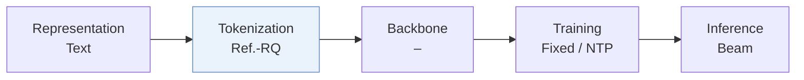
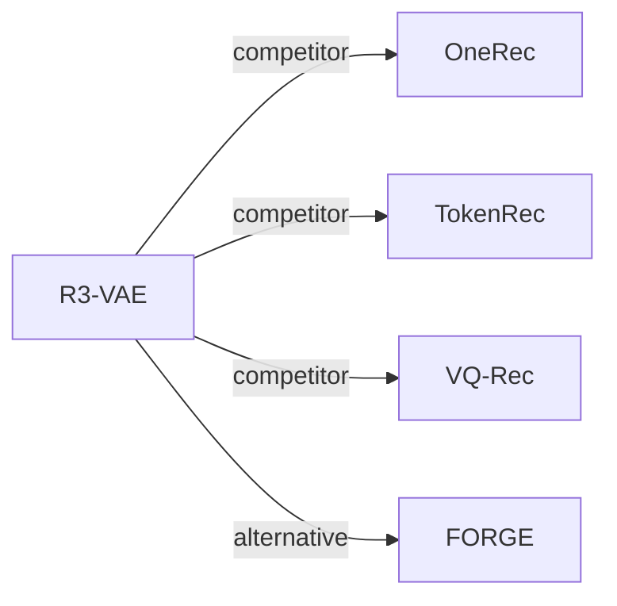

# R3-VAE

*Reference Vector-Guided Rating Residual Quantization VAE for Generative Recommendation* — Wan et al. · arXiv’26

`II. Uniqueness and Validity` · `Tokenization` · [Paper](https://arxiv.org/abs/2604.11440) · [Code](https://github.com/wwqq/R3-VAE) · [Matrix](../../README.md#ii--tokenization) · [中文](../zh/papers/r3-vae.md)

Reading level: Overview (Level 1) · On this page: [TL;DR](#tldr) · [At a Glance](#at-a-glance) · [3. Experiments](#3-experimental-findings) · [5. Related Work](#5-connections-to-related-work)

- `Ref.-RQ`: Reference-vector RQ variant.
- `–`: Not reported in the paper.
- `Fixed`: SIDs are built first and not changed while the generator trains.
- `NTP`: Next-token prediction loss only; continuing from a pretrained LLM (SFT) also counts as NTP.

### TL;DR

> [!NOTE]
> R3-VAE stabilizes residual quantization with a reference vector as semantic anchor and a dot-product rating mechanism, and uses two Semantic ID quality metrics as training regularizers.

### At a Glance

| Aspect | Summary |
| :-- | :-- |
| Research Problem | II. Uniqueness and Validity: Does every item get its own SID, every generated SID name a real item, and the codebook get used evenly? |
| Key Contribution | R3-VAE stabilizes residual quantization with a reference vector as semantic anchor and a dot-product rating mechanism, and uses two Semantic ID quality metrics as training regularizers. |
| Modified Stage | Tokenization |

### 3. Experimental Findings

Experimental setup

- **Datasets**: Public: Amazon Beauty, Sports, Toys, Clothing, plus LastFM and ML1M. Industrial: Toutiao interaction logs. Filtering rules and corpus sizes: not reported in the body.
  - Source: Public datasets: [S4.SS1.SSS1.p1](https://arxiv.org/html/2604.11440v3#S4.SS1.SSS1.p1); industrial Toutiao data: [S4.SS3.p1](https://arxiv.org/html/2604.11440v3#S4.SS3.p1); no filtering rules or statistics found in the body.
- **Split**: not reported for the public datasets. Industrial: offline MRR plus online A/B tests for both the generative (OneRec framework) and CTR settings; test periods and traffic not reported.
  - Source: No split rule found; online tests: [S4.T3](https://arxiv.org/html/2604.11440v3#S4.T3) and [S4.SS4.SSS3.p1](https://arxiv.org/html/2604.11440v3#S4.SS4.SSS3.p1).
- **Candidates**: not reported (full catalog versus sampled); Recall and NDCG at 10, 20, 30 on the generated top-K sequence; industrial generative MRR and CTR UAUC.
  - Source: Generated top-K sequences: [S4.SS1.SSS3.Px1.p1](https://arxiv.org/html/2604.11440v3#S4.SS1.SSS3.Px1.p1).
- **Visibility**: warm; no unseen-item protocol is defined. The online CTR test reports cold-start click volume for existing and new users without defining item visibility.
  - Source: Online cold-start click volume for new users, no unseen-item protocol: [S4.SS4.SSS3.p1](https://arxiv.org/html/2604.11440v3#S4.SS4.SSS3.p1).
- **SID**: Reference-vector-guided residual quantization VAE: inputs are projected on a learned reference vector, each layer assigns soft top-K weights over codewords, and the SID takes the top-weighted index per layer; a metric loss maximizes semantic cohesion and preference discrimination. Industrial: 3 levels x 8,192. Public: the Beauty sensitivity study fixes L=3 and K=256; codebook sizes for the other public runs: not reported. Collision handling: not reported (collision rates are measured, e.g. Table 6).
  - Source: Reference-vector projection and weighted rating residual quantization: [S3.SS3.SSS3.p1](https://arxiv.org/html/2604.11440v3#S3.SS3.SSS3.p1) and [S3.SS5.SSS1.p1](https://arxiv.org/html/2604.11440v3#S3.SS5.SSS1.p1); industrial codebooks 8192^3: [S4.SS3.SSS1.p1](https://arxiv.org/html/2604.11440v3#S4.SS3.SSS1.p1); Beauty sensitivity study with L=3, K=256 fixed: [S4.SS6.SSS2.p1](https://arxiv.org/html/2604.11440v3#S4.SS6.SSS2.p1).
- **Inference budget**: Industrial generative setting follows OneRec: beam search generating 512 responses for DPO, on 64 NVIDIA A100 GPUs. CTR setting: SIDs replace item-ID embeddings in DIN, SIM, RankMixer (batch 2,048). Public decoding settings, inference batch size, and latency: not reported.
  - Source: OneRec framework with beam 512 responses and hardware: [S4.SS3.SSS1.p1](https://arxiv.org/html/2604.11440v3#S4.SS3.SSS1.p1); CTR setting: [S4.SS4.SSS1.p1](https://arxiv.org/html/2604.11440v3#S4.SS4.SSS1.p1).
- **Results from**: Table 1 (Beauty, Sports, Toys) and Table 2 (LastFM, ML1M, Clothing) with SC/PD metrics; Table 3 (industrial generative MRR and online A/B); Tables 4-5 (CTR UAUC and online A/B); Table 6 (Beauty SID quality including collision rate and Gini).
  - Source: Results: [S3.T1](https://arxiv.org/html/2604.11440v3#S3.T1), [S4.T2](https://arxiv.org/html/2604.11440v3#S4.T2), [S4.T3](https://arxiv.org/html/2604.11440v3#S4.T3), [S4.T4](https://arxiv.org/html/2604.11440v3#S4.T4), [S4.T5](https://arxiv.org/html/2604.11440v3#S4.T5), [S4.T6](https://arxiv.org/html/2604.11440v3#S4.T6).

### 5. Connections to Related Work

- **Competitor** · [OneRec](onerec.md): OneRec's residual K-means is the main industrial baseline and the generation framework; R3-VAE adds a reference-vector projection, rating-weighted residual quantization, and SID-quality regularization.
  - Source: R3-VAE v3, baselines and OneRec framework: https://arxiv.org/html/2604.11440v3#S4.SS1.SSS2.p1 and https://arxiv.org/html/2604.11440v3#S4.SS3.SSS1.p1; Tables 1, 3, 4: https://arxiv.org/html/2604.11440v3#S3.T1, https://arxiv.org/html/2604.11440v3#S4.T3, https://arxiv.org/html/2604.11440v3#S4.T4.
- **Competitor** · [TokenRec](tokenrec.md): TokenRec's masked vector-quantized tokenizer (MQ) is a baseline; R3-VAE differs by reference-guided soft residual assignment.
  - Source: R3-VAE v3, baseline MQ [26]: https://arxiv.org/html/2604.11440v3#S4.SS1.SSS2.p1; Tables 1 and 4: https://arxiv.org/html/2604.11440v3#S3.T1 and https://arxiv.org/html/2604.11440v3#S4.T4.
- **Competitor** · [VQ-Rec](vq-rec.md): VQ-Rec's OPQ-style codes appear as the OPQ-KMeans baseline; R3-VAE uses residual rather than product quantization.
  - Source: R3-VAE v3, baseline OPQ-KMeans [5, 7]: https://arxiv.org/html/2604.11440v3#S4.SS1.SSS2.p1; Table 1: https://arxiv.org/html/2604.11440v3#S3.T1.
- **Alternative** · [FORGE](forge.md): FORGE proposes Embedding HitRate and Gini to evaluate SIDs without full training; R3-VAE proposes semantic cohesion and preference discrimination for the same purpose.
  - Source: R3-VAE v3, Section 3.4 draws on FORGE [4]: https://arxiv.org/html/2604.11440v3#S3.SS4.p1; Section 1: https://arxiv.org/html/2604.11440v3#S1.p3.

[View all papers in this cell](../../README.md#ii--tokenization)
