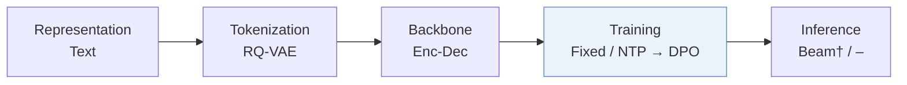
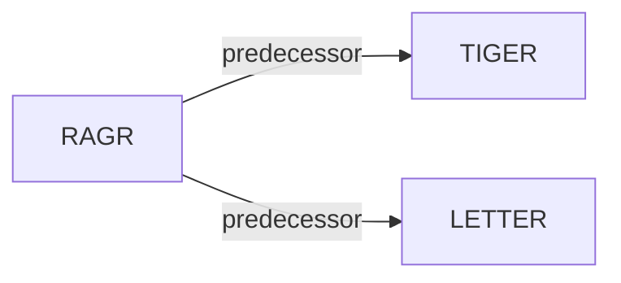

# RAGR

*Review-Augmented Generative Recommendation* — Zhang et al. · arXiv’26

`I. Informativeness` · `Training` · [Paper](https://arxiv.org/abs/2605.17267) · [Code](https://github.com/Zhang-Yingyi/TKDE_RAGR) · [Matrix](../../README.md#i--training) · [中文](../zh/papers/ragr.md)

Reading level: Overview (Level 1) · On this page: [TL;DR](#tldr) · [At a Glance](#at-a-glance) · [3. Experiments](#3-experimental-findings) · [5. Related Work](#5-connections-to-related-work)

- `Enc-Dec`: Encoder-decoder.
- `Fixed`: SIDs are built first and not changed while the generator trains.
- `NTP → DPO`: NTP, then preference optimization.
- `Beam† / –`: Inherited beam search in one configuration; decoding not reported in the other.

### TL;DR

> [!NOTE]

> RAGR interleaves item Semantic IDs and review Semantic IDs chronologically in the user sequence and uses DPO to favor item tokens at prediction positions, instead of modeling item-only sequences.

### At a Glance

| Aspect | Summary |
| :-- | :-- |
| Research Problem | I. Informativeness: Do the SIDs, or the model reading them, carry the collaborative and multimodal signals recommendation needs? |
| Key Contribution | RAGR interleaves item Semantic IDs and review Semantic IDs chronologically in the user sequence and uses DPO to favor item tokens at prediction positions, instead of modeling item-only sequences. |
| Modified Stage | Training |

### 3. Experimental Findings

Experimental setup

- **Datasets**: Amazon Beauty, Sports and Outdoors, Toys and Games, with historical review text; remove users/items with fewer than five interactions; maximum history 20, truncating oldest interactions.
  - Source: [S4.SS1.SSS1.p1](https://arxiv.org/html/2605.17267v1#S4.SS1.SSS1.p1) ; #S4.SS1.SSS4.p3
- **Split**: Per-user chronological leave-one-out: last interaction test, second last validation, remaining interactions training.
  - Source: [S4.SS1.SSS1.p1](https://arxiv.org/html/2605.17267v1#S4.SS1.SSS1.p1)
- **Candidates**: not reported
  - Source: Experimental settings report top-K metrics but no candidate universe: [S4.SS1](https://arxiv.org/html/2605.17267v1#S4.SS1)
- **Visibility**: warm; no unseen-item protocol is defined. Historical reviews are retained; tokenizer fitting exposure to test items not reported.
  - Source: [S4.SS1.SSS1.p1](https://arxiv.org/html/2605.17267v1#S4.SS1.SSS1.p1) ; #S4.SS4.p4
- **SID**: RQ-VAE: 4 x 256, 32-dimensional codewords, shared item/review token space. Default tokenizer fits item text only; collision handling not reported.
  - Source: [S4.SS1.SSS4.p2](https://arxiv.org/html/2605.17267v1#S4.SS1.SSS4.p2) ; #S4.SS4.p4 ; #S4.SS5.p4
- **Inference budget**: Autoregressive item-SID prediction; HIT/NDCG@5/10/20. Decoding algorithm/beam width, inference batch size and latency not reported. General experiment server: 8 RTX PRO 6000 96GB GPUs; inference-specific allocation not reported.
  - Source: [S4.SS1.SSS3.p1](https://arxiv.org/html/2605.17267v1#S4.SS1.SSS3.p1) ; #S4.SS1.SSS4.p1 ; #S4.SS1.SSS4.p5
- **Results from**: Original Table II: TIGER/LETTER with and without RAGR, means over seeds 42/43/44; all baselines trained/evaluated with the common split/protocol. Table III: ablations; Tables IV-V: tokenizer efficiency/collisions. No baseline-result reuse stated.
  - Source: [S4.T2](https://arxiv.org/html/2605.17267v1#S4.T2) ; #S4.T3 ; #S4.T4 ; #S4.T5 ; #S4.SS1.SSS4.p1 ; #S4.SS1.SSS4.p5

### 5. Connections to Related Work

- **前序工作** · [TIGER](tiger.md): RAGR augments TIGER with interleaved review SIDs, review-generation supervision and DPO alignment toward item generation.
  - Source: RAGR v1, Section IV-A and Table II: https://arxiv.org/html/2605.17267v1#S4.SS1.SSS4.p1; https://arxiv.org/html/2605.17267v1#S4.T2.
- **前序工作** · [LETTER](letter.md): LETTER is the second backbone receiving the same review augmentation and item-centric DPO alignment.
  - Source: RAGR v1, Section IV-A and Table II: https://arxiv.org/html/2605.17267v1#S4.SS1.SSS4.p1; https://arxiv.org/html/2605.17267v1#S4.T2.

[查看同格全部论文](../../README.md#i--training)
