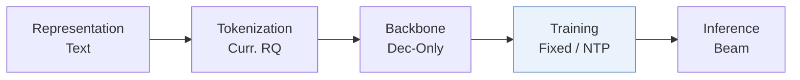
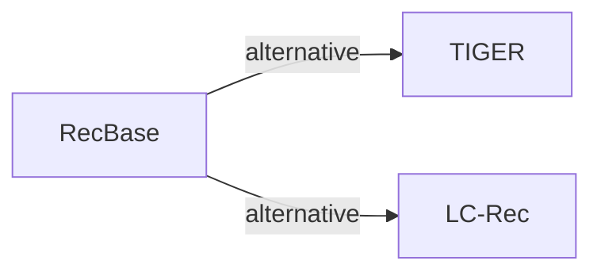

# RecBase

*Generative foundation model pretraining for zero-shot recommendation* — Zhou et al. · EMNLP’25

`VI. Generalization` · `Training`

[Paper](https://arxiv.org/abs/2509.03131) · [Code](https://github.com/reczoo/RecBase) · [Matrix](../../README.md#vi--training)

Reading level: Overview (Level 1) · On this page: [TL;DR](#tldr) · [At a Glance](#at-a-glance) · [3. Experimental Findings](#3-experimental-findings) · [5. Connections to Related Work](#5-connections-to-related-work)

- `Dec-Only`: Decoder-only.
- `Fixed`: SIDs are built first and not changed while the generator trains.
- `NTP`: Next-token prediction loss only; continuing from a pretrained LLM (SFT) also counts as NTP.

### TL;DR

RecBase pretrains a domain-agnostic foundation model on a cross-domain corpus with a unified tokenizer of hierarchical concept identifiers, for zero-shot recommendation instead of language-centric pretraining.

### At a Glance

| Aspect | Summary |
| :-- | :-- |
| Research Problem | VI. Generalization: Does it still work for new items, new domains, and shifting interests? |
| Key Contribution | RecBase pretrains a domain-agnostic foundation model on a cross-domain corpus with a unified tokenizer of hierarchical concept identifiers, for zero-shot recommendation instead of language-centric pretraining. |
| Modified Stage | Training |

### 3. Experimental Findings

**Experimental setup**

- **Datasets**: Pre-training on 15 datasets and testing on 8 unseen datasets from RecBench (MIND, MovieLens, MicroLens, Goodreads, Yelp, Steam, H&M, HotelRec as test sets). Totals: training 4,595,003 items / 35,047,682 users; fine-tuning 1,005,745 / 5,098,084; test 623,615 / 145,975. Length-based filtering: users with fewer than 15 interactions are removed (e.g. AmazonToys) and histories over 2,500 interactions are truncated (e.g. LastFM, PixelRec); thresholds for the other datasets: not reported.
- **Split**: Dataset-level: pre-train on training datasets and evaluate zero-shot on held-out datasets; a fine-tuning study adds in-domain data for five test datasets. Within-dataset split rules: not reported.
- **Candidates**: n/a for ranking candidates: user-item pairs are scored and evaluated by AUC (RecBench protocol); how negative pairs are formed is not restated.
- **Visibility**: Zero-shot: test datasets and their items are unseen by the generator; whether the CL-VAE tokenizer was trained on test-dataset items: not reported. Fine-tuned setting: warm.
- **SID**: Concept IDs from a curriculum-learning RQ-VAE (CL-VAE) with 4 levels x 2,048 codes over NV-Embed-v2 text embeddings, with codebook reinitialization against collapse. Collisions are measured as a conflict rate (Figure 2) but a resolution rule is not reported.
- **Inference budget**: Scores items from the logits over concept IDs (no beam search described); Qwen2-style decoder (Base: 24 layers, hidden 1,024; Large: 28 layers, hidden 1,536; vocabulary 20,000). Hardware, inference batch size, and latency: not reported.
- **Results from**: Table 1 (zero-shot AUC on 8 datasets versus P5, RecGPT, and LLM baselines); Table 3 (zero-shot versus fine-tuned); Table 4 (ablations of CL-VAE components); Figure 2 (codebook size and levels).

Sources

- **Datasets**: RecBench and dataset roles: [S4.p1](https://arxiv.org/html/2509.03131v1#S4.p1) and [S4.SS1.p1](https://arxiv.org/html/2509.03131v1#S4.SS1.p1); statistics: [S4.T2](https://arxiv.org/html/2509.03131v1#S4.T2); length filtering: [A2.SS2.SSS0.Px2.p1](https://arxiv.org/html/2509.03131v1#A2.SS2.SSS0.Px2.p1).
- **Split**: Dataset-level split between pre-training and zero-shot test: [S4.p1](https://arxiv.org/html/2509.03131v1#S4.p1); fine-tuning study: [S4.T3](https://arxiv.org/html/2509.03131v1#S4.T3).
- **Candidates**: User-item pair scoring with AUC: [S4.SS1.p1](https://arxiv.org/html/2509.03131v1#S4.SS1.p1) and [S4.SS1.p3](https://arxiv.org/html/2509.03131v1#S4.SS1.p3).
- **Visibility**: Test datasets are unseen in pre-training: [S4.p1](https://arxiv.org/html/2509.03131v1#S4.p1) and [S4.SS1.p3](https://arxiv.org/html/2509.03131v1#S4.SS1.p3).
- **SID**: CL-VAE with 4 levels x 2048 over NV-Embed-v2: [S4.SS2.p1](https://arxiv.org/html/2509.03131v1#S4.SS2.p1); curriculum and reinitialization: [S3.SS2.p2](https://arxiv.org/html/2509.03131v1#S3.SS2.p2); conflict rate study: [S5.SS2.p1](https://arxiv.org/html/2509.03131v1#S5.SS2.p1).
- **Inference budget**: Logit-based ranking of concept IDs: [S4.SS1.p2](https://arxiv.org/html/2509.03131v1#S4.SS1.p2); model sizes: [S4.SS2.p2](https://arxiv.org/html/2509.03131v1#S4.SS2.p2).
- **Results from**: Zero-shot: [S3.T1](https://arxiv.org/html/2509.03131v1#S3.T1); fine-tuning: [S4.T3](https://arxiv.org/html/2509.03131v1#S4.T3); ablation: [S5.T4](https://arxiv.org/html/2509.03131v1#S5.T4); codebook study: [S5.SS2.p1](https://arxiv.org/html/2509.03131v1#S5.SS2.p1).

### 5. Connections to Related Work

- **Alternative** · [TIGER](tiger.md): TIGER builds RQ-VAE semantic IDs per dataset for next-item generation; RecBase pre-trains a recommendation foundation model over concept IDs shared across many domains.
  - Source: RecBase v1, Section 2.2 cites Rajput et al. (2023): https://arxiv.org/html/2509.03131v1#S2.SS2.p1.
- **Alternative** · [LC-Rec](lc-rec.md): LC-Rec adapts an existing LLM to one domain's item indices; RecBase pre-trains from scratch on recommendation corpora for zero-shot transfer.
  - Source: RecBase v1, Section 2.2: https://arxiv.org/html/2509.03131v1#S2.SS2.p1.

[View all papers in this cell](../../README.md#vi--training)
