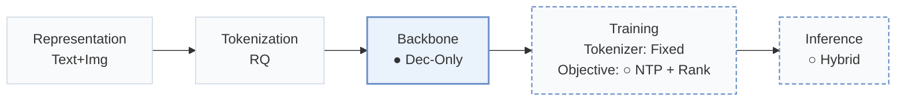
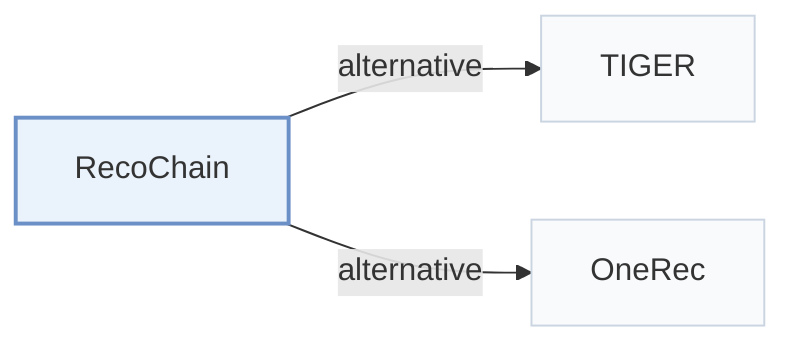

# RecoChain

[← Problem × Stage Matrix](../../README.md#iv--backbone) · [Papers by Stage](../index/stages.md) · [Papers by Modality](../index/modality.md) · [Papers by Domain](../index/domain.md) · English | [中文](../zh/papers/recochain.md)

| **Title** | *Harmonizing Generative Retrieval and Ranking in Chain-of-Recommendation* |
| :-- | :-- |
| **Authors** | Liu and Cao |
| **Venue** | arXiv’26 |
| **Problem × Stage** | `IV. Utility` · `Backbone` |
| **Changes** | ● Backbone · ○ Objective · ○ Inference |
| **SID inputs** | `MM` |
| **Domain** | `E-commerce` |
| **Links** | [Paper](https://arxiv.org/abs/2604.25787) |
| **Reading level** | Overview (Level 1) |

**On this page**: [TL;DR](#tldr) · [3. Experiments](#3-experimental-findings) · [5. Related Work](#5-connections-to-related-work)

- `Text+Img`: Text and visual item representations.
- `RQ`: Residual quantization.
- `Dec-Only`: Decoder-only.
- `Fixed`: SIDs are built first and not changed while the generator trains.
- `NTP + Rank`: NTP plus a ranking loss.
- `Hybrid`: Hybrid retrieval combining generative SID decoding with dense or co-occurrence retrieval.

### TL;DR

> [!NOTE]
> RecoChain generates candidates by hierarchical Semantic ID prediction and then ranks them with SIM-based click estimation in the same Transformer, to close the gap between generation and ranking.

---

### 3. Experimental Findings

Experimental setup

- **Datasets**: TAOBAO-MM: 8.79M users, 35.4M items, 99M interactions, histories up to 1,000 interactions, with 128-dimensional multimodal item embeddings; adapted from CTR to sequential recommendation by keeping interaction histories and discarding exposure labels. Further filtering: not reported.
  - Source: TAOBAO-MM and adaptation: [S3.p1](https://arxiv.org/html/2604.25787v1#S3.p1).
- **Split**: The official TAOBAO-MM train/validation/test split, without further sequence-level partitioning.
  - Source: Official split: [S3.p1](https://arxiv.org/html/2604.25787v1#S3.p1).
- **Candidates**: not reported (full catalog versus sampled); top-K comes from C beam candidates (beam size 20 by default) that are re-ranked by a click-probability head.
  - Source: Beam candidates re-ranked; metrics: [S3.p4](https://arxiv.org/html/2604.25787v1#S3.p4) and [S2.SS4.p1](https://arxiv.org/html/2604.25787v1#S2.SS4.p1).
- **Visibility**: warm; no unseen-item protocol is defined.
  - Source: Official split with no unseen-item protocol: [S3.p1](https://arxiv.org/html/2604.25787v1#S3.p1).
- **SID**: 3-level RQ-Kmeans over the pretrained multimodal embeddings, plus a random fourth token s4 that makes the item-SID mapping one-to-one; codebook size per level: not reported.
  - Source: 3-level RQ-Kmeans plus a random fourth token: [S2.SS2.p1](https://arxiv.org/html/2604.25787v1#S2.SS2.p1).
- **Inference budget**: Hierarchical beam search (default beam 20; 10 to 40 in Table 1) with KV cache, then for each candidate the top-10 most similar history items are appended and a rank head scores the candidate by continuing decoding. 2-layer decoder (hidden 1,024). Hardware, inference batch size, and latency: not reported.
  - Source: Generate-retrieve-rerank with KV reuse: [S2.SS3.SSS2.p2](https://arxiv.org/html/2604.25787v1#S2.SS3.SSS2.p2), [S2.SS3.SSS2.p4](https://arxiv.org/html/2604.25787v1#S2.SS3.SSS2.p4), [S2.SS4.p2](https://arxiv.org/html/2604.25787v1#S2.SS4.p2); defaults: [S3.p4](https://arxiv.org/html/2604.25787v1#S3.p4); model: [S3.p2](https://arxiv.org/html/2604.25787v1#S3.p2).
- **Results from**: Tables 1-3 (Recall and NDCG at 5 and 10 before and after re-ranking, varying beam size, input sequence length, and retrieval length on TAOBAO-MM).
  - Source: Results: [S2.T1](https://arxiv.org/html/2604.25787v1#S2.T1), [S2.T2](https://arxiv.org/html/2604.25787v1#S2.T2), [S2.T3](https://arxiv.org/html/2604.25787v1#S2.T3).

---

### 5. Connections to Related Work

- **Alternative** · [TIGER](tiger.md): TIGER stops at beam-search retrieval; RecoChain appends retrieved history items to each beam candidate and re-ranks them in the same decoder.
  - Source: RecoChain v1, Section 1 cites TIGER and OneRec as beam-search retrievers: [S1.p4](https://arxiv.org/html/2604.25787v1#S1.p4).
- **Alternative** · [OneRec](onerec.md): OneRec unifies retrieval and ranking with preference alignment over sessions; RecoChain chains generation and a click-probability re-rank head with KV-cache reuse.
  - Source: RecoChain v1, Section 1: [S1.p2](https://arxiv.org/html/2604.25787v1#S1.p2) and [S1.p4](https://arxiv.org/html/2604.25787v1#S1.p4).

[View all papers in this cell](../../README.md#iv--backbone)
