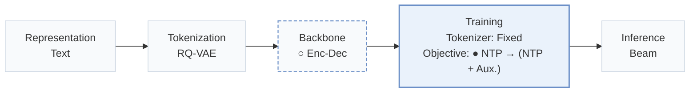
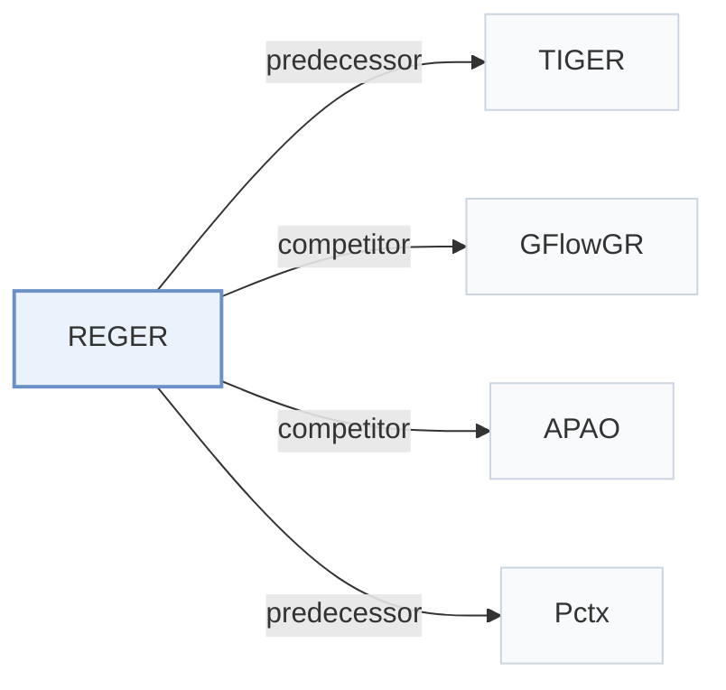

# REGER

[← Problem × Stage Matrix](../../README.md#i--training) · [Papers by Stage](../index/stages.md) · [Papers by Modality](../index/modality.md) · [Papers by Domain](../index/domain.md) · English | [中文](../zh/papers/reger.md)

| **Title** | *Modeling inter-item Relations with Semantic IDs for Generative Recommendation* |
| :-- | :-- |
| **Authors** | Huang et al. |
| **Venue** | arXiv’26 |
| **Problem × Stage** | `I. Informativeness` · `Training` |
| **Changes** | ○ Backbone · ● Objective |
| **SID inputs** | `Text` |
| **Domain** | `E-commerce` |
| **Scenario** | `General Item Recommendation`; `Public Benchmarks` |
| **Links** | [Paper](https://arxiv.org/abs/2610.37584) |
| **Reading level** | Overview (Level 1) |

**On this page**: [TL;DR](#tldr) · [3. Experiments](#3-experimental-findings) · [5. Related Work](#5-connections-to-related-work)

- `Text`: Textual item metadata (titles, descriptions, categories, or prompts).
- `RQ-VAE`: Residual-Quantized Variational AutoEncoder.
- `Enc-Dec`: Encoder-decoder.
- `Fixed`: SIDs are built first and not changed while the generator trains.
- `NTP → (NTP + Aux.)`: Next-token prediction, followed by joint optimization of next-token prediction and auxiliary objectives.
- `Beam`: Autoregressive beam search over Semantic ID tokens.

### TL;DR

> [!NOTE]
> REGER pretrains a generator to produce semantic neighbors' Semantic IDs, combines global and ID-boundary local attention, and distills a discriminative teacher's next-token distributions along the target prefix path.

---

### 3. Experimental Findings

Experimental setup

- **Datasets**: Amazon Reviews 2014 Beauty/Sports/Toys and 2023 Instruments/Scientific/Games; 5-core filtering and maximum history 20 items.
  - Source: [S5.SS1.p1](https://arxiv.org/html/2610.37584v1#S5.SS1.p1) ; #A1.T6
- **Split**: Per-user chronological leave-one-out: latest interaction test, second latest validation, all earlier interactions training.
  - Source: [A1.SS1.p1](https://arxiv.org/html/2610.37584v1#A1.SS1.p1)
- **Candidates**: not reported
  - Source: Evaluation settings give metrics and seeds but no evaluation universe: [S5.SS1](https://arxiv.org/html/2610.37584v1#S5.SS1) ; #A1.SS1
- **Visibility**: warm; no unseen-item protocol is defined. GSR semantic neighbors are drawn from the item catalog; tokenizer and frozen DuoRec teacher exposure to test items/interactions not explicitly separated.
  - Source: [S5.SS1.p1](https://arxiv.org/html/2610.37584v1#S5.SS1.p1) ; #S4.SS1.p3 ; #S4.SS3.SSS2.p1 ; #A1.SS3.p1
- **SID**: RQ-VAE on Sentence-T5 embeddings reduced to 128 dimensions by PCA/whitening; semantic level count and codebook sizes not reported in paper. Extra token distinguishes identical semantic codes; suffix vocabulary size/assignment not reported. Dataset-specific SID mapping shared across recommender seeds.
  - Source: [S3.SS1.p1](https://arxiv.org/html/2610.37584v1#S3.SS1.p1) ; #A1.SS3.p1
- **Inference budget**: Unconstrained beam 20 for validation/test, without teacher; teacher ablation uses beam 50. Recall/NDCG@5/10. Table 4 efficiency probe on TIGER+HCPD: one L40, FP32, test batch 256, KV cache off, 16 s for full Beauty test set. REGER-specific absolute inference time and general inference batch/hardware not reported.
  - Source: [A1.SS3.p2](https://arxiv.org/html/2610.37584v1#A1.SS3.p2) ; #A1.SS3.p4 ; #A1.T7 ; #S5.T4 ; #S5.SS4.p3
- **Results from**: Table 1: 2014 comparisons with reproduced baselines, three seeds 2024/2025/2026; Table 2: training objectives on TIGER; Table 3: REGER ablations. Table 6: 2023 results, with published baseline rows from Latte, OMEGA, DECOR and TopoTok papers.
  - Source: [S4.T1](https://arxiv.org/html/2610.37584v1#S4.T1) ; #S5.T2 ; #S5.T3 ; #A1.T6 ; #A1.SS3.p2

---

### 5. Connections to Related Work

- **Predecessor** · [TIGER](tiger.md): REGER uses residual-quantized SID generation and additionally tests its HCPD training objective directly on TIGER.
  - Source: REGER v1, Section 3.1 and Table 2: [S3.SS1.p1](https://arxiv.org/html/2610.37584v1#S3.SS1.p1); [S5.T2](https://arxiv.org/html/2610.37584v1#S5.T2).
- **Competitor** · [GFlowGR](gflowgr.md): GFlowGR supervises generation with collaborative rewards and flow balance; HCPD directly matches teacher conditional preferences over legal prefix branches, using the same DuoRec teacher.
  - Source: REGER v1, Section 5.4 and Table 2: [S5.SS4.p2](https://arxiv.org/html/2610.37584v1#S5.SS4.p2); [S5.T2](https://arxiv.org/html/2610.37584v1#S5.T2).
- **Competitor** · [APAO](apao.md): APAO-pointwise is a compared GR training objective; HCPD instead distills full conditional distributions over legal next tokens along observed target paths.
  - Source: REGER v1, Sections 4.3.2/5.1 and Table 2: [S4.SS3.SSS2.p4](https://arxiv.org/html/2610.37584v1#S4.SS3.SSS2.p4); [S5.SS1.p3](https://arxiv.org/html/2610.37584v1#S5.SS1.p3); [S5.T2](https://arxiv.org/html/2610.37584v1#S5.T2).
- **Predecessor** · [Pctx](pctx.md): REGER follows Pctx in choosing DuoRec as its auxiliary recommender, but transfers collaborative preferences through distillation rather than personalized tokenization.
  - Source: REGER v1, Section 4.3.2: [S4.SS3.SSS2.p1](https://arxiv.org/html/2610.37584v1#S4.SS3.SSS2.p1).

[View all papers in this cell](../../README.md#i--training)
