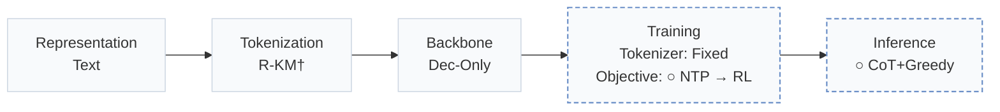
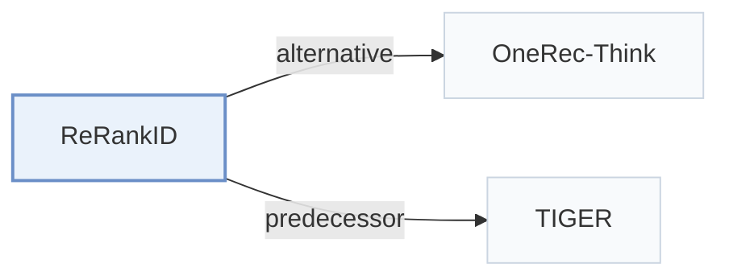

# ReRankID

[← Problem × Stage Matrix](../../README.md#paradigms-systems-and-benchmarks) · [Papers by Stage](../index/stages.md) · [Papers by Modality](../index/modality.md) · [Papers by Domain](../index/domain.md) · English | [中文](../zh/papers/rerankid.md)

| **Title** | *Reasoning Reranking with Semantic IDs as the Sole Item Representation* |
| :-- | :-- |
| **Authors** | Tang et al. |
| **Venue** | arXiv’26 |
| **Problem × Stage** | `Paradigms, Systems and Benchmarks` · `No single stage` |
| **Changes** | ○ Objective · ○ Inference |
| **SID inputs** | `Text` |
| **Domain** | `Short video / Live` |
| **Settings** | `cold-start (user)` |
| **Links** | [Paper](https://arxiv.org/abs/2610.22797) · [Code](https://github.com/lilv98/ReRankID) |
| **Reading level** | Overview (Level 1) |

**On this page**: [TL;DR](#tldr) · [3. Experiments](#3-experimental-findings) · [5. Related Work](#5-connections-to-related-work)

- `Text`: Textual item metadata (titles, descriptions, categories, or prompts).
- `R-KM†`: Residual k-means tokenization (inferred).
- `Dec-Only`: Decoder-only.
- `Fixed`: SIDs are built first and not changed while the generator trains.
- `NTP → RL`: NTP, then reinforcement learning (GRPO, GBPO, etc.).
- `CoT+Greedy`: Reasoning with greedy decoding.

### TL;DR

> [!NOTE]
> ReRankID evaluates how language models reason over and rerank candidate slates represented solely by Semantic IDs across different post-training recipes.

---

### 3. Experimental Findings

Experimental setup

- **Datasets**: Kuaishou OpenOneRec-RecIF short-video release, 162074 source users; evaluation requires a renderable positive and >=256 items with both SID/caption histories.
  - Source: Section 3 and Appendix A.2: [S3.SS0.SSS0.Px2.p1](https://arxiv.org/html/2610.22797v1#S3.SS0.SSS0.Px2.p1) and [A1.SS2.p1](https://arxiv.org/html/2610.22797v1#A1.SS2.p1) and [A5.p1](https://arxiv.org/html/2610.22797v1#A5.p1)
- **Split**: User-disjoint SFT/post-training/development/test partitions; 400 development and 400 test users, each balanced 200 explicit-engagement/200 long-view positives; histories precede targets.
  - Source: Appendix A.2: [A1.SS2.p1](https://arxiv.org/html/2610.22797v1#A1.SS2.p1)
- **Candidates**: sampled: 29 negatives plus one positive at anchor; slate sizes 10/20/30/50/100. Exposure-hard negatives plus uniform catalog fill; user-engaged items excluded. Exclusion of other historical exposures: not reported.
  - Source: Appendix A.2-A.3: [A1.SS2.p2](https://arxiv.org/html/2610.22797v1#A1.SS2.p2) and [A1.SS3.p1](https://arxiv.org/html/2610.22797v1#A1.SS3.p1)
- **Visibility**: warm; evaluation release users/items were exposed during backbone pretraining, while post-training users are disjoint. Reranking supplied slates is a new task.
  - Source: Appendix A.4: [A1.SS4.p1](https://arxiv.org/html/2610.22797v1#A1.SS4.p1) and [A1.SS4.p3](https://arxiv.org/html/2610.22797v1#A1.SS4.p3)
- **SID**: Released OpenOneRec three-code SIDs from quantized item-text embeddings; quantizer algorithm, codebook sizes and collision handling: not reported.
  - Source: Section 3 and Appendix A.1: [S3.SS0.SSS0.Px2.p1](https://arxiv.org/html/2610.22797v1#S3.SS0.SSS0.Px2.p1) and [A1.SS1.p1](https://arxiv.org/html/2610.22797v1#A1.SS1.p1)
- **Inference budget**: SID: greedy reasoning 2048 tokens, fallback structured extraction 256 tokens from <=1200 reasoning characters; top-10 indices; A100/BF16. Text APIs: 8192-32768 output-token caps. Inference batch and latency: not reported.
  - Source: Appendix B.1, Table B.2 and Appendix E: [A2.SS1.p2](https://arxiv.org/html/2610.22797v1#A2.SS1.p2) and [A2.T2](https://arxiv.org/html/2610.22797v1#A2.T2) and [A5.p2](https://arxiv.org/html/2610.22797v1#A5.p2)
- **Results from**: This testbed's paired evaluations: Table 1 initial models/references, Table 2 post-training, Table D.1 full metrics. Each post-training method compares its own initializer; invalid outputs score zero.
  - Source: Tables 1/2/D.1 and Section 5.1: [S4.T1](https://arxiv.org/html/2610.22797v1#S4.T1) and [S5.T2](https://arxiv.org/html/2610.22797v1#S5.T2) and [A4.T1](https://arxiv.org/html/2610.22797v1#A4.T1) and [S5.SS1.p1](https://arxiv.org/html/2610.22797v1#S5.SS1.p1)

---

### 5. Connections to Related Work

- **Alternative** · [OneRec-Think](onerec-think.md): OneRec-Think reasons before catalog-item generation; ReRankID reasons over a supplied candidate slate.
  - Source: ReRankID v1, Section 2: [S2.SS0.SSS0.Px1.p1](https://arxiv.org/html/2610.22797v1#S2.SS0.SSS0.Px1.p1).
- **Predecessor** · [TIGER](tiger.md): TIGER's SID-generation paradigm is the background contrasted with SID-only slate reranking.
  - Source: ReRankID v1, Section 2: [S2.SS0.SSS0.Px1.p1](https://arxiv.org/html/2610.22797v1#S2.SS0.SSS0.Px1.p1).

[View all papers in this cell](../../README.md#paradigms-systems-and-benchmarks)
