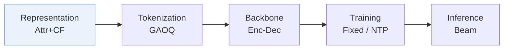
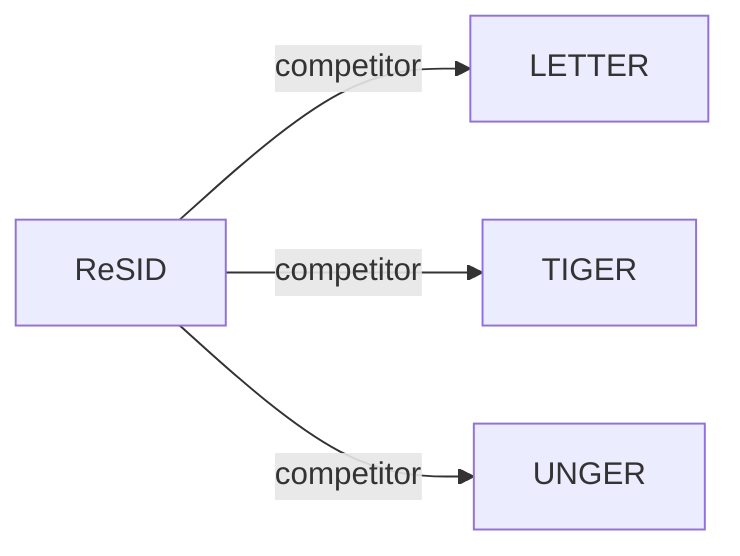

# ReSID

*Rethinking Generative Recommender Tokenizer: Recsys-Native Encoding and Semantic Quantization Beyond LLMs* — Liang et al. · arXiv’26

`I. Informativeness` · `Representation` · [Paper](https://arxiv.org/abs/2602.02338) · [Code](https://github.com/FuCongResearchSquad/ReSID) · [Matrix](../../README.md#i--representation) · [中文](../zh/papers/resid.md)

Reading level: Overview (Level 1) · On this page: [TL;DR](#tldr) · [At a Glance](#at-a-glance) · [3. Experiments](#3-experimental-findings) · [5. Related Work](#5-connections-to-related-work)

- `Attr+CF`: Structured item attributes combined with collaborative signals.
- `GAOQ`: Globally Aligned Orthogonal Quantization.
- `Enc-Dec`: Encoder-decoder.
- `Fixed`: SIDs are built first and not changed while the generator trains.
- `NTP`: Next-token prediction loss only; continuing from a pretrained LLM (SFT) also counts as NTP.

### TL;DR

> [!NOTE]
> ReSID learns item representations from structured features with field-aware masked autoencoding and quantizes them with globally aligned orthogonal quantization, instead of LLM embeddings and generic quantizers.

### At a Glance

| Aspect | Summary |
| :-- | :-- |
| Research Problem | I. Informativeness: Do the SIDs, or the model reading them, carry the collaborative and multimodal signals recommendation needs? |
| Key Contribution | ReSID learns item representations from structured features with field-aware masked autoencoding and quantizes them with globally aligned orthogonal quantization, instead of LLM embeddings and generic quantizers. |
| Modified Stage | Representation |

### 3. Experimental Findings

Experimental setup

- **Datasets**: Amazon 2023: Musical Instruments, Video Games, Industrial/Scientific, Baby Products, Arts/Crafts/Sewing, Sports/Outdoors, Toys/Games, Health/Household, Beauty/Personal Care, Books. User/item 5-core; require store and three category-level fields.
  - Source: Section 4 and Appendix C: [S4.p3](https://arxiv.org/html/2602.02338v1#S4.p3) and [A3.p1](https://arxiv.org/html/2602.02338v1#A3.p1)
- **Split**: Chronological per-user last/penultimate interactions test/validation; sliding training windows, maximum length 32. Evaluation target items absent from training are added to the training set.
  - Source: Section 4 and Appendix C: [S4.p6](https://arxiv.org/html/2602.02338v1#S4.p6) and [A3.p1](https://arxiv.org/html/2602.02338v1#A3.p1)
- **Candidates**: not reported
  - Source: Section 4 and Appendix E specify ranking metrics but no candidate protocol; 128 sampled negatives are a training objective: [S4.p6](https://arxiv.org/html/2602.02338v1#S4.p6) and [A5.p2](https://arxiv.org/html/2602.02338v1#A5.p2)
- **Visibility**: warm; evaluation target items absent from training are added to the training set.
  - Source: Appendix C explicitly inserts evaluation-only items into training: [A3.p1](https://arxiv.org/html/2602.02338v1#A3.p1)
- **SID**: GAOQ, 3 levels. Branching tuples: MI(32,40,19),VG(32,64,13),IS(24,80,14),BP(32,64,18),ACS(64,96,16),SO(128,128,11),TG(192,192,5),HH(50,512,8),BPC(96,192,11),Books(256,256,8). Global anchor-vocabulary sizes and collision handling: not reported.
  - Source: Table 7 and Algorithm 1: [A5.T7](https://arxiv.org/html/2602.02338v1#A5.T7) and [alg1](https://arxiv.org/html/2602.02338v1#alg1)
- **Inference budget**: Beam 50; Recall/NDCG@5/10. Inference hardware, batch size, latency: not reported; batch 2048 is training.
  - Source: Section 4 and Appendix E: [S4.p6](https://arxiv.org/html/2602.02338v1#S4.p6) and [A5.p4](https://arxiv.org/html/2602.02338v1#A5.p4)
- **Results from**: Tables 1/4 aggregate/full main comparison; Tables 2/5 ablations; Table 3 quantization runtime, not inference latency. All SID methods use this study's common T5-style generator; tokenizer settings follow original methods.
  - Source: Tables 1-5 and Appendix E: [S5.T1](https://arxiv.org/html/2602.02338v1#S5.T1) and [S5.T2](https://arxiv.org/html/2602.02338v1#S5.T2) and [S5.T3](https://arxiv.org/html/2602.02338v1#S5.T3) and [A0.T4](https://arxiv.org/html/2602.02338v1#A0.T4) and [A0.T5](https://arxiv.org/html/2602.02338v1#A0.T5) and [A5.p4](https://arxiv.org/html/2602.02338v1#A5.p4) and [A5.p3](https://arxiv.org/html/2602.02338v1#A5.p3)

### 5. Connections to Related Work

- **Competitor** · [LETTER](letter.md): LETTER is the strongest compared SID baseline and a quantization-runtime reference.
  - Source: ReSID v1, Sections 5.1/5.4: https://arxiv.org/html/2602.02338v1#S5.SS1.p4; https://arxiv.org/html/2602.02338v1#S5.SS4.p1.
- **Competitor** · [TIGER](tiger.md): TIGER's semantic RQ-VAE tokenizer is compared under the common downstream generator.
  - Source: ReSID v1, Appendix D/E: https://arxiv.org/html/2602.02338v1#A4.p3; https://arxiv.org/html/2602.02338v1#A5.p4.
- **Competitor** · [UNGER](unger.md): UNGER aligns semantic/collaborative representations; ReSID uses structured-field masked prediction.
  - Source: ReSID v1, Section 3.1 and Appendix D: https://arxiv.org/html/2602.02338v1#S3.SS1.p3; https://arxiv.org/html/2602.02338v1#A4.p3.

[View all papers in this cell](../../README.md#i--representation)
