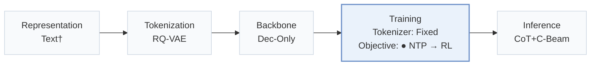
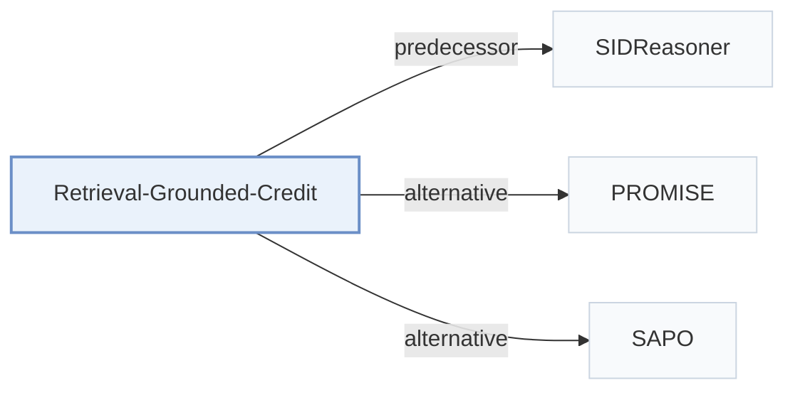

# Retrieval-Grounded-Credit

[← Problem × Stage Matrix](../../README.md#iv--training) · [Papers by Stage](../index/stages.md) · [Papers by Modality](../index/modality.md) · [Papers by Domain](../index/domain.md) · English | [中文](../zh/papers/retrieval-grounded-credit.md)

| **Title** | *From Interests to Semantic IDs: Retrieval-Grounded Credit Assignment for Generative Recommendation* |
| :-- | :-- |
| **Authors** | Zhu et al. |
| **Venue** | arXiv’26 |
| **Problem × Stage** | `IV. Utility` · `Training` |
| **Changes** | ● Objective |
| **SID inputs** | `Text` |
| **Domain** | `E-commerce` |
| **Links** | [Paper](https://arxiv.org/abs/2609.29983) · [Code](https://github.com/YuFan-Microsoft/Retrieval-Grounded-Credit-Assignment-for-Generative-Recommendation) |
| **Reading level** | Overview (Level 1) |

**On this page**: [TL;DR](#tldr) · [3. Experiments](#3-experimental-findings) · [5. Related Work](#5-connections-to-related-work)

- `Text†`: Textual item representations (inferred).
- `RQ-VAE`: Residual-Quantized Variational AutoEncoder.
- `Dec-Only`: Decoder-only.
- `Fixed`: SIDs are built first and not changed while the generator trains.
- `NTP → RL`: NTP, then reinforcement learning (GRPO, GBPO, etc.).
- `CoT+C-Beam`: Reasoning followed by constrained beam-search decoding.

### TL;DR

> [!NOTE]
> Retrieval-Grounded-Credit splits each reasoning trace into interest hypotheses, runs each as a query through a frozen retriever, and rewards hypotheses that hit the target, not only the decoded Semantic ID.

---

### 3. Experimental Findings

Experimental setup

- **Datasets**: Amazon Video Games, Office Products, Industrial and Scientific; October 2016-November 2018 interactions, 5-core filtering, histories capped at 10 items.
  - Source: v1 Section 4.1, pp. 5-6: [page=5](https://arxiv.org/pdf/2609.29983v1#page=5)
- **Split**: Per-user chronological last interaction test, penultimate validation; earlier interactions form sliding-window training pairs.
  - Source: v1 Section 4.1, pp. 5-6: [page=5](https://arxiv.org/pdf/2609.29983v1#page=5)
- **Candidates**: full catalog; trie contains all catalog SIDs, no sampled negatives.
  - Source: v1 Section 4.1, p. 6: [page=6](https://arxiv.org/pdf/2609.29983v1#page=6)
- **Visibility**: warm; no unseen-item protocol is defined. SIDReasoner tokenizers/mappings reused and frozen; tokenizer exposure to test items not reported.
  - Source: v1 Sections 3.1/4.1, pp. 3/5-6 define no unseen-item holdout: [page=3](https://arxiv.org/pdf/2609.29983v1#page=3) and [page=5](https://arxiv.org/pdf/2609.29983v1#page=5)
- **SID**: Domain-specific RQ-VAE: 3 levels x 256 codes; collision handling not reported.
  - Source: v1 Section 3.1, p. 3: [page=3](https://arxiv.org/pdf/2609.29983v1#page=3)
- **Inference budget**: Qwen3-1.7B; constrained beam returns 10 valid SIDs, metrics @5/10. Interests average 3.8/query set, each retrieves top-50 by frozen Qwen3-Embedding-4B exact cosine search. Hardware, inference batch size, latency not reported; training samples 16 trajectories/prompt, distinct from evaluation.
  - Source: v1 Section 4.1, p. 6, Figure 5, p. 9: [page=6](https://arxiv.org/pdf/2609.29983v1#page=6) and [page=9](https://arxiv.org/pdf/2609.29983v1#page=9)
- **Results from**: Original Table 4 RL controls/ours; external baselines are reported SIDReasoner results. Ours and SID-plus-trace control average three training seeds. Figure 5 interest-conditioned decoding includes target-aware oracle upper bounds.
  - Source: v1 Section 4.1/Table 4, p. 6, Figure 5, p. 9: [page=6](https://arxiv.org/pdf/2609.29983v1#page=6) and [page=9](https://arxiv.org/pdf/2609.29983v1#page=9)

---

### 5. Connections to Related Work

- **Predecessor** · [SIDReasoner](sidreasoner.md): Reuses SIDReasoner's tokenizer, alignment data, and evaluator; adds retrieval-grounded trace credit.
  - Source: Retrieval-Grounded-Credit v1, Sections 3.1/3.2 and 4.1, pp. 3/6: [page=3](https://arxiv.org/pdf/2609.29983v1#page=3); [page=6](https://arxiv.org/pdf/2609.29983v1#page=6).
- **Alternative** · [PROMISE](promise.md): PROMISE rewards intermediate SID paths; this method verifies language interests through retrieval.
  - Source: Retrieval-Grounded-Credit v1, Section 2.3, p. 3: [page=3](https://arxiv.org/pdf/2609.29983v1#page=3).
- **Alternative** · [SAPO](sapo.md): SAPO aligns reasoning blocks with SID tokens; this method attributes query hits to interest lines.
  - Source: Retrieval-Grounded-Credit v1, Section 2.3, p. 3: [page=3](https://arxiv.org/pdf/2609.29983v1#page=3).

[View all papers in this cell](../../README.md#iv--training)
