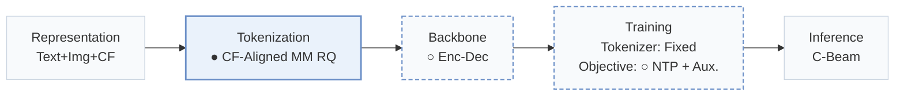
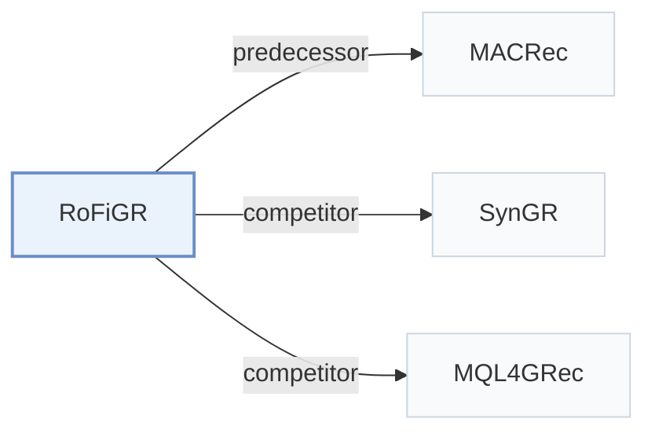

# RoFiGR

[← Problem × Stage Matrix](../../README.md#i--tokenization) · [Papers by Stage](../index/stages.md) · [Papers by Modality](../index/modality.md) · [Papers by Domain](../index/domain.md) · English | [中文](../zh/papers/rofigr.md)

| **Title** | *Coarse Routing, Fine Refinement via Level-Adaptive Distillation in Multimodal Generative Recommendation* |
| :-- | :-- |
| **Authors** | Dai et al. |
| **Venue** | arXiv’26 |
| **Problem × Stage** | `I. Informativeness` · `Tokenization` |
| **Changes** | ● Tokenization · ○ Backbone · ○ Objective |
| **SID inputs** | text: `Text` + `Img` + `CF` · image: `Text` + `Img` + `CF` |
| **Domain** | `E-commerce` |
| **Scenario** | `General Item Recommendation`; `Public Benchmarks` |
| **Links** | [Paper](https://arxiv.org/abs/2610.39470) |
| **Reading level** | Overview (Level 1) |

**On this page**: [TL;DR](#tldr) · [3. Experiments](#3-experimental-findings) · [5. Related Work](#5-connections-to-related-work)

- `Text+Img+CF`: Text and image representations combined with collaborative signals.
- `CF-Aligned MM RQ`: Multimodal residual quantization aligned with collaborative signals.
- `Enc-Dec`: Encoder-decoder.
- `Fixed`: SIDs are built first and not changed while the generator trains.
- `NTP + Aux.`: NTP plus another auxiliary loss.
- `C-Beam`: Constrained beam search.

### TL;DR

> [!NOTE]
> RoFiGR aligns coarse Semantic ID code vectors with collaborative embeddings and distills a sequential teacher over legal branches with level-adaptive weights, to reduce early routing errors.

---

### 3. Experimental Findings

Experimental setup

- **Datasets**: Amazon Instruments, Arts, Games; 5-core filtering, histories capped at 20; catalogs 6250/9416/13839 items, respectively.
  - Source: Section 4.1: [S4.SS1.p1](https://arxiv.org/html/2610.39470v1#S4.SS1.p1)
- **Split**: Per-user chronological last event test, penultimate validation, earlier events training; teacher fitting and student optimization use the training partition.
  - Source: Section 4.1: [S4.SS1.p1](https://arxiv.org/html/2610.39470v1#S4.SS1.p1)
- **Candidates**: full catalog; no sampled negatives. A target absent from the decoded stream union scores zero.
  - Source: Section 4.1: [S4.SS1.p2](https://arxiv.org/html/2610.39470v1#S4.SS1.p2)
- **Visibility**: warm; no unseen-item protocol is defined. MISSRec teacher fits training interactions; item embeddings/scores are frozen offline. Tokenizer exposure to test items not separately reported.
  - Source: Sections 3.1/4.1 define no item holdout: [S3.SS1.p2](https://arxiv.org/html/2610.39470v1#S3.SS1.p2) and [S4.SS1.p1](https://arxiv.org/html/2610.39470v1#S4.SS1.p1)
- **SID**: Separate text/image residual trees, each [64,256,256,512], code dimension 32. Collisions repaired at L4 or L3-L4, preserving L1-L2; complete SIDs uniquely identify items.
  - Source: Sections 3.2/3.6: [S3.SS2.p2](https://arxiv.org/html/2610.39470v1#S3.SS2.p2) and [S3.SS6.p1](https://arxiv.org/html/2610.39470v1#S3.SS6.p1)
- **Inference budget**: Four independent trie beams of 20, item union and equal-weight stream fusion; HR@1/5/10, NDCG@5/10. One L20, FP16, batch 1, history 20: four-stream mean latency 56.7/60.9/63.7 ms (Instruments/Arts/Games); two-stream 31.8/33.5/35.1 ms. Includes encoding through final sorting; no online teacher/reranker.
  - Source: Sections 3.5/4.8: [S3.SS5.p3](https://arxiv.org/html/2610.39470v1#S3.SS5.p3) and [S4.SS8.p2](https://arxiv.org/html/2610.39470v1#S4.SS8.p2)
- **Results from**: Original Table 3: five-seed main comparison; MACRec/SynGR retain native two-stream inference versus RoFiGR's four. Tables 5/6 separate task exposure, stream fusion, matched beam slots and candidate caps.
  - Source: Section 4.1/4.2 and Tables 3/5/6: [S4.SS1.p2](https://arxiv.org/html/2610.39470v1#S4.SS1.p2) and [S3.T3](https://arxiv.org/html/2610.39470v1#S3.T3) and [S4.SS2.p1](https://arxiv.org/html/2610.39470v1#S4.SS2.p1) and [S4.T5](https://arxiv.org/html/2610.39470v1#S4.T5) and [S4.T6](https://arxiv.org/html/2610.39470v1#S4.T6)

---

### 5. Connections to Related Work

- **Predecessor** · [MACRec](macrec.md): RoFiGR retains MACRec's two-tree quantizer and adds coarse collaborative alignment.
  - Source: RoFiGR v1, Section 3.2 and Table 3: [S3.SS2.p1](https://arxiv.org/html/2610.39470v1#S3.SS2.p1); [S3.T3](https://arxiv.org/html/2610.39470v1#S3.T3).
- **Competitor** · [SynGR](syngr.md): SynGR promotes cross-modal synergy; RoFiGR adds collaborative coarse routing supervision.
  - Source: RoFiGR v1, Section 2 and Table 3: [S2.SS0.SSS0.Px2.p1](https://arxiv.org/html/2610.39470v1#S2.SS0.SSS0.Px2.p1); [S3.T3](https://arxiv.org/html/2610.39470v1#S3.T3).
- **Competitor** · [MQL4GRec](mql4grec.md): RoFiGR adopts MQL4GRec's domain data setting and compares against it.
  - Source: RoFiGR v1, Section 4.1 and Table 3: [S4.SS1.p1](https://arxiv.org/html/2610.39470v1#S4.SS1.p1); [S3.T3](https://arxiv.org/html/2610.39470v1#S3.T3).

[View all papers in this cell](../../README.md#i--tokenization)
