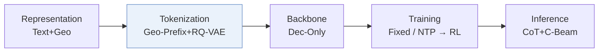
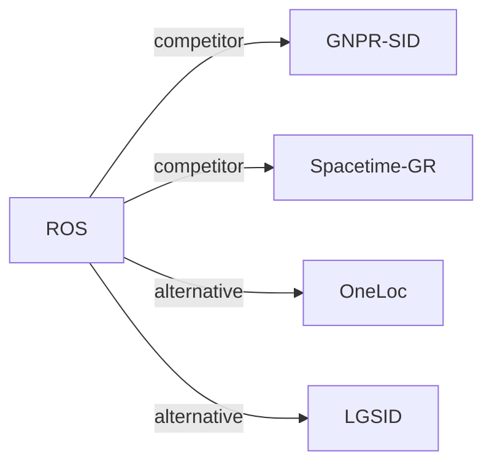

# ROS

*Reasoning Over Space: Enabling Geographic Reasoning for LLM-Based Generative Next POI Recommendation* — Lv et al. · ACL’26

`I. Informativeness` · `Tokenization` · `POI` · [Paper](https://arxiv.org/abs/2601.04562) · [Code](https://github.com/amap-cvlab/Reasoning-Over-Space) · [Matrix](../../README.md#i--tokenization) · [中文](../zh/papers/ros.md)

Reading level: Reading Notes (Level 2) · On this page: [TL;DR](#tldr) · [At a Glance](#at-a-glance) · [1. Why It Matters](#1-why-this-paper-matters) · [2. Method](#2-how-it-works) · [3. Experiments](#3-experimental-findings) · [4. Limitations](#4-limitations--critical-analysis) · [5. Related Work](#5-connections-to-related-work)

- `Geo-Prefix+RQ-VAE`: Geographic prefixes combined with residual-quantized variational codes.
- `Dec-Only`: Decoder-only.
- `Fixed`: SIDs are built first and not changed while the generator trains.
- `NTP → RL`: NTP, then reinforcement learning (GRPO, GBPO, etc.).
- `CoT+C-Beam`: Reasoning followed by constrained beam-search decoding.

### TL;DR

> [!NOTE]

> ROS adds hierarchical spatial Semantic IDs, a mobility chain-of-thought with locality-informed pruning, and spatial-guided reinforcement learning to LLM-based next-POI generation.

### At a Glance

| Aspect | Summary |
| :-- | :-- |
| Research Problem | I. Informativeness: Do the SIDs, or the model reading them, carry the collaborative and multimodal signals recommendation needs? |
| Key Contribution | ROS adds hierarchical spatial Semantic IDs, a mobility chain-of-thought with locality-informed pruning, and spatial-guided reinforcement learning to LLM-based next-POI generation. |
| Modified Stage | Tokenization |
| Key Findings | On NYC, ROS reports HR@1 of 0.4478 against 0.4027 for CoAST (+11.2%), and the paper reports gains of +11.0% on TKY and +15.7% on Gowalla-CA over the strongest LLM-based baselines (Table 1). |
| Limitation | A monotonic prior treats long moves within short intervals as unlikely, so ROS can underweight fast trips by metro or highway (Limitations). |

### 1. Why This Paper Matters

LLM-based generative recommenders make limited use of geographic signals, which matter in mobility and local-service scenarios (Abstract). ROS models the next visit as a sequence of constrained decisions driven by time, intent, and geography (Sec. 2.3). It represents each POI with a hierarchical spatial Semantic ID (SID) that encodes locality and POI semantics (Abstract).

> "We present ROS, a generative next POI recommendation framework that treats geography as an explicit decision variable." (Sec. 5)

Based on arXiv v2.

### 2. How It Works

#### Hierarchical Spatial SID

Each POI SID has a geospatial prefix, a semantic anchor, and a discriminative suffix (Sec. 2.2.1). The prefix takes the POI's S2 Cell ID, written as hexadecimal digits, removes the prefix shared by all POIs, and groups the remaining digits into tokens. The semantic anchor embeds the POI's category description with Qwen-0.6B and quantizes it with an RQ-VAE.

#### SID Grounding

Bidirectional alignment trains the model to predict the SID from text and to generate text from the SID (Sec. 2.2.2).

> "This bidirectional alignment grounds SID tokens in functional semantics and fine-grained neighborhood cues." (Sec. 2.2.2)

Sequence pretraining then trains next-POI prediction on SID sequences, where the model learns recency, category repetition, and neighborhood continuity.

#### Mobility Chain-of-Thought

The model reasons in three deterministic stages: it profiles the user, builds an intent-aligned candidate space, and prunes candidates (Sec. 2.3). Pruning uses temporal consistency, semantic fit, and spatial feasibility from street addresses and transition distances.

#### Spatial-Guided RL

GRPO optimizes a unified reward (Sec. 2.4.3). The reward combines the Haversine distance between the predicted and true POI (Sec. 2.4.1), a hierarchical SID match with a bonus for an exact match (Sec. 2.4.2), and a format term.

### 3. Experimental Findings

Experimental setup

- **Datasets**: Foursquare NYC and TKY, Gowalla CA, prepared with the LLM4POI pipeline: users and POIs with fewer than 10 check-ins removed, trajectories segmented by a 24-hour time-gap threshold, and street-level addresses added by reverse geocoding. Sizes after preprocessing (users / POIs / check-ins): NYC 1,048 / 4,981 / 103,941; TKY 2,282 / 7,833 / 405,000; CA 3,957 / 9,690 / 238,369.
  - Source: Datasets and LLM4POI pipeline: [S3.SS1.p1](https://arxiv.org/html/2601.04562v2#S3.SS1.p1); 24-hour gap and sizes: [A1.T10](https://arxiv.org/html/2601.04562v2#A1.T10).
- **Split**: Temporal 80% / 10% / 10% train/validation/test split. Separate cross-city test: train on one city and evaluate on others.
  - Source: Temporal 80/10/10 split keeping test users and POIs observed: [S3.SS1.p1](https://arxiv.org/html/2601.04562v2#S3.SS1.p1); cross-city: [S3.T6](https://arxiv.org/html/2601.04562v2#S3.T6).
- **Candidates**: n/a for candidate ranking: the model outputs exactly one POI per request and is scored by HR@1.
  - Source: One recommendation per request, HR@1: [S3.SS1.SSS0.Px2.p1](https://arxiv.org/html/2601.04562v2#S3.SS1.SSS0.Px2.p1).
- **Visibility**: warm; validation and test users and POIs are kept only if observed in training. The cross-city test (Table 6) uses POIs of another city; their tokenizer exposure is not reported.
  - Source: Test users and POIs observed in training: [S3.SS1.p1](https://arxiv.org/html/2601.04562v2#S3.SS1.p1).
- **SID**: Hierarchical spatial SID [g; s; u]: two S2-cell locality tokens (after removing the dataset-wide common prefix), two semantic tokens from a 2-level residual quantizer with 28 codes per level over Qwen-0.6B category embeddings, and a sequential suffix token within each (g, s) pair that makes IDs unique (at most 8 suffix values observed).
  - Source: HS-SID construction: [A1.SS3.SSS0.Px1.p1](https://arxiv.org/html/2601.04562v2#A1.SS3.SSS0.Px1.p1).
- **Inference budget**: Generates a mobility chain-of-thought and then one POI SID per request (three inference runs averaged); decoding settings not reported. Qwen3-4B student on 8 NVIDIA H20 GPUs; inference batch size and latency: not reported.
  - Source: One output per request, hardware: [S3.SS1.SSS0.Px2.p1](https://arxiv.org/html/2601.04562v2#S3.SS1.SSS0.Px2.p1) and [S3.SS1.SSS0.Px3.p1](https://arxiv.org/html/2601.04562v2#S3.SS1.SSS0.Px3.p1).
- **Results from**: Table 1 (HR@1 on NYC, TKY, CA versus traditional, neural, and LLM-based baselines); Tables 2-5 and Figure 3 (SID design, CoT stages, geographic cues, reward weights); Table 6 (cross-city generalization).
  - Source: Main: [S3.T1](https://arxiv.org/html/2601.04562v2#S3.T1); ablations: [S3.T2](https://arxiv.org/html/2601.04562v2#S3.T2), [S3.T3](https://arxiv.org/html/2601.04562v2#S3.T3), [S3.T4](https://arxiv.org/html/2601.04562v2#S3.T4), [S3.T5](https://arxiv.org/html/2601.04562v2#S3.T5); RL weights: [S3.F3](https://arxiv.org/html/2601.04562v2#S3.F3); cross-city: [S3.T6](https://arxiv.org/html/2601.04562v2#S3.T6).

- CoT stages: the best result needs all three stages together (Sec. 3.3, Table 3).
- Cross-city transfer: trained on one city and applied to two unseen cities, ROS achieves the best transfer results against LLM4POI and GA-LLM (Sec. 3.4, Table 6).

### 4. Limitations & Critical Analysis

**Stated by the authors.** ROS relies on a monotonic prior that long transitions are unlikely within short time intervals. The authors state that this prior can underweight fast long-range moves by metro rail or highway, especially near transit hubs (Limitations).

**Our analysis.**

- GNPR-SID quantizes POI features with a plain `RQ-VAE`; ROS puts an explicit S2-cell prefix before the semantic codes (`Geo-Prefix+RQ-VAE`).
- SpaceTime-GR uses geographic indices only (`Geo`, `Geo-Idx`); ROS adds category semantics to the SID and reasons before decoding (`CoT+C-Beam`).

### 5. Connections to Related Work

- **同期对比** · [GNPR-SID](gnpr-sid.md): GNPR-SID quantizes POI embeddings without explicit spatial structure; ROS builds S2-cell locality tokens plus semantic codes and adds mobility chain-of-thought and spatial RL.
  - Source: ROS v2, LLM-based baselines: https://arxiv.org/html/2601.04562v2#S3.SS1.SSS0.Px1.p1; Table 1: https://arxiv.org/html/2601.04562v2#S3.T1.
- **同期对比** · [Spacetime-GR](spacetime-gr.md): SpaceTime-GR also generates next POIs with an LLM; ROS adds hierarchical spatial SIDs and explicit reasoning before the recommendation.
  - Source: ROS v2, LLM-based baselines (ST-GR): https://arxiv.org/html/2601.04562v2#S3.SS1.SSS0.Px1.p1; Table 1: https://arxiv.org/html/2601.04562v2#S3.T1.
- **替代方案** · [OneLoc](oneloc.md): OneLoc injects geography into the SID input and rewards; ROS encodes geography directly as S2-cell prefix tokens.
  - Source: ROS v2, Section 1 cites OneLoc: https://arxiv.org/html/2601.04562v2#S1.p3.
- **替代方案** · [LGSID](lgsid.md): LGSID aligns embeddings with geographic rewards before quantization; ROS separates geographic and semantic tokens inside the SID.
  - Source: ROS v2, Section 1 cites LGSID: https://arxiv.org/html/2601.04562v2#S1.p3.

[查看同格全部论文](../../README.md#i--tokenization)
