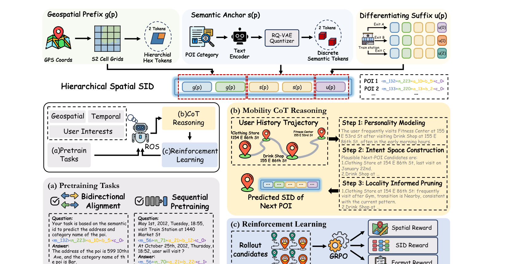

# ROS

*Reasoning Over Space: Enabling Geographic Reasoning for LLM-Based Generative Next POI Recommendation* — Lv et al. · ACL’26

`I. Informativeness` · `Tokenization` · `POI`

[Paper](https://arxiv.org/abs/2601.04562) · [Code](https://github.com/amap-cvlab/Reasoning-Over-Space) · [Matrix](../../README.md#i--tokenization)

Reading level: Overview (Level 1) · On this page: [TL;DR](#tldr) · [At a Glance](#at-a-glance) · [2. How It Works](#2-how-it-works) · [3. Experimental Findings](#3-experimental-findings) · [5. Connections to Related Work](#5-connections-to-related-work)

| Representation | Tokenization | Backbone | Training | Inference |
| :-: | :-: | :-: | :-: | :-: |
| `Text+Geo` | **`Geo-Prefix+RQ-VAE`** | `Dec-Only` | `Fixed / NTP → RL` | `CoT+C-Beam` |

- `Geo-Prefix+RQ-VAE`: Geographic prefixes combined with residual-quantized variational codes.
- `Dec-Only`: Decoder-only.
- `Fixed`: SIDs are built first and not changed while the generator trains.
- `NTP → RL`: NTP, then reinforcement learning (GRPO, GBPO, etc.).
- `CoT+C-Beam`: Reasoning followed by constrained beam-search decoding.

### TL;DR

ROS adds hierarchical spatial Semantic IDs, a mobility chain-of-thought with locality-informed pruning, and spatial-guided reinforcement learning to LLM-based next-POI generation.

### At a Glance

| Aspect | Summary |
| :-- | :-- |
| Research Problem | I. Informativeness: Do the SIDs, or the model reading them, carry the collaborative and multimodal signals recommendation needs? |
| Key Contribution | ROS adds hierarchical spatial Semantic IDs, a mobility chain-of-thought with locality-informed pruning, and spatial-guided reinforcement learning to LLM-based next-POI generation. |
| Modified Stage | Tokenization |

### 2. How It Works

### 3. Experimental Findings

**Experimental setup**

- **Datasets**: Foursquare NYC and TKY, Gowalla CA, prepared with the LLM4POI pipeline: users and POIs with fewer than 10 check-ins removed, trajectories segmented by a 24-hour time-gap threshold, and street-level addresses added by reverse geocoding. Sizes after preprocessing (users / POIs / check-ins): NYC 1,048 / 4,981 / 103,941; TKY 2,282 / 7,833 / 405,000; CA 3,957 / 9,690 / 238,369.
  - Source: Datasets and LLM4POI pipeline: https://arxiv.org/html/2601.04562v2#S3.SS1.p1; 24-hour gap and sizes: https://arxiv.org/html/2601.04562v2#A1.T10.
- **Split**: Temporal 80% / 10% / 10% train/validation/test split. Separate cross-city test: train on one city and evaluate on others.
  - Source: Temporal 80/10/10 split keeping test users and POIs observed: https://arxiv.org/html/2601.04562v2#S3.SS1.p1; cross-city: https://arxiv.org/html/2601.04562v2#S3.T6.
- **Candidates**: n/a for candidate ranking: the model outputs exactly one POI per request and is scored by HR@1.
  - Source: One recommendation per request, HR@1: https://arxiv.org/html/2601.04562v2#S3.SS1.SSS0.Px2.p1.
- **Visibility**: warm; validation and test users and POIs are kept only if observed in training. The cross-city test (Table 6) uses POIs of another city; their tokenizer exposure is not reported.
  - Source: Test users and POIs observed in training: https://arxiv.org/html/2601.04562v2#S3.SS1.p1.
- **SID**: Hierarchical spatial SID [g; s; u]: two S2-cell locality tokens (after removing the dataset-wide common prefix), two semantic tokens from a 2-level residual quantizer with 28 codes per level over Qwen-0.6B category embeddings, and a sequential suffix token within each (g, s) pair that makes IDs unique (at most 8 suffix values observed).
  - Source: HS-SID construction: https://arxiv.org/html/2601.04562v2#A1.SS3.SSS0.Px1.p1.
- **Inference budget**: Generates a mobility chain-of-thought and then one POI SID per request (three inference runs averaged); decoding settings not reported. Qwen3-4B student on 8 NVIDIA H20 GPUs; inference batch size and latency: not reported.
  - Source: One output per request, hardware: https://arxiv.org/html/2601.04562v2#S3.SS1.SSS0.Px2.p1 and https://arxiv.org/html/2601.04562v2#S3.SS1.SSS0.Px3.p1.
- **Results from**: Table 1 (HR@1 on NYC, TKY, CA versus traditional, neural, and LLM-based baselines); Tables 2-5 and Figure 3 (SID design, CoT stages, geographic cues, reward weights); Table 6 (cross-city generalization).
  - Source: Main: https://arxiv.org/html/2601.04562v2#S3.T1; ablations: https://arxiv.org/html/2601.04562v2#S3.T2, https://arxiv.org/html/2601.04562v2#S3.T3, https://arxiv.org/html/2601.04562v2#S3.T4, https://arxiv.org/html/2601.04562v2#S3.T5; RL weights: https://arxiv.org/html/2601.04562v2#S3.F3; cross-city: https://arxiv.org/html/2601.04562v2#S3.T6.

## 旧卡片说明

迁自 `d61aa6c:papers/ros.md`。保留方法说明、实验叙述与局限；本轮只对照现有记录处理明确冲突，未重新逐句核查原论文。分类和规格以页面上方由记录生成的表格为准。

### ROS：空间推理增强的生成式下一兴趣点推荐

> ROS 将地理关系显式纳入下一 POI 推理过程，通过层次化空间 SID、移动思维链和空间引导强化学习生成可行地点。

### 研究动机与问题定义

下一 POI 不是普通的物品分类：用户兴趣、时间规律和空间可达性共同决定目的地。已有 LLM 推荐方法虽能生成 SID，却常把空间信息作为文本或单步条件，缺少显式的候选构造和可行性判断。ROS 将推荐建模为带空间约束的多阶段决策。

### TL;DR（核心摘要）

`坐标/网格/类别 → 空间SID → 用户画像与候选空间 → 移动CoT剪枝 → 生成POI SID`

ROS 把 POI SID 分成地理前缀、语义锚点和区分性后缀。模型先通过双向对齐和序列预训练学习 SID 与地址/类别的对应关系，再用三步 Mobility CoT 建立用户画像、构造意图候选并进行局部性剪枝，最后用空间、SID 和格式奖励进行强化学习。

### 输入与使用场景

| 方面 | 说明 |
|---|---|
| 使用信息 | GPS、S2 网格、POI 类别、地址、用户历史和时间 |
| 信息融入位置 | SID 结构、预训练任务、思维链和强化学习奖励 |
| 语义标识结构 | 层次化、定长离散序列 |
| 适用场景 | 下一 POI、跨城市迁移和地理可行性推荐 |

### 方法设计

#### 2.1 问题形式化
给定用户历史轨迹、时间和上下文，模型需要生成下一 POI 的完整 SID。与只预测一个标签不同，ROS 将生成过程拆为画像分析、候选空间构造和局部性筛选等有顺序的决策。

#### 2.2 空间语义标识
地理前缀由 GPS 映射到 S2 网格，再转换为层次化六边形 token；语义锚点由 POI 类别等文本信息经过编码和 RQ-VAE 量化得到；后缀用于区分同一地理和语义区域内的不同 POI。三者拼接为 Hierarchical Spatial SID。

#### 2.2.2 SID 对齐预训练
模型使用双向 SID-文本/地址对齐任务，使 SID 能预测 POI 的类别和地址，也使文本能恢复 SID。另一个序列预训练任务让模型学习移动轨迹中的时间、类别重复和邻域连续性。

#### 2.3 Mobility CoT 推理
第一步从历史轨迹提炼用户移动画像；第二步根据画像和当前上下文形成候选 POI 空间；第三步依据访问频率、时间和空间邻近性对候选进行局部性剪枝，再生成目标 SID。这种流程把地理可行性变成显式推理条件。

#### 2.4 空间引导强化学习
训练时从策略模型采样推理轨迹，奖励由空间距离、SID 层次匹配和格式合法性组成，并通过 GRPO 优化。层级 SID 奖励使正确的地理前缀和语义部分获得分层反馈。

### 实验结论

- 在三个 LBSN 数据集上，ROS 相比 LLM 基线取得更高命中率，论文报告相对提升超过 10%。
- 移动 CoT 和空间奖励的消融支持显式候选构造与地理剪枝的作用。
- 跨城市实验显示模型具有较好的迁移能力，但论文指出短时间长距离移动的交通先验仍未充分建模。

### 局限性与研究定位

#### 局限性

- 当前地理可行性主要采用短时间内长距离移动不太可能的单调先验，可能低估地铁、高速等交通支持的远距离移动。
- 多阶段思维链会增加生成 token 和推理成本，在线延迟比较未充分展开。

#### 研究定位

ROS 代表把“空间推理”引入 Semantic ID 生成推荐的路线，适合放在“推理增强与地理约束生成推荐”章节。

### 相关资源

- [论文原文](https://arxiv.org/abs/2601.04562)

### 标签

`空间推理` · `层次化SID` · `移动思维链` · `空间强化学习`

### 架构图来源

*图源：原论文，图2（[论文原文](https://arxiv.org/abs/2601.04562)）。图片使用许可待核实。*

---

### 旧总表补充

来源：`d61aa6c:tables/all-methods.md`。

- 核心贡献：用移动思维链和空间奖励显式执行地理推理。
- 使用场景：下一 POI、跨城市迁移。

### 5. Connections to Related Work

- **Competitor** · [GNPR-SID](gnpr-sid.md): GNPR-SID quantizes POI embeddings without explicit spatial structure; ROS builds S2-cell locality tokens plus semantic codes and adds mobility chain-of-thought and spatial RL.
  - Source: ROS v2, LLM-based baselines: https://arxiv.org/html/2601.04562v2#S3.SS1.SSS0.Px1.p1; Table 1: https://arxiv.org/html/2601.04562v2#S3.T1.
- **Competitor** · [Spacetime-GR](spacetime-gr.md): SpaceTime-GR also generates next POIs with an LLM; ROS adds hierarchical spatial SIDs and explicit reasoning before the recommendation.
  - Source: ROS v2, LLM-based baselines (ST-GR): https://arxiv.org/html/2601.04562v2#S3.SS1.SSS0.Px1.p1; Table 1: https://arxiv.org/html/2601.04562v2#S3.T1.
- **Alternative** · [OneLoc](oneloc.md): OneLoc injects geography into the SID input and rewards; ROS encodes geography directly as S2-cell prefix tokens.
  - Source: ROS v2, Section 1 cites OneLoc: https://arxiv.org/html/2601.04562v2#S1.p3.
- **Alternative** · [LGSID](lgsid.md): LGSID aligns embeddings with geographic rewards before quantization; ROS separates geographic and semantic tokens inside the SID.
  - Source: ROS v2, Section 1 cites LGSID: https://arxiv.org/html/2601.04562v2#S1.p3.

[View all papers in this cell](../../README.md#i--tokenization)
