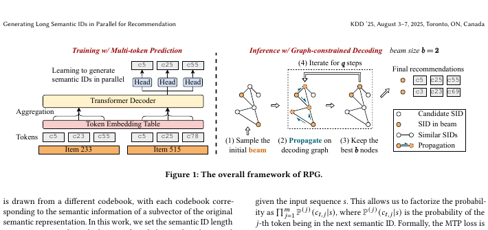
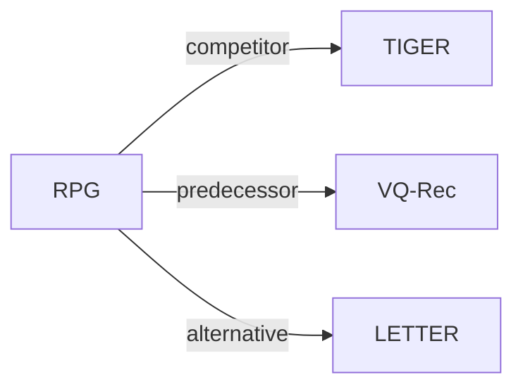

# RPG

*Generating long semantic ids in parallel for recommendation* — Hou et al. · KDD’25

`V. Efficiency` · `Backbone` · [Paper](https://arxiv.org/abs/2506.05781) · [Code](https://github.com/facebookresearch/RPG_KDD2025) · [Matrix](../../README.md#v--backbone) · [中文](../zh/papers/rpg.md)

Reading level: Annotated Deep Dive (Level 3) · On this page: [TL;DR](#tldr) · [At a Glance](#at-a-glance) · [1. Why It Matters](#1-why-this-paper-matters) · [2. Method](#2-how-it-works) · [3. Experiments](#3-experimental-findings) · [4. Limitations](#4-limitations--critical-analysis) · [5. Related Work](#5-connections-to-related-work)


- `Non-AR`: Non-autoregressive.
- `Fixed`: SIDs are built first and not changed while the generator trains.
- `MTP`: Predicts several codes in parallel at once.

### TL;DR

> [!NOTE]
> RPG predicts long, unordered OPQ Semantic IDs in parallel with a multi-token prediction loss and decodes over a graph of valid IDs, replacing autoregressive beam search over short IDs.

### At a Glance

| Aspect | Summary |
| :-- | :-- |
| Research Problem | V. Efficiency: Can it be trained and served within latency and cost budgets? |
| Key Contribution | RPG predicts long, unordered OPQ Semantic IDs in parallel with a multi-token prediction loss and decodes over a graph of valid IDs, replacing autoregressive beam search over short IDs. |
| Modified Stage | Backbone |
| Key Findings | With 64-token IDs, RPG outperforms generative baselines by an average of 12.6% on NDCG@10 and also improves inference efficiency (Abstract). |
| Limitation | The authors assume that the tokens of an SID are conditionally independent given the input sequence (Sec. 2.2.1). |

### 1. Why This Paper Matters

Generative recommenders such as TIGER decode a Semantic ID (SID) token by token with beam search, which needs several forward passes of the generator per recommendation. As a result, existing models keep SIDs short, often 4 tokens (Abstract). ACERec and SPRINT, later papers in the same matrix cell, use the same `Par. OPQ` tokenization and `Non-AR` backbone.

> "Running beam search for 32 steps would be computationally prohibitive." (Sec. 1)

### 2. How It Works



#### Overview


#### Step 1: Long SIDs from OPQ

RPG replaces residual quantization with optimized product quantization (OPQ), so that the tokens can be predicted in parallel rather than one after another (Sec. 2.1.1).

> "To align with parallel decoding, we tokenize each item into an unordered long semantic ID (up to 64 tokens per item) using optimized product quantization (Jégou et al., 2011; Ge et al., 2014)." (Sec. 1)

OPQ splits the item's semantic embedding into $`m`$ subvectors and quantizes each subvector with its own codebook of size $`M`$ (Sec. 2.1.1). The standard product-quantization assignment is:

```math
\mathbf{x}_i = \left[\mathbf{x}_i^{(1)}; \dots; \mathbf{x}_i^{(m)}\right], \qquad c_{i,j} = \arg\min_{c \in \mathcal{C}^{(j)}} \left\| \mathbf{x}_i^{(j)} - \mathbf{a}_c^{(j)} \right\|_2^2
```

where:
- $`\mathbf{x}_i`$ is the semantic embedding of item $`i`$ after the OPQ rotation;
- $`\mathbf{x}_i^{(j)}`$ is its $`j`$-th subvector;
- $`\mathcal{C}^{(j)}`$ is the $`j`$-th codebook with $`M`$ codewords $`\mathbf{a}_c^{(j)}`$;
- $`c_{i,j}`$ is the $`j`$-th token of the SID of item $`i`$.

"Unordered" means that no token is predicted from the tokens before it. Position $`j`$ still belongs to codebook $`j`$ (Sec. 2.1.1). Different items can share the same token set; the authors describe such collisions as very unlikely with 64-token IDs (Appendix C).

#### Step 2: Item-Level Input

A 64-token SID per history item would make the input sequence too long (Sec. 2.1.2). RPG gives each codebook a learnable token embedding table $`\mathbf{E}_j \in \mathbb{R}^{M \times d}`$ and pools the $`m`$ token embeddings of an item into one vector $`\mathbf{v}_i = \mathrm{Aggr}(\mathbf{e}_{1,c_{i,1}}, \dots, \mathbf{e}_{m,c_{i,m}})`$ with mean or max pooling (Sec. 2.1.2). A Transformer decoder reads the sequence $`\mathbf{v}_1, \dots, \mathbf{v}_{t-1}`$ and outputs a sequence representation $`\mathbf{s} \in \mathbb{R}^{d}`$ (Sec. 2.2.1).

#### Step 3: Parallel Prediction with the MTP Loss

RPG predicts each token of the next SID with its own head and trains all heads with a multi-token prediction (MTP) loss.

> "Since each token produced by OPQ encodes a separate subvector of the target item's semantic representation, we assume that tokens in the tuple are conditionally independent given the input sequence s." (Sec. 2.2.1)

```math
\mathcal{L} = -\sum_{j=1}^{m} \log \mathbb{P}^{(j)}(c_{t,j} \mid s) = -\sum_{j=1}^{m} \log \frac{\exp\left(\mathbf{e}_{c_{t,j}}^{\top} g_j(\mathbf{s}) / \tau\right)}{\sum_{c \in \mathcal{C}^{(j)}} \exp\left(\mathbf{e}_{c}^{\top} g_j(\mathbf{s}) / \tau\right)}
```

where:
- $`c_{t,j}`$ is the $`j`$-th token of the target item's SID;
- $`g_j`$ is an MLP projection head for codebook $`j`$;
- $`\mathbf{e}_c`$ is the token embedding of token $`c`$;
- $`\tau`$ is a temperature (Eq. 1).

#### Step 4: Cached Token Scores

For one input sequence, RPG computes each codebook's token distribution once and caches it (Eq. 2). The score of any candidate SID is then a sum of cached values (Eq. 3):

```math
\mathbf{p}^{(j)} = \mathrm{softmax}\left(\mathbf{E}_j\, g_j(\mathbf{s}) / \tau\right) \in \mathbb{R}^{M}, \qquad \mathrm{score}(c_1, \dots, c_m) = \sum_{j=1}^{m} \log p^{(j)}_{c_j}
```

where $`p^{(j)}_{c_j}`$ is the entry of $`\mathbf{p}^{(j)}`$ for token $`c_j`$ (Sec. 2.2.2).

#### Step 5: Graph-Constrained Decoding

After training, RPG builds a graph whose nodes are the SIDs of catalog items (Sec. 2.3.1). The similarity of two SIDs is the sum of the inner products of their token embeddings:

```math
\mathrm{sim}(i, i') = \sum_{j=1}^{m} \mathbf{e}_{j,c_{i,j}}^{\top}\, \mathbf{e}_{j,c_{i',j}}
```

Each node keeps its $`k`$ most similar neighbors (Sec. 2.3.1), and each node has an edge to itself (Sec. 2.3.2). Decoding then runs four steps (Sec. 2.3.2):

1. Sample $`b`$ SIDs from the catalog as the initial beam.
2. Add all $`b \times k`$ graph neighbors of the beam to a candidate set.
3. Score the candidates with the cached values and keep the best $`b`$.
4. Repeat steps 2 and 3 for $`q`$ iterations and return the final beam as the top-$`K`$ items.

> "Since neighboring nodes in the graph tend to have similar logits, we expand the beam by propagating through the graph, including all b×k neighbors of the current beam into a temporary set." (Sec. 2.3.2)

```python
import torch

def rpg_decode(s, heads, token_emb, item_codes, neighbors, b=10, q=2, tau=0.05):
    """
    s:          [d] sequence representation of one user
    heads:      list of m projection heads g_j, each mapping [d] -> [d]
    token_emb:  [m, M, d] token embedding tables E_j
    item_codes: [N, m] SID of every catalog item; entry j indexes codebook j
    neighbors:  [N, k] graph neighbors of every item; the item itself is included here
    """
    m = item_codes.size(1)
    # Eq. 2: one softmax per codebook, cached for this user
    proj = torch.stack([g(s) for g in heads])                                         # [m, d]
    log_p = torch.log_softmax(torch.einsum("jcd,jd->jc", token_emb, proj) / tau, -1)  # [m, M]
    # Eq. 3 for the whole catalog
    scores = log_p[torch.arange(m), item_codes].sum(dim=-1)                          # [N]
    # step 1: random initial beam of b valid SIDs
    beam = torch.randperm(item_codes.size(0))[:b]                                     # [b]
    for _ in range(q):
        # step 2: beam plus graph neighbors, without duplicates
        cand = torch.unique(neighbors[beam].reshape(-1))                              # [<= b*k]
        # step 3: keep the b best candidates
        beam = cand[torch.topk(scores[cand], k=min(b, cand.numel())).indices]
    return beam                                                                       # item indices
```

Simplifications: The code scores every item in the catalog before the graph search; the paper scores only the nodes visited along graph edges (Sec. 2.3.3). It also takes the heads, token embeddings, and graph as inputs, and omits OPQ, the Transformer decoder, MTP training, and graph construction.

> "Compared to generative models like TIGER (Rajput et al., 2023), RPG reduces the number of sequence encoder forward passes per input instance from approximately O(bm) to just O(1), greatly improving inference efficiency (Section 3.3)." (Sec. 2.4.2)

### 3. Experimental Findings

<details>
<summary>Experimental setup</summary>

- **Datasets**: Amazon Reviews: Sports and Outdoors, Beauty, Toys and Games, and CDs and Vinyl; filtering rules: not reported.
  - Source: The four Amazon categories and chronological protocol are stated, but 5-core or other filtering rules are not stated in the body or appendix; [S3.SS1.p1](https://arxiv.org/html/2506.05781v1#S3.SS1.p1) and [S3.SS1.p2](https://arxiv.org/html/2506.05781v1#S3.SS1.p2), dataset counts in [S2.T1](https://arxiv.org/html/2506.05781v1#S2.T1).
- **Split**: Per-user chronological leave-last-out: last item for test, second-last for validation, earlier items for training.
  - Source: The last interaction is test, the second-last validation, and the remaining earlier interactions form the training history; [S3.SS1.p2](https://arxiv.org/html/2506.05781v1#S3.SS1.p2).
- **Candidates**: Evaluation candidate protocol: not reported (full catalog versus sampled-negative ranking). Inference searches a graph of valid catalog items and scores only visited nodes; per-user exclusion rules are not reported.
  - Source: The evaluation description does not specify full-catalog versus sampled-negative ranking; [S3.SS1.p2](https://arxiv.org/html/2506.05781v1#S3.SS1.p2). The separate inference description builds a graph over valid catalog items and starts with b random valid nodes; this does not by itself establish the evaluation candidate protocol; [S2.SS3.SSS1.p1](https://arxiv.org/html/2506.05781v1#S2.SS3.SSS1.p1) and [S2.SS3.SSS2.p2](https://arxiv.org/html/2506.05781v1#S2.SS3.SSS2.p2).
- **Visibility**: Tokenizer exposure of test-only items: not reported. The long-tail analysis groups items by training frequency [0,5], [6,10], [11,15], and [16,20]; it does not isolate strictly unseen items from low-frequency items.
  - Source: Figure 5 combines zero-frequency and low-frequency targets, so it cannot establish separate strictly unseen-item performance; tokenizer exposure of those targets is not specified; [S3.SS5.SSS3.p1](https://arxiv.org/html/2506.05781v1#S3.SS5.SSS3.p1).
- **SID**: Parallel OPQ subspaces, with best lengths Sports 16, Beauty 32, Toys 16, and CDs 64; per-subspace codebook size: not reported as an experimental setting. Colliding items retain separate graph nodes; no guaranteed collision-free identifier is claimed.
  - Source: Best SID lengths are in Table 6; the 256-entry codebook in the introduction is an example, not an explicit main-experiment setting; item-based graph nodes permit collisions; [A2.T6](https://arxiv.org/html/2506.05781v1#A2.T6), [S1](https://arxiv.org/html/2506.05781v1#S1), and [A3.p2](https://arxiv.org/html/2506.05781v1#A3.p2).
- **Inference budget**: Initial random seeds and retained beam b=10; best (neighbors k, iterations q): Sports (100,2), Beauty (100,3), Toys (50,5), CDs (500,3). One NVIDIA RTX 3090 24GB; inference batch size: not reported (training batch size is 256). Sports-only fixed-configuration scaling experiment reports approximately 15x faster inference and 25x lower runtime memory than TIGER; these are not total-storage reductions or per-request latency claims.
  - Source: Table 6 supplies b/k/q; Appendix B supplies hardware and separates checkpoint selection from graph-budget tuning; the batch size 256 in Section 3.1 is a training setting, not an inference setting; [A2.T6](https://arxiv.org/html/2506.05781v1#A2.T6), [A2.p1](https://arxiv.org/html/2506.05781v1#A2.p1), [S3.SS1.p6](https://arxiv.org/html/2506.05781v1#S3.SS1.p6). Speed/memory scope: [S3.SS3.p1](https://arxiv.org/html/2506.05781v1#S3.SS3.p1) and [S3.SS3.p2](https://arxiv.org/html/2506.05781v1#S3.SS3.p2).
- **Results from**: arXiv:2506.05781v1: Table 2 (main ranking results), Table 3 (ablations), Table 4 (semantic-encoder-controlled comparison), Figure 3 (Sports efficiency), Figure 5 (training-frequency analysis), and Tables 6 and 8 (best inference budgets and memory scope).
  - Source: Overall ranking metrics, graph/architecture ablations, encoder-matched comparisons, and the bounded efficiency study are separate result locations; [S2.T2](https://arxiv.org/html/2506.05781v1#S2.T2), [S3.T3](https://arxiv.org/html/2506.05781v1#S3.T3), [S3.T4](https://arxiv.org/html/2506.05781v1#S3.T4), and [S3.F3](https://arxiv.org/html/2506.05781v1#S3.F3).

</details>

- Overall: with 64-token IDs, RPG outperforms the generative baselines by an average of 12.6% on NDCG@10 (Abstract). Table 2 gives the full comparison.
- Efficiency: on Sports, RPG uses less runtime memory and less inference time than TIGER (Sec. 3.3, Fig. 3).

  > "Moreover, RPG reduces runtime memory consumption by nearly 25× and achieves an inference speedup of almost 15× compared to TIGER." (Sec. 3.3)

- ID length: performance does not rise with every increase in length. The best lengths are 16 on Sports, 32 on Beauty, 16 on Toys, and 64 on CDs (Sec. 3.5.1, Fig. 4).

  > "From Figure 4, we observe that, in general, longer OPQ-based semantic IDs lead to better performance. However, for smaller datasets, they may converge earlier." (Sec. 3.5.1)

- Semantic encoder: the main runs use OpenAI text-embedding-3-large, and Table 4 repeats the comparison with sentence-t5-base for parity with benchmark results (Sec. 3.1, Sec. 3.5.2).
- Long-tail items: on Sports, the authors state that RPG achieves the best overall performance across the training-frequency groups (Sec. 3.5.3, Fig. 5).

### 4. Limitations & Critical Analysis

**Stated by the authors.** The authors state that the efficiency study uses one fixed set of hyperparameters, and that its runtime memory covers the GPU memory for computing logits, not the storage of model parameters (Sec. 3.3).

**Our analysis.**

- The score of an SID is a sum of per-token scores (Eq. 3), so the model cannot express dependencies between tokens of one SID. In the same cell, ACERec adds contrastive and auxiliary objectives (`MTP + Ctr. + Aux.`), and SPRINT replaces the objective with `Dual-level Flow Ctr.`; both keep `Par. OPQ` and `Non-AR`.
- The decoding graph is an index outside the model. It has one node per catalog item and must be rebuilt after retraining or re-tokenization (Sec. 2.3.1).

### 5. Connections to Related Work



- **Competitor** · [TIGER](tiger.md): RPG compares its parallel OPQ-token prediction and graph-constrained decoding with TIGER's autoregressive RQ-VAE-token generation.
  - Source: RPG v1, Section 2.1.1 describes OPQ: https://arxiv.org/html/2506.05781v1#S2.SS1.SSS1.p1; Section 2.4.2 explicitly contrasts TIGER: https://arxiv.org/html/2506.05781v1#S2.SS4.SSS2.p1; Section 3.1 names the TIGER baseline and Table 2 compares results: https://arxiv.org/html/2506.05781v1#S3.SS1.p4 and https://arxiv.org/html/2506.05781v1#S2.T2.
- **Predecessor** · [VQ-Rec](vq-rec.md): RPG follows VQ-Rec in using optimized product quantization, then predicts individual codes and searches an item graph instead of using VQ-Rec's retrieval model.
  - Source: RPG v1, Section 2.1.1 explicitly follows Hou et al. (2023) for OPQ: https://arxiv.org/html/2506.05781v1#S2.SS1.SSS1.p1; Section 2.4.1 identifies the compared model as VQ-Rec: https://arxiv.org/html/2506.05781v1#S2.SS4.SSS1.p1; Table 2 includes VQ-Rec: https://arxiv.org/html/2506.05781v1#S2.T2.
- **Alternative** · [LETTER](letter.md): LETTER regularizes a hierarchical RQ-VAE tokenizer for collaborative alignment and code diversity, whereas RPG uses long OPQ codes with parallel prediction to improve inference efficiency.
  - Source: Manually compared mechanisms, not a head-to-head evaluation: RPG v1, Section 4 cites LETTER (Wang et al., 2024a) among quantization methods: https://arxiv.org/html/2506.05781v1#S4.p2; Section 2.1.1 gives RPG's OPQ rationale: https://arxiv.org/html/2506.05781v1#S2.SS1.SSS1.p1; LETTER v1, Section 3.1 defines its regularized hierarchical RQ-VAE tokenizer: https://arxiv.org/html/2405.07314v1#S3.SS1.p1 and https://arxiv.org/html/2405.07314v1#S3.SS1.p2.

[View all papers in this cell](../../README.md#v--backbone)
