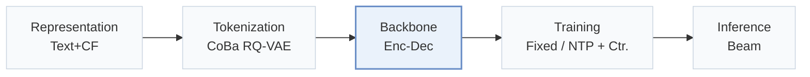
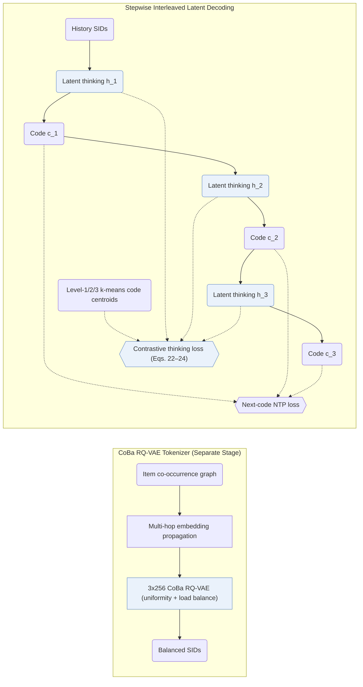
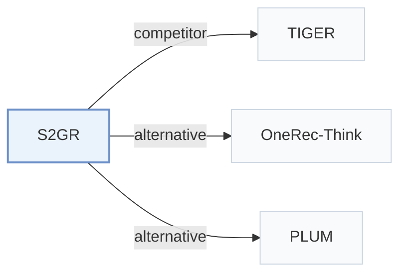

# S2GR

[← Problem × Stage Matrix](../../README.md#iii--backbone) · [Papers by Stage](../index/stages.md) · [Papers by Modality](../index/modality.md) · English | [中文](../zh/papers/s2gr.md)

| **Title** | *Stepwise Semantic-Guided Reasoning in Latent Space for Generative Recommendation* |
| :-- | :-- |
| **Authors** | Guo et al. |
| **Venue** | KDD’26 |
| **Problem × Stage** | `III. SID–Model Alignment` · `Backbone` |
| **Links** | [Paper](https://arxiv.org/abs/2601.18664) |
| **Reading level** | Reading Notes (Level 2) |

**On this page**: [TL;DR](#tldr) · [At a Glance](#at-a-glance) · [1. Why It Matters](#1-why-this-paper-matters) · [2. Method](#2-how-it-works) · [3. Experiments](#3-experimental-findings) · [4. Limitations](#4-limitations--critical-analysis) · [5. Related Work](#5-connections-to-related-work)

- `Text+CF`: Text representations combined with collaborative signals.
- `CoBa RQ-VAE`: Collaborative and Balanced RQ-VAE.
- `Enc-Dec`: Encoder-decoder.
- `Fixed`: SIDs are built first and not changed while the generator trains.
- `NTP + Ctr.`: NTP plus a contrastive loss.
- `Beam`: Autoregressive beam search over Semantic ID tokens.

### TL;DR

> [!NOTE]
> S2GR inserts a thinking token before each Semantic ID step, supervised contrastively with codebook cluster distributions, and builds the codebook with co-occurrence, load-balancing, and uniformity objectives.

---

### At a Glance

| Aspect | Summary |
| :-- | :-- |
| Research Problem | III. SID–Model Alignment: Can the generator read, write, and reason over SIDs, and do the tokenizer and generator work toward the same goal? |
| Key Contribution | S2GR inserts a thinking token before each Semantic ID step, supervised contrastively with codebook cluster distributions, and builds the codebook with co-occurrence, load-balancing, and uniformity objectives. |
| Modified Stage | Backbone |
| Key Findings | S2GR achieves an independent coding rate of 99.30% on Beauty and 76.25% on an industrial short-video catalog while outperforming sequential, reasoning, and TIGER baselines offline and lifting online A/B performance against TIGER (Abstract, Sec. 5.3, Sec. 5.4, Tables 2–4). |
| Limitation | On the industrial dataset with matched model scale, interleaved latent thinking raises training time from about 45 h (TIGER) to about 59 h and total inference time from about 0.88 h to about 0.90 h (Appendix B.1, Table B.1). |

---

### 1. Why This Paper Matters

Standard generative recommenders emit Semantic IDs (SIDs) directly without intermediate reasoning, whereas text-first CoT variants concentrate all reasoning compute before the first code and latent-reasoning variants lack grounded supervision (Abstract, Sec. 1). S2GR interleaves one continuous thinking vector immediately before each SID code level and supervises each vector against the k-means cluster centroid of the upcoming ground-truth code.

---

### 2. How It Works

#### Behavior-Aligned Codebook

S2GR constructs an item co-occurrence graph from training histories and smooths pretrained text embeddings across multi-hop neighbors prior to quantization (Sec. 4.2.1).

> "This encodes essential collaborative patterns without requiring additional model training." (Sec. 4.2.1)

A codebook-balanced RQ-VAE (`CoBa RQ-VAE`) then quantizes the smoothed representations under uniformity constraints and adaptive load balancing, trained separately before the generator (Sec. 4.2, Sec. 4.2.2).

#### Stepwise Latent Thinking

Before emitting each discrete SID code, the encoder-decoder generator outputs a continuous latent thinking embedding rather than natural-language tokens (Sec. 4.3.2). A contrastive thinking loss pulls each thinking vector toward the k-means centroid of the next ground-truth code in the corresponding level's codebook, optimized jointly with next-token recommendation cross-entropy (Eqs. 22–24).

#### Decoding

During beam search, each beam deterministically emits the continuous thinking vector and then branches only on the discrete SID code, avoiding beam fragmentation on latent steps (Appendix B.1).

> "For inference, the increase in latency is relatively small." (Appendix B.1)

---

### 3. Experimental Findings

Experimental setup

- **Datasets**: Amazon Beauty (May 1996-September 2014; 22,363 users / 12,101 items / 198,502 interactions) and an industrial short-video dataset of long-play records from sampled active users over 2 consecutive days (37,500 users / 1,086,872 items / 3,778,562 interactions). Dataset filtering rules: not reported; a table footnote states that user sequences shorter than 10 are filtered out during testing.
  - Source: Datasets and statistics: [S5.SS1.SSS1.p1](https://arxiv.org/html/2601.18664v3#S5.SS1.SSS1.p1) and [S5.T1](https://arxiv.org/html/2601.18664v3#S5.T1); test-time length filter: footnote 1 of [S5.T2](https://arxiv.org/html/2601.18664v3#S5.T2).
- **Split**: not reported (the train/validation/test rule is not described). The co-occurrence graph for codebook optimization uses history sequences that precede those used for training and evaluation. Online: 7-day A/B test with 5.25% of users per group, TIGER as control.
  - Source: No split rule stated; leakage control for co-occurrence: [S5.SS1.SSS3.p1](https://arxiv.org/html/2601.18664v3#S5.SS1.SSS3.p1); online test: [S5.SS4.p1](https://arxiv.org/html/2601.18664v3#S5.SS4.p1).
- **Candidates**: not reported (full catalog versus sampled evaluation candidates); HR and NDCG at 5 and 10 (Beauty) and at 10 and 100 (industrial).
  - Source: Metrics only: [S5.SS1.SSS1.p1](https://arxiv.org/html/2601.18664v3#S5.SS1.SSS1.p1).
- **Visibility**: warm; no unseen-item protocol is defined.
  - Source: No unseen-item protocol: [S5.SS1.SSS1.p1](https://arxiv.org/html/2601.18664v3#S5.SS1.SSS1.p1).
- **SID**: 3 levels x 256 codes from a codebook-balanced RQ-VAE (CoBa RQ-VAE) over Qwen3-Embedding-4B embeddings smoothed by multi-hop co-occurrence propagation; collision handling: not reported (independent coding rate 99.30% on Beauty, 76.25% industrial).
  - Source: 3 levels x 256, behavior-aligned embeddings and balanced RQ-VAE: [S5.SS1.SSS3.p1](https://arxiv.org/html/2601.18664v3#S5.SS1.SSS3.p1), [S4.SS2.SSS1.p3](https://arxiv.org/html/2601.18664v3#S4.SS2.SSS1.p3), [S4.SS2.SSS2.p1](https://arxiv.org/html/2601.18664v3#S4.SS2.SSS2.p1); utilization and ICR: [S5.T3](https://arxiv.org/html/2601.18664v3#S5.T3).
- **Inference budget**: Thinking tokens are generated before each SID level; T5 with 4 encoder and 4 decoder layers (same as the TIGER baseline). Beam width, hardware, inference batch size, and latency: not reported.
  - Source: T5 4+4 layers matching TIGER: [S5.SS1.SSS3.p1](https://arxiv.org/html/2601.18664v3#S5.SS1.SSS3.p1); decoding settings not found.
- **Results from**: Table 2 (Beauty and industrial versus sequential, reasoning, and TIGER baselines); Table 3 (tokenizer CUR and ICR); Table 4 and Section 5.4 (7-day online A/B against TIGER).
  - Source: Main: [S5.T2](https://arxiv.org/html/2601.18664v3#S5.T2); tokenizers: [S5.T3](https://arxiv.org/html/2601.18664v3#S5.T3); online: [S5.SS4.p1](https://arxiv.org/html/2601.18664v3#S5.SS4.p1).

- Component ablations: dropping either the interleaved thinking vectors or the centroid-aligned contrastive loss consistently degrades ranking accuracy on both Amazon Beauty and the industrial short-video dataset (Sec. 5.3, Table 2).
- Online deployment: a 7-day online A/B test on a short-video platform against a matched TIGER control confirms statistically consistent live gains for S2GR (Abstract, Sec. 5.4, Table 4).

---

### 4. Limitations & Critical Analysis

**Our analysis.**

- TIGER pairs text-only `RQ-VAE` codes (`Text`) with plain `NTP`; S2GR smooths item embeddings over a co-occurrence graph (`Text+CF`, `CoBa RQ-VAE`) and supervises interleaved latent states via `NTP + Ctr.`.
- OneRec-Think generates variable-length natural-language `CoT` with a `Dec-Only` LLM; S2GR retains a compact `Enc-Dec` backbone under standard `Beam` search by reasoning one continuous vector per code level.

---

### 5. Connections to Related Work

- **Competitor** · [TIGER](tiger.md): TIGER predicts SID codes directly; S2GR inserts thinking tokens aligned with coarse code semantics before each SID level and balances the codebook with behavior-aligned embeddings.
  - Source: S2GR v3, baselines: [S5.I1.i6.p1](https://arxiv.org/html/2601.18664v3#S5.I1.i6.p1); Table 2: [S5.T2](https://arxiv.org/html/2601.18664v3#S5.T2); online control group: [S5.SS4.p1](https://arxiv.org/html/2601.18664v3#S5.SS4.p1).
- **Alternative** · [OneRec-Think](onerec-think.md): OneRec-Think reasons explicitly in text with an LLM; S2GR reasons implicitly through latent thinking tokens inside a small seq2seq model to meet latency limits.
  - Source: S2GR v3, Section 2.2 places OneRec-Think in the explicit-reasoning line: [S2.SS2.p2](https://arxiv.org/html/2601.18664v3#S2.SS2.p2).
- **Alternative** · [PLUM](plum.md): PLUM feeds ID tokens to a pretrained LLM for explicit reasoning, whereas S2GR adds lightweight implicit reasoning steps.
  - Source: S2GR v3, Section 2.2: [S2.SS2.p2](https://arxiv.org/html/2601.18664v3#S2.SS2.p2).

[View all papers in this cell](../../README.md#iii--backbone)
