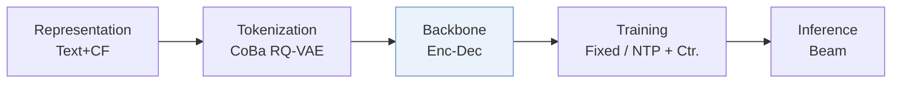
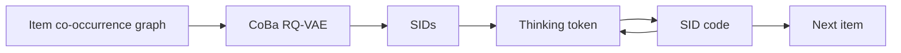
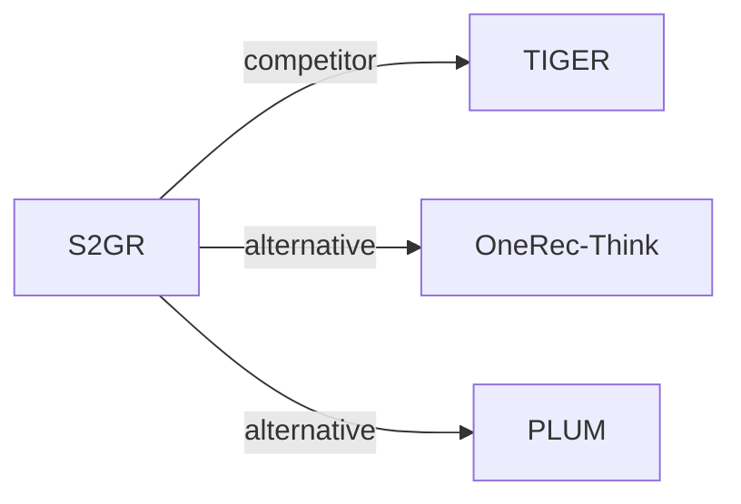

# S2GR

*Stepwise Semantic-Guided Reasoning in Latent Space for Generative Recommendation* — Guo et al. · KDD’26

`III. SID–Model Alignment` · `Backbone` · [Paper](https://arxiv.org/abs/2601.18664) · [Matrix](../../README.md#iii--backbone) · [中文](../zh/papers/s2gr.md)

Reading level: Reading Notes (Level 2) · On this page: [TL;DR](#tldr) · [At a Glance](#at-a-glance) · [1. Why It Matters](#1-why-this-paper-matters) · [2. Method](#2-how-it-works) · [3. Experiments](#3-experimental-findings) · [4. Limitations](#4-limitations--critical-analysis) · [5. Related Work](#5-connections-to-related-work)

- `CoBa RQ-VAE`: Collaborative and Balanced RQ-VAE.
- `Enc-Dec`: Encoder-decoder.
- `Fixed`: SIDs are built first and not changed while the generator trains.
- `NTP + Ctr.`: NTP plus a contrastive loss.

### TL;DR

> [!NOTE]

> S2GR inserts a thinking token before each Semantic ID step, supervised contrastively with codebook cluster distributions, and builds the codebook with co-occurrence, load-balancing, and uniformity objectives.

### At a Glance

| Aspect | Summary |
| :-- | :-- |
| Research Problem | III. SID–Model Alignment: Can the generator read, write, and reason over SIDs, and do the tokenizer and generator work toward the same goal? |
| Key Contribution | S2GR inserts a thinking token before each Semantic ID step, supervised contrastively with codebook cluster distributions, and builds the codebook with co-occurrence, load-balancing, and uniformity objectives. |
| Modified Stage | Backbone |
| Limitation | On the industrial dataset with same-scale models, training takes about 59 h against about 45 h for TIGER, while total inference rises from about 0.88 h to about 0.90 h (Appendix B.1, Table B.1). |

### 1. Why This Paper Matters

Most generative recommenders generate Semantic IDs (SIDs) directly from interaction sequences without a reasoning step (Abstract). The authors name two problems in reasoning-enhanced variants: reasoning placed entirely before generation spreads computation unevenly across the SID levels, and latent reasoning vectors have no interpretable semantics or verifiable supervision. S2GR interleaves thinking tokens with SID code generation, one before each code, and supervises each with the semantics of the next code (Sec. 1).

Based on arXiv v3.

### 2. How It Works

#### Behavior-Aligned Codebook

S2GR builds an item co-occurrence graph from history sequences and propagates item embeddings over it (Sec. 4.2.1).

> "This encodes essential collaborative patterns without requiring additional model training." (Sec. 4.2.1)

The codebook-balanced RQ-VAE adds uniformity constraints and adaptive load balancing to the quantizer (Sec. 4.2.2).

#### Stepwise Latent Thinking

Before each SID code, the generator outputs a thinking token, which is a continuous latent embedding rather than natural-language text (Sec. 4.3.2). A contrastive loss aligns it with the k-means cluster centroid of the next ground-truth code in the corresponding codebook. The generator objective adds this thinking loss to the recommendation loss (Eqs. 22–24). The tokenizer is optimized separately (Sec. 4.2).

#### Decoding

Each beam produces the thinking token and its following SID code in one continuous step, so thinking tokens do not expand the beam (Appendix B.1).

> "For inference, the increase in latency is relatively small." (Appendix B.1)

### 3. Experimental Findings

Experimental setup

- **Datasets**: Amazon Beauty (May 1996-September 2014; 22,363 users / 12,101 items / 198,502 interactions) and an industrial short-video dataset of long-play records from sampled active users over 2 consecutive days (37,500 users / 1,086,872 items / 3,778,562 interactions). Dataset filtering rules: not reported; a table footnote states that user sequences shorter than 10 are filtered out during testing.
  - Source: Datasets and statistics: [S5.SS1.SSS1.p1](https://arxiv.org/html/2601.18664v3#S5.SS1.SSS1.p1) and [S5.T1](https://arxiv.org/html/2601.18664v3#S5.T1); test-time length filter: footnote 1 of [S5.T2](https://arxiv.org/html/2601.18664v3#S5.T2).
- **Split**: not reported (the train/validation/test rule is not described). The co-occurrence graph for codebook optimization uses history sequences that precede those used for training and evaluation. Online: 7-day A/B test with 5.25% of users per group, TIGER as control.
  - Source: No split rule stated; leakage control for co-occurrence: [S5.SS1.SSS3.p1](https://arxiv.org/html/2601.18664v3#S5.SS1.SSS3.p1); online test: [S5.SS4.p1](https://arxiv.org/html/2601.18664v3#S5.SS4.p1).
- **Candidates**: not reported (full catalog versus sampled evaluation candidates); HR and NDCG at 5 and 10 (Beauty) and at 10 and 100 (industrial).
  - Source: Metrics only: [S5.SS1.SSS1.p1](https://arxiv.org/html/2601.18664v3#S5.SS1.SSS1.p1).
- **Visibility**: warm; no unseen-item protocol is defined.
  - Source: No unseen-item protocol: [S5.SS1.SSS1.p1](https://arxiv.org/html/2601.18664v3#S5.SS1.SSS1.p1).
- **SID**: 3 levels x 256 codes from a codebook-balanced RQ-VAE (CoBa RQ-VAE) over Qwen3-Embedding-4B embeddings smoothed by multi-hop co-occurrence propagation; collision handling: not reported (independent coding rate 99.30% on Beauty, 76.25% industrial).
  - Source: 3 levels x 256, behavior-aligned embeddings and balanced RQ-VAE: [S5.SS1.SSS3.p1](https://arxiv.org/html/2601.18664v3#S5.SS1.SSS3.p1), [S4.SS2.SSS1.p3](https://arxiv.org/html/2601.18664v3#S4.SS2.SSS1.p3), [S4.SS2.SSS2.p1](https://arxiv.org/html/2601.18664v3#S4.SS2.SSS2.p1); utilization and ICR: [S5.T3](https://arxiv.org/html/2601.18664v3#S5.T3).
- **Inference budget**: Thinking tokens are generated before each SID level; T5 with 4 encoder and 4 decoder layers (same as the TIGER baseline). Beam width, hardware, inference batch size, and latency: not reported.
  - Source: T5 4+4 layers matching TIGER: [S5.SS1.SSS3.p1](https://arxiv.org/html/2601.18664v3#S5.SS1.SSS3.p1); decoding settings not found.
- **Results from**: Table 2 (Beauty and industrial versus sequential, reasoning, and TIGER baselines); Table 3 (tokenizer CUR and ICR); Table 4 and Section 5.4 (7-day online A/B against TIGER).
  - Source: Main: [S5.T2](https://arxiv.org/html/2601.18664v3#S5.T2); tokenizers: [S5.T3](https://arxiv.org/html/2601.18664v3#S5.T3); online: [S5.SS4.p1](https://arxiv.org/html/2601.18664v3#S5.SS4.p1).

- Ablation: removing the stepwise reasoning tokens or the thinking loss degrades performance on Beauty and on the industrial dataset (Sec. 5.3, Table 2).
- Online A/B test: the authors report that the test on a large-scale short-video platform, with TIGER as the control, confirms the efficacy of S2GR (Abstract, Sec. 5.4, Table 4).

### 4. Limitations & Critical Analysis

**Our analysis.**

- TIGER uses text-only `RQ-VAE` codes (`Text`) and plain `NTP`; S2GR adds collaborative signals to the tokenizer (`Text+CF`, `CoBa RQ-VAE`) and a contrastive term to the generator (`NTP + Ctr.`).
- OneRec-Think reasons in text with a `Dec-Only` LLM (`CoT`); S2GR keeps an `Enc-Dec` generator with `Beam` decoding and reasons in latent tokens.

### 5. Connections to Related Work

- **同期对比** · [TIGER](tiger.md): TIGER predicts SID codes directly; S2GR inserts thinking tokens aligned with coarse code semantics before each SID level and balances the codebook with behavior-aligned embeddings.
  - Source: S2GR v3, baselines: https://arxiv.org/html/2601.18664v3#S5.I1.i6.p1; Table 2: https://arxiv.org/html/2601.18664v3#S5.T2; online control group: https://arxiv.org/html/2601.18664v3#S5.SS4.p1.
- **替代方案** · [OneRec-Think](onerec-think.md): OneRec-Think reasons explicitly in text with an LLM; S2GR reasons implicitly through latent thinking tokens inside a small seq2seq model to meet latency limits.
  - Source: S2GR v3, Section 2.2 places OneRec-Think in the explicit-reasoning line: https://arxiv.org/html/2601.18664v3#S2.SS2.p2.
- **替代方案** · [PLUM](plum.md): PLUM feeds ID tokens to a pretrained LLM for explicit reasoning, whereas S2GR adds lightweight implicit reasoning steps.
  - Source: S2GR v3, Section 2.2: https://arxiv.org/html/2601.18664v3#S2.SS2.p2.

[查看同格全部论文](../../README.md#iii--backbone)
