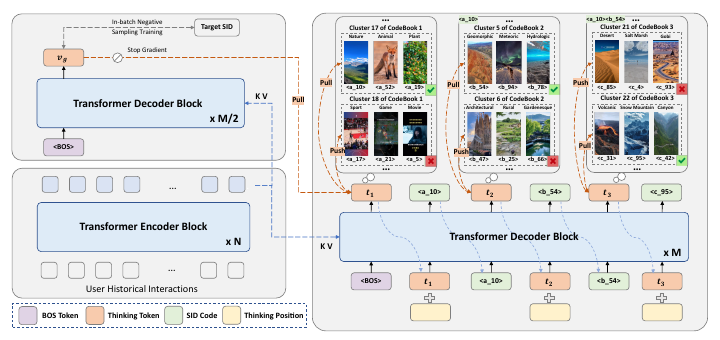

# S2GR

*Stepwise Semantic-Guided Reasoning in Latent Space for Generative Recommendation* — Guo et al. · KDD’26

`III. SID–Model Alignment` · `Backbone`

[Paper](https://arxiv.org/abs/2601.18664) · [Matrix](../../README.md#iii--backbone)

Reading level: Overview (Level 1) · On this page: [TL;DR](#tldr) · [At a Glance](#at-a-glance) · [2. How It Works](#2-how-it-works) · [3. Experimental Findings](#3-experimental-findings) · [5. Connections to Related Work](#5-connections-to-related-work)

| Representation | Tokenization | Backbone | Training | Inference |
| :-: | :-: | :-: | :-: | :-: |
| `Text+CF` | `CoBa RQ-VAE` | **`Enc-Dec`** | `Fixed / NTP + Ctr.` | `Beam` |

- `CoBa RQ-VAE`: Collaborative and Balanced RQ-VAE.
- `Enc-Dec`: Encoder-decoder.
- `Fixed`: SIDs are built first and not changed while the generator trains.
- `NTP + Ctr.`: NTP plus a contrastive loss.

### TL;DR

S2GR inserts a thinking token before each Semantic ID step, supervised contrastively with codebook cluster distributions, and builds the codebook with co-occurrence, load-balancing, and uniformity objectives.

### At a Glance

| Aspect | Summary |
| :-- | :-- |
| Research Problem | III. SID–Model Alignment: Can the generator read, write, and reason over SIDs, and do the tokenizer and generator work toward the same goal? |
| Key Contribution | S2GR inserts a thinking token before each Semantic ID step, supervised contrastively with codebook cluster distributions, and builds the codebook with co-occurrence, load-balancing, and uniformity objectives. |
| Modified Stage | Backbone |

### 2. How It Works

### 3. Experimental Findings

**Experimental setup**

- **Datasets**: Amazon Beauty (May 1996-September 2014; 22,363 users / 12,101 items / 198,502 interactions) and an industrial short-video dataset of long-play records from sampled active users over 2 consecutive days (37,500 users / 1,086,872 items / 3,778,562 interactions). Dataset filtering rules: not reported; a table footnote states that user sequences shorter than 10 are filtered out during testing.
  - Source: Datasets and statistics: https://arxiv.org/html/2601.18664v3#S5.SS1.SSS1.p1 and https://arxiv.org/html/2601.18664v3#S5.T1; test-time length filter: footnote 1 of https://arxiv.org/html/2601.18664v3#S5.T2.
- **Split**: not reported (the train/validation/test rule is not described). The co-occurrence graph for codebook optimization uses history sequences that precede those used for training and evaluation. Online: 7-day A/B test with 5.25% of users per group, TIGER as control.
  - Source: No split rule stated; leakage control for co-occurrence: https://arxiv.org/html/2601.18664v3#S5.SS1.SSS3.p1; online test: https://arxiv.org/html/2601.18664v3#S5.SS4.p1.
- **Candidates**: not reported (full catalog versus sampled evaluation candidates); HR and NDCG at 5 and 10 (Beauty) and at 10 and 100 (industrial).
  - Source: Metrics only: https://arxiv.org/html/2601.18664v3#S5.SS1.SSS1.p1.
- **Visibility**: warm; no unseen-item protocol is defined.
  - Source: No unseen-item protocol: https://arxiv.org/html/2601.18664v3#S5.SS1.SSS1.p1.
- **SID**: 3 levels x 256 codes from a codebook-balanced RQ-VAE (CoBa RQ-VAE) over Qwen3-Embedding-4B embeddings smoothed by multi-hop co-occurrence propagation; collision handling: not reported (independent coding rate 99.30% on Beauty, 76.25% industrial).
  - Source: 3 levels x 256, behavior-aligned embeddings and balanced RQ-VAE: https://arxiv.org/html/2601.18664v3#S5.SS1.SSS3.p1, https://arxiv.org/html/2601.18664v3#S4.SS2.SSS1.p3, https://arxiv.org/html/2601.18664v3#S4.SS2.SSS2.p1; utilization and ICR: https://arxiv.org/html/2601.18664v3#S5.T3.
- **Inference budget**: Thinking tokens are generated before each SID level; T5 with 4 encoder and 4 decoder layers (same as the TIGER baseline). Beam width, hardware, inference batch size, and latency: not reported.
  - Source: T5 4+4 layers matching TIGER: https://arxiv.org/html/2601.18664v3#S5.SS1.SSS3.p1; decoding settings not found.
- **Results from**: Table 2 (Beauty and industrial versus sequential, reasoning, and TIGER baselines); Table 3 (tokenizer CUR and ICR); Table 4 and Section 5.4 (7-day online A/B against TIGER).
  - Source: Main: https://arxiv.org/html/2601.18664v3#S5.T2; tokenizers: https://arxiv.org/html/2601.18664v3#S5.T3; online: https://arxiv.org/html/2601.18664v3#S5.SS4.p1.

## 旧卡片说明

迁自 `d61aa6c:papers/s2gr.md`。保留方法说明、实验叙述与局限；本轮只对照现有记录处理明确冲突，未重新逐句核查原论文。分类和规格以页面上方由记录生成的表格为准。

### S2GR：潜空间逐步语义引导推理

> S2GR 在生成 SID 的每一步注入语义引导信号，使模型在潜空间中逐步缩小推荐候选范围。

### 研究动机与问题定义

传统生成器通常只在最终 SID 上接受监督，缺乏对中间 token 决策的细粒度引导。S2GR 研究如何利用 SID 层次结构在生成过程中表达逐步推理。

### TL;DR（核心摘要）

`交互图与物品内容 → 协同平衡RQ-VAE → 逐步语义引导 → 生成SID → 推荐物品`

模型先构造物品共现图并学习兼顾协同关系和码本均衡的 RQ-VAE。生成时把逐步思考 token 插入 SID 序列，并用语义引导对齐监督中间状态；完整 SID 直接确定物品。

### 输入与使用场景

| 方面 | 说明 |
|---|---|
| 使用信息 | 用户交互、物品内容和物品共现图 |
| 信息融入位置 | RQ-VAE、生成中间状态和对齐目标 |
| 语义标识结构 | 层次化序列，交织推理 token |
| 适用场景 | 常规和工业生成式推荐 |

### 方法设计

#### 4.1 协同与均衡 RQ-VAE
S2GR 先根据物品共现构建协同图，并在 RQ-VAE 中加入码本均衡约束。量化器得到层次化 SID，同时减少 codeword 使用偏斜，为后续逐步推理提供稳定结构。

#### 4.2 逐步语义引导推理
模型把 thinking token 交织到 SID 生成过程中。每个 thinking token 对应一个层次或候选簇，生成器据此从粗粒度语义逐步缩小到细粒度 code；中间状态接受语义对齐监督。

#### 4.3 训练与部署
训练联合 next-item 生成、语义-行为对齐、码本均衡和逐步监督。推理时按层次顺序生成 thinking token 与 SID，最终完整标识直接映射到物品。论文还报告线上测试和不同规模分析。

### 实验结论

- 逐步语义引导提升了推荐效果。
- 协同平衡量化和中间状态监督均有贡献。
- 论文报告了工业线上测试结果。

### 局限性与研究定位

#### 局限性
- 交织推理 token 增加序列长度与服务成本。
- 工业线上收益的可复现细节有限。

#### 研究定位
S2GR 的贡献是把 SID 的层次结构转化为逐步推理信号，适合放在“潜空间推理与结构化生成”章节。

### 标签

`潜空间推理` · `语义引导` · `协同量化` · `生成式推荐`

### 架构图来源

*图源：原论文，图3。图片使用许可待核实。*

---

### 旧总表补充

来源：`d61aa6c:tables/all-methods.md`。

- 核心贡献：逐步语义引导潜空间推理。
- 使用场景：工业推荐。

### 5. Connections to Related Work

- **Competitor** · [TIGER](tiger.md): TIGER predicts SID codes directly; S2GR inserts thinking tokens aligned with coarse code semantics before each SID level and balances the codebook with behavior-aligned embeddings.
  - Source: S2GR v3, baselines: https://arxiv.org/html/2601.18664v3#S5.I1.i6.p1; Table 2: https://arxiv.org/html/2601.18664v3#S5.T2; online control group: https://arxiv.org/html/2601.18664v3#S5.SS4.p1.
- **Alternative** · [OneRec-Think](onerec-think.md): OneRec-Think reasons explicitly in text with an LLM; S2GR reasons implicitly through latent thinking tokens inside a small seq2seq model to meet latency limits.
  - Source: S2GR v3, Section 2.2 places OneRec-Think in the explicit-reasoning line: https://arxiv.org/html/2601.18664v3#S2.SS2.p2.
- **Alternative** · [PLUM](plum.md): PLUM feeds ID tokens to a pretrained LLM for explicit reasoning, whereas S2GR adds lightweight implicit reasoning steps.
  - Source: S2GR v3, Section 2.2: https://arxiv.org/html/2601.18664v3#S2.SS2.p2.

[View all papers in this cell](../../README.md#iii--backbone)
