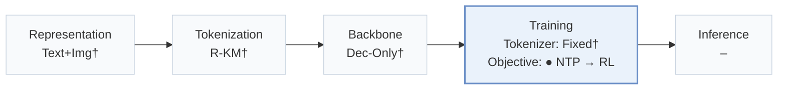
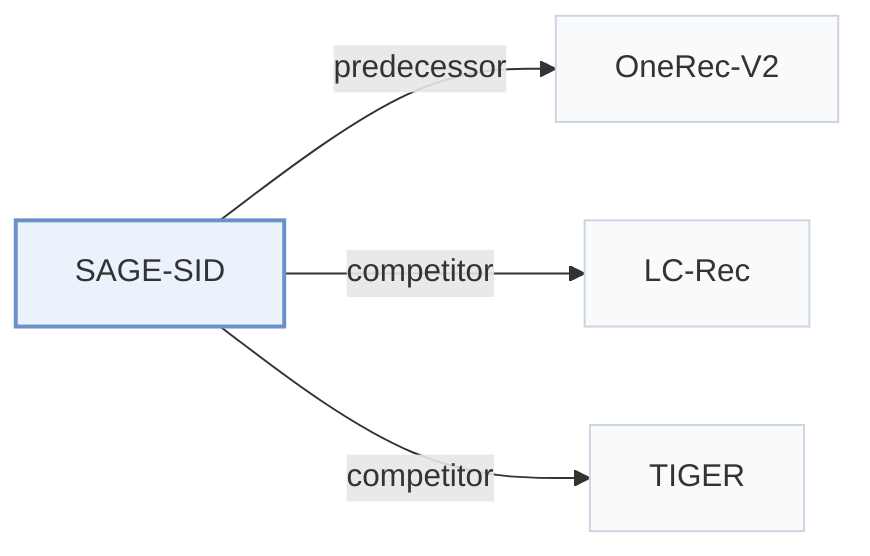

# SAGE-SID

[← Problem × Stage Matrix](../../README.md#iv--training) · [Papers by Stage](../index/stages.md) · [Papers by Modality](../index/modality.md) · [Papers by Domain](../index/domain.md) · English | [中文](../zh/papers/sage-sid.md)

| **Title** | *SAGE: Sequence-level Adaptive Gradient Evolution for Generative Recommendation* |
| :-- | :-- |
| **Authors** | Xie et al. |
| **Venue** | arXiv’26 |
| **Problem × Stage** | `IV. Utility` · `Training` |
| **Changes** | ● Objective |
| **SID inputs** | `Text` + `Img` |
| **Domain** | `E-commerce` · `Short video / Live` · `Ads` |
| **Links** | [Paper](https://arxiv.org/abs/2601.21452) |
| **Reading level** | Overview (Level 1) |

**On this page**: [TL;DR](#tldr) · [3. Experiments](#3-experimental-findings) · [5. Related Work](#5-connections-to-related-work)

- `Text+Img†`: Text and image representations (inferred).
- `R-KM†`: Residual k-means tokenization (inferred).
- `Dec-Only†`: Decoder-only autoregressive backbone (inferred).
- `Fixed†`: Tokenizer frozen before generator training (inferred).
- `NTP → RL`: NTP, then reinforcement learning (GRPO, GBPO, etc.).

### TL;DR

> [!NOTE]
> SAGE-SID optimizes list-wise generators with a geometric-mean sequence ratio, decoupled multi-objective advantages, asymmetric adaptive bounds, and an entropy-aware penalty, replacing the symmetric bounds of GBPO.

---

### 3. Experimental Findings

Experimental setup

- **Datasets**: Amazon Reviews 2014 Sports/Beauty/Toys; RecIF-Bench: about 120M interactions, 200K users, Short Video/Ad/Product. Filtering not reported.
  - Source: Section 4.1.1: [S4.SS1.SSS1.p1](https://arxiv.org/html/2601.21452v3#S4.SS1.SSS1.p1) and [S4.SS1.SSS1.p2](https://arxiv.org/html/2601.21452v3#S4.SS1.SSS1.p2)
- **Split**: RecIF: 20% users held out, per-user histories separated temporally from future targets. Amazon split and validation allocation not reported.
  - Source: Section 4.1.1: [S4.SS1.SSS1.p3](https://arxiv.org/html/2601.21452v3#S4.SS1.SSS1.p3)
- **Candidates**: not reported for the SID branch
  - Source: Section 4.1.4 identifies inherited SID evaluation settings but does not specify candidate enumeration: [S4.SS1.SSS4.p3](https://arxiv.org/html/2601.21452v3#S4.SS1.SSS4.p3)
- **Visibility**: warm; no unseen-item protocol is defined. Amazon cold items are bottom 5% by training interaction frequency; RecIF holds out users, not explicitly items.
  - Source: Sections 4.1.1/4.1.3: [S4.SS1.SSS1.p3](https://arxiv.org/html/2601.21452v3#S4.SS1.SSS1.p3) and [S4.SS1.SSS3.p1](https://arxiv.org/html/2601.21452v3#S4.SS1.SSS3.p1)
- **SID**: OneRec-SAGE uses Semantic IDs and OpenOneRec checkpoints/settings; SID length, codebook sizes and collision handling not reported here.
  - Source: Sections 4.1.2/4.1.4: [S4.SS1.SSS2.p4](https://arxiv.org/html/2601.21452v3#S4.SS1.SSS2.p4) and [S4.SS1.SSS4.p3](https://arxiv.org/html/2601.21452v3#S4.SS1.SSS4.p3)
- **Inference budget**: Reported slate length 10; Amazon Recall/NDCG@5/10; RecIF Pass/Recall@1/32 and label AUC. SID beam width, inference hardware, batch size and latency not reported.
  - Source: Sections 4.1.3/4.1.4: [S4.SS1.SSS3.p1](https://arxiv.org/html/2601.21452v3#S4.SS1.SSS3.p1) and [S4.SS1.SSS3.p2](https://arxiv.org/html/2601.21452v3#S4.SS1.SSS3.p2) and [S4.SS1.SSS4.p1](https://arxiv.org/html/2601.21452v3#S4.SS1.SSS4.p1) and [S4.SS1.SSS4.p3](https://arxiv.org/html/2601.21452v3#S4.SS1.SSS4.p3)
- **Results from**: OneRec-SAGE rows in Tables 1/2 (Amazon) and 3/4 (RecIF). RecIF task-specific sequential and TIGER baseline numbers are reused from the benchmark; OneRec variants use public checkpoints/settings.
  - Source: Tables 1-4 and Section 4.1.4: [S3.T1](https://arxiv.org/html/2601.21452v3#S3.T1) and [S3.T2](https://arxiv.org/html/2601.21452v3#S3.T2) and [S3.T3](https://arxiv.org/html/2601.21452v3#S3.T3) and [S4.T4](https://arxiv.org/html/2601.21452v3#S4.T4) and [S4.SS1.SSS4.p3](https://arxiv.org/html/2601.21452v3#S4.SS1.SSS4.p3)

---

### 5. Connections to Related Work

- **Predecessor** · [OneRec-V2](onerec-v2.md): SAGE extends the GBPO optimizer evaluated as OneRec-GBPO.
  - Source: SAGE v3, Sections 3.4.1/4.1.2: [S3.SS4.SSS1.p1](https://arxiv.org/html/2601.21452v3#S3.SS4.SSS1.p1); [S4.SS1.SSS2.p4](https://arxiv.org/html/2601.21452v3#S4.SS1.SSS2.p4).
- **Competitor** · [LC-Rec](lc-rec.md): Adapted to a Qwen3-8B backbone for the RecIF comparison.
  - Source: SAGE v3, Section 4.1.2: [S4.SS1.SSS2.p3](https://arxiv.org/html/2601.21452v3#S4.SS1.SSS2.p3).
- **Competitor** · [TIGER](tiger.md): RecIF comparison reuses TIGER's reported benchmark numbers.
  - Source: SAGE v3, Section 4.1.4: [S4.SS1.SSS4.p3](https://arxiv.org/html/2601.21452v3#S4.SS1.SSS4.p3).

[View all papers in this cell](../../README.md#iv--training)
