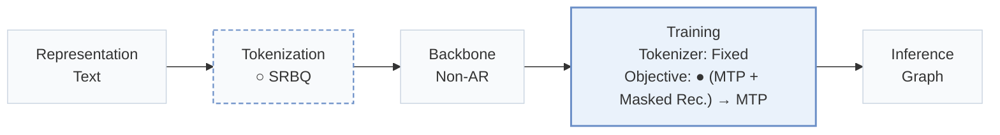
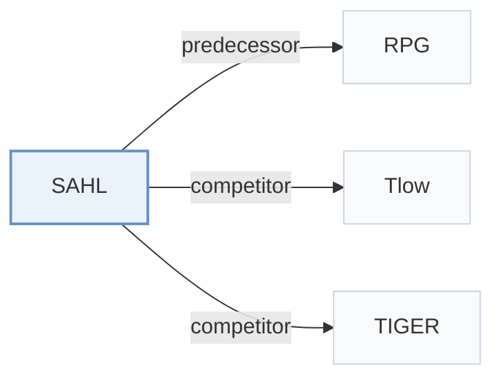

# SAHL

[← Problem × Stage Matrix](../../README.md#iv--training) · [Papers by Stage](../index/stages.md) · [Papers by Modality](../index/modality.md) · [Papers by Domain](../index/domain.md) · English | [中文](../zh/papers/sahl.md)

| **Title** | *Structure-Aligned History Learning with Subspace-Structured Semantic IDs for Generative Recommendation* |
| :-- | :-- |
| **Authors** | Wei et al. |
| **Venue** | arXiv’26 |
| **Problem × Stage** | `IV. Utility` · `Training` |
| **Changes** | ○ Tokenization · ● Objective |
| **SID inputs** | `Text` |
| **Domain** | `E-commerce` |
| **Links** | [Paper](https://arxiv.org/abs/2610.25093) · [Code](https://github.com/CQU-MM-Intelligent-Lab/SAHL) |
| **Reading level** | Overview (Level 1) |

**On this page**: [TL;DR](#tldr) · [3. Experiments](#3-experimental-findings) · [5. Related Work](#5-connections-to-related-work)

- `Text`: Textual item metadata (titles, descriptions, categories, or prompts).
- `SRBQ`: Semantic Residual Balanced Quantization
- `Non-AR`: Non-autoregressive.
- `Fixed`: SIDs are built first and not changed while the generator trains.
- `(MTP + Masked Rec.) → MTP`: Joint multi-token prediction and masked reconstruction, followed by multi-token prediction alone.
- `Graph`: Iterative decoding over a proximity graph of valid item Semantic IDs.

### TL;DR

> [!NOTE]
> SAHL quantizes items with SRBQ into a balanced token-subspace-item hierarchy and reconstructs user history at those granularities, moving by curriculum to next-item prediction, instead of next-item prediction alone.

---

### 3. Experimental Findings

Experimental setup

- **Datasets**: Amazon Reviews 2014 Beauty, Toys and Games, Sports and Outdoors, CDs and Vinyl, in this order; user/item 5-core.
  - Source: Section 5.1: [S5.SS1.p1](https://arxiv.org/html/2610.25093v1#S5.SS1.p1)
- **Split**: Per-user chronological leave-one-out: last interaction test, penultimate validation, earlier interactions train.
  - Source: Section 5.2: [S5.SS2.p1](https://arxiv.org/html/2610.25093v1#S5.SS2.p1)
- **Candidates**: not reported
  - Source: Sections 5.2/5.4 specify graph-constrained decoding but not full-catalog versus sampled-negative evaluation: [S5.SS2](https://arxiv.org/html/2610.25093v1#S5.SS2) and [S5.SS4.p2](https://arxiv.org/html/2610.25093v1#S5.SS4.p2)
- **Visibility**: warm; no unseen-item protocol is defined. Low-frequency analysis is explicitly near-cold, not zero-interaction.
  - Source: Section 6.11.4: [S6.SS11.SSS4.p1](https://arxiv.org/html/2610.25093v1#S6.SS11.SSS4.p1)
- **SID**: SRBQ: 4/8/8/16 subspaces x 4 residual levels x 256 codes, producing 16/32/32/64 tokens in dataset order. Colliding items remain separate, equal-scored candidates; fixed catalog indices break ties.
  - Source: Sections 4.2.2/5.4: [S4.SS2.SSS2.p1](https://arxiv.org/html/2610.25093v1#S4.SS2.SSS2.p1) and [S5.SS4.p1](https://arxiv.org/html/2610.25093v1#S5.SS4.p1) and [S5.SS4.p2](https://arxiv.org/html/2610.25093v1#S5.SS4.p2)
- **Inference budget**: Dataset order: beam 100/200/100/50, graph neighbors 100/100/200/500, propagation depths 3/5/2/4; temperature 0.03; Recall/NDCG@5/10. Inference hardware, batch size and latency not reported; A6000 timings concern training.
  - Source: Section 5.4 and Section 6.11.2: [S5.SS4.p1](https://arxiv.org/html/2610.25093v1#S5.SS4.p1) and [S6.SS11.SSS2.p1](https://arxiv.org/html/2610.25093v1#S6.SS11.SSS2.p1) and [S6.SS11.SSS2.p3](https://arxiv.org/html/2610.25093v1#S6.SS11.SSS2.p3)
- **Results from**: Table 2: overall comparison. RPG*, MHL and SAHL use matched controlled experiments; Tlow follows its published matched protocol. Other baseline score provenance not reported.
  - Source: Sections 5.3/6.1 and Table 2: [S5.SS3.p2](https://arxiv.org/html/2610.25093v1#S5.SS3.p2) and [S6.SS1.p1](https://arxiv.org/html/2610.25093v1#S6.SS1.p1) and [S5.T2](https://arxiv.org/html/2610.25093v1#S5.T2)

---

### 5. Connections to Related Work

- **Predecessor** · [RPG](rpg.md): Supplies the parallel backbone and graph-constrained decoder retained by SAHL.
  - Source: SAHL v1, Sections 5.3/6.11.2: [S5.SS3.p2](https://arxiv.org/html/2610.25093v1#S5.SS3.p2); [S6.SS11.SSS2.p3](https://arxiv.org/html/2610.25093v1#S6.SS11.SSS2.p3).
- **Competitor** · [Tlow](tlow.md): Tokenizer-oriented comparator; its scores follow the published matched protocol.
  - Source: SAHL v1, Section 5.3 and Table 2: [S5.SS3.p2](https://arxiv.org/html/2610.25093v1#S5.SS3.p2); [S5.T2](https://arxiv.org/html/2610.25093v1#S5.T2).
- **Competitor** · [TIGER](tiger.md): Included semantic-ID baseline; SAHL adds quantizer-aligned history reconstruction.
  - Source: SAHL v1, Section 5.3 and Table 2: [S5.SS3.p1](https://arxiv.org/html/2610.25093v1#S5.SS3.p1); [S5.T2](https://arxiv.org/html/2610.25093v1#S5.T2).

[View all papers in this cell](../../README.md#iv--training)
