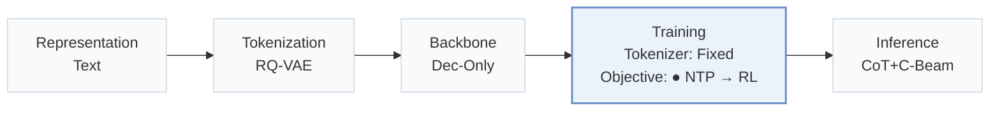
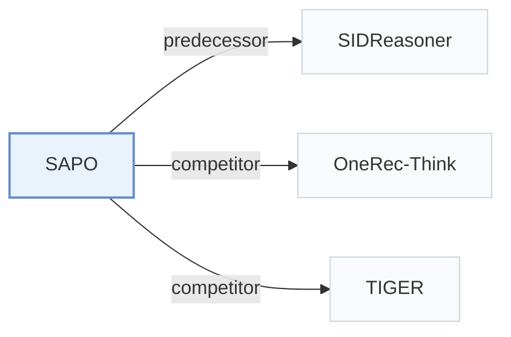

# SAPO

[← Problem × Stage Matrix](../../README.md#iv--training) · [Papers by Stage](../index/stages.md) · [Papers by Modality](../index/modality.md) · [Papers by Domain](../index/domain.md) · English | [中文](../zh/papers/sapo.md)

| **Title** | *Step-Aligned Policy Optimization for Reasoning-Based Generative Recommendation* |
| :-- | :-- |
| **Authors** | Zheng et al. |
| **Venue** | arXiv’26 |
| **Problem × Stage** | `IV. Utility` · `Training` |
| **Changes** | ● Objective |
| **SID inputs** | `Text` |
| **Domain** | `E-commerce` |
| **Scenario** | `General Item Recommendation`; `Public Benchmarks` |
| **Links** | [Paper](https://arxiv.org/abs/2605.17648) · [Code](https://github.com/zhengzaiyi/SAPO) |
| **Reading level** | Overview (Level 1) |

**On this page**: [TL;DR](#tldr) · [3. Experiments](#3-experimental-findings) · [5. Related Work](#5-connections-to-related-work)

- `Text`: Textual item metadata (titles, descriptions, categories, or prompts).
- `RQ-VAE`: Residual-Quantized Variational AutoEncoder.
- `Dec-Only`: Decoder-only.
- `Fixed`: SIDs are built first and not changed while the generator trains.
- `NTP → RL`: NTP, then reinforcement learning (GRPO, GBPO, etc.).
- `CoT+C-Beam`: Reasoning followed by constrained beam-search decoding.

### TL;DR

> [!NOTE]
> SAPO computes a separate group-relative advantage for each reasoning step, one thinking block plus one Semantic ID token, instead of broadcasting one exact-match advantage to the whole response.

---

### 3. Experimental Findings

Experimental setup

- **Datasets**: Amazon Reviews Office Products, Video Games, Industrial & Scientific; October 2016-November 2018; 5-core users/items. Further history truncation not reported.
  - Source: [S5.SS1.p1](https://arxiv.org/html/2605.17648v1#S5.SS1.p1) ; #A8.p1
- **Split**: Per-user chronological leave-one-out: last item test, second last validation, remaining prefix training; all valid sliding-window history/target pairs used for training.
  - Source: [A8.p1](https://arxiv.org/html/2605.17648v1#A8.p1)
- **Candidates**: not reported
  - Source: [S5.SS1](https://arxiv.org/html/2605.17648v1#S5.SS1) ; #S5.SS2.p1 ; #A8
- **Visibility**: warm; no unseen-item protocol is defined. Tokenizer fitting exposure to test items not explicitly separated.
  - Source: [A8.p1](https://arxiv.org/html/2605.17648v1#A8.p1) ; #A8.p3
- **SID**: RQ-VAE: 3 x 256 over title/category/brand/description embeddings. Paper reports training until every item has a unique tuple, with no extra collision suffix; a separate collision-assignment rule is not reported.
  - Source: [A8.p3](https://arxiv.org/html/2605.17648v1#A8.p3)
- **Inference budget**: Qwen3-1.7B generates three thinking blocks followed by three contiguous SID tokens, enabling trie-constrained beam decoding and KV reuse; Recall/NDCG@5/10. Test beam width, reasoning cap, hardware allocation, batch size and latency not reported. The 16 rollouts/prompt, 1024-token cap and 4 H100s are training settings.
  - Source: [A6.p2](https://arxiv.org/html/2605.17648v1#A6.p2) ; #A9.SS2.p1 ; #A10.p1 ; #A11.p2
- **Results from**: Original Table 1: main comparison; SIDReasoner uses author checkpoints evaluated by this paper, all other baselines reimplemented. Table 2: SAPO component ablations; Table 7: training overhead, not inference latency.
  - Source: [S5.T1](https://arxiv.org/html/2605.17648v1#S5.T1) ; #S5.T2 ; #S5.SS1.p2 ; #A12.T7

---

### 5. Connections to Related Work

- **Predecessor** · [SIDReasoner](sidreasoner.md): SAPO shares SIDReasoner Stage 1/2 checkpoints but replaces rollout-level Stage 3 credit with rewards and advantages for thinking-block/SID-token pairs.
  - Source: SAPO v1, Appendix G and Section 5.2: [A7.p3](https://arxiv.org/html/2605.17648v1#A7.p3); [S5.SS2.p2](https://arxiv.org/html/2605.17648v1#S5.SS2.p2).
- **Competitor** · [OneRec-Think](onerec-think.md): OneRec-Think is a reasoning-based generative baseline with outcome-level feedback; SAPO localizes RL credit to individual SID reasoning steps.
  - Source: SAPO v1, Appendix G and Table 1: [A7.p3](https://arxiv.org/html/2605.17648v1#A7.p3); [S5.T1](https://arxiv.org/html/2605.17648v1#S5.T1).
- **Competitor** · [TIGER](tiger.md): TIGER is the non-reasoning residual-SID generation baseline; SAPO adds structured reasoning and step-aligned policy optimization.
  - Source: SAPO v1, Appendix G and Table 1: [A7.p2](https://arxiv.org/html/2605.17648v1#A7.p2); [S5.T1](https://arxiv.org/html/2605.17648v1#S5.T1).

[View all papers in this cell](../../README.md#iv--training)
