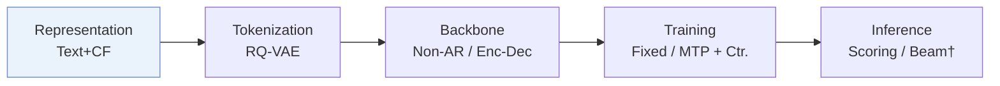
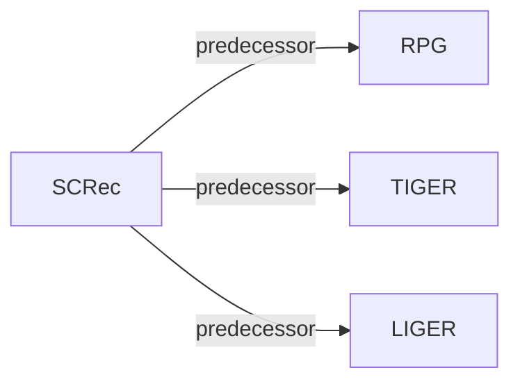

# SCRec

*Addressing Cross-Stage Decoupling of Semantic and Collaborative Signals in Generative Recommendation* — Dan · RecSys’26

`I. Informativeness` · `Representation` · [Paper](https://arxiv.org/abs/2609.13678) · [Code](https://github.com/DanJiayi/SCRec) · [Matrix](../../README.md#i--representation) · [中文](../zh/papers/screc.md)

Reading level: Overview (Level 1) · On this page: [TL;DR](#tldr) · [At a Glance](#at-a-glance) · [3. Experiments](#3-experimental-findings) · [5. Related Work](#5-connections-to-related-work)

- `Non-AR / Enc-Dec`: Non-autoregressive and encoder–decoder backbone variants.
- `Fixed`: SIDs are built first and not changed while the generator trains.
- `MTP + Ctr.`: MTP plus a contrastive loss.
- `Scoring / Beam†`: Discriminative candidate scoring vs. generative beam search.

### TL;DR

> [!NOTE]
> SCRec injects textualized collaborative signals into semantic tokenization, recalibrates semantic priors with learnable code embeddings during generation, and aligns codebook and semantic spaces, to couple the two stages.

### At a Glance

| Aspect | Summary |
| :-- | :-- |
| Research Problem | I. Informativeness: Do the SIDs, or the model reading them, carry the collaborative and multimodal signals recommendation needs? |
| Key Contribution | SCRec injects textualized collaborative signals into semantic tokenization, recalibrates semantic priors with learnable code embeddings during generation, and aligns codebook and semantic spaces, to couple the two stages. |
| Modified Stage | Representation |

### 3. Experimental Findings

Experimental setup

- **Datasets**: Amazon Reviews Beauty, Sports and Outdoors, Toys and Games. Filtering and maximum history length not reported directly; preprocessing settings delegated to RPG.
  - Source: [S4.SS1.p1](https://arxiv.org/html/2609.13678v1#S4.SS1.p1) ; #S4.SS1.p5
- **Split**: Per-user chronological leave-last-out: final interaction test, penultimate validation, remaining interactions training; shared across baselines.
  - Source: [S4.SS1.p1](https://arxiv.org/html/2609.13678v1#S4.SS1.p1)
- **Candidates**: not reported; evaluation configurations are delegated to RPG without specifying the candidate universe or negative sampling.
  - Source: [S4.SS1.p4](https://arxiv.org/html/2609.13678v1#S4.SS1.p4) ; #S4.SS1.p5
- **Visibility**: warm; no unseen-item protocol is defined. SASRec for top-10 collaborative neighbors is pretrained on training data; tokenizer fitting exposure to test items not reported.
  - Source: [S4.SS1.p1](https://arxiv.org/html/2609.13678v1#S4.SS1.p1) ; #S4.SS1.p5
- **SID**: RQ-VAE with 256 entries/codebook and latent dimension 256, quantizing fused item-text and textualized-neighbor embeddings. Semantic level count and collision handling not reported.
  - Source: [S3.SS1.p9](https://arxiv.org/html/2609.13678v1#S3.SS1.p9) ; #S4.SS1.p5
- **Inference budget**: Main decoder-only backbone follows RPG, with TIGER/LIGER module variants. Exact main inference procedure, prediction-head structure and beam width not reported; Recall/NDCG@5/10. General experiment GPU: one RTX 4090; inference batch size and absolute latency not reported. Beauty module inference-time increases: TIGER 6.19%, LIGER 0.54%, averaged over ten runs.
  - Source: [S3.SS2.p5](https://arxiv.org/html/2609.13678v1#S3.SS2.p5) ; #S4.SS1.p4 ; #S4.SS1.p5 ; #S4.SS5.p1 ; #S4.SS5.p2
- **Results from**: Original Table 1: main comparison; baselines including RPG rerun in the same environment, TIGER/LIGER evaluated through the same LIGER codebase. Table 2: ablations; Table 3: backbone extensions; Tables 4-5: alternative fusion/alignment. No imported baseline results stated.
  - Source: [S4.T1](https://arxiv.org/html/2609.13678v1#S4.T1) ; #S4.T2 ; #S4.T3 ; #S4.T4 ; #S4.T5 ; #S4.SS1.p5

### 5. Connections to Related Work

- **Predecessor** · [RPG](rpg.md): SCRec adopts a decoder-only backbone following RPG but replaces tokenization with collaborative-enhanced RQ-VAE and adds semantic/manifold alignment modules.
  - Source: SCRec v1, Sections 3.1/4.1: https://arxiv.org/html/2609.13678v1#S3.SS1.p9; https://arxiv.org/html/2609.13678v1#S4.SS1.p5.
- **Predecessor** · [TIGER](tiger.md): SCRec is also added to TIGER as a reusable module, improving collaborative input to tokenization and semantic guidance during generation.
  - Source: SCRec v1, Section 4.5 and Table 3: https://arxiv.org/html/2609.13678v1#S4.SS5.p1; https://arxiv.org/html/2609.13678v1#S4.T3.
- **Predecessor** · [LIGER](liger.md): SCRec augments the hybrid LIGER backbone with the same reusable cross-stage supplementation module and measures its inference overhead.
  - Source: SCRec v1, Section 4.5 and Table 3: https://arxiv.org/html/2609.13678v1#S4.SS5.p1; https://arxiv.org/html/2609.13678v1#S4.SS5.p2; https://arxiv.org/html/2609.13678v1#S4.T3.

[View all papers in this cell](../../README.md#i--representation)
