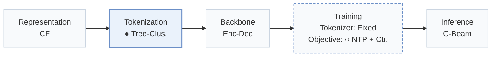
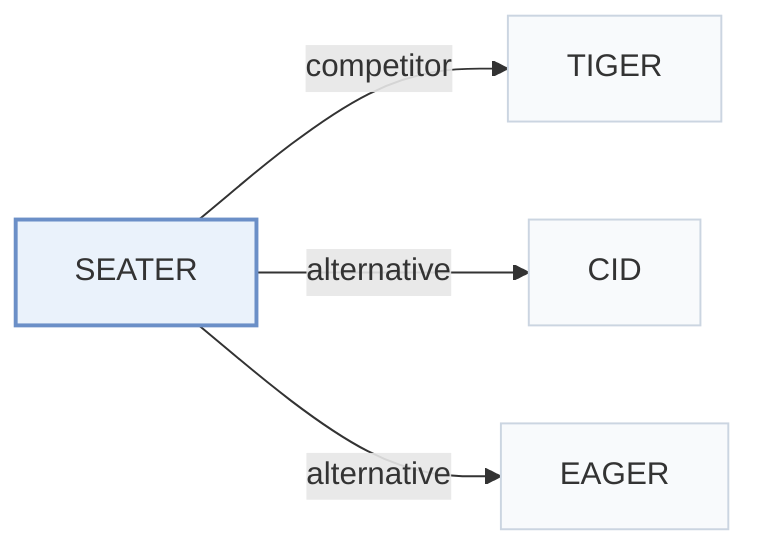

# SEATER

[← Problem × Stage Matrix](../../README.md#v--tokenization) · [Papers by Stage](../index/stages.md) · [Papers by Modality](../index/modality.md) · [Papers by Domain](../index/domain.md) · English | [中文](../zh/papers/seater.md)

| **Title** | *Generative retrieval with semantic tree-structured identifiers and contrastive learning* |
| :-- | :-- |
| **Authors** | Si et al. |
| **Venue** | SIGIR-AP’24 |
| **Problem × Stage** | `V. Efficiency` · `Tokenization` |
| **Changes** | ● Tokenization · ○ Objective |
| **SID inputs** | `CF` |
| **Domain** | `POI / Local` · `E-commerce` · `News` · `Short video / Live` |
| **Scenario** | `General Item Recommendation`; `Industrial Data, Offline` |
| **Links** | [Paper](https://arxiv.org/abs/2309.13375) · [Code](https://github.com/Ethan00Si/SEATER_Generative_Retrieval) |
| **Reading level** | Overview (Level 1) |

**On this page**: [TL;DR](#tldr) · [3. Experiments](#3-experimental-findings) · [5. Related Work](#5-connections-to-related-work)

- `CF`: Collaborative filtering signal.
- `Tree-Clus.`: Balanced k-ary tree clustering tokenization.
- `Enc-Dec`: Encoder-decoder.
- `Fixed`: SIDs are built first and not changed while the generator trains.
- `NTP + Ctr.`: NTP plus a contrastive loss.
- `C-Beam`: Constrained beam search.

### TL;DR

> [!NOTE]
> SEATER builds item identifiers on a balanced k-ary tree and trains an encoder-decoder with generation, infoNCE, and triplet losses, to learn token hierarchy with equal inference cost for all items.

---

### 3. Experimental Findings

Experimental setup

- **Datasets**: Yelp 2018 (31,668 users / 38,048 items), Amazon Books (459,133 / 313,966), MIND-small News (50,000 / 39,865), and an industrial Micro-Video dataset of 0.75 million randomly selected users over two weeks in 2023 (6.1 million items, 85 million interactions, unfiltered). Public-dataset filtering: not reported.
  - Source: Datasets: [S5.SS1.SSS1.p1](https://arxiv.org/html/2309.13375v2#S5.SS1.SSS1.p1) and [S5.SS1.SSS1.p2](https://arxiv.org/html/2309.13375v2#S5.SS1.SSS1.p2); statistics: [S5.T2](https://arxiv.org/html/2309.13375v2#S5.T2).
- **Split**: Users are partitioned 8:1:1 into training, validation, and test; for each evaluated user the first 80% of behaviors are context and the remaining 20% are ground truth (ComiRec protocol).
  - Source: User-level 8:1:1 split with 80/20 context/target: [S5.SS1.SSS2.p1](https://arxiv.org/html/2309.13375v2#S5.SS1.SSS2.p1).
- **Candidates**: full catalog (top-n items from the entire candidate set via constrained beam search); NDCG uses all positive items for the ideal DCG.
  - Source: Top-n from the entire candidate set: [S3.SS4.p1](https://arxiv.org/html/2309.13375v2#S3.SS4.p1); NDCG computed against all positives: [S5.SS1.SSS2.p2](https://arxiv.org/html/2309.13375v2#S5.SS1.SSS2.p2).
- **Visibility**: warm; no unseen-item protocol is defined. Test users are held out from training (user-level split); the SASRec embeddings used to build identifiers are trained on interaction data whose user split is not restated.
  - Source: Test users disjoint from training users; items shared: [S5.SS1.SSS2.p1](https://arxiv.org/html/2309.13375v2#S5.SS1.SSS2.p1).
- **SID**: Balanced k-ary tree identifiers from recursive constrained k-means over trained SASRec item embeddings; leaf-layer tokens correspond one-to-one with items and share the item's embedding. The branch count k is searched over 2, 4, 8, 16, and 32, and the paper states that k is set to 8 or 16 in the experiments; the value per dataset: not reported.
  - Source: Balanced k-ary tree from constrained k-means over SASRec embeddings; [algorithm1.6](https://arxiv.org/html/2309.13375v2#algorithm1.6); leaf tokens one-to-one with items: [S3.SS2.SSS2.p3](https://arxiv.org/html/2309.13375v2#S3.SS2.SSS2.p3); k search range: [S5.SS1.SSS3.p4](https://arxiv.org/html/2309.13375v2#S5.SS1.SSS3.p4); k set to 8 or 16: [S4.SS2.p2](https://arxiv.org/html/2309.13375v2#S4.SS2.p2).
- **Inference budget**: Constrained beam search over the prefix tree with beam size 50 (also for TDM and RecForest); Table 1 gives asymptotic inference cost. Main SEATER uses a single encoder-decoder layer. Hardware, inference batch size, and latency: not reported.
  - Source: Beam size 50 for tree-based and generative methods: [S5.SS1.SSS3.p4](https://arxiv.org/html/2309.13375v2#S5.SS1.SSS3.p4); complexity: [S3.T1](https://arxiv.org/html/2309.13375v2#S3.T1).
- **Results from**: Table 3 (Yelp, News, Books, Micro-Video versus dual-encoder, tree-based, and generative baselines including GPTRec and TIGER); Table 1 (time and space complexity); Section 5.5 (more encoder-decoder layers).
  - Source: Main: [S5.T3](https://arxiv.org/html/2309.13375v2#S5.T3); complexity: [S3.T1](https://arxiv.org/html/2309.13375v2#S3.T1).

---

### 5. Connections to Related Work

- **Competitor** · [TIGER](tiger.md): TIGER builds identifiers by RQ-VAE over text embeddings; SEATER builds balanced tree identifiers from collaborative SASRec embeddings and adds alignment and ranking losses over the tree.
  - Source: SEATER v2, Section 4.1 related work: [S4.SS1.p2](https://arxiv.org/html/2309.13375v2#S4.SS1.p2); Table 3 generative baseline: [S5.T3](https://arxiv.org/html/2309.13375v2#S5.T3).
- **Alternative** · [CID](cid.md): P5 with collaborative indexing uses spectral clustering of interactions for IDs; SEATER uses a balanced k-ary tree from constrained k-means.
  - Source: SEATER v2, Section 4.1 cites Hua et al. (2023b): [S4.SS1.p2](https://arxiv.org/html/2309.13375v2#S4.SS1.p2).
- **Alternative** · [EAGER](eager.md): EAGER, a later paper that cites SEATER among generative recommenders, builds two tree-structured codes (behavior and semantic) with hierarchical k-means instead of one collaborative tree.
  - Source: Evidence is from the later EAGER paper, Section 1: [S1.p2](https://arxiv.org/html/2406.14017v2#S1.p2).

[View all papers in this cell](../../README.md#v--tokenization)
