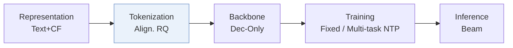
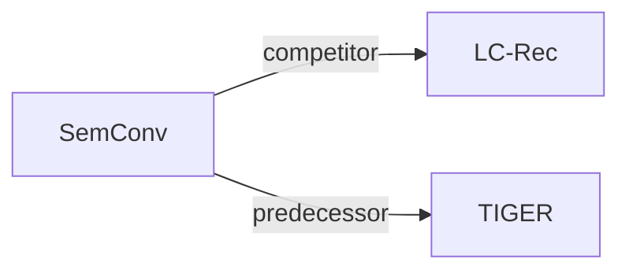

# SemConv

*Semantic Convergence: Harmonizing Recommender Systems via Two-Stage Alignment and Behavioral Semantic Tokenization* — Li et al. · AAAI’25

`III. SID–Model Alignment` · `Tokenization` · [Paper](https://arxiv.org/abs/2412.13771) · [Matrix](../../README.md#iii--tokenization) · [中文](../zh/papers/semconv.md)

Reading level: Overview (Level 1) · On this page: [TL;DR](#tldr) · [At a Glance](#at-a-glance) · [3. Experiments](#3-experimental-findings) · [5. Related Work](#5-connections-to-related-work)

- `Align. RQ`: Residual quantization trained with alignment objectives.
- `Dec-Only`: Decoder-only.
- `Fixed`: SIDs are built first and not changed while the generator trains.
- `Multi-task NTP`: The same NTP loss over several tasks.

### TL;DR

> [!NOTE]

> SemConv converts item IDs into token sequences aligned with the LLM space through Alignment Tokenization, adds tasks linking collaborative signals and language, and pre-caches top-K results for serving.

### At a Glance

| Aspect | Summary |
| :-- | :-- |
| Research Problem | III. SID–Model Alignment: Can the generator read, write, and reason over SIDs, and do the tokenizer and generator work toward the same goal? |
| Key Contribution | SemConv converts item IDs into token sequences aligned with the LLM space through Alignment Tokenization, adds tasks linking collaborative signals and language, and pre-caches top-K results for serving. |
| Modified Stage | Tokenization |

### 3. Experimental Findings

Experimental setup

- **Datasets**: Amazon Games, Arts and Instruments; history cap 20; exclude samples whose concatenated prompt exceeds 2048 tokens. Other filtering: not reported.
  - Source: Experiment Setup, Datasets: [Sx4.SSx1.SSSx1.p1](https://arxiv.org/html/2412.13771v1#Sx4.SSx1.SSSx1.p1)
- **Split**: Evaluation uses each user's last interaction as target and preceding interactions as context. First S-1 actions form training examples; exact validation allocation: not reported.
  - Source: Experiment Setup, Baselines: [Sx4.SSx1.SSSx2.p2](https://arxiv.org/html/2412.13771v1#Sx4.SSx1.SSSx2.p2)
- **Candidates**: not reported
  - Source: Experiment Setup does not specify evaluation candidate sampling; negative sampling in Alignment Task is training: [Sx4.SSx1](https://arxiv.org/html/2412.13771v1#Sx4.SSx1) and [Sx3.SSx2.p4](https://arxiv.org/html/2412.13771v1#Sx3.SSx2.p4)
- **Visibility**: warm; no unseen-item protocol is defined. DCCF embedding exposure to test items/interactions: not reported.
  - Source: Experiment Setup and Alignment Tokenization: [Sx4.SSx1](https://arxiv.org/html/2412.13771v1#Sx4.SSx1) and [Sx3.SSx1.p3](https://arxiv.org/html/2412.13771v1#Sx3.SSx1.p3)
- **SID**: Aligned residual codebooks: 4 levels x 256 codes; Games reports 0% collisions at four levels. Explicit collision handling: not reported.
  - Source: Alignment Tokenization and Table 5: [Sx3.SSx1.p10](https://arxiv.org/html/2412.13771v1#Sx3.SSx1.p10) and [Sx4.T5](https://arxiv.org/html/2412.13771v1#Sx4.T5)
- **Inference budget**: Beam-generated valid item codes are cached per user; online serving reads cache. HR/NDCG@1/5/10. Beam width, cache K, hardware, inference batch, numerical latency: not reported.
  - Source: Inference and Metrics: [Sx3.SSx3.p1](https://arxiv.org/html/2412.13771v1#Sx3.SSx3.p1) and [Sx4.SSx1.SSSx3.p1](https://arxiv.org/html/2412.13771v1#Sx4.SSx1.SSSx3.p1)
- **Results from**: Reported Table 1 main comparison and Tables 3-8 Games ablations. P5 uses the cited external implementation; other baseline borrowed-versus-rerun provenance: not reported.
  - Source: Tables 1/3-8: [Sx3.T1](https://arxiv.org/html/2412.13771v1#Sx3.T1) and [Sx4.T3](https://arxiv.org/html/2412.13771v1#Sx4.T3) and [Sx4.T8](https://arxiv.org/html/2412.13771v1#Sx4.T8) and [Sx4.SSx1.SSSx2.p1](https://arxiv.org/html/2412.13771v1#Sx4.SSx1.SSSx2.p1)

### 5. Connections to Related Work

- **同期对比** · [LC-Rec](lc-rec.md): LC-Rec supplies the alignment-task/inference template and is the strongest evaluated baseline.
  - Source: SemConv v1, Alignment Task, Inference and Table1: https://arxiv.org/html/2412.13771v1#Sx3.SSx2.p1; https://arxiv.org/html/2412.13771v1#Sx3.SSx3.p1; https://arxiv.org/html/2412.13771v1#Sx3.T1.
- **前序工作** · [TIGER](tiger.md): SemConv draws on TIGER's residual codebooks while removing autoencoder reconstruction.
  - Source: SemConv v1, Alignment Tokenization: https://arxiv.org/html/2412.13771v1#Sx3.SSx1.p2; https://arxiv.org/html/2412.13771v1#Sx3.SSx1.p11.

[查看同格全部论文](../../README.md#iii--tokenization)
