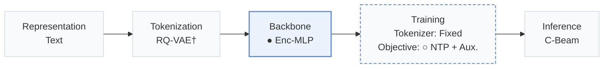
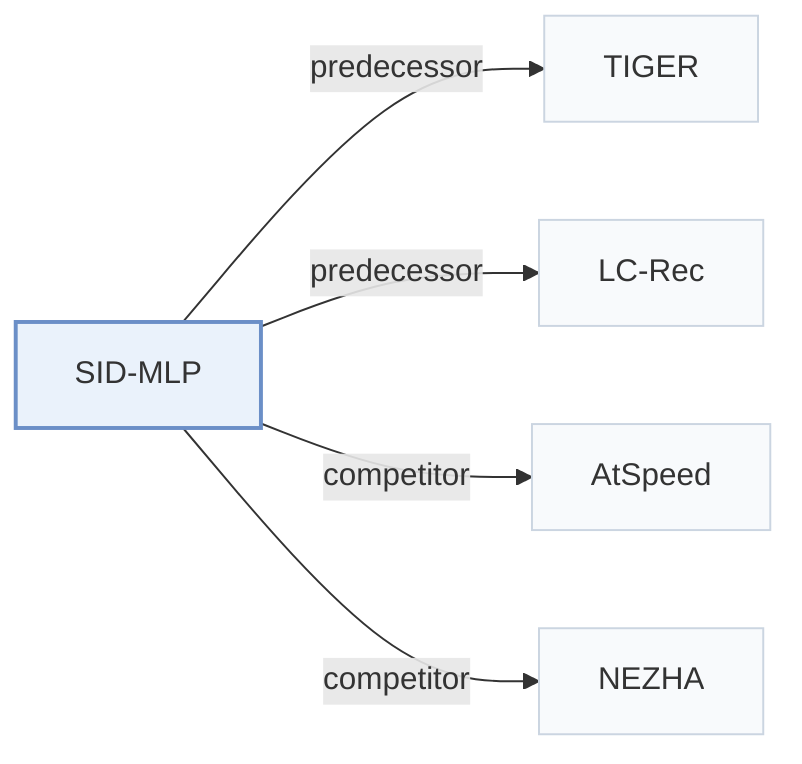

# SID-MLP

[← Problem × Stage Matrix](../../README.md#v--backbone) · [Papers by Stage](../index/stages.md) · [Papers by Modality](../index/modality.md) · [Papers by Domain](../index/domain.md) · English | [中文](../zh/papers/sid-mlp.md)

| **Title** | *MLPs are Efficient Distilled Generative Recommenders* |
| :-- | :-- |
| **Authors** | Guo et al. |
| **Venue** | arXiv’26 |
| **Problem × Stage** | `V. Efficiency` · `Backbone` |
| **Changes** | ● Backbone · ○ Objective |
| **SID inputs** | `Text` |
| **Domain** | `E-commerce` |
| **Links** | [Paper](https://arxiv.org/abs/2605.12617) · [Code](https://github.com/ztguo715/SID-MLP.git) |
| **Reading level** | Overview (Level 1) |

**On this page**: [TL;DR](#tldr) · [3. Experiments](#3-experimental-findings) · [5. Related Work](#5-connections-to-related-work)

- `Text`: Textual item metadata (titles, descriptions, categories, or prompts).
- `RQ-VAE†`: Residual-Quantized Variational AutoEncoder (inferred).
- `Enc-MLP`: A history encoder followed by MLP-based prediction heads.
- `Fixed`: SIDs are built first and not changed while the generator trains.
- `NTP + Aux.`: NTP plus another auxiliary loss.
- `C-Beam`: Constrained beam search.

### TL;DR

> [!NOTE]
> SID-MLP distills an autoregressive Transformer decoder into position-specific MLP heads over a single user-context computation, replacing repeated attention steps in Semantic ID decoding.

---

### 3. Experimental Findings

Experimental setup

- **Datasets**: Main: Amazon Reviews 2023 Musical Instruments, Industrial & Scientific and Video Games, 5-core. LC-Rec extension: Amazon Reviews 2018 Musical Instruments, Arts Crafts and Sewing and Video Games, filtering users/items with fewer than five interactions.
  - Source: Sec.4.1 and Appendix C.1/D.1: [S4.SS1.p1](https://arxiv.org/html/2605.12617v1#S4.SS1.p1) and [A3.T10](https://arxiv.org/html/2605.12617v1#A3.T10) and [A4.T13](https://arxiv.org/html/2605.12617v1#A4.T13)
- **Split**: Main: chronological leave-last-out, history truncated to 20 items; four rolling next-item training targets per user; evaluation leave-one-out. Exact validation allocation: not reported. LC-Rec extension follows its protocol; exact allocation/history cap: not reported.
  - Source: Appendix C.1 and D.1: [A3.SS1.p1](https://arxiv.org/html/2605.12617v1#A3.SS1.p1) and [A3.T10](https://arxiv.org/html/2605.12617v1#A3.T10) and [A4.SS1.p1](https://arxiv.org/html/2605.12617v1#A4.SS1.p1)
- **Candidates**: Evaluation over valid four-digit SIDs with a fixed item-to-SID prefix mask. Full-catalog versus sampled ranking and history-item exclusion: not reported.
  - Source: Sec.4.1 and Sec.3.4: [S4.SS1.p3](https://arxiv.org/html/2605.12617v1#S4.SS1.p3) and [S3.SS4.p2](https://arxiv.org/html/2605.12617v1#S3.SS4.p2)
- **Visibility**: warm; no unseen-item protocol is defined. Temporal-80/90 diagnostics select targets introduced after global 80%/90% timestamps while reusing existing TIGER checkpoints, tokenizer and candidates; the paper explicitly excludes a strict zero-shot insertion interpretation. Tokenizer exposure to test items: not reported.
  - Source: Appendix E.3 explicitly distinguishes temporal shift from strict zero-shot insertion: [A5.SS3.p1](https://arxiv.org/html/2605.12617v1#A5.SS3.p1)
- **SID**: Fixed teacher SID mapping: four digits, three residual-quantization codes with 256-way codebook plus a conflict-avoidance digit; main experiments use sentence-T5 SIDs. Tokenizer sensitivity tests RQ-KMeans, RQ-VAE and PSID. LC-Rec retains its four SID tokens.
  - Source: Sec.2.1, Sec.3.4, Sec.4.4 and Appendix D.2: [S2.SS1.p1](https://arxiv.org/html/2605.12617v1#S2.SS1.p1) and [S3.SS4.p2](https://arxiv.org/html/2605.12617v1#S3.SS4.p2) and [S4.SS4.p2](https://arxiv.org/html/2605.12617v1#S4.SS4.p2) and [A4.SS2.p2](https://arxiv.org/html/2605.12617v1#A4.SS2.p2) and [A4.SS4.p3](https://arxiv.org/html/2605.12617v1#A4.SS4.p3)
- **Inference budget**: Constrained beam 50, batch 32, Recall/NDCG@5/10; one context read followed by four sequential MLP heads. Main profile: one RTX A6000 48GB; timed forward passes, beam expansion, validity mask, item lookup and metrics, excluding initialization/loading/offline extraction. SID-MLP/++: 3706/4347 samples/s, 8.74x/10.25x TIGER-kv; reported 0.27/0.23 ms/sample is inverse throughput. Peak memory on Instruments: 0.09/0.43GB. LC-Rec extension reports 38.04 samples/s end-to-end and 5194 decode-only; Figure4 uses decode-only LC-Rec rates excluding prefill. Extension beam/batch: not separately reported.
  - Source: Sec.3.4/4.1, Appendix C.3, D.1 and Figure4: [S3.SS4.p2](https://arxiv.org/html/2605.12617v1#S3.SS4.p2) and [S4.SS1.p3](https://arxiv.org/html/2605.12617v1#S4.SS1.p3) and [A3.SS3.p1](https://arxiv.org/html/2605.12617v1#A3.SS3.p1) and [A3.SS3.p2](https://arxiv.org/html/2605.12617v1#A3.SS3.p2) and [A3.SS3.p3](https://arxiv.org/html/2605.12617v1#A3.SS3.p3) and [A3.T11](https://arxiv.org/html/2605.12617v1#A3.T11) and [A4.SS1.p5](https://arxiv.org/html/2605.12617v1#A4.SS1.p5) and [A4.F4](https://arxiv.org/html/2605.12617v1#A4.F4)
- **Results from**: This paper's matched-checkpoint evaluations, baseline adaptations and ablations, not quoted baseline scores. Table3 main comparisons; Tables5/14 ablations, Table11 profile, Table12 seeds 42/43/44, Table15 temporal diagnostic. AtSpeed/EARN/NEZHA are ports to TIGER; NEZHA is also reproduced on LC-Rec. LC-Rec extension uses released Amazon-2018 checkpoints and retrains TIGER at three scales; Figure4 LC-Rec throughput excludes prefill.
  - Source: Tables3/5/11/12 and Appendices D.1-D.4/E: [S4.T3](https://arxiv.org/html/2605.12617v1#S4.T3) and [S4.T5](https://arxiv.org/html/2605.12617v1#S4.T5) and [A3.T11](https://arxiv.org/html/2605.12617v1#A3.T11) and [A3.T12](https://arxiv.org/html/2605.12617v1#A3.T12) and [A4.SS1.p2](https://arxiv.org/html/2605.12617v1#A4.SS1.p2) and [A4.SS3.p1](https://arxiv.org/html/2605.12617v1#A4.SS3.p1) and [A4.SS4.p1](https://arxiv.org/html/2605.12617v1#A4.SS4.p1) and [A5.T14](https://arxiv.org/html/2605.12617v1#A5.T14) and [A5.T15](https://arxiv.org/html/2605.12617v1#A5.T15)

---

### 5. Connections to Related Work

- **Predecessor** · [TIGER](tiger.md): TIGER supplies the main frozen teacher and fixed SID space.
  - Source: SID-MLP v1, Sec.4.1: [S4.SS1.p1](https://arxiv.org/html/2605.12617v1#S4.SS1.p1); [S4.SS1.p2](https://arxiv.org/html/2605.12617v1#S4.SS1.p2).
- **Predecessor** · [LC-Rec](lc-rec.md): LC-Rec supplies the second, LLaMA-2 teacher for the extension.
  - Source: SID-MLP v1, Appendix D.1: [A4.SS1.p2](https://arxiv.org/html/2605.12617v1#A4.SS1.p2).
- **Competitor** · [AtSpeed](atspeed.md): Strict and relaxed AtSpeed variants are adapted to TIGER and compared.
  - Source: SID-MLP v1, Appendix D.2: [A4.SS2.p2](https://arxiv.org/html/2605.12617v1#A4.SS2.p2); [S4.T3](https://arxiv.org/html/2605.12617v1#S4.T3).
- **Competitor** · [NEZHA](nezha.md): NEZHA is reproduced on both TIGER and LC-Rec.
  - Source: SID-MLP v1, Appendix D.4: [A4.SS4.p1](https://arxiv.org/html/2605.12617v1#A4.SS4.p1); [A4.SS4.p5](https://arxiv.org/html/2605.12617v1#A4.SS4.p5).

[View all papers in this cell](../../README.md#v--backbone)
