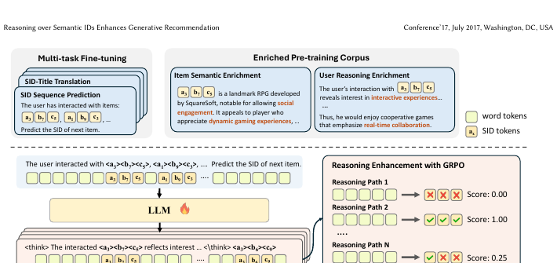

# SIDReasoner

*Reasoning over Semantic IDs Enhances Generative Recommendation* — He et al. · KDD’26

`III. SID–Model Alignment` · `Training`

[Paper](https://arxiv.org/abs/2603.23183) · [Code](https://github.com/HappyPointer/SIDReasoner) · [Matrix](../../README.md#iii--training)

Reading level: Reading Notes (Level 2) · On this page: [TL;DR](#tldr) · [At a Glance](#at-a-glance) · [1. Why This Paper Matters](#1-why-this-paper-matters) · [2. How It Works](#2-how-it-works) · [3. Experimental Findings](#3-experimental-findings) · [4. Limitations & Critical Analysis](#4-limitations--critical-analysis) · [5. Connections to Related Work](#5-connections-to-related-work)

| Representation | Tokenization | Backbone | Training | Inference |
| :-: | :-: | :-: | :-: | :-: |
| `Text` | `RQ-VAE` | `Dec-Only` | **`Fixed / NTP → RL`** | `C-Beam` |

- `Dec-Only`: Decoder-only.
- `Fixed`: SIDs are built first and not changed while the generator trains.
- `NTP → RL`: NTP, then reinforcement learning (GRPO, GBPO, etc.).
- `C-Beam`: Constrained beam search.

### TL;DR

SIDReasoner strengthens Semantic ID-language alignment with multi-task training on a teacher-synthesized corpus, then improves reasoning through outcome-driven reinforcement learning, without annotated recommendation reasoning traces.

### At a Glance

| Aspect | Summary |
| :-- | :-- |
| Research Problem | III. SID–Model Alignment: Can the generator read, write, and reason over SIDs, and do the tokenizer and generator work toward the same goal? |
| Key Contribution | SIDReasoner strengthens Semantic ID-language alignment with multi-task training on a teacher-synthesized corpus, then improves reasoning through outcome-driven reinforcement learning, without annotated recommendation reasoning traces. |
| Modified Stage | Training |
| Limitation | The RL reward scores only the generated Semantic ID, by its longest correct prefix and whether it maps to a catalog item, and not the reasoning text (Sec. 3.3.2). |

### 1. Why This Paper Matters

LLM-based generative recommenders already share one token space for language and Semantic IDs (SIDs), but reasoning over SIDs is hard: itemic tokens carry no native meaning for an LLM, and recommendation reasoning has little high-quality supervision (Abstract). SIDReasoner strengthens SID-language alignment first, so that the LLM's general reasoning can carry over to recommendation without many recommendation-specific reasoning traces.

> "Stronger SID–language alignment can help general reasoning abilities better generalize to recommendation tasks." (Sec. 5)

Based on arXiv v2.

### 2. How It Works

*Figure source: Fig. 1, original paper.*

#### SID-Language Alignment

Multi-task training covers next-item prediction and bidirectional translation between SIDs and item titles (Sec. 3.2.2). A teacher model enriches item descriptions in item-centric and user-centric forms, and general reasoning data is mixed in (Sec. 3.2.3).

#### Reasoning Activation

A short supervised stage teaches the model to write reasoning before the recommendation (Sec. 3.3.1). The paper calls it cold-start reasoning activation; it concerns the response format, not cold-start users or items.

> "This stage mainly serves to improve the reliability of response formatting, ensuring that reasoning is consistently generated before recommendation." (Sec. 3.3.1)

#### Outcome-Based GRPO

GRPO samples groups of reasoning-and-prediction trajectories and optimizes them with rewards from recommendation accuracy (Sec. 3.3.2, Eqs. 6–8).

### 3. Experimental Findings

**Experimental setup**

- **Datasets**: Amazon Reviews 2023: Video Games (3,858 items / 61,417 interactions), Office Products (3,459 / 48,656), Industrial and Scientific (3,686 / 45,325); 5-core filtering of users and items; histories truncated by a sliding window of length 10.
- **Split**: Per user, interactions sorted chronologically and split 8:1:1 into training, validation, and test, with the most recent interactions for validation and test.
- **Candidates**: full catalog (ranking metrics over the entire item set rather than sampled negatives).
- **Visibility**: warm; no unseen-item protocol is defined.
- **SID**: RQ-VAE semantic IDs with L codebooks of K codes over text-encoder embeddings, added to the Qwen3-1.7B vocabulary as new tokens; numerical L and K and collision handling: not reported.
- **Inference budget**: Reason-then-recommend generation: the model writes a reasoning sequence and then the target SID; evaluation decoding method and width: not reported (GRPO training uses 16 rollouts). Hardware, inference batch size, and latency: not reported.
- **Results from**: Table 2 (Games, Office, Industrial versus discriminative, generative, and reasoning baselines); Table 3 (alignment strategies before and after RL); Table 4 (general-ability benchmarks); Table 5 (teacher models for corpus enrichment).

Sources

- **Datasets**: Datasets, 5-core, sliding window 10: [S4.SS1.SSS1.p1](https://arxiv.org/html/2603.23183v2#S4.SS1.SSS1.p1); statistics: [S3.T1](https://arxiv.org/html/2603.23183v2#S3.T1).
- **Split**: Temporal 8:1:1 per user: [S4.SS1.SSS1.p1](https://arxiv.org/html/2603.23183v2#S4.SS1.SSS1.p1).
- **Candidates**: Full-item ranking: [S4.SS1.SSS1.p2](https://arxiv.org/html/2603.23183v2#S4.SS1.SSS1.p2).
- **Visibility**: Temporal split with no unseen-item protocol: [S4.SS1.SSS1.p1](https://arxiv.org/html/2603.23183v2#S4.SS1.SSS1.p1).
- **SID**: RQ-VAE with L codebooks of K codes over text embeddings: [S3.SS2.SSS1.p1](https://arxiv.org/html/2603.23183v2#S3.SS2.SSS1.p1); numerical L, K not found.
- **Inference budget**: Rollout and training settings: [S4.SS1.SSS3.p1](https://arxiv.org/html/2603.23183v2#S4.SS1.SSS3.p1) and [S4.SS1.SSS3.p3](https://arxiv.org/html/2603.23183v2#S4.SS1.SSS3.p3); decoding for evaluation not found.
- **Results from**: Main: [S4.T2](https://arxiv.org/html/2603.23183v2#S4.T2); alignment ablation: [S4.T3](https://arxiv.org/html/2603.23183v2#S4.T3); general abilities: [S4.T4](https://arxiv.org/html/2603.23183v2#S4.T4); teachers: [S4.T5](https://arxiv.org/html/2603.23183v2#S4.T5).

- Alignment strategies: adding the enriched corpus to multi-task alignment improves results, and each variant is reported before and after RL (Table 3).
- Cross-domain: after joint SID-language alignment on all domains, the paper compares RL on a single domain with RL on all domains (Sec. 4.2.2, Fig. 3).

  > "Such reasoning knowledge, once learned, can be transferred across domains." (Sec. 4.2.2)

- Reasoning length: the length of the reasoning text decreases during RL (Sec. 4.4.2, Fig. 6).

### 4. Limitations & Critical Analysis

**Our analysis.**

- LC-Rec aligns a `Dec-Only` LLM to `RQ-VAE` SIDs with `Multi-task NTP`; SIDReasoner keeps that kind of alignment and adds an RL stage (`NTP → RL`).
- TIGER predicts `RQ-VAE` SIDs with a small `Enc-Dec` generator trained by `NTP`; SIDReasoner uses the same kind of SIDs with a `Dec-Only` LLM.

### 5. Connections to Related Work

- **Competitor** · [LC-Rec](lc-rec.md): LC-Rec aligns an LLM to SIDs with multi-task tuning; SIDReasoner enriches SID-language alignment with teacher-written corpora and adds reasoning activation and GRPO.
  - Source: SIDReasoner v2, generative baselines: https://arxiv.org/html/2603.23183v2#S4.SS1.SSS2.p1; Table 2: https://arxiv.org/html/2603.23183v2#S4.T2; multi-task alignment is ablation S1 in Table 3: https://arxiv.org/html/2603.23183v2#S4.T3.
- **Competitor** · [LETTER](letter.md): LETTER improves the tokenizer; SIDReasoner keeps RQ-VAE IDs and changes how the LLM reasons over them.
  - Source: SIDReasoner v2, generative baselines: https://arxiv.org/html/2603.23183v2#S4.SS1.SSS2.p1; Table 2: https://arxiv.org/html/2603.23183v2#S4.T2.
- **Competitor** · [TIGER](tiger.md): TIGER predicts SIDs directly with a small generator; SIDReasoner reasons in language before predicting SIDs.
  - Source: SIDReasoner v2, generative baselines: https://arxiv.org/html/2603.23183v2#S4.SS1.SSS2.p1; Table 2: https://arxiv.org/html/2603.23183v2#S4.T2.
- **Alternative** · [OneRec-Think](onerec-think.md): OneRec-Think also interleaves reasoning with itemic tokens; SIDReasoner relies on enriched SID-language alignment and outcome-reward GRPO.
  - Source: SIDReasoner v2, Sections 1 and 2.2 cite OneRec-Think: https://arxiv.org/html/2603.23183v2#S1.p2 and https://arxiv.org/html/2603.23183v2#S2.SS2.p2; not a baseline in Table 2.

[View all papers in this cell](../../README.md#iii--training)
