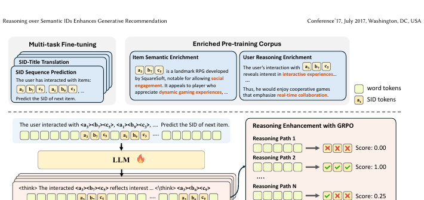

# SIDReasoner

*Reasoning over Semantic IDs Enhances Generative Recommendation* — He et al., KDD’26

[arXiv](https://arxiv.org/abs/2603.23183) · [Record](../../data/papers/sidreasoner.yaml) · [← Catalog](../../README.md#iii--training)

> 本篇§3.1明确复用SIDReasoner的SID管线；另核2603.23183v2 §3.2.1 PDF p4明确item textual metadata构码，本文未重述的输入标Text†。

| Problem it fixes | Stage it changes |
| :-- | :-- |
| **III. SID–Model Alignment**: Can the generator read, write, and reason over SIDs, and do the tokenizer and generator work toward the same goal? | **Training** |

## Pipeline

| Representation | Tokenization | Backbone | Training | Inference |
| :-: | :-: | :-: | :-: | :-: |
| `Text` | `RQ-VAE` | `Dec-Only` | **`Fixed / NTP → RL`** | `C-Beam` |

- `Dec-Only`: Decoder-only.
- `Fixed`: SIDs are built first and not changed while the generator trains.
- `NTP → RL`: NTP, then reinforcement learning (GRPO, GBPO, etc.).
- `C-Beam`: Constrained beam search.

## Architecture

## Evidence

- **`problem`** (arXiv abstract): Abstract: "Itemic tokens are not natively meaningful to LLMs".
- **`objective`** (§3.2.2, §3.3.1, §3.3.2, p4–5): Location from the pre-10-26 Training evidence in the appendix.
- **`inference`** (code: HappyPointer/SIDReasoner evaluate_Qwen3_think.py (commit 2575927, read statically)): Not stated in the text.

## 旧卡片说明

迁自 `d61aa6c:papers/sidreasoner.md`。保留方法说明、实验叙述与局限；本轮只对照现有记录处理明确冲突，未重新逐句核查原论文。分类和规格以页面上方由记录生成的表格为准。

### SIDReasoner：基于语义标识推理的生成式推荐

> SIDReasoner 让语言模型在生成最终语义标识前显式推理用户偏好，以提升跨域和冷启动推荐能力。

### 研究动机与问题定义

直接预测 SID 容易把推荐当作模式匹配，难以利用物品语义和用户偏好之间的中间关系。SIDReasoner 将推理文本或结构化思考引入 SID 生成过程。

### TL;DR（核心摘要）

`用户历史与物品信息 → 对齐语料预训练 → 偏好推理 → 生成SID → 推荐物品`

模型以语义标识为推荐目标，先通过丰富的对齐语料学习语义、行为和标识之间的关系，再使用冷启动推理激活与分组强化学习优化推理链。最终输出 SID 直接映射物品。

### 输入与使用场景

| 方面 | 说明 |
|---|---|
| 使用信息 | 用户行为、物品语义和跨域推荐数据 |
| 信息融入位置 | 对齐语料、推理过程和强化学习奖励 |
| 语义标识结构 | 推理序列后接多 token SID |
| 适用场景 | 跨域、冷启动和常规推荐 |

### 方法设计

#### 3.1 任务形式化
SIDReasoner 将推荐输出表示为语义标识，并要求模型在生成标识前形成与用户历史和物品语义相关的推理过程。推理文本和最终 SID 在同一生成任务中衔接。

#### 3.2 丰富的 SID-语言对齐
模型构造多种对齐语料，让 SID 能被翻译为物品语义、让物品内容能解释 SID，并同时学习行为序列预测。该阶段的作用是把离散标识嵌入语言模型的语义空间。

#### 3.3 推理增强强化学习
方法包含冷启动推理激活和分组强化学习。模型根据候选推理路径及最终推荐结果获得奖励，训练其生成更有依据的偏好分析，再输出目标 SID。

#### 3.4 实验与分析
论文评估跨域泛化、不同对齐策略、模型规模和强化学习设置，重点观察推理能力是否真正转化为推荐收益。

### 实验结论

- 推理增强改善了跨域推荐表现。
- 丰富对齐语料、冷启动激活和强化学习均有独立贡献。

### 局限性与研究定位

#### 局限性
- 推理文本会增加生成长度和推理成本。
- 推理质量、奖励设计与真实用户意图之间仍可能存在偏差。

#### 研究定位
SIDReasoner 的贡献是把 SID 作为推理对象而不只是输出标签，适合放在“推理增强生成式推荐”章节。

### 标签

`语义标识推理` · `强化学习` · `跨域泛化` · `生成式推荐`

### 架构图来源

*图源：原论文，图1。图片使用许可待核实。*

---

### 旧总表补充

来源：`d61aa6c:tables/all-methods.md`。

- 核心贡献：在SID生成前进行偏好推理。
- 使用场景：跨域与冷启动。

## Same cell: III × Training (8 more)

| Paper | Venue | Pipeline |
| :-- | :-- | :-- |
| [LC-Rec](lc-rec.md) | ICDE’24 | `Text` → `RQ-VAE` → `Dec-Only` → **`Fixed / Multi-task NTP`** → `Beam` |
| [ETEGRec](etegrec.md) | SIGIR’25 | `CF` → `Learn. RQ` → `Enc-Dec` → **`Altern. / NTP + Ctr.`** → `Beam` |
| [GREAM](gream.md) | arXiv’25 | `Text+CF` → `RQ-KM` → `Dec-Only` → **`Fixed / NTP → RL`** → `Beam` |
| [OneRec-Think](onerec-think.md) | arXiv’25 | `Text+Img+CF†` → `R-KM†` → `Dec-Only` → **`Fixed / NTP → RL`** → `CoT` |
| [Evo-Rec](evo-rec.md) | arXiv’26 | `Text` → `RQ-VAE` → `Dec-Only` → **`Fixed / NTP → RL`** → `CoT+C-Beam` |
| [GTI](gti.md) | arXiv’26 | `Text+CF / Text` → `RQ-VAE` → `Dec-Only` → **`Fixed / Multi-task NTP`** → `–` |
| [Intent-Driven-News](intent-driven-news.md) | ACL’26 Industry | `Text` → `RQ-VAE` → `Dec-Only` → **`Fixed / Multi-task NTP`** → `CoT+Fuzzy Match` |
| [Think2Go](think2go.md) | KDD’26 | `Attr+Geo+CF†` → `RQ-VAE` → `Dec-Only` → **`Fixed / NTP → RL`** → `CoT+Beam` |
