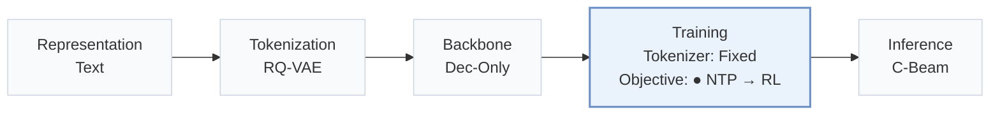
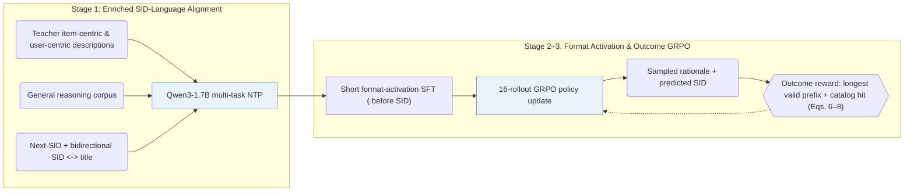
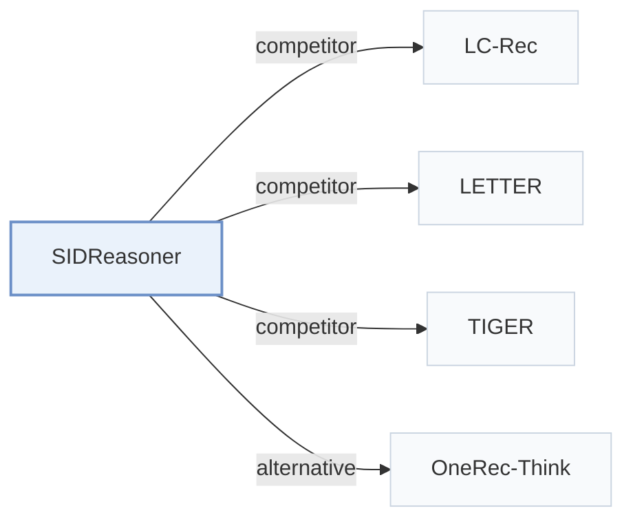

# SIDReasoner

[← Problem × Stage Matrix](../../README.md#iii--training) · [Papers by Stage](../index/stages.md) · [Papers by Modality](../index/modality.md) · [Papers by Domain](../index/domain.md) · English | [中文](../zh/papers/sidreasoner.md)

| **Title** | *Reasoning over Semantic IDs Enhances Generative Recommendation* |
| :-- | :-- |
| **Authors** | He et al. |
| **Venue** | KDD’26 |
| **Problem × Stage** | `III. SID–Model Alignment` · `Training` |
| **Changes** | ● Objective |
| **SID inputs** | `Text` |
| **Domain** | `E-commerce` |
| **Settings** | `cross-domain` |
| **Links** | [Paper](https://arxiv.org/abs/2603.23183) · [Code](https://github.com/HappyPointer/SIDReasoner) |
| **Reading level** | Reading Notes (Level 2) |

**On this page**: [TL;DR](#tldr) · [At a Glance](#at-a-glance) · [1. Why It Matters](#1-why-this-paper-matters) · [2. Method](#2-how-it-works) · [3. Experiments](#3-experimental-findings) · [4. Limitations](#4-limitations--critical-analysis) · [5. Related Work](#5-connections-to-related-work)

- `Text`: Textual item metadata (titles, descriptions, categories, or prompts).
- `RQ-VAE`: Residual-Quantized Variational AutoEncoder.
- `Dec-Only`: Decoder-only.
- `Fixed`: SIDs are built first and not changed while the generator trains.
- `NTP → RL`: NTP, then reinforcement learning (GRPO, GBPO, etc.).
- `C-Beam`: Constrained beam search.

### TL;DR

> [!NOTE]
> SIDReasoner strengthens Semantic ID-language alignment with multi-task training on a teacher-synthesized corpus, then improves reasoning through outcome-driven reinforcement learning, without annotated recommendation reasoning traces.

---

### At a Glance

| Aspect | Summary |
| :-- | :-- |
| Key Findings | Enriching multi-task SID–language alignment with teacher-synthesized descriptions and mixing general reasoning corpora lifts full-catalog accuracy across Amazon Games, Office, and Industrial both before and after GRPO reinforcement learning (Tables 2 and 3). |
| Limitation | Outcome-based GRPO scores only the terminal Semantic ID—by longest matching prefix and catalog validity—without directly supervising the intermediate reasoning text (Sec. 3.3.2). |

---

### 1. Why This Paper Matters

Even when Semantic IDs (SIDs) share one vocabulary with text tokens, large language models (LLMs) struggle to reason over opaque discrete codes while high-quality recommendation rationales remain scarce (Abstract). SIDReasoner invests first in dense bidirectional SID–language grounding mixed with general reasoning corpora, allowing general LLM deduction to transfer to recommendation under lightweight outcome-only RL.

> "Stronger SID–language alignment can help general reasoning abilities better generalize to recommendation tasks." (Sec. 5)

---

### 2. How It Works

#### SID-Language Alignment

Multi-task continued training combines sequential next-SID prediction with bidirectional translation between SIDs and item titles (Sec. 3.2.2). A teacher LLM expands raw metadata into both item-centric and user-centric descriptions, co-trained alongside general-domain reasoning data so new SID embeddings remain anchored to the LLM's reasoning subspace (Sec. 3.2.3).

#### Reasoning Activation

A brief supervised "cold-start reasoning activation" step trains the model to emit a structured `<think>` rationale prior to the target SID—stabilizing output formatting rather than addressing cold-start users or items (Sec. 3.3.1).

> "This stage mainly serves to improve the reliability of response formatting, ensuring that reasoning is consistently generated before recommendation." (Sec. 3.3.1)

#### Outcome-Based GRPO

Group Relative Policy Optimization (GRPO) samples 16 reasoning-plus-SID trajectories per user prompt and updates the policy using outcome rewards defined solely on prefix-match depth and catalog validity of the predicted SID (Sec. 3.3.2, Eqs. 6–8).

---

### 3. Experimental Findings

Experimental setup

- **Datasets**: Amazon Reviews 2023: Video Games (3,858 items / 61,417 interactions), Office Products (3,459 / 48,656), Industrial and Scientific (3,686 / 45,325); 5-core filtering of users and items; histories truncated by a sliding window of length 10.
  - Source: Datasets, 5-core, sliding window 10: [S4.SS1.SSS1.p1](https://arxiv.org/html/2603.23183v2#S4.SS1.SSS1.p1); statistics: [S3.T1](https://arxiv.org/html/2603.23183v2#S3.T1).
- **Split**: Per user, interactions sorted chronologically and split 8:1:1 into training, validation, and test, with the most recent interactions for validation and test.
  - Source: Temporal 8:1:1 per user: [S4.SS1.SSS1.p1](https://arxiv.org/html/2603.23183v2#S4.SS1.SSS1.p1).
- **Candidates**: full catalog (ranking metrics over the entire item set rather than sampled negatives).
  - Source: Full-item ranking: [S4.SS1.SSS1.p2](https://arxiv.org/html/2603.23183v2#S4.SS1.SSS1.p2).
- **Visibility**: warm; no unseen-item protocol is defined.
  - Source: Temporal split with no unseen-item protocol: [S4.SS1.SSS1.p1](https://arxiv.org/html/2603.23183v2#S4.SS1.SSS1.p1).
- **SID**: RQ-VAE semantic IDs with L codebooks of K codes over text-encoder embeddings, added to the Qwen3-1.7B vocabulary as new tokens; numerical L and K and collision handling: not reported.
  - Source: RQ-VAE with L codebooks of K codes over text embeddings: [S3.SS2.SSS1.p1](https://arxiv.org/html/2603.23183v2#S3.SS2.SSS1.p1); numerical L, K not found.
- **Inference budget**: Reason-then-recommend generation: the model writes a reasoning sequence and then the target SID; evaluation decoding method and width: not reported (GRPO training uses 16 rollouts). Hardware, inference batch size, and latency: not reported.
  - Source: Rollout and training settings: [S4.SS1.SSS3.p1](https://arxiv.org/html/2603.23183v2#S4.SS1.SSS3.p1) and [S4.SS1.SSS3.p3](https://arxiv.org/html/2603.23183v2#S4.SS1.SSS3.p3); decoding for evaluation not found.
- **Results from**: Table 2 (Games, Office, Industrial versus discriminative, generative, and reasoning baselines); Table 3 (alignment strategies before and after RL); Table 4 (general-ability benchmarks); Table 5 (teacher models for corpus enrichment).
  - Source: Main: [S4.T2](https://arxiv.org/html/2603.23183v2#S4.T2); alignment ablation: [S4.T3](https://arxiv.org/html/2603.23183v2#S4.T3); general abilities: [S4.T4](https://arxiv.org/html/2603.23183v2#S4.T4); teachers: [S4.T5](https://arxiv.org/html/2603.23183v2#S4.T5).

- Alignment ablations: adding teacher-enriched descriptions and general reasoning data to multi-task alignment consistently boosts full-catalog accuracy both immediately after alignment and after subsequent GRPO (Table 3).
- Cross-domain reasoning transfer: after joint multi-domain SID–language alignment, applying GRPO on a single domain already transfers reasoning gains to the remaining unseen-RL domains, approaching full multi-domain RL (Sec. 4.2.2, Fig. 3).

  > "Such reasoning knowledge, once learned, can be transferred across domains." (Sec. 4.2.2)

- Concise rationales: generated reasoning traces shorten naturally over GRPO training iterations without accuracy loss (Sec. 4.4.2, Fig. 6).

---

### 4. Limitations & Critical Analysis

**Our analysis.**

- LC-Rec stops after `Multi-task NTP` instruction alignment on a `Dec-Only` LLM; SIDReasoner couples teacher-enriched alignment with format activation and outcome-driven `NTP → RL` (`CoT`).
- TIGER decodes `RQ-VAE` SIDs directly with a small `Enc-Dec` Transformer under `NTP`; SIDReasoner feeds `RQ-VAE` tokens into Qwen3-1.7B and elicits natural-language reasoning before emitting the SID.

---

### 5. Connections to Related Work

- **Competitor** · [LC-Rec](lc-rec.md): LC-Rec aligns an LLM to SIDs with multi-task tuning; SIDReasoner enriches SID-language alignment with teacher-written corpora and adds reasoning activation and GRPO.
  - Source: SIDReasoner v2, generative baselines: [S4.SS1.SSS2.p1](https://arxiv.org/html/2603.23183v2#S4.SS1.SSS2.p1); Table 2: [S4.T2](https://arxiv.org/html/2603.23183v2#S4.T2); multi-task alignment is ablation S1 in Table 3: [S4.T3](https://arxiv.org/html/2603.23183v2#S4.T3).
- **Competitor** · [LETTER](letter.md): LETTER improves the tokenizer; SIDReasoner keeps RQ-VAE IDs and changes how the LLM reasons over them.
  - Source: SIDReasoner v2, generative baselines: [S4.SS1.SSS2.p1](https://arxiv.org/html/2603.23183v2#S4.SS1.SSS2.p1); Table 2: [S4.T2](https://arxiv.org/html/2603.23183v2#S4.T2).
- **Competitor** · [TIGER](tiger.md): TIGER predicts SIDs directly with a small generator; SIDReasoner reasons in language before predicting SIDs.
  - Source: SIDReasoner v2, generative baselines: [S4.SS1.SSS2.p1](https://arxiv.org/html/2603.23183v2#S4.SS1.SSS2.p1); Table 2: [S4.T2](https://arxiv.org/html/2603.23183v2#S4.T2).
- **Alternative** · [OneRec-Think](onerec-think.md): OneRec-Think also interleaves reasoning with itemic tokens; SIDReasoner relies on enriched SID-language alignment and outcome-reward GRPO.
  - Source: SIDReasoner v2, Sections 1 and 2.2 cite OneRec-Think: [S1.p2](https://arxiv.org/html/2603.23183v2#S1.p2) and [S2.SS2.p2](https://arxiv.org/html/2603.23183v2#S2.SS2.p2); not a baseline in Table 2.

[View all papers in this cell](../../README.md#iii--training)
