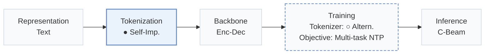
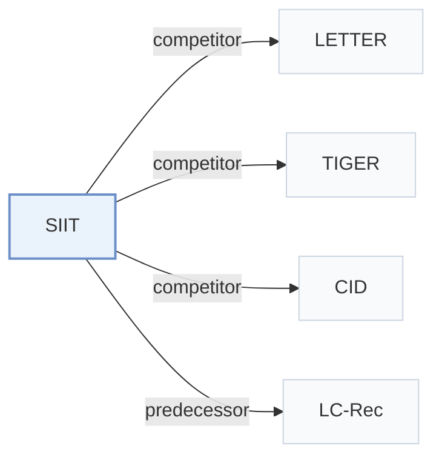

# SIIT

[← Problem × Stage Matrix](../../README.md#iii--tokenization) · [Papers by Stage](../index/stages.md) · [Papers by Modality](../index/modality.md) · [Papers by Domain](../index/domain.md) · English | [中文](../zh/papers/siit.md)

| **Title** | *Enhancing item tokenization for generative recommendation through self-improvement* |
| :-- | :-- |
| **Authors** | Chen et al. |
| **Venue** | arXiv’24 |
| **Problem × Stage** | `III. SID–Model Alignment` · `Tokenization` |
| **Changes** | ● Tokenization · ○ Tokenizer |
| **SID inputs** | `Text` |
| **Domain** | `E-commerce` · `POI / Local` |
| **Scenario** | `General Item Recommendation`; `Public Benchmarks` |
| **Links** | [Paper](https://arxiv.org/abs/2412.17171) |
| **Reading level** | Overview (Level 1) |

**On this page**: [TL;DR](#tldr) · [3. Experiments](#3-experimental-findings) · [5. Related Work](#5-connections-to-related-work)

- `Text`: Textual item metadata (titles, descriptions, categories, or prompts).
- `Self-Imp.`: Self-improving tokenization refined iteratively from the generator's learned representations.
- `Enc-Dec`: Encoder-decoder.
- `Altern.`: Tokenizer and generator are updated in turns.
- `Multi-task NTP`: The same NTP loss over several tasks.
- `C-Beam`: Constrained beam search.

### TL;DR

> [!NOTE]
> SIIT starts from item tokenizations of any external model and periodically adjusts them to the LLM's learned patterns during training, so tokenization matches the LLM's internal item understanding.

---

### 3. Experimental Findings

Experimental setup

- **Datasets**: Amazon Instruments (24,772 users / 9,922 items), Amazon Beauty (22,363 / 12,101), and Yelp (30,431 / 20,033), as introduced by LETTER; users and items with fewer than 5 interactions removed.
  - Source: Datasets and preprocessing following LETTER and LC-Rec: [S4.SS1.SSS1.p1](https://arxiv.org/html/2412.17171v1#S4.SS1.SSS1.p1); statistics: [S4.T1](https://arxiv.org/html/2412.17171v1#S4.T1).
- **Split**: Per-user leave-one-out (most recent item for test, second-to-last for validation, the rest for training); histories capped at the 10 most recent items.
  - Source: Leave-one-out allocation and 10-item cap: [S4.SS1.SSS1.p2](https://arxiv.org/html/2412.17171v1#S4.SS1.SSS1.p2).
- **Candidates**: full catalog (rank list generated from the entire item set without predefined candidate sets).
  - Source: Rank list from the entire item set: [S4.SS1.SSS2.p1](https://arxiv.org/html/2412.17171v1#S4.SS1.SSS2.p1).
- **Visibility**: warm; no unseen-item protocol is defined.
  - Source: Standard split with no unseen-item protocol: [S4.SS1.SSS1.p2](https://arxiv.org/html/2412.17171v1#S4.SS1.SSS1.p2).
- **SID**: Identifiers are initialized with CID, TIGER, or LETTER codes and then regenerated by the LLM itself over 2-5 iterations. Collisions: each item takes the first unused identifier among its top-20 beam candidates; any remaining duplicates get an appended token.
  - Source: Self-improving identifiers initialized from CID, TIGER, or LETTER; diverse beam assignment k=20 and suffix fallback: [S3.SS3.p3](https://arxiv.org/html/2412.17171v1#S3.SS3.p3), [S3.SS3.p4](https://arxiv.org/html/2412.17171v1#S3.SS3.p4), [S4.I3.i3.p1](https://arxiv.org/html/2412.17171v1#S4.I3.i3.p1).
- **Inference budget**: Constrained beam search over a prefix tree of all item identifiers, outputs ranked by perplexity; numerical beam width for recommendation: not reported. Flan-T5-Small backbone; experiments on 8 NVIDIA A100-40GB GPUs; inference batch size and latency: not reported.
  - Source: Constrained beam search and perplexity ranking: [S3.SS4.p1](https://arxiv.org/html/2412.17171v1#S3.SS4.p1); hardware: [S4.SS1.SSS4.p1](https://arxiv.org/html/2412.17171v1#S4.SS1.SSS4.p1).
- **Results from**: Table 2 (Instruments, Beauty, Yelp versus traditional and LLM-based baselines with simple and advanced tokenization); Table 3 (diverse generation and collision avoidance ablation on Yelp); Table 4 (identifier similarity before and after refinement).
  - Source: Main: [S4.T2](https://arxiv.org/html/2412.17171v1#S4.T2); ablation: [S4.T3](https://arxiv.org/html/2412.17171v1#S4.T3); identifier similarity: [S4.T4](https://arxiv.org/html/2412.17171v1#S4.T4).

---

### 5. Connections to Related Work

- **Competitor** · [LETTER](letter.md): LETTER fixes its regularized RQ-VAE identifiers before generator training; SIIT starts from such identifiers and lets the LLM regenerate them iteratively with alignment tasks.
  - Source: SIIT v1, advanced-tokenization baselines and initializer: [S4.I3.i3.p1](https://arxiv.org/html/2412.17171v1#S4.I3.i3.p1); data from LETTER: [S4.SS1.SSS1.p1](https://arxiv.org/html/2412.17171v1#S4.SS1.SSS1.p1); Table 2: [S4.T2](https://arxiv.org/html/2412.17171v1#S4.T2).
- **Competitor** · [TIGER](tiger.md): TIGER's RQ-VAE codes are both a baseline and one of SIIT's initializations, which SIIT then refines.
  - Source: SIIT v1, [S4.I3.i3.p1](https://arxiv.org/html/2412.17171v1#S4.I3.i3.p1); Tables 2 and 4: [S4.T2](https://arxiv.org/html/2412.17171v1#S4.T2) and [S4.T4](https://arxiv.org/html/2412.17171v1#S4.T4).
- **Competitor** · [CID](cid.md): CID's spectral-clustering IDs (and the simple TID/SID variants) are baselines and an initializer; SIIT replaces fixed IDs with model-generated ones.
  - Source: SIIT v1, baselines: [S4.I3.i2.p1](https://arxiv.org/html/2412.17171v1#S4.I3.i2.p1) and [S4.I3.i3.p1](https://arxiv.org/html/2412.17171v1#S4.I3.i3.p1); Table 2: [S4.T2](https://arxiv.org/html/2412.17171v1#S4.T2).
- **Predecessor** · [LC-Rec](lc-rec.md): SIIT follows LC-Rec's preprocessing and its idea of aligning LLMs to item identifiers through auxiliary tasks.
  - Source: SIIT v1, Section 4.1.1 follows Zheng et al. (2024): [S4.SS1.SSS1.p1](https://arxiv.org/html/2412.17171v1#S4.SS1.SSS1.p1); Section 5.2 related work: [S5.SS2.p1](https://arxiv.org/html/2412.17171v1#S5.SS2.p1).

[View all papers in this cell](../../README.md#iii--tokenization)
