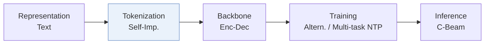
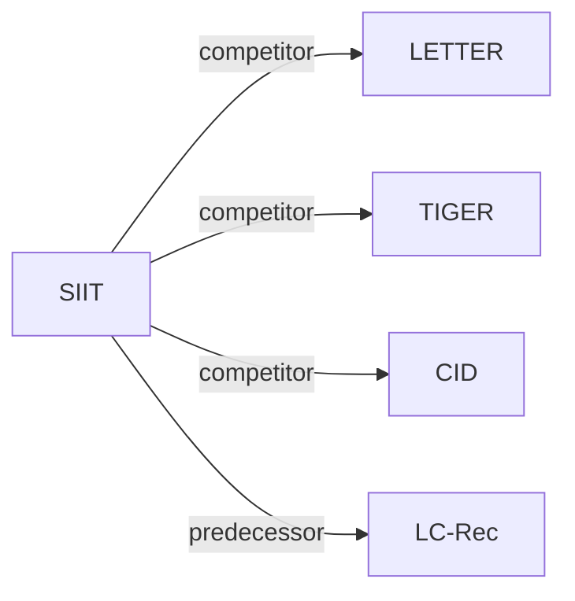

# SIIT

*Enhancing item tokenization for generative recommendation through self-improvement* — Chen et al. · arXiv’24

`III. SID–Model Alignment` · `Tokenization`

[Paper](https://arxiv.org/abs/2412.17171) · [Matrix](../../README.md#iii--tokenization)

Reading level: Overview (Level 1) · On this page: [TL;DR](#tldr) · [At a Glance](#at-a-glance) · [3. Experimental Findings](#3-experimental-findings) · [5. Connections to Related Work](#5-connections-to-related-work)

- `Enc-Dec`: Encoder-decoder.
- `Altern.`: Tokenizer and generator are updated in turns.
- `Multi-task NTP`: The same NTP loss over several tasks.
- `C-Beam`: Constrained beam search.

### TL;DR

SIIT starts from item tokenizations of any external model and periodically adjusts them to the LLM's learned patterns during training, so tokenization matches the LLM's internal item understanding.

### At a Glance

| Aspect | Summary |
| :-- | :-- |
| Research Problem | III. SID–Model Alignment: Can the generator read, write, and reason over SIDs, and do the tokenizer and generator work toward the same goal? |
| Key Contribution | SIIT starts from item tokenizations of any external model and periodically adjusts them to the LLM's learned patterns during training, so tokenization matches the LLM's internal item understanding. |
| Modified Stage | Tokenization |

### 3. Experimental Findings

**Experimental setup**

- **Datasets**: Amazon Instruments (24,772 users / 9,922 items), Amazon Beauty (22,363 / 12,101), and Yelp (30,431 / 20,033), as introduced by LETTER; users and items with fewer than 5 interactions removed.
- **Split**: Per-user leave-one-out (most recent item for test, second-to-last for validation, the rest for training); histories capped at the 10 most recent items.
- **Candidates**: full catalog (rank list generated from the entire item set without predefined candidate sets).
- **Visibility**: warm; no unseen-item protocol is defined.
- **SID**: Identifiers are initialized with CID, TIGER, or LETTER codes and then regenerated by the LLM itself over 2-5 iterations. Collisions: each item takes the first unused identifier among its top-20 beam candidates; any remaining duplicates get an appended token.
- **Inference budget**: Constrained beam search over a prefix tree of all item identifiers, outputs ranked by perplexity; numerical beam width for recommendation: not reported. Flan-T5-Small backbone; experiments on 8 NVIDIA A100-40GB GPUs; inference batch size and latency: not reported.
- **Results from**: Table 2 (Instruments, Beauty, Yelp versus traditional and LLM-based baselines with simple and advanced tokenization); Table 3 (diverse generation and collision avoidance ablation on Yelp); Table 4 (identifier similarity before and after refinement).

Sources

- **Datasets**: Datasets and preprocessing following LETTER and LC-Rec: [S4.SS1.SSS1.p1](https://arxiv.org/html/2412.17171v1#S4.SS1.SSS1.p1); statistics: [S4.T1](https://arxiv.org/html/2412.17171v1#S4.T1).
- **Split**: Leave-one-out allocation and 10-item cap: [S4.SS1.SSS1.p2](https://arxiv.org/html/2412.17171v1#S4.SS1.SSS1.p2).
- **Candidates**: Rank list from the entire item set: [S4.SS1.SSS2.p1](https://arxiv.org/html/2412.17171v1#S4.SS1.SSS2.p1).
- **Visibility**: Standard split with no unseen-item protocol: [S4.SS1.SSS1.p2](https://arxiv.org/html/2412.17171v1#S4.SS1.SSS1.p2).
- **SID**: Self-improving identifiers initialized from CID, TIGER, or LETTER; diverse beam assignment k=20 and suffix fallback: [S3.SS3.p3](https://arxiv.org/html/2412.17171v1#S3.SS3.p3), [S3.SS3.p4](https://arxiv.org/html/2412.17171v1#S3.SS3.p4), [S4.I3.i3.p1](https://arxiv.org/html/2412.17171v1#S4.I3.i3.p1).
- **Inference budget**: Constrained beam search and perplexity ranking: [S3.SS4.p1](https://arxiv.org/html/2412.17171v1#S3.SS4.p1); hardware: [S4.SS1.SSS4.p1](https://arxiv.org/html/2412.17171v1#S4.SS1.SSS4.p1).
- **Results from**: Main: [S4.T2](https://arxiv.org/html/2412.17171v1#S4.T2); ablation: [S4.T3](https://arxiv.org/html/2412.17171v1#S4.T3); identifier similarity: [S4.T4](https://arxiv.org/html/2412.17171v1#S4.T4).

### 5. Connections to Related Work

- **Competitor** · [LETTER](letter.md): LETTER fixes its regularized RQ-VAE identifiers before generator training; SIIT starts from such identifiers and lets the LLM regenerate them iteratively with alignment tasks.
  - Source: SIIT v1, advanced-tokenization baselines and initializer: https://arxiv.org/html/2412.17171v1#S4.I3.i3.p1; data from LETTER: https://arxiv.org/html/2412.17171v1#S4.SS1.SSS1.p1; Table 2: https://arxiv.org/html/2412.17171v1#S4.T2.
- **Competitor** · [TIGER](tiger.md): TIGER's RQ-VAE codes are both a baseline and one of SIIT's initializations, which SIIT then refines.
  - Source: SIIT v1, https://arxiv.org/html/2412.17171v1#S4.I3.i3.p1; Tables 2 and 4: https://arxiv.org/html/2412.17171v1#S4.T2 and https://arxiv.org/html/2412.17171v1#S4.T4.
- **Competitor** · [CID](cid.md): CID's spectral-clustering IDs (and the simple TID/SID variants) are baselines and an initializer; SIIT replaces fixed IDs with model-generated ones.
  - Source: SIIT v1, baselines: https://arxiv.org/html/2412.17171v1#S4.I3.i2.p1 and https://arxiv.org/html/2412.17171v1#S4.I3.i3.p1; Table 2: https://arxiv.org/html/2412.17171v1#S4.T2.
- **Predecessor** · [LC-Rec](lc-rec.md): SIIT follows LC-Rec's preprocessing and its idea of aligning LLMs to item identifiers through auxiliary tasks.
  - Source: SIIT v1, Section 4.1.1 follows Zheng et al. (2024): https://arxiv.org/html/2412.17171v1#S4.SS1.SSS1.p1; Section 5.2 related work: https://arxiv.org/html/2412.17171v1#S5.SS2.p1.

[View all papers in this cell](../../README.md#iii--tokenization)
