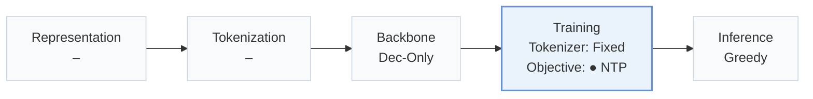
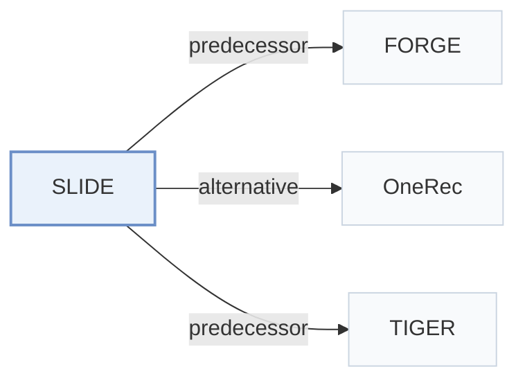

# SLIDE

[← Problem × Stage Matrix](../../README.md#iv--training) · [Papers by Stage](../index/stages.md) · [Papers by Modality](../index/modality.md) · [Papers by Domain](../index/domain.md) · English | [中文](../zh/papers/slide.md)

| **Title** | *Search-to-List Item Distillation for Single-Rollout Generative Retrieval* |
| :-- | :-- |
| **Authors** | Zhan et al. |
| **Venue** | arXiv’26 |
| **Problem × Stage** | `IV. Utility` · `Training` |
| **Changes** | ● Objective |
| **SID inputs** | `Other` (FORGE SIDs; Taobao tokenizer inputs unstated) |
| **Domain** | `E-commerce` · `Search` |
| **Links** | [Paper](https://arxiv.org/abs/2610.34764) |
| **Reading level** | Overview (Level 1) |

**On this page**: [TL;DR](#tldr) · [3. Experiments](#3-experimental-findings) · [5. Related Work](#5-connections-to-related-work)

- `Dec-Only`: Decoder-only.
- `Fixed`: SIDs are built first and not changed while the generator trains.
- `NTP`: Next-token prediction loss only; continuing from a pretrained LLM (SFT) also counts as NTP.
- `Greedy`: Select the highest-scoring next token at each decoding step.

### TL;DR

> [!NOTE]
> SLIDE concatenates a teacher's offline beam-search candidates into list-wise Semantic ID targets, so a student generates the whole top-K list in one greedy pass instead of item-level beam search.

---

### 3. Experimental Findings

Experimental setup

- **Datasets**: FORGE Stage S3; industrial Taobao Search requests with about 12 training labels/request. Additional filtering rules not reported.
  - Source: Section 5.1: [S5.SS1.SSS0.Px1.p1](https://arxiv.org/html/2610.34764v1#S5.SS1.SSS0.Px1.p1)
- **Split**: FORGE: retain provided S3 train/evaluation sets. Taobao: 10 consecutive training days, immediately following day test. Validation allocation not reported.
  - Source: Section 5.1: [S5.SS1.SSS0.Px1.p1](https://arxiv.org/html/2610.34764v1#S5.SS1.SSS0.Px1.p1)
- **Candidates**: not reported
  - Source: Section 5.1 describes valid unique generated candidates, without evaluation negative-sampling details: [S5.SS1.SSS0.Px3.p1](https://arxiv.org/html/2610.34764v1#S5.SS1.SSS0.Px3.p1)
- **Visibility**: warm; no unseen-item protocol is defined.
  - Source: Section 5.1 defines no unseen-item holdout: [S5.SS1](https://arxiv.org/html/2610.34764v1#S5.SS1)
- **SID**: Three tokens/item. FORGE uses provided SID vocabulary, sizes not restated; Taobao codebooks [32768,8192,8192]. Tokenizer algorithm and collision handling not reported.
  - Source: Section 5.1/Appendix A.2: [S5.SS1.SSS0.Px4.p1](https://arxiv.org/html/2610.34764v1#S5.SS1.SSS0.Px4.p1) and [A1.SS2.p1](https://arxiv.org/html/2610.34764v1#A1.SS2.p1)
- **Inference budget**: Qwen2.5-0.5B student; single greedy rollout to EOS or 1024 tokens; HR@1/5/10/20. Beam reference [20,20,200]; offline teacher distillation uses [20,20,20], 20-item targets. Serving hardware/batch/latency not reported; 32 H20 GPUs and global batch 8192 describe training.
  - Source: Section 5.1: [S5.SS1.SSS0.Px4.p1](https://arxiv.org/html/2610.34764v1#S5.SS1.SSS0.Px4.p1)
- **Results from**: Original Table 2: direct-training greedy/beam references versus distilled greedy students; teacher sizes 0.5B/3B/7B. Tables 3-6 analyze training, target construction, and supplementary RL.
  - Source: Section 5.2 and Table 2: [S5.SS2.p1](https://arxiv.org/html/2610.34764v1#S5.SS2.p1) and [S5.T2](https://arxiv.org/html/2610.34764v1#S5.T2) and [S5.T3](https://arxiv.org/html/2610.34764v1#S5.T3) and [S5.T4](https://arxiv.org/html/2610.34764v1#S5.T4) and [S5.T5](https://arxiv.org/html/2610.34764v1#S5.T5) and [S5.T6](https://arxiv.org/html/2610.34764v1#S5.T6)

---

### 5. Connections to Related Work

- **Predecessor** · [FORGE](forge.md): SLIDE reuses FORGE's S3 split and SID vocabulary.
  - Source: SLIDE v1, Section 5.1: [S5.SS1.SSS0.Px1.p1](https://arxiv.org/html/2610.34764v1#S5.SS1.SSS0.Px1.p1); [S5.SS1.SSS0.Px4.p1](https://arxiv.org/html/2610.34764v1#S5.SS1.SSS0.Px4.p1).
- **Alternative** · [OneRec](onerec.md): OneRec models session dependencies; SLIDE focuses on search-to-greedy list distillation.
  - Source: SLIDE v1, Section 2.1 (Deng et al., 2025, arXiv:2502.18965): [S2.SS1.p2](https://arxiv.org/html/2610.34764v1#S2.SS1.p2).
- **Predecessor** · [TIGER](tiger.md): SLIDE replaces the conventional item-level search interface with a distilled list rollout.
  - Source: SLIDE v1, Introduction and Section 2.1: [S1.p1](https://arxiv.org/html/2610.34764v1#S1.p1); [S2.SS1.p1](https://arxiv.org/html/2610.34764v1#S2.SS1.p1).

[View all papers in this cell](../../README.md#iv--training)
