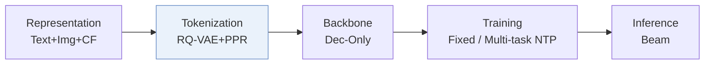
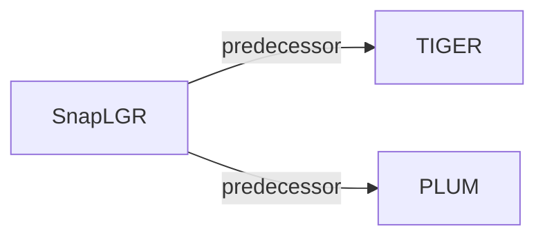

# SnapLGR

*LLM-Based Generative Retrieval for Snapchat Content Recommendation* — Collins et al. · arXiv’26

`II. Uniqueness and Validity` · `Tokenization` · [Paper](https://arxiv.org/abs/2607.28895) · [Matrix](../../README.md#ii--tokenization) · [中文](../zh/papers/snaplgr.md)

Reading level: Overview (Level 1) · On this page: [TL;DR](#tldr) · [At a Glance](#at-a-glance) · [3. Experiments](#3-experimental-findings) · [5. Related Work](#5-connections-to-related-work)

- `RQ-VAE+PPR`: Residual-quantized variational codes informed by Personalized PageRank signals.
- `Dec-Only`: Decoder-only.
- `Fixed`: SIDs are built first and not changed while the generator trains.
- `Multi-task NTP`: The same NTP loss over several tasks.

### TL;DR

> [!NOTE]
> SnapLGR builds Semantic IDs from multimodal embeddings with Personalized PageRank contrastive learning, grounds them by continued pretraining before fine-tuning an LLM, and serves beam search with TensorRT-LLM.

### At a Glance

| Aspect | Summary |
| :-- | :-- |
| Research Problem | II. Uniqueness and Validity: Does every item get its own SID, every generated SID name a real item, and the codebook get used evenly? |
| Key Contribution | SnapLGR builds Semantic IDs from multimodal embeddings with Personalized PageRank contrastive learning, grounds them by continued pretraining before fine-tuning an LLM, and serves beam search with TensorRT-LLM. |
| Modified Stage | Tokenization |

### 3. Experimental Findings

Experimental setup

- **Datasets**: Internal Snapchat short-video engagement logs and multimodal video corpus; dataset size and filtering rules not reported. Up to 10 future items/request supply evaluation targets.
  - Source: Sections 2.1/4.1: [S2.SS1.p3](https://arxiv.org/html/2607.28895v4#S2.SS1.p3) and [S4.SS1.p1](https://arxiv.org/html/2607.28895v4#S4.SS1.p1)
- **Split**: SFT uses one day; evaluation uses the immediately following hour. CPT uses one month ending one week before SFT; validation allocation not reported.
  - Source: Section 4.1: [S4.SS1.p1](https://arxiv.org/html/2607.28895v4#S4.SS1.p1)
- **Candidates**: not reported; primary offline metrics match generated SID clusters before video materialization.
  - Source: Section 4.1/Appendix B.2 defines SID-level generated-set metrics, not sampled evaluation negatives: [S4.SS1.p2](https://arxiv.org/html/2607.28895v4#S4.SS1.p2) and [A2.SS2.p1](https://arxiv.org/html/2607.28895v4#A2.SS2.p1)
- **Visibility**: warm; no unseen-item protocol is defined. PPR co-engagement graph and tokenizer exposure to test videos not reported.
  - Source: Sections 2.1/4.1 define no unseen-item holdout: [S2.SS1.p7](https://arxiv.org/html/2607.28895v4#S2.SS1.p7) and [S4.SS1.p1](https://arxiv.org/html/2607.28895v4#S4.SS1.p1)
- **SID**: PPR-supervised RQ-VAE: [1024,512,256]. Shared SIDs represent video clusters; materialization ranks videos within each bucket by engagement value. Per-bucket retained-video cap not reported.
  - Source: Section 3.1/Appendix A.3.1: [S3.SS1.p3](https://arxiv.org/html/2607.28895v4#S3.SS1.p3) and [A1.SS3.SSS1.p1](https://arxiv.org/html/2607.28895v4#A1.SS3.SSS1.p1)
- **Inference budget**: Qwen3-0.6B, beam 32; daily offline generation, online candidate-index lookup. A100 single-GPU and 64-GPU inference studies; optimized per-GPU throughput 45.7x legacy pipeline. Inference batch size, absolute throughput and latency not reported.
  - Source: Sections 2.3/4.1/4.4: [S2.SS3.p1](https://arxiv.org/html/2607.28895v4#S2.SS3.p1) and [S2.SS2.p1](https://arxiv.org/html/2607.28895v4#S2.SS2.p1) and [S4.SS1.p2](https://arxiv.org/html/2607.28895v4#S4.SS1.p2) and [S4.SS4.SSS2.p2](https://arxiv.org/html/2607.28895v4#S4.SS4.SSS2.p2) and [S4.SS4.SSS2.p3](https://arxiv.org/html/2607.28895v4#S4.SS4.SSS2.p3) and [S4.SS4.SSS2.p5](https://arxiv.org/html/2607.28895v4#S4.SS4.SSS2.p5)
- **Results from**: Original Table 3: offline SID comparison with T5 retrained on identical SIDs/data; Table 5: SID/video recall. Table 8: seven-day A/B versus deployed T5 with coarser CLIP SIDs, jointly changing tokenizer/backbone/serving.
  - Source: Section 4.1/4.5 and Tables 3/5/8: [S4.SS1.p3](https://arxiv.org/html/2607.28895v4#S4.SS1.p3) and [S4.T3](https://arxiv.org/html/2607.28895v4#S4.T3) and [S4.T5](https://arxiv.org/html/2607.28895v4#S4.T5) and [S4.SS5.p2](https://arxiv.org/html/2607.28895v4#S4.SS5.p2) and [S4.T8](https://arxiv.org/html/2607.28895v4#S4.T8)

### 5. Connections to Related Work

- **Predecessor** · [TIGER](tiger.md): SnapLGR replaces the deployed TIGER-style T5 retriever with a grounded decoder-only LLM.
  - Source: SnapLGR v4, Sections 4.1/4.5: https://arxiv.org/html/2607.28895v4#S4.SS1.p3; https://arxiv.org/html/2607.28895v4#S4.SS5.p1.
- **Predecessor** · [PLUM](plum.md): SnapLGR follows PLUM's CPT/SFT pipeline and adds PPR supervision and serving optimizations.
  - Source: SnapLGR v4, Sections 2.1/5: https://arxiv.org/html/2607.28895v4#S2.SS1.p6; https://arxiv.org/html/2607.28895v4#S5.p2.

[View all papers in this cell](../../README.md#ii--tokenization)
