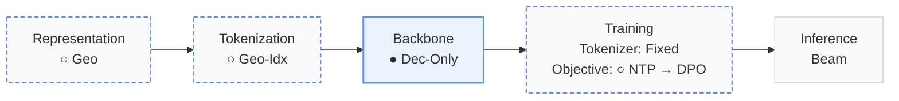
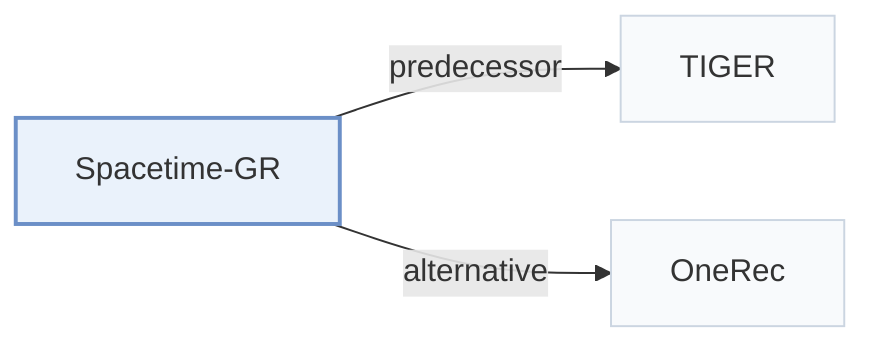

# Spacetime-GR

[← Problem × Stage Matrix](../../README.md#i--backbone) · [Papers by Stage](../index/stages.md) · [Papers by Modality](../index/modality.md) · [Papers by Domain](../index/domain.md) · English | [中文](../zh/papers/spacetime-gr.md)

| **Title** | *A Spacetime-Aware Generative Model for Large Scale Online POI Recommendation* |
| :-- | :-- |
| **Authors** | Lin et al. |
| **Venue** | arXiv’25 |
| **Problem × Stage** | `I. Informativeness` · `Backbone` · `POI` |
| **Changes** | ○ Representation · ○ Tokenization · ● Backbone · ○ Objective |
| **SID inputs** | `Geo` |
| **Domain** | `POI / Local` |
| **Links** | [Paper](https://arxiv.org/abs/2508.16126) |
| **Reading level** | Overview (Level 1) |

**On this page**: [TL;DR](#tldr) · [3. Experiments](#3-experimental-findings) · [5. Related Work](#5-connections-to-related-work)

- `Geo`: Geographic coordinates or spatial features.
- `Geo-Idx`: Identifiers constructed from geographic indexing.
- `Dec-Only`: Decoder-only.
- `Fixed`: SIDs are built first and not changed while the generator trains.
- `NTP → DPO`: NTP, then preference optimization.
- `Beam`: Autoregressive beam search over Semantic ID tokens.

### TL;DR

> [!NOTE]
> Spacetime-GR indexes POIs with a geographic hierarchy, encodes spatiotemporal context into action sequences, adds multimodal POI embeddings, and post-trains for embeddings, ranking scores, and candidates.

---

### 3. Experimental Findings

Experimental setup

- **Datasets**: One year of sampled Amap actions; predict interest-based actions, discard sequences with distinct-POI/action ratio <0.3. Public Foursquare-NYC/TKY and Gowalla-CA follow STHGCN preprocessing, not detailed here.
  - Source: Sections 3.2.1/4.2.1: [S3.SS2.SSS1.p1](https://arxiv.org/html/2508.16126v1#S3.SS2.SSS1.p1) and [S3.SS2.SSS1.Px1.SPx1.p1](https://arxiv.org/html/2508.16126v1#S3.SS2.SSS1.Px1.SPx1.p1) and [S3.SS2.SSS1.Px1.SPx2.p3](https://arxiv.org/html/2508.16126v1#S3.SS2.SSS1.Px1.SPx2.p3) and [S4.SS2.SSS1.p1](https://arxiv.org/html/2508.16126v1#S4.SS2.SSS1.p1)
- **Split**: Industrial train/validation/test counts: pretraining 578M/19794/19837; SFT-alignment 31M/611K/553K. Partition construction and public splits not reported. Alignment probe uses last 5 POI actions as targets, earlier actions as context.
  - Source: Table 3 and Section 5.1.3: [S4.T3](https://arxiv.org/html/2508.16126v1#S4.T3) and [S5.SS1.SSS3.p1](https://arxiv.org/html/2508.16126v1#S5.SS1.SSS3.p1)
- **Candidates**: Generation evaluation universe not reported. SFT/alignment test requests average 10.6 provided POIs; candidate selection and historical-item exclusion not reported.
  - Source: Table 3 and Sections 4.1.5/5.1.1: [S4.T3](https://arxiv.org/html/2508.16126v1#S4.T3) and [S4.SS1.SSS5.p1](https://arxiv.org/html/2508.16126v1#S4.SS1.SSS5.p1) and [S5.SS1.SSS1.p3](https://arxiv.org/html/2508.16126v1#S5.SS1.SSS1.p3)
- **Visibility**: warm; no unseen-item protocol is defined.
  - Source: Sections 4-5 define no unseen-item holdout: [S4](https://arxiv.org/html/2508.16126v1#S4) and [S5](https://arxiv.org/html/2508.16126v1#S5)
- **SID**: Industrial: two tokens, 5km x 5km block plus within-block POI index; one-to-one mapping, total vocabulary reduced from 100M to 400K. Public experiments use a single-level index; codebooks n/a.
  - Source: Sections 3.2.1/4.2.2: [S3.SS2.SSS1.Px2.p2](https://arxiv.org/html/2508.16126v1#S3.SS2.SSS1.Px2.p2) and [S4.SS2.SSS2.p1](https://arxiv.org/html/2508.16126v1#S4.SS2.SSS2.p1)
- **Inference budget**: Generate 10 blocks x 10 inner IDs, rank 100 POIs. Generation hardware, batch size and latency not reported. T4 latency 10-20ms applies to SFT representation/ranking services.
  - Source: Sections 5.1.1/4.1.6: [S5.SS1.SSS1.p3](https://arxiv.org/html/2508.16126v1#S5.SS1.SSS1.p3) and [S4.SS1.SSS6.p1](https://arxiv.org/html/2508.16126v1#S4.SS1.SSS6.p1)
- **Results from**: Tables 5/9: aligned industrial generation; Table 7: pretraining ablation; Table 6: public next-POI accuracy. Table 5 judges 800 requests with LLMs and seven volunteers; public-baseline score provenance not reported.
  - Source: Original Tables 5/6/7/9: [S4.T5](https://arxiv.org/html/2508.16126v1#S4.T5) and [S4.T6](https://arxiv.org/html/2508.16126v1#S4.T6) and [S5.T7](https://arxiv.org/html/2508.16126v1#S5.T7) and [S5.T9](https://arxiv.org/html/2508.16126v1#S5.T9)

---

### 5. Connections to Related Work

- **Predecessor** · [TIGER](tiger.md): Semantic-ID generation inspires the geographic two-token POI indexing design.
  - Source: Spacetime-GR v1, Section 3.2.1, citing Rajput et al. (2023): [S3.SS2.SSS1.Px2.p2](https://arxiv.org/html/2508.16126v1#S3.SS2.SSS1.Px2.p2).
- **Alternative** · [OneRec](onerec.md): Cited MoE/DPO recommender; Spacetime-GR specializes generation for spatiotemporal POI contexts.
  - Source: Spacetime-GR v1, Section 2.1, citing Deng et al. (2025): [S2.SS1.p3](https://arxiv.org/html/2508.16126v1#S2.SS1.p3).

[View all papers in this cell](../../README.md#i--backbone)
