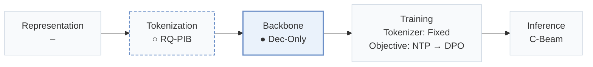
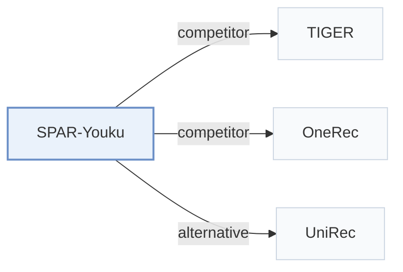

# SPAR-Youku

[← Problem × Stage Matrix](../../README.md#i--backbone) · [Papers by Stage](../index/stages.md) · [Papers by Modality](../index/modality.md) · [Papers by Domain](../index/domain.md) · English | [中文](../zh/papers/spar-youku.md)

| **Title** | *SPAR: Stepwise Personalized Autoregressive Recommendation with Prefix-Balanced Semantic IDs* |
| :-- | :-- |
| **Authors** | Zhang et al. |
| **Venue** | arXiv’26 |
| **Problem × Stage** | `I. Informativeness` · `Backbone` |
| **Changes** | ○ Tokenization · ● Backbone |
| **SID inputs** | `unknown` |
| **Domain** | `Long video` |
| **Links** | [Paper](https://arxiv.org/abs/2610.27898) |
| **Reading level** | Overview (Level 1) |

**On this page**: [TL;DR](#tldr) · [3. Experiments](#3-experimental-findings) · [5. Related Work](#5-connections-to-related-work)

- `RQ-PIB`: Residual Quantization with Prefix-aware Interaction Balancing
- `Dec-Only`: Decoder-only.
- `Fixed`: SIDs are built first and not changed while the generator trains.
- `NTP → DPO`: NTP, then preference optimization.
- `C-Beam`: Constrained beam search.

### TL;DR

> [!NOTE]
> SPAR-Youku guides each Semantic ID decoding step with prefix-relevant evidence from compressed user memory and balances interaction loads among sibling branches with RQ-PIB, to reduce branch errors and popularity bias.

---

### 3. Experimental Findings

Experimental setup

- **Datasets**: Youku homepage production playback logs spanning several months; daily DPO uses recent request contexts. Dataset size, dates and filtering not reported.
  - Source: [S3.SS5.SSS1.Px1.p1](https://arxiv.org/html/2610.27898v1#S3.SS5.SSS1.Px1.p1)
- **Split**: User-disjoint train/validation/test split 90:5:5; randomization method not reported. Seven-day online A/B: control and treatment each approximately 10% of traffic.
  - Source: [S3.SS5.SSS1.Px1.p1](https://arxiv.org/html/2610.27898v1#S3.SS5.SSS1.Px1.p1) ; #S3.SS6.p1 ; #S4.p2
- **Candidates**: not reported; trie validity and HR cutoffs do not specify the evaluation universe.
  - Source: [S3.SS5.SSS1.Px2.p1](https://arxiv.org/html/2610.27898v1#S3.SS5.SSS1.Px2.p1) ; #S3.SS5.SSS1.Px3.p1
- **Visibility**: warm; no unseen-item protocol is defined. RQ-PIB branch weights use training-set interaction counts; tokenizer content-fitting exposure to test items not reported.
  - Source: [S3.SS5.SSS1.Px1.p1](https://arxiv.org/html/2610.27898v1#S3.SS5.SSS1.Px1.p1) ; #S3.SS5.SSS1.Px3.p1
- **SID**: Three-level RQ-PIB: residual K-means centers followed by prefix-local interaction-load balancing with frozen centers. Codebook sizes and collision handling not reported.
  - Source: [S3.SS3.p3](https://arxiv.org/html/2610.27898v1#S3.SS3.p3) ; #S3.SS3.SSS0.Px2.p1 ; #S3.SS5.SSS1.Px3.p1
- **Inference budget**: Qwen3-0.6B with trie-constrained beam search. Main HR@10/20/50/100; ablations also HR@1/5. Beam width, inference hardware, batch size and latency not reported.
  - Source: [S3.SS5.SSS1.Px3.p1](https://arxiv.org/html/2610.27898v1#S3.SS5.SSS1.Px3.p1) ; #S3.T1 ; #S3.T3
- **Results from**: Original Table 1: Youku retrieval comparisons; Table 2: backbone scaling; Table 3: module/SID/DPO ablations; Table 4: online A/B. Table 3 parts (a)-(c) use SFT only; part (d) adds DPO. Baseline-result reuse not stated.
  - Source: [S3.T1](https://arxiv.org/html/2610.27898v1#S3.T1) ; #S3.T2 ; #S3.T3 ; #S3.T4 ; #S3.SS5.SSS4.p1

---

### 5. Connections to Related Work

- **Competitor** · [TIGER](tiger.md): TIGER is a residual-SID retrieval baseline; SPAR jointly changes prefix-local branch balance and prefix-conditioned user evidence.
  - Source: SPAR-Youku v1, Section 3.5.1 and Table 1: [S3.SS5.SSS1.Px4.p1](https://arxiv.org/html/2610.27898v1#S3.SS5.SSS1.Px4.p1); [S3.T1](https://arxiv.org/html/2610.27898v1#S3.T1).
- **Competitor** · [OneRec](onerec.md): OneRec is the strongest measured generative baseline; SPAR adds stepwise memory retrieval and prefix-balanced SID construction.
  - Source: SPAR-Youku v1, Sections 3.5.1/3.5.2 and Table 1: [S3.SS5.SSS1.Px4.p1](https://arxiv.org/html/2610.27898v1#S3.SS5.SSS1.Px4.p1); [S3.SS5.SSS2.p1](https://arxiv.org/html/2610.27898v1#S3.SS5.SSS2.p1); [S3.T1](https://arxiv.org/html/2610.27898v1#S3.T1).
- **Alternative** · [UniRec](unirec.md): UniRec is cited for load-regulated SID assignment; SPAR regulates sibling-branch loads conditioned on parent prefixes and couples this with stepwise personalization.
  - Source: SPAR-Youku v1, Introduction and Section 2.1; cited alternative, not an evaluated baseline: [S1.p2](https://arxiv.org/html/2610.27898v1#S1.p2); [S2.SS1.p2](https://arxiv.org/html/2610.27898v1#S2.SS1.p2).

[View all papers in this cell](../../README.md#i--backbone)
