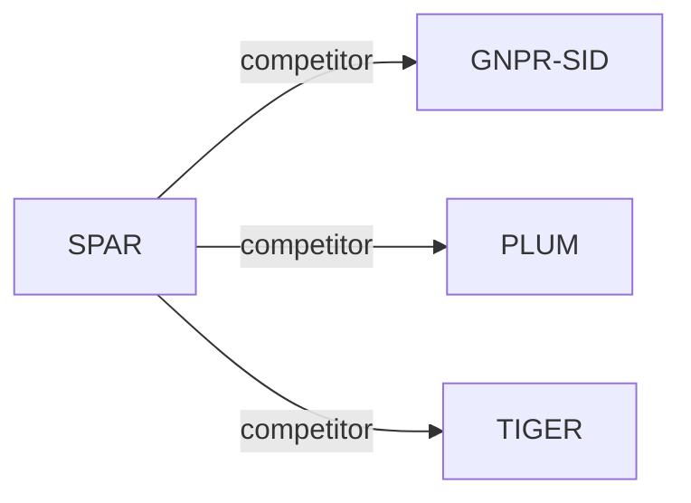

# SPAR

*Enhancing Industrial-Scale Generative POI Recommendation via Real-World Spatial Perception* — Wang et al. · arXiv’26

`I. Informativeness` · `Representation` · `POI`

[Paper](https://arxiv.org/abs/2609.02062) · [Matrix](../../README.md#i--representation)

Reading level: Overview (Level 1) · On this page: [TL;DR](#tldr) · [At a Glance](#at-a-glance) · [3. Experimental Findings](#3-experimental-findings) · [5. Connections to Related Work](#5-connections-to-related-work)

- `R-KM`: Residual k-means.
- `Dec-Only`: Decoder-only.
- `Fixed`: SIDs are built first and not changed while the generator trains.
- `Multi-task NTP`: The same NTP loss over several tasks.
- `–`: Not reported in the paper.

### TL;DR

SPAR fuses sinusoidal coordinate embeddings into Semantic ID construction, continually pre-trains the LLM on geospatial data, and anchors that knowledge as a frozen task vector during behavioral fine-tuning.

### At a Glance

| Aspect | Summary |
| :-- | :-- |
| Research Problem | I. Informativeness: Do the SIDs, or the model reading them, carry the collaborative and multimodal signals recommendation needs? |
| Key Contribution | SPAR fuses sinusoidal coordinate embeddings into Semantic ID construction, continually pre-trains the LLM on geospatial data, and anchors that knowledge as a frozen task vector during behavioral fine-tuning. |
| Modified Stage | Representation |

### 3. Experimental Findings

**Experimental setup**

- **Datasets**: Public NYC/TKY; one month of AMAP logs from Beijing, Shanghai, Tianjin and Zhejiang. MG-CPT adds 25 geospatial datasets per city. Cleaning details not reported.
- **Split**: Public: chronological 80%/10%/10% train/validation/test. Industrial: last day test, earlier interactions train; industrial validation allocation not reported. Each interaction uses its preceding history.
- **Candidates**: not reported
- **Visibility**: warm; no unseen-item protocol is defined. Cold/warm users have <8/>=16 historical interactions; queries and real-time location remain available. Quantizer fits training POIs; test-POI exclusion not detailed.
- **SID**: SI-SID: 3 residual K-Means codebooks x 32 codes for NYC/TKY or x 512 for AMAP, plus a fourth disambiguation index guaranteeing unique POI IDs.
- **Inference budget**: Default Qwen3-4B; Recall/NDCG/MRR@5/10/20. Experiment environment: 64 A100 GPUs; beam width, inference batch size and latency not reported. Reported batch 32 is training.
- **Results from**: Original Tables 2/3: public/industrial recommendation comparisons; Table 5: sparse-history users. Generative baselines are standardized to four-level SIDs with final disambiguation indices.

Sources

- **Datasets**: Section 5.1, Table 1 and Appendix B: [S5.SS1.p1](https://arxiv.org/html/2609.02062v2#S5.SS1.p1) and [S5.T1](https://arxiv.org/html/2609.02062v2#S5.T1) and [A2.p1](https://arxiv.org/html/2609.02062v2#A2.p1)
- **Split**: Section 5.1: [S5.SS1.p1](https://arxiv.org/html/2609.02062v2#S5.SS1.p1)
- **Candidates**: Section 5.1 reports metrics and splits without candidate enumeration or negative sampling: [S5.SS1](https://arxiv.org/html/2609.02062v2#S5.SS1)
- **Visibility**: Sections 4.1.2/5.5: [S4.SS1.SSS2.p2](https://arxiv.org/html/2609.02062v2#S4.SS1.SSS2.p2) and [S5.SS5.p1](https://arxiv.org/html/2609.02062v2#S5.SS5.p1)
- **SID**: Sections 4.1.2/5.1: [S4.SS1.SSS2.p2](https://arxiv.org/html/2609.02062v2#S4.SS1.SSS2.p2) and [S5.SS1.p4](https://arxiv.org/html/2609.02062v2#S5.SS1.p4)
- **Inference budget**: Section 5.1: [S5.SS1.p2](https://arxiv.org/html/2609.02062v2#S5.SS1.p2) and [S5.SS1.p4](https://arxiv.org/html/2609.02062v2#S5.SS1.p4)
- **Results from**: Original Tables 2/3/5 and Section 5.1: [S5.T2](https://arxiv.org/html/2609.02062v2#S5.T2) and [S5.T3](https://arxiv.org/html/2609.02062v2#S5.T3) and [S5.T5](https://arxiv.org/html/2609.02062v2#S5.T5) and [S5.SS1.p4](https://arxiv.org/html/2609.02062v2#S5.SS1.p4)

### 5. Connections to Related Work

- **Competitor** · [GNPR-SID](gnpr-sid.md): SID POI baseline; SPAR explicitly injects and preserves urban spatial knowledge.
  - Source: SPAR v2, Section 5.1 and Tables 2/3: https://arxiv.org/html/2609.02062v2#S5.SS1.p3; https://arxiv.org/html/2609.02062v2#S5.T2; https://arxiv.org/html/2609.02062v2#S5.T3.
- **Competitor** · [PLUM](plum.md): Generic SID-CPT-SFT comparator against SPAR's spatially specialized stages.
  - Source: SPAR v2, Section 5.2.2: https://arxiv.org/html/2609.02062v2#S5.SS2.SSS2.p2.
- **Competitor** · [TIGER](tiger.md): Evaluated with four-level SIDs including a final disambiguation index.
  - Source: SPAR v2, Section 5.1 and Tables 2/3: https://arxiv.org/html/2609.02062v2#S5.SS1.p3; https://arxiv.org/html/2609.02062v2#S5.SS1.p4; https://arxiv.org/html/2609.02062v2#S5.T2; https://arxiv.org/html/2609.02062v2#S5.T3.

[View all papers in this cell](../../README.md#i--representation)
