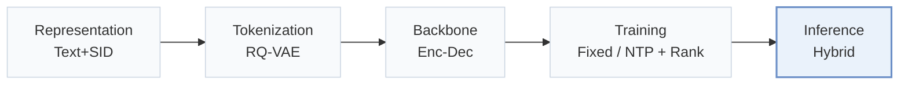
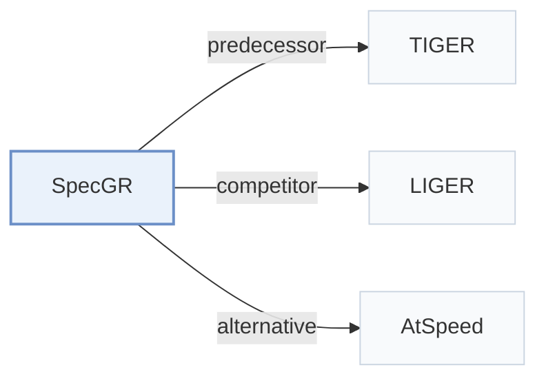

# SpecGR

[← Problem × Stage Matrix](../../README.md#vi--inference) · [Papers by Stage](../index/stages.md) · [Papers by Modality](../index/modality.md) · English | [中文](../zh/papers/specgr.md)

| **Title** | *Inductive Generative Recommendation via Retrieval-based Speculation* |
| :-- | :-- |
| **Authors** | Ding et al. |
| **Venue** | AAAI’26 |
| **Problem × Stage** | `VI. Generalization` · `Inference` |
| **Links** | [Paper](https://arxiv.org/abs/2410.02939) · [Code](https://github.com/Jamesding000/SpecGR) |
| **Reading level** | Overview (Level 1) |

**On this page**: [TL;DR](#tldr) · [At a Glance](#at-a-glance) · [3. Experiments](#3-experimental-findings) · [5. Related Work](#5-connections-to-related-work)

- `Text+SID`: Text representation plus semantic IDs (hybrid dense and generative retrieval).
- `RQ-VAE`: Residual-Quantized Variational AutoEncoder.
- `Enc-Dec`: Encoder-decoder.
- `Fixed`: SIDs are built first and not changed while the generator trains.
- `NTP + Rank`: NTP plus a ranking loss.
- `Hybrid`: Hybrid retrieval combining generative SID decoding with dense or co-occurrence retrieval.

### TL;DR

> [!NOTE]
> SpecGR uses an inductive drafter to propose existing and new items and the generative recommender as verifier, so the model can recommend items unseen in training.

---

### At a Glance

| Aspect | Summary |
| :-- | :-- |
| Research Problem | VI. Generalization: Does it still work for new items, new domains, and shifting interests? |
| Key Contribution | SpecGR uses an inductive drafter to propose existing and new items and the generative recommender as verifier, so the model can recommend items unseen in training. |
| Modified Stage | Inference |

---

### 3. Experimental Findings

Experimental setup

- **Datasets**: Amazon Reviews 2023 Video Games, Office Products, Cell Phones and Accessories; timestamp_w_his 5-core benchmark excludes users/items with fewer than five interactions; maximum input history 20 items.
  - Source: [Sx4.SSx1.SSSx1.p1](https://arxiv.org/html/2410.02939v2#Sx4.SSx1.SSSx1.p1) ; #Sx4.SSx1.SSSx4.p1
- **Split**: Global predefined timestamp cutoffs create train/validation/test sets; exact dates not reported in paper. Test divided into In-Sample and Unseen according to target-item occurrence in training.
  - Source: [Sx4.SSx1.SSSx1.p1](https://arxiv.org/html/2410.02939v2#Sx4.SSx1.SSSx1.p1) ; #Sx4.SSx1.SSSx3.p1
- **Candidates**: not reported; full-catalog and subset-ranking capabilities are discussed, but the main evaluation universe and negative-sampling protocol are not explicitly specified.
  - Source: [Sx4.SSx1.SSSx3.p1](https://arxiv.org/html/2410.02939v2#Sx4.SSx1.SSSx3.p1) ; #A6.SSx1.p1
- **Visibility**: Unseen targets have no training interactions and are unseen by the generator. New items are assigned SIDs for inference; tokenizer fitting exposure is not reported, so whether they are unseen by tokenizer too is not established.
  - Source: [Sx3.SSx1.p1](https://arxiv.org/html/2410.02939v2#Sx3.SSx1.p1) ; #Sx3.SSx1.p2 ; #Sx4.SSx1.SSSx3.p1
- **SID**: TIGER RQ-VAE tokenization; standard experiments use four-digit SIDs, including a final collision-identification token. Codebook sizes and suffix-assignment rule not reported. Verification excludes the identification token for unseen items.
  - Source: [Sx4.SSx1.SSSx4.p1](https://arxiv.org/html/2410.02939v2#Sx4.SSx1.SSSx4.p1) ; #Sx3.SSx2.SSSx2.p3 ; #A5.SSx2.p1
- **Inference budget**: Beam beta and draft size delta are 50 or output K (10/50); verification threshold tuned -1.1 to -1.8. Draft/verify with guided redrafting and early exit, then beam fallback if needed. Table A6 at draft size 50: SpecGR++ drafting/verifying 0.0003/0.0249 s versus TIGER 0.0403 s. Inference hardware, batch size and timing aggregation not reported.
  - Source: [A2.SSx1.p1](https://arxiv.org/html/2410.02939v2#A2.SSx1.p1) ; #Sx3.SSx2.SSSx4.p1 ; #A5.T6
- **Results from**: Original Table 1: overall comparison; Table 2: seen/unseen breakdown; Table 3: ablations; Table A6: latency. Baselines reproduced/tuned; Recformer starts from a third-party reproduction checkpoint and is fine-tuned on these datasets.
  - Source: [Sx4.SSx2.p1](https://arxiv.org/html/2410.02939v2#Sx4.SSx2.p1) ; #Sx4.SSx2.p2 ; #Sx4.T3 ; #A2.SSx3.p1 ; #A5.T6

---

### 5. Connections to Related Work

- **Predecessor** · [TIGER](tiger.md): SpecGR uses TIGER as its generative verifier and adds inductive drafting; SpecGR++ reuses the same encoder for self-drafting.
  - Source: SpecGR v2, Implementation Details and Drafting Strategies: [Sx4.SSx1.SSSx4.p1](https://arxiv.org/html/2410.02939v2#Sx4.SSx1.SSSx4.p1); [Sx3.SSx3.SSSx2.p1](https://arxiv.org/html/2410.02939v2#Sx3.SSx3.SSSx2.p1).
- **Competitor** · [LIGER](liger.md): LIGER blends dense-retrieved candidates with generated items; SpecGR filters and orders inductive drafts using generative target-aware likelihoods.
  - Source: SpecGR v2, Performance Analysis and Table 2: [Sx4.SSx2.p2](https://arxiv.org/html/2410.02939v2#Sx4.SSx2.p2).
- **Alternative** · [AtSpeed](atspeed.md): AtSpeed adapts speculative decoding to accelerate top-K generative recommendation; SpecGR uses draft-and-verify to introduce unseen-item recommendation capability.
  - Source: SpecGR v2, Related Work, citing Lin et al. (2024), arXiv:2410.05165: [Sx2.p3](https://arxiv.org/html/2410.02939v2#Sx2.p3).

[View all papers in this cell](../../README.md#vi--inference)
