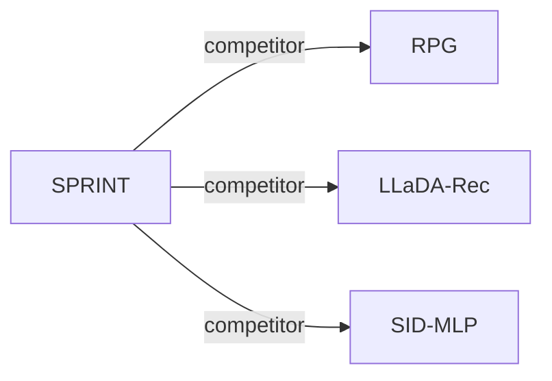

# SPRINT

*Single-Step Generative Recommendation via Average Probability Velocity* — Cai et al. · arXiv’26

`V. Efficiency` · `Backbone`

[Paper](https://arxiv.org/abs/2609.34306) · [Code](https://github.com/iamZhuoCai/SPRINT) · [Matrix](../../README.md#v--backbone)

Reading level: Overview (Level 1) · On this page: [TL;DR](#tldr) · [At a Glance](#at-a-glance) · [3. Experimental Findings](#3-experimental-findings) · [5. Connections to Related Work](#5-connections-to-related-work)

- `Non-AR`: Non-autoregressive.
- `Fixed`: SIDs are built first and not changed while the generator trains.
- `Dual-level Flow Ctr.`: Contrastive training at token and complete-identifier levels in a flow-based model.

### TL;DR

SPRINT predicts all Semantic ID token probabilities in one forward pass of a bidirectional Transformer, based on average probability velocity, and restores token coherence with a dual-level flow contrastive objective.

### At a Glance

| Aspect | Summary |
| :-- | :-- |
| Research Problem | V. Efficiency: Can it be trained and served within latency and cost budgets? |
| Key Contribution | SPRINT predicts all Semantic ID token probabilities in one forward pass of a bidirectional Transformer, based on average probability velocity, and restores token coherence with a dual-level flow contrastive objective. |
| Modified Stage | Backbone |

### 3. Experimental Findings

**Experimental setup**

- **Datasets**: Amazon Reviews 2014 Sports, Beauty and Toys; Amazon Reviews 2023 Instruments, Scientific, Games and Arts; Yelp. Filtering thresholds: not reported.
- **Split**: Per-user timestamp-ordered leave-one-out: last interaction test, penultimate validation, remainder training; history cap 20.
- **Candidates**: Full catalog: score valid SIDs with the sum of separately normalized token-probability and joint-SID similarity scores, returning top K. History-item exclusion: not reported. The 100/1000 sampled negative SIDs are training settings.
- **Visibility**: warm; no unseen-item protocol is defined. Tokenizer exposure to test items: not reported.
- **SID**: OPQ on sentence-t5-base content embeddings; four parallel codebooks x 256 codewords, four tokens/item. Collision handling: not reported.
- **Inference budget**: One encoder-decoder pass from four masks, followed by all-valid-SID scoring with precomputed item-side vectors; beam n/a for SPRINT. Test batch 256/history20; efficiency baselines use beam10 where applicable, embedding256. Recall/NDCG@5/10; additional K=20/50/100/1000. Whole-test-set seconds on Sports/Beauty/Toys/Scientific/Instruments/Games: 2.65/1.52/1.28/4.08/4.62/7.55. Hardware, per-request latency, and inclusion of precomputation/data loading/metric computation in timing: not reported.
- **Results from**: Paper's comparisons/ablations, averaged over five random-seed runs (seed values not reported). Tables2/8 main accuracy, Table12 Yelp/Arts, Tables3/10 whole-test inference time, Table9 per-epoch training time. Efficiency configurations are shared; accuracy settings follow original papers and are tuned per dataset. Table10 accelerators use TIGER backbones. Explicit borrowed-versus-rerun score attribution: not reported.

Sources

- **Datasets**: Sec.4.1 and Appendix D.1: [S4.SS1.p1](https://arxiv.org/html/2609.34306v1#S4.SS1.p1) and [A4.SS1.p1](https://arxiv.org/html/2609.34306v1#A4.SS1.p1)
- **Split**: Appendix D.1 and D.3: [A4.SS1.p1](https://arxiv.org/html/2609.34306v1#A4.SS1.p1) and [A4.SS3.p1](https://arxiv.org/html/2609.34306v1#A4.SS3.p1)
- **Candidates**: Sec.4.1 and Sec.3.4 inference; sampled SIDs in Eq.9 are training negatives: [S4.SS1.p1](https://arxiv.org/html/2609.34306v1#S4.SS1.p1) and [S3.SS4.p3](https://arxiv.org/html/2609.34306v1#S3.SS4.p3) and [S3.SS3.p6](https://arxiv.org/html/2609.34306v1#S3.SS3.p6) and [S4.SS1.p3](https://arxiv.org/html/2609.34306v1#S4.SS1.p3)
- **Visibility**: Sec.4.1 and Appendix D.1/D.3 define standard evaluation without unseen-item experiments: [S4.SS1](https://arxiv.org/html/2609.34306v1#S4.SS1) and [A4.SS1.p1](https://arxiv.org/html/2609.34306v1#A4.SS1.p1) and [A4.SS3.p1](https://arxiv.org/html/2609.34306v1#A4.SS3.p1)
- **SID**: Sec.3.1 and Appendix D.3: [S3.SS1.p2](https://arxiv.org/html/2609.34306v1#S3.SS1.p2) and [A4.SS3.p1](https://arxiv.org/html/2609.34306v1#A4.SS3.p1)
- **Inference budget**: Sec.3.4, Sec.4.1, Table3, Appendix D.3/D.11 and Algorithm2: [S3.SS4.p2](https://arxiv.org/html/2609.34306v1#S3.SS4.p2) and [S3.SS4.p3](https://arxiv.org/html/2609.34306v1#S3.SS4.p3) and [S4.SS1.p1](https://arxiv.org/html/2609.34306v1#S4.SS1.p1) and [S4.T3](https://arxiv.org/html/2609.34306v1#S4.T3) and [A4.SS3.p2](https://arxiv.org/html/2609.34306v1#A4.SS3.p2) and [A4.SS11.p1](https://arxiv.org/html/2609.34306v1#A4.SS11.p1) and [alg2](https://arxiv.org/html/2609.34306v1#alg2)
- **Results from**: Sec.4.1, Tables2/3/4 and Appendix D.3/D.6/D.8: [S4.SS1.p3](https://arxiv.org/html/2609.34306v1#S4.SS1.p3) and [S4.T2](https://arxiv.org/html/2609.34306v1#S4.T2) and [S4.T3](https://arxiv.org/html/2609.34306v1#S4.T3) and [S4.T4](https://arxiv.org/html/2609.34306v1#S4.T4) and [A4.SS3.p2](https://arxiv.org/html/2609.34306v1#A4.SS3.p2) and [A4.SS6.p2](https://arxiv.org/html/2609.34306v1#A4.SS6.p2) and [A4.SS8.p1](https://arxiv.org/html/2609.34306v1#A4.SS8.p1)

### 5. Connections to Related Work

- **Competitor** · [RPG](rpg.md): RPG is the compared single-step baseline with longer SIDs.
  - Source: SPRINT v1, Sec.1 and Sec.4.2: https://arxiv.org/html/2609.34306v1#S1.p2; https://arxiv.org/html/2609.34306v1#S4.SS2.p2.
- **Competitor** · [LLaDA-Rec](llada-rec.md): LLaDA-Rec is compared under one-step and four-step generation.
  - Source: SPRINT v1, Table1 and Sec.4.1: https://arxiv.org/html/2609.34306v1#S1.T1; https://arxiv.org/html/2609.34306v1#S4.SS1.p2.
- **Competitor** · [SID-MLP](sid-mlp.md): SID-MLP is the closest compared efficiency-oriented baseline.
  - Source: SPRINT v1, Appendix D.6: https://arxiv.org/html/2609.34306v1#A4.SS6.p2; https://arxiv.org/html/2609.34306v1#A4.T10.

[View all papers in this cell](../../README.md#v--backbone)
