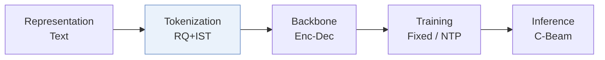
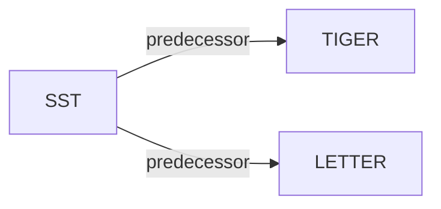

# SST

| **Title** | *Rethinking Item Tokenization in Generative Recommenders: From Fixed Atoms to Semantic Subwords* |
| :-- | :-- |
| **Authors** | Miao et al. |
| **Venue** | CIKM’26 |
| **Problem × Stage** | `III. SID–Model Alignment` · `Tokenization` |
| **Links** | [Paper](https://arxiv.org/abs/2608.22734) · [Code](https://github.com/mxrcandy/Semantic-Subword-Tokenization) · [Matrix](../../README.md#iii--tokenization) · [中文](../zh/papers/sst.md) |
| **Reading level** | Overview (Level 1) |

On this page: [TL;DR](#tldr) · [At a Glance](#at-a-glance) · [3. Experiments](#3-experimental-findings) · [5. Related Work](#5-connections-to-related-work)

- `RQ+IST`: Residual quantization combined with item-level subword tokenization.
- `Enc-Dec`: Encoder-decoder.
- `Fixed`: SIDs are built first and not changed while the generator trains.
- `NTP`: Next-token prediction loss only; continuing from a pretrained LLM (SFT) also counts as NTP.
- `C-Beam`: Constrained beam search.

### TL;DR

> [!NOTE]
> SST represents history items as variable-length subwords merged from stable adjacent Semantic ID tokens while keeping fixed-length target decoding, to reduce intra-item attention in the encoder.

---

### At a Glance

| Aspect | Summary |
| :-- | :-- |
| Research Problem | III. SID–Model Alignment: Can the generator read, write, and reason over SIDs, and do the tokenizer and generator work toward the same goal? |
| Key Contribution | SST represents history items as variable-length subwords merged from stable adjacent Semantic ID tokens while keeping fixed-length target decoding, to reduce intra-item attention in the encoder. |
| Modified Stage | Tokenization |

---

### 3. Experimental Findings

Experimental setup

- **Datasets**: Amazon Beauty/Instruments and Yelp; user/item 5-core filtering, chronological histories capped at 20.
  - Source: Section 3.1.1: [S3.SS1.SSS1.p1](https://arxiv.org/html/2608.22734v1#S3.SS1.SSS1.p1)
- **Split**: Per-user last interaction test, penultimate validation, earlier interactions training.
  - Source: Section 3.1.3: [S3.SS1.SSS3.p1](https://arxiv.org/html/2608.22734v1#S3.SS1.SSS3.p1)
- **Candidates**: full catalog; no sampled negatives.
  - Source: Section 3.1.3: [S3.SS1.SSS3.p1](https://arxiv.org/html/2608.22734v1#S3.SS1.SSS3.p1)
- **Visibility**: warm; no unseen-item protocol is defined. Tokenizer/collaborative encoder exposure to test items not reported.
  - Source: Section 3.1 defines no unseen-item holdout: [S3.SS1](https://arxiv.org/html/2608.22734v1#S3.SS1)
- **SID**: Sentence-T5 text embeddings; TIGER-VAE, TIGER-KM or LETTER targets retain 4 levels x 256 codes. History-side IST adds semantic subwords (merge budget tuned 64-512). Collision handling not reported.
  - Source: Section 3.1.4: [S3.SS1.SSS4.p2](https://arxiv.org/html/2608.22734v1#S3.SS1.SSS4.p2)
- **Inference budget**: Full-trie beam 20; Recall/NDCG@5/10. Hardware, inference batch size and standalone latency not reported; Table 3 wall time combines training, checkpoint loading and test evaluation.
  - Source: Sections 3.1.4/3.5: [S3.SS1.SSS4.p3](https://arxiv.org/html/2608.22734v1#S3.SS1.SSS4.p3) and [S3.SS5.p1](https://arxiv.org/html/2608.22734v1#S3.SS5.p1)
- **Results from**: Original Table 1: SST on three backbones; SARQ/VSID re-adapted to history-only variable lengths while preserving fixed target decoding. Table 6 reports all tokenizer-criterion variants.
  - Source: Table 1 and Section 3.1.2: [S3.T1](https://arxiv.org/html/2608.22734v1#S3.T1) and [S3.SS1.SSS2.p5](https://arxiv.org/html/2608.22734v1#S3.SS1.SSS2.p5) and [A1.T6](https://arxiv.org/html/2608.22734v1#A1.T6)

---

### 5. Connections to Related Work

- **Predecessor** · [TIGER](tiger.md): SST compresses TIGER-VAE/TIGER-KM histories while retaining fixed-length target SIDs.
  - Source: SST v1, Sections 3.1.2/3.1.4 and Table 1: https://arxiv.org/html/2608.22734v1#S3.SS1.SSS2.p2; https://arxiv.org/html/2608.22734v1#S3.SS1.SSS4.p2; https://arxiv.org/html/2608.22734v1#S3.T1.
- **Predecessor** · [LETTER](letter.md): LETTER is the collaborative-tokenization backbone used for the third SST configuration.
  - Source: SST v1, Section 3.1.2 and Table 1: https://arxiv.org/html/2608.22734v1#S3.SS1.SSS2.p2; https://arxiv.org/html/2608.22734v1#S3.T1.

[View all papers in this cell](../../README.md#iii--tokenization)
