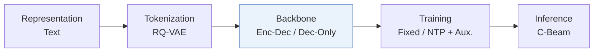
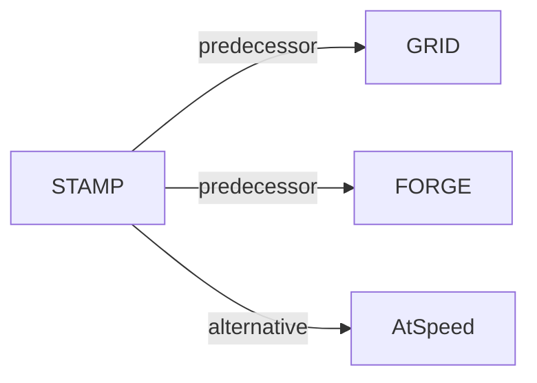

# STAMP

*Semantic Trimming and Auxiliary Multi-step Prediction for Generative Recommendation* — Zhan et al. · arXiv’26

`V. Efficiency` · `Backbone` · [Paper](https://arxiv.org/abs/2604.05329) · [Matrix](../../README.md#v--backbone) · [中文](../zh/papers/stamp.md)

Reading level: Overview (Level 1) · On this page: [TL;DR](#tldr) · [At a Glance](#at-a-glance) · [3. Experiments](#3-experimental-findings) · [5. Related Work](#5-connections-to-related-work)

- `Enc-Dec / Dec-Only`: Evaluated on both Encoder-Decoder and Decoder-Only backbones.
- `Fixed`: SIDs are built first and not changed while the generator trains.
- `NTP + Aux.`: NTP plus another auxiliary loss.
- `C-Beam`: Constrained beam search.

### TL;DR

> [!NOTE]
> STAMP prunes redundant Semantic ID tokens adaptively in the forward pass and adds a multi-step auxiliary prediction objective, to cut training cost and densify supervision for long Semantic IDs.

### At a Glance

| Aspect | Summary |
| :-- | :-- |
| Research Problem | V. Efficiency: Can it be trained and served within latency and cost budgets? |
| Key Contribution | STAMP prunes redundant Semantic ID tokens adaptively in the forward pass and adds a multi-step auxiliary prediction objective, to cut training cost and densify supervision for long Semantic IDs. |
| Modified Stage | Backbone |

### 3. Experimental Findings

Experimental setup

- **Datasets**: Amazon Beauty (22.4K users / 12.1K items), Sports (35.6K / 18.4K), Toys (19.4K / 11.9K) with 5-core filtering; and AL-GR-Tiny, a subset of the AL-GR benchmark from a Chinese e-commerce platform (the full AL-GR has 131M users / 251M items / 14B interactions).
  - Source: Datasets: [S5.I2.i1.p1](https://arxiv.org/html/2604.05329v3#S5.I2.i1.p1) and [S5.I2.i2.p1](https://arxiv.org/html/2604.05329v3#S5.I2.i2.p1); statistics: [S5.T1](https://arxiv.org/html/2604.05329v3#S5.T1).
- **Split**: Amazon: per-user leave-one-out (final interaction for test, penultimate for validation). AL-GR-Tiny: the benchmark's Stage 1 split, four days of training behaviors and a test set from the following day. GRID results averaged over five seeds.
  - Source: Leave-one-out on Amazon; AL-GR S1 split: [S5.I2.i1.p1](https://arxiv.org/html/2604.05329v3#S5.I2.i1.p1) and [S5.I2.i2.p1](https://arxiv.org/html/2604.05329v3#S5.I2.i2.p1).
- **Candidates**: not reported (full catalog versus sampled); Recall/NDCG at 5 and 10 under GRID, HitRate at 20-1000 under FORGE, as defined by those frameworks.
  - Source: Metrics inherited from GRID and FORGE: [S5.I4.i1.p1](https://arxiv.org/html/2604.05329v3#S5.I4.i1.p1).
- **Visibility**: warm; no unseen-item protocol is defined.
  - Source: No unseen-item protocol: [S5.I2.i1.p1](https://arxiv.org/html/2604.05329v3#S5.I2.i1.p1) and [S5.I2.i2.p1](https://arxiv.org/html/2604.05329v3#S5.I2.i2.p1).
- **SID**: Uses each framework's SIDs unchanged: GRID with RK-Means over Flan-T5-XL embeddings and three codebooks (codebook size not restated); FORGE's pre-processed AL-GR SIDs. Collision handling: not reported.
  - Source: GRID RK-Means with three codebooks over Flan-T5-XL: [S5.SS1.SSS4.p2](https://arxiv.org/html/2604.05329v3#S5.SS1.SSS4.p2); FORGE SIDs from AL-GR: [S5.SS1.SSS4.p3](https://arxiv.org/html/2604.05329v3#S5.SS1.SSS4.p3).
- **Inference budget**: STAMP accelerates training (token pruning plus an auxiliary loss that is discarded at inference, so no inference overhead is claimed); inference decoding settings follow GRID and FORGE and are not restated. Training speed and VRAM reported on one A100-40GB (GRID) and two A100-80GB (FORGE).
  - Source: Training-time acceleration; MAP discarded at inference: [S4.SS4.p1](https://arxiv.org/html/2604.05329v3#S4.SS4.p1); hardware: [S5.SS1.SSS4.p2](https://arxiv.org/html/2604.05329v3#S5.SS1.SSS4.p2) and [S5.SS1.SSS4.p3](https://arxiv.org/html/2604.05329v3#S5.SS1.SSS4.p3).
- **Results from**: Table 2 (GRID T5 on Beauty, Sports, Toys: accuracy, training time, VRAM versus EARN; five seeds); Table 3 (FORGE Qwen2.5-0.5B on AL-GR-Tiny); later analyses and ablations.
  - Source: Results: [S5.T2](https://arxiv.org/html/2604.05329v3#S5.T2) and [S5.T3](https://arxiv.org/html/2604.05329v3#S5.T3).

### 5. Connections to Related Work

- **Predecessor** · [GRID](grid.md): STAMP is implemented inside the GRID framework and keeps its tokenizer and T5 backbone, adding training-time token pruning and multi-step auxiliary prediction.
  - Source: STAMP v3, Section 5.1.4 GRID setup: https://arxiv.org/html/2604.05329v3#S5.SS1.SSS4.p2; Table 2: https://arxiv.org/html/2604.05329v3#S5.T2.
- **Predecessor** · [FORGE](forge.md): STAMP uses FORGE's AL-GR-Tiny data and Qwen backbone as its second testbed.
  - Source: STAMP v3, Section 5.1.1 and 5.1.4: https://arxiv.org/html/2604.05329v3#S5.I2.i2.p1 and https://arxiv.org/html/2604.05329v3#S5.SS1.SSS4.p3; Table 3: https://arxiv.org/html/2604.05329v3#S5.T3.
- **Alternative** · [AtSpeed](atspeed.md): AtSpeed accelerates inference by speculative decoding; STAMP targets training-time cost instead.
  - Source: STAMP v3, Section 2 acceleration paragraph: https://arxiv.org/html/2604.05329v3#S2.p3.

[View all papers in this cell](../../README.md#v--backbone)
