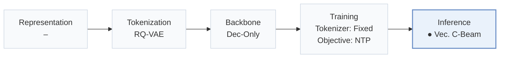
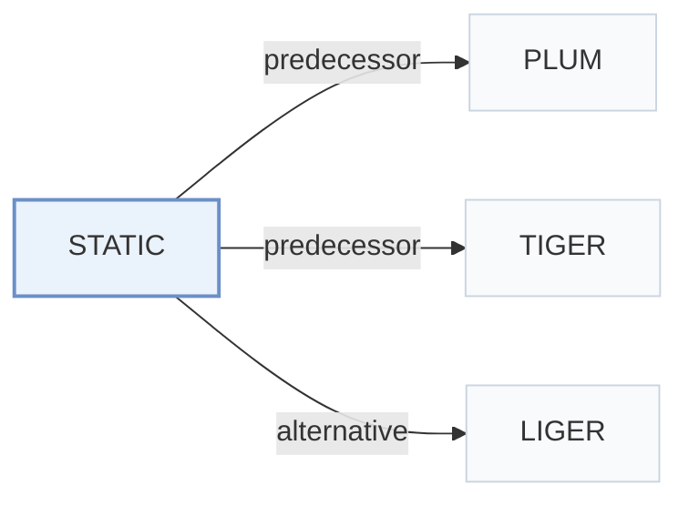

# STATIC

[← Problem × Stage Matrix](../../README.md#v--inference) · [Papers by Stage](../index/stages.md) · [Papers by Modality](../index/modality.md) · [Papers by Domain](../index/domain.md) · English | [中文](../zh/papers/static.md)

| **Title** | *Vectorizing the Trie: Efficient Constrained Decoding for LLM-based Generative Retrieval on Accelerators* |
| :-- | :-- |
| **Authors** | Su et al. |
| **Venue** | KDD’26 ADS |
| **Problem × Stage** | `V. Efficiency` · `Inference` |
| **Changes** | ● Inference |
| **SID inputs** | `Other` (RQ-VAE item features; source modalities unstated) |
| **Domain** | `E-commerce` · `Video` |
| **Settings** | `cold-start (item)` |
| **Scenario** | `General Item Recommendation`; `Online Experiment or Deployment` |
| **Links** | [Paper](https://arxiv.org/abs/2602.22647) · [Code](https://github.com/youtube/static-constraint-decoding) |
| **Reading level** | Overview (Level 1) |

**On this page**: [TL;DR](#tldr) · [3. Experiments](#3-experimental-findings) · [5. Related Work](#5-connections-to-related-work)

- `RQ-VAE`: Residual-Quantized Variational AutoEncoder.
- `Dec-Only`: Decoder-only.
- `Fixed`: SIDs are built first and not changed while the generator trains.
- `NTP`: Next-token prediction loss only; continuing from a pretrained LLM (SFT) also counts as NTP.
- `Vec. C-Beam`: Vectorized constrained beam search.

### TL;DR

> [!NOTE]
> STATIC flattens the prefix tree of valid Semantic IDs into a sparse CSR matrix, turning trie traversal into vectorized operations for constrained decoding on TPUs and GPUs.

---

### 3. Experimental Findings

Experimental setup

- **Datasets**: YouTube corpus (100M-1B items); Amazon Beauty, Sports and Outdoors, Toys and Games (10K-20K items/domain). Filtering rules not reported.
  - Source: Sections 5.1/6.1 and Table 3: [S5.SS1.p1](https://arxiv.org/html/2602.22647v3#S5.SS1.p1) and [S6.SS1.p1](https://arxiv.org/html/2602.22647v3#S6.SS1.p1) and [S6.T3](https://arxiv.org/html/2602.22647v3#S6.T3)
- **Split**: Amazon cold targets: newest 2% or 5% of items by oldest-review date. Training-sequence exclusion wording is internally contradictory; exact temporal/validation split not reported. YouTube training split not reported.
  - Source: Section 6.2 and Appendix F: [S6.SS2.p1](https://arxiv.org/html/2602.22647v3#S6.SS2.p1) and [A6.p2](https://arxiv.org/html/2602.22647v3#A6.p2)
- **Candidates**: Restricted catalog: YouTube about 20M high-quality videos uploaded within 7 days; Amazon only the selected cold-item set. Unconstrained baselines can access the full catalog.
  - Source: Sections 5.2/6.2: [S5.SS2.p1](https://arxiv.org/html/2602.22647v3#S5.SS2.p1) and [S6.SS2.p1](https://arxiv.org/html/2602.22647v3#S6.SS2.p1)
- **Visibility**: Amazon generator exclusion is ambiguous; tokenizer cold-item exposure is not reported. Section 6.2 calls training sequences no-cold-start but says to remove sequences without cold items. Unseen by generator only versus unseen by tokenizer too cannot be established.
  - Source: Sections 6.1/6.2: [S6.SS1.p1](https://arxiv.org/html/2602.22647v3#S6.SS1.p1) and [S6.SS2.p1](https://arxiv.org/html/2602.22647v3#S6.SS2.p1)
- **SID**: YouTube: 8 levels x 2048 codes; Amazon: separate RQ-VAE per domain, 4 levels x 256. Collision handling not reported.
  - Source: Sections 5.1/6.1: [S5.SS1.p1](https://arxiv.org/html/2602.22647v3#S5.SS1.p1) and [S6.SS1.p1](https://arxiv.org/html/2602.22647v3#S6.SS1.p1)
- **Inference budget**: TPU v6e. YouTube: Gemini-based dense 3B, batch 2/chip, beam 70; added constraint overhead 0.033 ms/step, 0.25% of inference time. Amazon: Gemma-based dense 1B, batch 16, beam 20, Recall@1.
  - Source: Sections 5.1/5.2/6.1: [S5.SS1.p2](https://arxiv.org/html/2602.22647v3#S5.SS1.p2) and [S5.SS2.p3](https://arxiv.org/html/2602.22647v3#S5.SS2.p3) and [S6.SS1.p2](https://arxiv.org/html/2602.22647v3#S6.SS1.p2)
- **Results from**: Original Table 1: constraint-enforcement latency (100 trials); Table 2: STATIC-enabled PLUM deployment A/B; Table 3: Amazon cold-start Recall@1, reported as peak over 70 training epochs.
  - Source: Tables 1-3 and Appendix F: [S5.T1](https://arxiv.org/html/2602.22647v3#S5.T1) and [S5.T2](https://arxiv.org/html/2602.22647v3#S5.T2) and [S6.T3](https://arxiv.org/html/2602.22647v3#S6.T3) and [A6.p2](https://arxiv.org/html/2602.22647v3#A6.p2)

---

### 5. Connections to Related Work

- **Predecessor** · [PLUM](plum.md): STATIC adds production decoding constraints to a PLUM-based YouTube retriever.
  - Source: STATIC v3, Sections 5.1/5.4: [S5.SS1.p2](https://arxiv.org/html/2602.22647v3#S5.SS1.p2); [S5.SS4.p1](https://arxiv.org/html/2602.22647v3#S5.SS4.p1).
- **Predecessor** · [TIGER](tiger.md): STATIC retains hierarchical SID retrieval and accelerates validity masking.
  - Source: STATIC v3, Sections 2.1/6.1: [S2.SS1.p2](https://arxiv.org/html/2602.22647v3#S2.SS1.p2); [S6.SS1.p1](https://arxiv.org/html/2602.22647v3#S6.SS1.p1).
- **Alternative** · [LIGER](liger.md): LIGER motivates the cold-start limitation; STATIC restricts decoding to cold items.
  - Source: STATIC v3, Section 2.1 (Yang et al., 2024) and Section 6: [S2.SS1.p3](https://arxiv.org/html/2602.22647v3#S2.SS1.p3); [S6.SS2.p1](https://arxiv.org/html/2602.22647v3#S6.SS2.p1).

[View all papers in this cell](../../README.md#v--inference)
