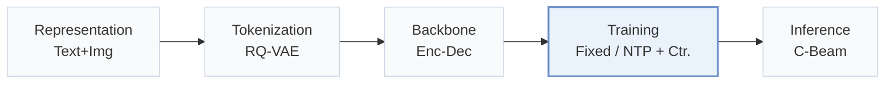
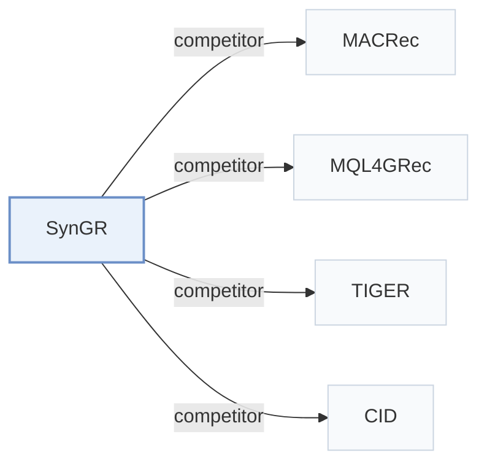

# SynGR

[← Problem × Stage Matrix](../../README.md#i--training) · [Papers by Stage](../index/stages.md) · [Papers by Modality](../index/modality.md) · English | [中文](../zh/papers/syngr.md)

| **Title** | *Unleashing the Potential of Cross-Modal Synergy for Generative Recommendation* |
| :-- | :-- |
| **Authors** | Chen et al. |
| **Venue** | ICML’26 |
| **Problem × Stage** | `I. Informativeness` · `Training` |
| **Links** | [Paper](https://arxiv.org/abs/2605.18920) · [Code](https://github.com/gxingyu/SynGR) |
| **Reading level** | Overview (Level 1) |

**On this page**: [TL;DR](#tldr) · [At a Glance](#at-a-glance) · [3. Experiments](#3-experimental-findings) · [5. Related Work](#5-connections-to-related-work)

- `Text+Img`: Text and visual item representations.
- `RQ-VAE`: Residual-Quantized Variational AutoEncoder.
- `Enc-Dec`: Encoder-decoder.
- `Fixed`: SIDs are built first and not changed while the generator trains.
- `NTP + Ctr.`: NTP plus a contrastive loss.
- `C-Beam`: Constrained beam search.

### TL;DR

> [!NOTE]
> SynGR constrains reliance on dominant modalities during generation, so the generator uses synergistic cross-modal information beyond shared or modality-specific signals, instead of alignment-centric fusion.

---

### At a Glance

| Aspect | Summary |
| :-- | :-- |
| Research Problem | I. Informativeness: Do the SIDs, or the model reading them, carry the collaborative and multimodal signals recommendation needs? |
| Key Contribution | SynGR constrains reliance on dominant modalities during generation, so the generator uses synergistic cross-modal information beyond shared or modality-specific signals, instead of alignment-centric fusion. |
| Modified Stage | Training |

---

### 3. Experimental Findings

Experimental setup

- **Datasets**: Amazon Reviews 2018 targets: Arts (22,171 users / 9,416 items), Games (42,259 / 13,839), Instruments (17,112 / 6,250), as in MQL4GRec; pre-training on six other categories (about 7.1M interactions, 884,918 users, 255,181 items). Filtering rules: not restated.
  - Source: Target datasets: [S5.SS1.p1](https://arxiv.org/html/2605.18920v2#S5.SS1.p1) and [S4.T2](https://arxiv.org/html/2605.18920v2#S4.T2); pre-training corpus: [A3.p1](https://arxiv.org/html/2605.18920v2#A3.p1).
- **Split**: Leave-one-out (following MQL4GRec and MACRec; allocation not restated beyond the label).
  - Source: Leave-one-out following MQL4GRec and MACRec: [S5.SS1.p3](https://arxiv.org/html/2605.18920v2#S5.SS1.p3).
- **Candidates**: full catalog (full ranking over the entire item space).
  - Source: Full ranking and beam 20: [S5.SS1.p3](https://arxiv.org/html/2605.18920v2#S5.SS1.p3).
- **Visibility**: warm; no unseen-item protocol is defined.
  - Source: Standard split with no unseen-item protocol: [S5.SS1.p3](https://arxiv.org/html/2605.18920v2#S5.SS1.p3).
- **SID**: Separate text (LLaMA) and image (ViT-L/14) semantic IDs from RQ-VAEs with 4 levels x 256 codes, merged into a unified dictionary; collision handling: not reported.
  - Source: 4 layers x 256 per modality RQ-VAE: [A3.p2](https://arxiv.org/html/2605.18920v2#A3.p2) and [S4.SS1.p2](https://arxiv.org/html/2605.18920v2#S4.SS1.p2); collision handling not found.
- **Inference budget**: Beam search with beam size 20 for all generative models, following MQL4GRec's multimodal decoding; the synergy loss is training-only. Efficiency study on six NVIDIA RTX 4090 GPUs reports inference 6.0% (Arts) and 4.0% (Instruments) faster than MACRec; absolute latency and batch size: not reported.
  - Source: Beam size 20 for all generative models: [S5.SS1.p3](https://arxiv.org/html/2605.18920v2#S5.SS1.p3); inference follows MQL4GRec: [S4.SS3.p2](https://arxiv.org/html/2605.18920v2#S4.SS3.p2); hardware: [S5.F3](https://arxiv.org/html/2605.18920v2#S5.F3).
- **Results from**: Table 1 (Arts, Games, Instruments versus sequential, multimodal, and generative baselines); Figure 3 (training time, inference speed, convergence versus MACRec); Figures 4-5 (parameters and ablations).
  - Source: Main: [S4.T1](https://arxiv.org/html/2605.18920v2#S4.T1); efficiency: [S5.F3](https://arxiv.org/html/2605.18920v2#S5.F3); parameters: [S5.F4](https://arxiv.org/html/2605.18920v2#S5.F4); ablation: [S5.F5](https://arxiv.org/html/2605.18920v2#S5.F5).

---

### 5. Connections to Related Work

- **Competitor** · [MACRec](macrec.md): MACRec aligns modalities with multiple explicit and implicit generation tasks; SynGR diagnoses modality shortcuts and adds a synergy-focused contrastive objective, with lower training cost.
  - Source: SynGR v2, generative baselines: [S5.SS1.p2](https://arxiv.org/html/2605.18920v2#S5.SS1.p2); Table 1: [S4.T1](https://arxiv.org/html/2605.18920v2#S4.T1); efficiency comparison: [S5.SS3.p2](https://arxiv.org/html/2605.18920v2#S5.SS3.p2).
- **Competitor** · [MQL4GRec](mql4grec.md): MQL4GRec translates each modality into its own quantitative language; SynGR follows its decoding and pre-training protocol but targets synergistic information between modalities.
  - Source: SynGR v2, baselines and protocol: [S5.SS1.p2](https://arxiv.org/html/2605.18920v2#S5.SS1.p2), [S5.SS1.p3](https://arxiv.org/html/2605.18920v2#S5.SS1.p3), [S4.SS3.p2](https://arxiv.org/html/2605.18920v2#S4.SS3.p2); Table 1: [S4.T1](https://arxiv.org/html/2605.18920v2#S4.T1).
- **Competitor** · [TIGER](tiger.md): TIGER uses unimodal text SIDs; SynGR fuses text and image codes and regularizes their synergy.
  - Source: SynGR v2, generative baselines: [S5.SS1.p2](https://arxiv.org/html/2605.18920v2#S5.SS1.p2); Table 1: [S4.T1](https://arxiv.org/html/2605.18920v2#S4.T1).
- **Competitor** · [CID](cid.md): P5-CID uses collaborative IDs in a P5 model; SynGR uses multimodal semantic IDs.
  - Source: SynGR v2, sequential baselines (P5-CID): [S5.SS1.p2](https://arxiv.org/html/2605.18920v2#S5.SS1.p2); Table 1: [S4.T1](https://arxiv.org/html/2605.18920v2#S4.T1).

[View all papers in this cell](../../README.md#i--training)
