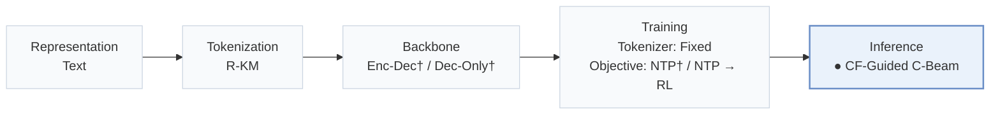
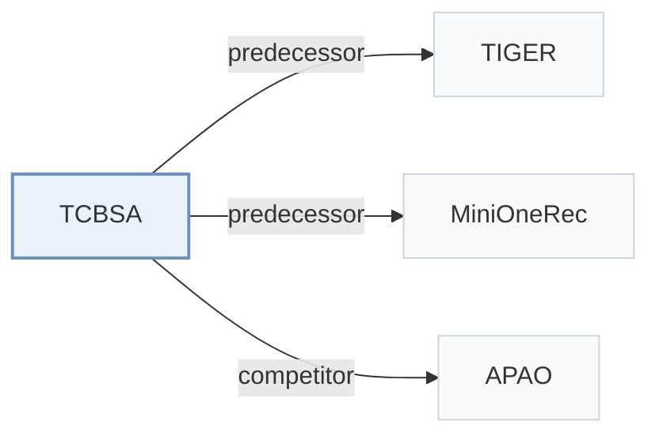

# TCBSA

[← Problem × Stage Matrix](../../README.md#iv--inference) · [Papers by Stage](../index/stages.md) · [Papers by Modality](../index/modality.md) · [Papers by Domain](../index/domain.md) · English | [中文](../zh/papers/tcbsa.md)

| **Title** | *From Item Scores to Semantic Tokens: Test-Time Collaborative Adaptation for Generative Recommendation* |
| :-- | :-- |
| **Authors** | Shan et al. |
| **Venue** | arXiv’26 |
| **Problem × Stage** | `IV. Utility` · `Inference` |
| **Changes** | ● Inference |
| **SID inputs** | `Text` |
| **Domain** | `E-commerce` · `POI / Local` |
| **Links** | [Paper](https://arxiv.org/abs/2610.32098) |
| **Reading level** | Overview (Level 1) |

**On this page**: [TL;DR](#tldr) · [3. Experiments](#3-experimental-findings) · [5. Related Work](#5-connections-to-related-work)

- `Text`: Textual item metadata (titles, descriptions, categories, or prompts).
- `R-KM`: Residual k-means.
- `Enc-Dec† / Dec-Only†`: Evaluated on both Encoder-Decoder and Decoder-Only backbones.
- `Fixed`: SIDs are built first and not changed while the generator trains.
- `NTP† / NTP → RL`: Inferred next-token training in one configuration, or next-token training followed by reinforcement learning in another.
- `CF-Guided C-Beam`: Constrained beam search guided by collaborative signals.

### TL;DR

> [!NOTE]
> TCBSA converts a discriminative recommender's score margins into potentials on shared Semantic ID prefixes and adds them, gated by confidence, to path scores before beam pruning, without retraining.

---

### 3. Experimental Findings

Experimental setup

- **Datasets**: Amazon Reviews 2023 Industrial and Scientific, Musical Instruments, Office Products: official 5-core, no extra rating thresholds/deduplication. Yelp Kaggle v2, 2019 window, all ratings implicit, iterative 5-core.
  - Source: Section 5.1 and Appendix B.1: [S5.SS1.SSS0.Px1.p1](https://arxiv.org/html/2610.32098v1#S5.SS1.SSS0.Px1.p1) and [A2.SS1.p1](https://arxiv.org/html/2610.32098v1#A2.SS1.p1)
- **Split**: Per-user chronological last/penultimate interactions are test/validation; earlier interactions train. Input histories capped at 20.
  - Source: Section 5.1: [S5.SS1.SSS0.Px1.p1](https://arxiv.org/html/2610.32098v1#S5.SS1.SSS0.Px1.p1)
- **Candidates**: full catalog; previously interacted items remain eligible, padding masked
  - Source: Section 5.1: [S5.SS1.SSS0.Px2.p1](https://arxiv.org/html/2610.32098v1#S5.SS1.SSS0.Px2.p1)
- **Visibility**: warm; no unseen-item protocol is defined. Generator and discriminative checkpoints remain frozen during adaptation.
  - Source: Section 5.1 defines no unseen-item holdout: [S5.SS1.SSS0.Px1.p1](https://arxiv.org/html/2610.32098v1#S5.SS1.SSS0.Px1.p1) and [S5.SS1.SSS0.Px4.p1](https://arxiv.org/html/2610.32098v1#S5.SS1.SSS0.Px4.p1)
- **SID**: Sentence-T5 text embeddings; 3 RQ-K-means levels plus fourth collision-resolution token for unique IDs. Codebook sizes not reported. Shared mapping across semantic-ID models.
  - Source: Section 5.1: [S5.SS1.SSS0.Px4.p1](https://arxiv.org/html/2610.32098v1#S5.SS1.SSS0.Px4.p1)
- **Inference budget**: Default beam 20, retrieval width 500; beam sweep 10/20/30/40/50. RTX 5880 Ada, inference batch 32. Synchronized per-user latency includes discriminative scoring/adaptation; default TCBSA costs 1.43-1.63x same-beam TIGER.
  - Source: Sections 5.1/5.6 and Appendix B.2: [S5.SS1.SSS0.Px4.p1](https://arxiv.org/html/2610.32098v1#S5.SS1.SSS0.Px4.p1) and [S5.SS6.p1](https://arxiv.org/html/2610.32098v1#S5.SS6.p1) and [S5.SS6.p3](https://arxiv.org/html/2610.32098v1#S5.SS6.p3) and [A2.SS2.p1](https://arxiv.org/html/2610.32098v1#A2.SS2.p1)
- **Results from**: Original Table 1: full-catalog comparisons; Figure 5: accuracy/latency. Baselines instantiated using specified implementations; MiniOneRec evaluated at its final RL checkpoint.
  - Source: Original Table 1 and Figure 5, implementation details: [S5.T1](https://arxiv.org/html/2610.32098v1#S5.T1) and [S5.F5](https://arxiv.org/html/2610.32098v1#S5.F5) and [S5.SS1.SSS0.Px4.p1](https://arxiv.org/html/2610.32098v1#S5.SS1.SSS0.Px4.p1)

---

### 5. Connections to Related Work

- **Predecessor** · [TIGER](tiger.md): Frozen generative backbone used with SASRec and GRU4Rec guidance.
  - Source: TCBSA v1, Section 5.1: [S5.SS1.SSS0.Px4.p1](https://arxiv.org/html/2610.32098v1#S5.SS1.SSS0.Px4.p1).
- **Predecessor** · [MiniOneRec](minionerec.md): Final RL checkpoint supplies the second frozen generative backbone.
  - Source: TCBSA v1, Section 5.1: [S5.SS1.SSS0.Px4.p1](https://arxiv.org/html/2610.32098v1#S5.SS1.SSS0.Px4.p1).
- **Competitor** · [APAO](apao.md): Prefix-aware training comparator against test-time beam adaptation.
  - Source: TCBSA v1, Section 5.1 and Table 1: [S5.SS1.SSS0.Px3.p1](https://arxiv.org/html/2610.32098v1#S5.SS1.SSS0.Px3.p1); [S5.T1](https://arxiv.org/html/2610.32098v1#S5.T1).

[View all papers in this cell](../../README.md#iv--inference)
