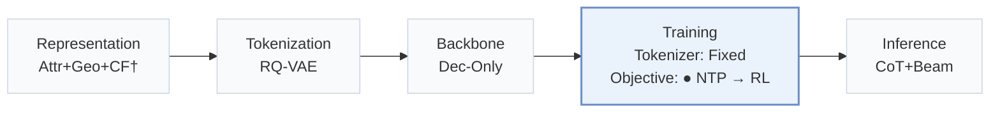
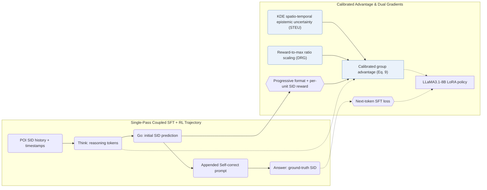
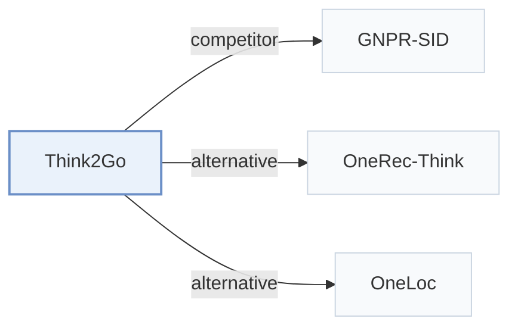

# Think2Go

[← Problem × Stage Matrix](../../README.md#iii--training) · [Papers by Stage](../index/stages.md) · [Papers by Modality](../index/modality.md) · [Papers by Domain](../index/domain.md) · English | [中文](../zh/papers/think2go.md)

| **Title** | *Generative Next POI Recommendation with LLM Reasoning* |
| :-- | :-- |
| **Authors** | Zhuang et al. |
| **Venue** | KDD’26 |
| **Problem × Stage** | `III. SID–Model Alignment` · `Training` · `POI` |
| **Changes** | ● Objective |
| **SID inputs** | `Other` (RQ-VAE POI identifiers; tokenizer inputs unstated) |
| **Domain** | `POI / Local` |
| **Settings** | `cross-domain` |
| **Scenario** | `POI and Local Services`; `Public Benchmarks` |
| **Links** | [Paper](https://arxiv.org/abs/2607.28997) · [Code](https://doi.org/10.5281/zenodo.18206701) |
| **Reading level** | Reading Notes (Level 2) |

**On this page**: [TL;DR](#tldr) · [At a Glance](#at-a-glance) · [1. Why It Matters](#1-why-this-paper-matters) · [2. Method](#2-how-it-works) · [3. Experiments](#3-experimental-findings) · [4. Limitations](#4-limitations--critical-analysis) · [5. Related Work](#5-connections-to-related-work)

- `Attr+Geo+CF†`: Structured item attributes, geographic information, and collaborative signals (inferred).
- `RQ-VAE`: Residual-Quantized Variational AutoEncoder.
- `Dec-Only`: Decoder-only.
- `Fixed`: SIDs are built first and not changed while the generator trains.
- `NTP → RL`: NTP, then reinforcement learning (GRPO, GBPO, etc.).
- `CoT+Beam`: Reasoning followed by beam-search decoding.

### TL;DR

> [!NOTE]
> Think2Go unifies supervised fine-tuning and reinforcement learning reasoning for next-POI generation, weighting advantages by prompt epistemic uncertainty and normalized rewards, to deepen the LLM's understanding of Semantic IDs.

---

### At a Glance

| Aspect | Summary |
| :-- | :-- |
| Key Findings | Across Foursquare NYC, TKY, and Gowalla CA, Think2Go outperforms sequential, graph, LLM, and reasoning POI baselines while improving 10-way SID category identification over GNPR and curbing cross-city out-of-domain drop (Sec. 5.5–5.8, Tables 2–5). |
| Limitation | Prompts contain only discrete POI Semantic IDs and timestamps without raw textual names or coordinates, relying entirely on RQ-VAE codes and KDE uncertainty weights to carry spatial context (Sec. 4.2.1, Appendix E). |

---

### 1. Why This Paper Matters

Next-POI mobility trajectories are sparse and noisy, yet non-reasoning generators miss multi-step intent transitions while separately trained Semantic IDs (SIDs) remain opaque to pretrained LLMs (Abstract, Sec. 5.8). Think2Go unifies supervised memorization and reinforcement-learning exploration inside a single `Think -> Go -> Self-correct -> Answer` pass and calibrates group advantages by spatial-temporal epistemic uncertainty and relative reward scale (Sec. 4, Sec. 4.1).

---

### 2. How It Works

#### Unified SFT and RL

Model inputs consist solely of listwise RQ-VAE POI SIDs and timestamps (Appendix E). Each training sequence concatenates the model's sampled reasoning (`Think`) and first prediction (`Go`) with a fixed self-correction prompt and the ground-truth POI (`Answer`), routing RL policy gradients through the reasoning trace and SFT cross-entropy through the appended answer (Sec. 4.1, Table 7).

> "This forms a Think–>Go–>Self–correct–>Answer structure, where tokens from the reasoning trace are used for RL, and tokens from the appended answer are used for SFT." (Sec. 4.1)

#### Progressive Reward

The RL reward transitions from syntax formatting validity to decomposed unit-by-unit SID match accuracy across hierarchical code levels (Sec. 4.2.2).

#### Calibrated Advantage

Standard group-relative advantages weight easy routine check-ins and novel mobility queries equally (Sec. 4.2.3). Think2Go modulates updates with two factors: kernel density estimation (KDE) over the user's spatial-temporal history measures query epistemic uncertainty (STEU) to amplify updates on correct hard predictions while damping wrong ones (Sec. 4.2.1, Sec. 6), and dynamic reward-guided scaling (DRG) multiplies group advantages by the ratio to the maximum reward so absolute quality signals survive group normalization, acting as an implicit curriculum (Sec. 4.2.4, Eq. 9).

> "challenging samples with high epistemic uncertainty and correct predictions receive larger updates to encourage exploration, while incorrect predictions are updated conservatively to ensure robustness." (Sec. 4.2.1)

---

### 3. Experimental Findings

Experimental setup

- **Datasets**: Foursquare NYC and TKY (April 2012-February 2013) and Gowalla CA (February 2009-October 2010), preprocessed as in GNPR-SID: POIs with fewer than 10 interactions and users with fewer than 10 check-ins removed. Sizes (users / POIs): NYC 1,083 / 5,135; TKY 2,293 / 7,873; CA 6,592 / 14,027.
  - Source: Datasets and GNPR preprocessing: [S5.SS1.p1](https://arxiv.org/html/2607.28997v1#S5.SS1.p1); statistics: [S5.T1](https://arxiv.org/html/2607.28997v1#S5.T1).
- **Split**: Records sorted chronologically and split 80% / 10% / 10% for training, validation, and test; for each user the last check-in is the answer. Separate cross-city transfer test (Table 5).
  - Source: Temporal 80/10/10 with last check-in as answer: [S5.SS1.p1](https://arxiv.org/html/2607.28997v1#S5.SS1.p1); cross-domain: [S5.T5](https://arxiv.org/html/2607.28997v1#S5.T5).
- **Candidates**: not reported (full catalog versus sampled); Acc@1, 5, 10 and MRR over the predicted top-K POIs.
  - Source: Acc@K and MRR over predicted lists: [S5.SS3.p1](https://arxiv.org/html/2607.28997v1#S5.SS3.p1).
- **Visibility**: warm; users and POIs that do not appear in training are removed from the test set. The cross-city transfer (Table 5) tests POIs of another city; their tokenizer exposure is not reported.
  - Source: Test users and POIs absent from training removed: [S5.SS1.p1](https://arxiv.org/html/2607.28997v1#S5.SS1.p1).
- **SID**: Listwise semantic IDs built with RQ-VAE, which the paper contrasts with the pointwise semantic IDs of GNPR; numerical levels, codebook sizes, and collision handling: not reported.
  - Source: Listwise semantic IDs whose correlations are learned through RQ-VAE, contrasted with GNPR's pointwise IDs: [S5.SS5.p2](https://arxiv.org/html/2607.28997v1#S5.SS5.p2); numerical settings not found.
- **Inference budget**: Reasoning generated with vLLM (max length 1,024, temperature 1.3, 4 rollouts, beam search width 10) before the POI SID; LLaMA3.1-8B with LoRA. Five NVIDIA L40s GPUs (four for training, one for rollout inference); latency: not reported.
  - Source: Rollout and decoding settings, hardware: [A1.p1](https://arxiv.org/html/2607.28997v1#A1.p1).
- **Results from**: Table 2 (NYC, TKY, CA versus traditional, sequence, GCN, LLM, and reasoning baselines); Table 3 (ablations); Table 4 (SID category prediction versus GNPR); Table 5 (cross-city generalization).
  - Source: Main: [S5.T2](https://arxiv.org/html/2607.28997v1#S5.T2); ablation: [S5.T3](https://arxiv.org/html/2607.28997v1#S5.T3); SID understanding: [S5.T4](https://arxiv.org/html/2607.28997v1#S5.T4); cross-domain: [S5.T5](https://arxiv.org/html/2607.28997v1#S5.T5).

- Component ablations and exploration entropy: removing reasoning tokens, STEU uncertainty weighting, DRG reward scaling, or the token entropy bonus each lowers accuracy across NYC, TKY, and CA (Sec. 5.5, Table 3), while DRG prevents reasoning-token entropy collapse during RL training (Sec. 4.2.4, Sec. 5.6, Fig. 3).

  > "Through comparative experiments, we further observe that it effectively alleviates entropy collapse by maintaining a high entropy level for the reasoning tokens, which implies greater exploration capacity." (Sec. 4.2.4)

- SID semantic probing and cross-city transfer: on 1-shot 10-way POI category classification from a bare SID (Appendix C.2, Table 8), Think2Go surpasses GNPR (Sec. 5.7, Table 4), degrades less under cross-city out-of-domain evaluation (Sec. 5.8, Table 5), and reports competitive per-epoch training time, test latency, and GPU memory against Refine-POI on NYC (Appendix E, Table 10).

---

### 4. Limitations & Critical Analysis

**Our analysis.**

- GNPR-SID trains on `RQ-VAE` POI SIDs with `NTP` alone without reporting its decoding rule (`–`); Think2Go couples SFT with uncertainty-calibrated RL (`NTP → RL`) and decodes via `CoT+Beam`.
- ROS embeds geographic prefixes directly inside the identifier (`Geo-Prefix+RQ-VAE`) under `CoT+C-Beam`; Think2Go retains a pure `RQ-VAE` SID and injects spatio-temporal density into the RL advantage weights instead.

---

### 5. Connections to Related Work

- **Competitor** · [GNPR-SID](gnpr-sid.md): GNPR-SID trains SID knowledge by SFT alone; Think2Go adds reasoning tokens and advantage-calibrated GRPO over the same kind of POI semantic IDs and generalizes better across cities.
  - Source: Think2Go v1, LLM-based baselines and preprocessing: [S5.SS2.p4](https://arxiv.org/html/2607.28997v1#S5.SS2.p4) and [S5.SS1.p1](https://arxiv.org/html/2607.28997v1#S5.SS1.p1); Tables 2, 4, 5: [S5.T2](https://arxiv.org/html/2607.28997v1#S5.T2), [S5.T4](https://arxiv.org/html/2607.28997v1#S5.T4), [S5.T5](https://arxiv.org/html/2607.28997v1#S5.T5).
- **Alternative** · [OneRec-Think](onerec-think.md): OneRec-Think adds reasoning to industrial video recommendation; Think2Go applies RL-trained reasoning to next-POI prediction with SIDs.
  - Source: Think2Go v1, Section 2.2 cites OneRec-Think: [S2.SS2.p1](https://arxiv.org/html/2607.28997v1#S2.SS2.p1).
- **Alternative** · [OneLoc](oneloc.md): OneLoc is a geo-aware generative recommender trained without explicit reasoning; Think2Go relies on reasoning to use spatial context.
  - Source: Think2Go v1, Section 1 cites OneLoc: [S1.p4](https://arxiv.org/html/2607.28997v1#S1.p4).

[View all papers in this cell](../../README.md#iii--training)
