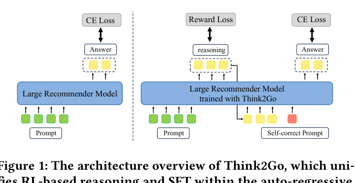
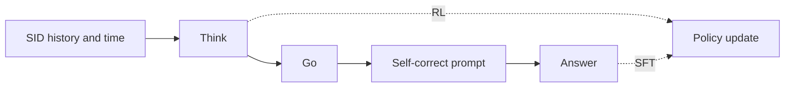

# Think2Go

*Generative Next POI Recommendation with LLM Reasoning* — Zhuang et al. · KDD’26

`III. SID–Model Alignment` · `Training` · `POI`

[Paper](https://arxiv.org/abs/2607.28997) · [Code](https://doi.org/10.5281/zenodo.18206701) · [Matrix](../../README.md#iii--training)

Reading level: Reading Notes (Level 2) · On this page: [TL;DR](#tldr) · [At a Glance](#at-a-glance) · [1. Why This Paper Matters](#1-why-this-paper-matters) · [2. How It Works](#2-how-it-works) · [3. Experimental Findings](#3-experimental-findings) · [4. Limitations & Critical Analysis](#4-limitations--critical-analysis) · [5. Connections to Related Work](#5-connections-to-related-work)

| Representation | Tokenization | Backbone | Training | Inference |
| :-: | :-: | :-: | :-: | :-: |
| `Attr+Geo+CF†` | `RQ-VAE` | `Dec-Only` | **`Fixed / NTP → RL`** | `CoT+Beam` |

- `Attr+Geo+CF†`: Structured item attributes, geographic information, and collaborative signals (inferred).
- `Dec-Only`: Decoder-only.
- `Fixed`: SIDs are built first and not changed while the generator trains.
- `NTP → RL`: NTP, then reinforcement learning (GRPO, GBPO, etc.).
- `CoT+Beam`: Reasoning followed by beam-search decoding.

### TL;DR

Think2Go unifies supervised fine-tuning and reinforcement learning reasoning for next-POI generation, weighting advantages by prompt epistemic uncertainty and normalized rewards, to deepen the LLM's understanding of Semantic IDs.

### At a Glance

| Aspect | Summary |
| :-- | :-- |
| Research Problem | III. SID–Model Alignment: Can the generator read, write, and reason over SIDs, and do the tokenizer and generator work toward the same goal? |
| Key Contribution | Think2Go unifies supervised fine-tuning and reinforcement learning reasoning for next-POI generation, weighting advantages by prompt epistemic uncertainty and normalized rewards, to deepen the LLM's understanding of Semantic IDs. |
| Modified Stage | Training |

### 1. Why This Paper Matters

Next-POI recommendation learns from sparse and complex mobility patterns (Abstract). The authors argue that non-reasoning models lack the capacity to capture deep intent from them, and that LLMs understand Semantic IDs (SIDs) poorly when the SIDs are trained separately from the model (Abstract, Sec. 5.8). Think2Go lets an LLM reason before it recommends, and trains memorization and reasoning in one architecture instead of running SFT and RL one after the other (Sec. 4, Sec. 4.1).

Based on arXiv v1.

### 2. How It Works

*Figure source: Fig. 1, original paper.*

#### Unified SFT and RL

The model input contains SIDs and temporal information only (Appendix E). During training, the model reasons and makes a first prediction, then a fixed self-correct prompt is appended, followed by the correct answer (Sec. 4.1, Table 7).

> "This forms a Think–>Go–>Self–correct–>Answer structure, where tokens from the reasoning trace are used for RL, and tokens from the appended answer are used for SFT." (Sec. 4.1)

#### Progressive Reward

The reward first favors well-formatted responses and then semantically correct answers (Sec. 4.2.2). Correctness is scored on the decomposed SID units.

#### Calibrated Advantage

Standard group advantages give the same update weight to easy and hard samples (Sec. 4.2.3). Think2Go adds two weights. Kernel density estimation measures how well the query matches the user's spatial-temporal history, and this epistemic uncertainty changes the update size (Sec. 4.2.1, Sec. 6).

> "challenging samples with high epistemic uncertainty and correct predictions receive larger updates to encourage exploration, while incorrect predictions are updated conservatively to ensure robustness." (Sec. 4.2.1)

The second weight rescales the group advantage by the reward relative to the maximum reward, so that the absolute performance signal is kept (Sec. 4.2.4, Eq. 9). The authors describe the combination as an implicit curriculum.

### 3. Experimental Findings

**Experimental setup**

- **Datasets**: Foursquare NYC and TKY (April 2012-February 2013) and Gowalla CA (February 2009-October 2010), preprocessed as in GNPR-SID: POIs with fewer than 10 interactions and users with fewer than 10 check-ins removed. Sizes (users / POIs): NYC 1,083 / 5,135; TKY 2,293 / 7,873; CA 6,592 / 14,027.
- **Split**: Records sorted chronologically and split 80% / 10% / 10% for training, validation, and test; for each user the last check-in is the answer. Separate cross-city transfer test (Table 5).
- **Candidates**: not reported (full catalog versus sampled); Acc@1, 5, 10 and MRR over the predicted top-K POIs.
- **Visibility**: warm; users and POIs that do not appear in training are removed from the test set. The cross-city transfer (Table 5) tests POIs of another city; their tokenizer exposure is not reported.
- **SID**: Listwise semantic IDs built with RQ-VAE, which the paper contrasts with the pointwise semantic IDs of GNPR; numerical levels, codebook sizes, and collision handling: not reported.
- **Inference budget**: Reasoning generated with vLLM (max length 1,024, temperature 1.3, 4 rollouts, beam search width 10) before the POI SID; LLaMA3.1-8B with LoRA. Five NVIDIA L40s GPUs (four for training, one for rollout inference); latency: not reported.
- **Results from**: Table 2 (NYC, TKY, CA versus traditional, sequence, GCN, LLM, and reasoning baselines); Table 3 (ablations); Table 4 (SID category prediction versus GNPR); Table 5 (cross-city generalization).

Sources

- **Datasets**: Datasets and GNPR preprocessing: [S5.SS1.p1](https://arxiv.org/html/2607.28997v1#S5.SS1.p1); statistics: [S5.T1](https://arxiv.org/html/2607.28997v1#S5.T1).
- **Split**: Temporal 80/10/10 with last check-in as answer: [S5.SS1.p1](https://arxiv.org/html/2607.28997v1#S5.SS1.p1); cross-domain: [S5.T5](https://arxiv.org/html/2607.28997v1#S5.T5).
- **Candidates**: Acc@K and MRR over predicted lists: [S5.SS3.p1](https://arxiv.org/html/2607.28997v1#S5.SS3.p1).
- **Visibility**: Test users and POIs absent from training removed: [S5.SS1.p1](https://arxiv.org/html/2607.28997v1#S5.SS1.p1).
- **SID**: Listwise semantic IDs whose correlations are learned through RQ-VAE, contrasted with GNPR's pointwise IDs: [S5.SS5.p2](https://arxiv.org/html/2607.28997v1#S5.SS5.p2); numerical settings not found.
- **Inference budget**: Rollout and decoding settings, hardware: [A1.p1](https://arxiv.org/html/2607.28997v1#A1.p1).
- **Results from**: Main: [S5.T2](https://arxiv.org/html/2607.28997v1#S5.T2); ablation: [S5.T3](https://arxiv.org/html/2607.28997v1#S5.T3); SID understanding: [S5.T4](https://arxiv.org/html/2607.28997v1#S5.T4); cross-domain: [S5.T5](https://arxiv.org/html/2607.28997v1#S5.T5).

- Ablation: Table 3 removes the reasoning tokens, the epistemic-uncertainty weight (STEU), the reward-informed weight (DRG), and a token entropy bonus (Sec. 5.5).
- Entropy: the reward-informed scaling keeps the entropy of reasoning tokens high during training (Sec. 4.2.4, Sec. 5.6, Fig. 3).

  > "Through comparative experiments, we further observe that it effectively alleviates entropy collapse by maintaining a high entropy level for the reasoning tokens, which implies greater exploration capacity." (Sec. 4.2.4)

- SID understanding: given a SID and ten candidate categories, the model identifies the correct category, compared against GNPR (Sec. 5.7, Table 4). The prompt for this task includes one example (Appendix C.2, Table 8).
- Out-of-domain: Think2Go degrades less than the other methods on out-of-domain datasets (Sec. 5.8, Table 5).
- Efficiency: against Refine-POI trained on NYC, the paper reports training time per epoch, test time, and memory (Appendix E, Table 10).

### 4. Limitations & Critical Analysis

**Our analysis.**

- GNPR-SID trains on `RQ-VAE` POI SIDs with `NTP` only and has no reported inference strategy (`–`); Think2Go adds an RL stage (`NTP → RL`) and reasons before decoding (`CoT+Beam`).
- ROS also reasons before decoding (`CoT+C-Beam`) but puts geography into the SID itself (`Geo-Prefix+RQ-VAE`); Think2Go keeps a plain `RQ-VAE` SID and models space through the advantage weights.

### 5. Connections to Related Work

- **Competitor** · [GNPR-SID](gnpr-sid.md): GNPR-SID trains SID knowledge by SFT alone; Think2Go adds reasoning tokens and advantage-calibrated GRPO over the same kind of POI semantic IDs and generalizes better across cities.
  - Source: Think2Go v1, LLM-based baselines and preprocessing: https://arxiv.org/html/2607.28997v1#S5.SS2.p4 and https://arxiv.org/html/2607.28997v1#S5.SS1.p1; Tables 2, 4, 5: https://arxiv.org/html/2607.28997v1#S5.T2, https://arxiv.org/html/2607.28997v1#S5.T4, https://arxiv.org/html/2607.28997v1#S5.T5.
- **Alternative** · [OneRec-Think](onerec-think.md): OneRec-Think adds reasoning to industrial video recommendation; Think2Go applies RL-trained reasoning to next-POI prediction with SIDs.
  - Source: Think2Go v1, Section 2.2 cites OneRec-Think: https://arxiv.org/html/2607.28997v1#S2.SS2.p1.
- **Alternative** · [OneLoc](oneloc.md): OneLoc is a geo-aware generative recommender trained without explicit reasoning; Think2Go relies on reasoning to use spatial context.
  - Source: Think2Go v1, Section 1 cites OneLoc: https://arxiv.org/html/2607.28997v1#S1.p4.

[View all papers in this cell](../../README.md#iii--training)
