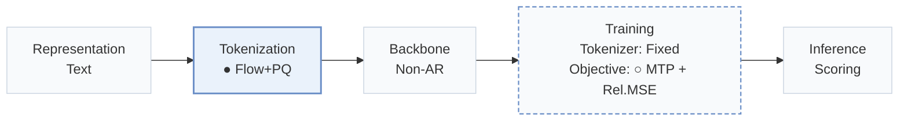
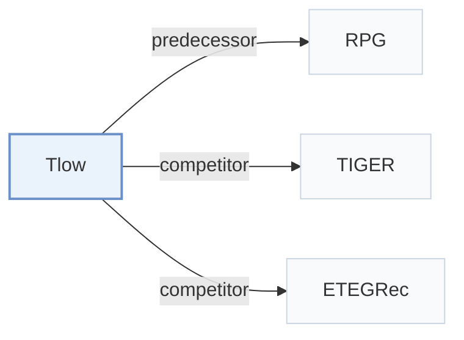

# Tlow

[← Problem × Stage Matrix](../../README.md#i--tokenization) · [Papers by Stage](../index/stages.md) · [Papers by Modality](../index/modality.md) · [Papers by Domain](../index/domain.md) · English | [中文](../zh/papers/tlow.md)

| **Title** | *Flow-based Item Tokenizer for Recommendation* |
| :-- | :-- |
| **Authors** | Li et al. |
| **Venue** | CIKM’26 Applied |
| **Problem × Stage** | `I. Informativeness` · `Tokenization` |
| **Changes** | ● Tokenization · ○ Objective |
| **SID inputs** | A: `Text` · B: `Text` + `Img` |
| **Domain** | `E-commerce` · `Image / Article` |
| **Settings** | `cross-domain` · `cold-start (item)` |
| **Scenario** | `General Item Recommendation`; `Online Experiment or Deployment` |
| **Links** | [Paper](https://arxiv.org/abs/2608.24176) · [Code](https://github.com/wjjln/Tlow) |
| **Reading level** | Overview (Level 1) |

**On this page**: [TL;DR](#tldr) · [3. Experiments](#3-experimental-findings) · [5. Related Work](#5-connections-to-related-work)

- `Text`: Textual item metadata (titles, descriptions, categories, or prompts).
- `Flow+PQ`: Flow-based representation transformation followed by product quantization.
- `Non-AR`: Non-autoregressive.
- `Fixed`: SIDs are built first and not changed while the generator trains.
- `MTP + Rel.MSE`: Multi-token prediction jointly optimized with a mean-squared-error objective on relations.
- `Scoring`: Direct candidate scoring without step-by-step SID generation.

### TL;DR

> [!NOTE]
> Tlow maps semantic embeddings with a normalizing flow into a standard normal latent space before independent quantization, and aligns codebook and token embedding spaces, unlike RQ-VAE or OPQ.

---

### 3. Experimental Findings

Experimental setup

- **Datasets**: Amazon Reviews Sports/Beauty/Toys/CDs; processed Cloth-Sports cross-domain data. WeChat picture/article logs for online multimodal retrieval. Filtering not reported.
  - Source: Sections 3.1.1/3.6.1: [S3.SS1.SSS1.p1](https://arxiv.org/html/2608.24176v1#S3.SS1.SSS1.p1) and [S3.SS6.SSS1.p1](https://arxiv.org/html/2608.24176v1#S3.SS6.SSS1.p1)
- **Split**: Public: chronological last item test, penultimate validation, earlier interactions train. Online holdout protocol and A/B duration not reported; two weeks refers to model training.
  - Source: Sections 3.1.1/3.6.2: [S3.SS1.SSS1.p2](https://arxiv.org/html/2608.24176v1#S3.SS1.SSS1.p2) and [S3.SS6.SSS2.p1](https://arxiv.org/html/2608.24176v1#S3.SS6.SSS2.p1)
- **Candidates**: full catalog for offline ranking; historical-item exclusion not reported
  - Source: Section 3.1.3: [S3.SS1.SSS3.p1](https://arxiv.org/html/2608.24176v1#S3.SS1.SSS3.p1)
- **Visibility**: Offline: warm; no unseen-item protocol is defined. Cold analysis bins targets by training frequency. Online cold pictures are exposed on publication day; generator/tokenizer exclusion not reported. Tokenizer fits about 1M items, then encodes additional unseen items.
  - Source: Sections 3.5/3.6.2/3.6.3: [S3.SS5.p1](https://arxiv.org/html/2608.24176v1#S3.SS5.p1) and [S3.SS6.SSS2.p1](https://arxiv.org/html/2608.24176v1#S3.SS6.SSS2.p1) and [S3.SS6.SSS3.p1](https://arxiv.org/html/2608.24176v1#S3.SS6.SSS3.p1)
- **SID**: Flow plus independent PQ: C in {16,32,64,96,128}, 256 codes each; selected C per offline dataset not reported. Online: 16 x 256. Collision handling not reported.
  - Source: Sections 3.1.4/3.6.2: [S3.SS1.SSS4.p1](https://arxiv.org/html/2608.24176v1#S3.SS1.SSS4.p1) and [S3.SS6.SSS2.p1](https://arxiv.org/html/2608.24176v1#S3.SS6.SSS2.p1)
- **Inference budget**: Single-forward parallel token scoring, Recall/NDCG@5/10; temperature searched over 0.03/0.05/0.07. Recommendation hardware, batch size and latency not reported. Online tokenization of tens of millions of new items takes minutes on one unspecified GPU, not per-request serving time.
  - Source: Sections 3.1.4/3.6.1/3.6.2: [S3.SS1.SSS4.p1](https://arxiv.org/html/2608.24176v1#S3.SS1.SSS4.p1) and [S3.SS6.SSS1.p1](https://arxiv.org/html/2608.24176v1#S3.SS6.SSS1.p1) and [S3.SS6.SSS2.p1](https://arxiv.org/html/2608.24176v1#S3.SS6.SSS2.p1)
- **Results from**: Tables 2/4/5/6: general/cross-domain/multimodal/online results. General comparison reuses RPG-paper baseline scores and reruns RPG; main semantic embeddings are sentence-t5-base.
  - Source: Section 3.1.4 and Tables 2/4/5/6: [S3.SS1.SSS4.p1](https://arxiv.org/html/2608.24176v1#S3.SS1.SSS4.p1) and [S3.T2](https://arxiv.org/html/2608.24176v1#S3.T2) and [S3.T4](https://arxiv.org/html/2608.24176v1#S3.T4) and [S3.T5](https://arxiv.org/html/2608.24176v1#S3.T5) and [S3.T6](https://arxiv.org/html/2608.24176v1#S3.T6)

---

### 5. Connections to Related Work

- **Predecessor** · [RPG](rpg.md): Supplies the parallel prediction setup and the rerun controlled baseline.
  - Source: Tlow v1, Section 3.1.4: [S3.SS1.SSS4.p1](https://arxiv.org/html/2608.24176v1#S3.SS1.SSS4.p1).
- **Competitor** · [TIGER](tiger.md): Autoregressive RQ-VAE comparator against independent flow-space tokenization.
  - Source: Tlow v1, Introduction and Section 3.1.2: [S1.p2](https://arxiv.org/html/2608.24176v1#S1.p2); [S3.SS1.SSS2.p1](https://arxiv.org/html/2608.24176v1#S3.SS1.SSS2.p1).
- **Competitor** · [ETEGRec](etegrec.md): Included tokenizer comparator; general baseline scores are reused from the RPG paper.
  - Source: Tlow v1, Sections 3.1.2/3.1.4 and Table 2: [S3.SS1.SSS2.p1](https://arxiv.org/html/2608.24176v1#S3.SS1.SSS2.p1); [S3.SS1.SSS4.p1](https://arxiv.org/html/2608.24176v1#S3.SS1.SSS4.p1); [S3.T2](https://arxiv.org/html/2608.24176v1#S3.T2).

[View all papers in this cell](../../README.md#i--tokenization)
