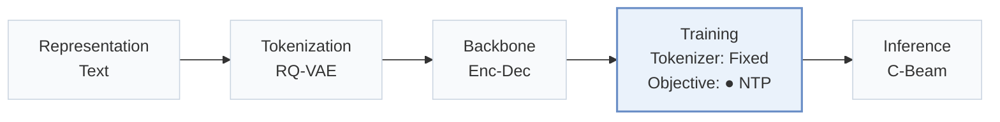
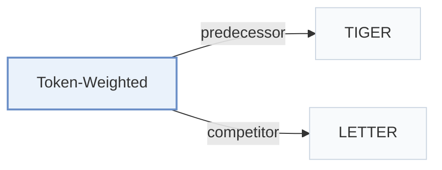

# Token-Weighted

[← Problem × Stage Matrix](../../README.md#iv--training) · [Papers by Stage](../index/stages.md) · [Papers by Modality](../index/modality.md) · [Papers by Domain](../index/domain.md) · English | [中文](../zh/papers/token-weighted.md)

| **Title** | *Beyond Uniform Token Training: A Multi-Target Framework for Learning Token-Weighted Objectives in Generative Recommenders* |
| :-- | :-- |
| **Authors** | Chiu et al. |
| **Venue** | CIKM’26 |
| **Problem × Stage** | `IV. Utility` · `Training` |
| **Changes** | ● Objective |
| **SID inputs** | `Text` |
| **Domain** | `E-commerce` · `POI / Local` · `Movie` |
| **Links** | [Paper](https://arxiv.org/abs/2601.17787) · [Code](https://github.com/CHIUWEINING/Token-Weighted-Multi-Target-Learning-for-Generative-Recommenders-with-Curriculum-Learning) |
| **Reading level** | Overview (Level 1) |

**On this page**: [TL;DR](#tldr) · [3. Experiments](#3-experimental-findings) · [5. Related Work](#5-connections-to-related-work)

- `Text`: Textual item metadata (titles, descriptions, categories, or prompts).
- `RQ-VAE`: Residual-Quantized Variational AutoEncoder.
- `Enc-Dec`: Encoder-decoder.
- `Fixed`: SIDs are built first and not changed while the generator trains.
- `NTP`: Next-token prediction loss only; continuing from a pretrained LLM (SFT) also counts as NTP.
- `C-Beam`: Constrained beam search.

### TL;DR

> [!NOTE]
> Token-Weighted weights Semantic ID tokens by prefix ambiguity reduction and by token frequency, combining both with the standard likelihood under curriculum learning, instead of uniform token training.

---

### 3. Experimental Findings

Experimental setup

- **Datasets**: Amazon Musical Instruments and Industrial & Scientific, Yelp, MovieLens 1M; 5-core users/items. Maximum history length not reported.
  - Source: [S5.SS1.SSS1.p1](https://arxiv.org/html/2601.17787v2#S5.SS1.SSS1.p1) ; #S5.SS1.SSS1.p2
- **Split**: Per-user leave-one-out: last interaction test, penultimate validation, others training. Additional head/tail analysis divides test items equally by interaction frequency; it does not redefine the training split.
  - Source: [S5.SS1.SSS1.p2](https://arxiv.org/html/2601.17787v2#S5.SS1.SSS1.p2) ; #S5.SS2.SSS5.p1
- **Candidates**: not reported
  - Source: [S5.SS1](https://arxiv.org/html/2601.17787v2#S5.SS1)
- **Visibility**: warm; no unseen-item protocol is defined. Tokenizer fitting exposure to test items not reported.
  - Source: [S5.SS1.SSS1.p2](https://arxiv.org/html/2601.17787v2#S5.SS1.SSS1.p2) ; #S5.SS1.SSS3.p2
- **SID**: RQ-VAE: 4 x 256 using LLaMA2-7B item embeddings; duplicate IDs resolved by random reassignment of the final token. PQ extension uses four independently quantized embedding segments; PQ codebook sizes not reported.
  - Source: [S5.SS1.SSS3.p2](https://arxiv.org/html/2601.17787v2#S5.SS1.SSS3.p2) ; #S5.SS2.SSS3.p1
- **Inference budget**: Constrained beam search; Hit/NDCG@5/10. Main backbone TIGER/T5; LLaMA3.2-3B extension uses 8-bit LoRA at training and inference. Beam width, inference batch size and latency not reported. General experiment pool: two RTX 3090s and one RTX A6000; inference allocation not reported.
  - Source: [S3.SS2.p2](https://arxiv.org/html/2601.17787v2#S3.SS2.p2) ; #S5.SS1.SSS3.p1 ; #S5.SS2.SSS3.p2
- **Results from**: Original Table 3: main comparison, five-run means; token-level baselines implemented on TIGER. Table 4: ablations; Table 5: PQ IDs; Table 6: larger backbone. Baseline-result reuse not stated.
  - Source: [S4.T3](https://arxiv.org/html/2601.17787v2#S4.T3) ; #S5.T4 ; #S5.T5 ; #S5.T6 ; #S5.SS1.SSS2.p1 ; #S5.SS1.SSS3.p1

---

### 5. Connections to Related Work

- **Predecessor** · [TIGER](tiger.md): The proposed curriculum combines token-weighted objectives with standard likelihood on the TIGER architecture.
  - Source: Token-Weighted v2, Section 5.1.2 and Table 3: [S5.SS1.SSS2.p1](https://arxiv.org/html/2601.17787v2#S5.SS1.SSS2.p1); [S4.T3](https://arxiv.org/html/2601.17787v2#S4.T3).
- **Competitor** · [LETTER](letter.md): The Rank baseline adapts LETTER ranking-guided loss to TIGER; the proposed method instead combines prefix-dispersion and token-frequency weights through a curriculum.
  - Source: Token-Weighted v2, Sections 4.1/5.1.2 and Table 3; comparison is to the adapted Rank objective, not the full LETTER system: [S4.SS1.p2](https://arxiv.org/html/2601.17787v2#S4.SS1.p2); [S5.SS1.SSS2.p2](https://arxiv.org/html/2601.17787v2#S5.SS1.SSS2.p2); [S4.T3](https://arxiv.org/html/2601.17787v2#S4.T3).

[View all papers in this cell](../../README.md#iv--training)
