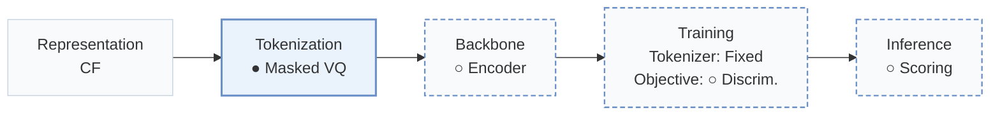
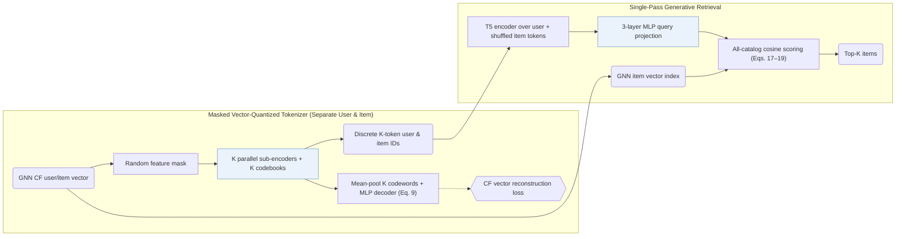
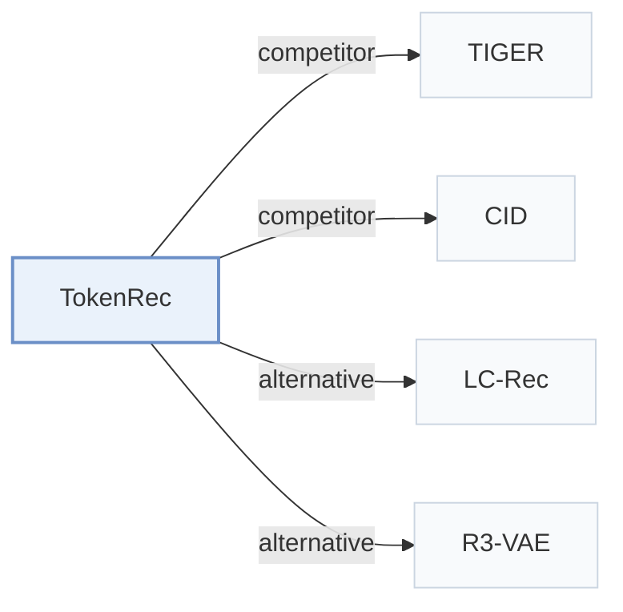

# TokenRec

[← Problem × Stage Matrix](../../README.md#i--tokenization) · [Papers by Stage](../index/stages.md) · [Papers by Modality](../index/modality.md) · [Papers by Domain](../index/domain.md) · English | [中文](../zh/papers/tokenrec.md)

| **Title** | *Learning to tokenize id for llm-based generative recommendations* |
| :-- | :-- |
| **Authors** | Qu et al. |
| **Venue** | TKDE’25 |
| **Problem × Stage** | `I. Informativeness` · `Tokenization` |
| **Changes** | ● Tokenization · ○ Backbone · ○ Objective · ○ Inference |
| **SID inputs** | `CF` |
| **Domain** | `Music` · `Movie` · `E-commerce` |
| **Settings** | `cold-start (user)` |
| **Scenario** | `General Item Recommendation`; `Public Benchmarks` |
| **Links** | [Paper](https://arxiv.org/abs/2406.10450) · [Code](https://github.com/Quhaoh233/TokenRec) |
| **Reading level** | Reading Notes (Level 2) |

**On this page**: [TL;DR](#tldr) · [At a Glance](#at-a-glance) · [1. Why It Matters](#1-why-this-paper-matters) · [2. Method](#2-how-it-works) · [3. Experiments](#3-experimental-findings) · [4. Limitations](#4-limitations--critical-analysis) · [5. Related Work](#5-connections-to-related-work)

- `CF`: Collaborative filtering signal.
- `Masked VQ`: Masked vector quantization over collaborative representations.
- `Encoder`: Bidirectional encoder backbone without autoregressive token generation.
- `Fixed`: SIDs are built first and not changed while the generator trains.
- `Discrim.`: Scores items; does not generate SIDs.
- `Scoring`: Direct candidate scoring without step-by-step SID generation.

### TL;DR

> [!NOTE]
> TokenRec quantizes masked collaborative user and item representations into discrete tokens and retrieves top-K items without autoregressive decoding or beam search, to generalize to new users and items.

---

### At a Glance

| Aspect | Summary |
| :-- | :-- |
| Key Findings | Across LastFM, MovieLens-1M, Amazon Beauty, and Clothing, TokenRec outperforms collaborative, sequential, and LLM baselines while cutting per-user top-20 inference time to 5.76–8.43 ms against 76–102 ms for beam-search LLM baselines (Abstract, Tables 2, 3, and 5). |
| Limitation | Onboarding unseen users or items still requires updating the upstream GNN collaborative filtering model to produce their base embeddings, even though the MQ-Tokenizer and LLM remain frozen (Sec. II-E.2). |

---

### 1. Why This Paper Matters

Assigning one dedicated token per user and item grows an LLM's vocabulary linearly with catalog scale (Sec. I), while text-only codes miss high-order collaborative structure and struggle on unseen users or items (Abstract). TokenRec quantizes masked GNN collaborative embeddings into compact user and item token tuples and replaces multi-step autoregressive beam search with single-pass dense vector retrieval.

---

### 2. How It Works

#### MQ-Tokenizer

A GNN collaborative filtering backbone pre-computes dense user and item representations stored in an item vector index (Sec. II-C.2). Separate user and item MQ-Tokenizers apply random feature masking to each GNN vector, project it through $`K`$ parallel sub-encoders, and quantize each branch against its own sub-codebook (Sec. II-C.2, Sec. II-C.3). Averaging the $`K`$ selected codewords through an MLP decoder reconstructs the unmasked GNN vector (Sec. II-C.4, Eq. 9).

> "Specifically, our MQ-Tokenizer assigns each user and item a small number of discrete tokens generated by quantizing the GNN-based representations." (Sec. II-C.1)

> "we propose to randomly mask these representations to create a challenging task that enables the tokenizer to build a comprehensive understanding and generalize well." (Sec. II-C.2)

#### Generative Retrieval

The T5 backbone encodes a prompt containing the user's discrete tokens alongside interacted item tokens—randomly shuffled during training rather than ordered chronologically (Sec. II-D.2). A 3-layer MLP projects the final hidden state into the collaborative vector space, scoring the entire catalog via cosine similarity against the stored GNN item embeddings for top-$`K`$ retrieval (Sec. II-D.3, Eqs. 17–19).

---

### 3. Experimental Findings

Experimental setup

- **Datasets**: LastFM (1,090 users / 3,646 items), MovieLens-1M (6,040 / 3,416), Amazon Beauty (22,363 / 12,101), Amazon Clothing (23,033 / 39,387 as printed); histories capped at 100 items. Filtering rules: not reported.
  - Source: Datasets and statistics: [S3.SS1.SSS1.p1](https://arxiv.org/html/2406.10450v3#S3.SS1.SSS1.p1) and [S3.T1](https://arxiv.org/html/2406.10450v3#S3.T1).
- **Split**: Leave-one-out: all but the last observation for training; histories are randomly shuffled to give non-chronological lists (to match collaborative-filtering baselines). Separate study on Beauty and LastFM: the 5% of users with the least history are removed from training as unseen users, and all items they interacted with are excluded from training too.
  - Source: Leave-one-out with shuffled histories: [S3.SS1.SSS1.p1](https://arxiv.org/html/2406.10450v3#S3.SS1.SSS1.p1); unseen-user split: [S3.SS3.p2](https://arxiv.org/html/2406.10450v3#S3.SS3.p2).
- **Candidates**: full catalog (scores all items in the item base and retrieves top-K). Training uses 1:1 negatives drawn at random from un-interacted items.
  - Source: Scores over all items for top-K retrieval; training negatives 1:1: [S2.SS4.SSS3.p3](https://arxiv.org/html/2406.10450v3#S2.SS4.SSS3.p3) and [S3.SS1.SSS4.p1](https://arxiv.org/html/2406.10450v3#S3.SS1.SSS4.p1).
- **Visibility**: Main: warm; no unseen-item protocol is defined. Unseen-user study: held-out users and every item they interacted with are excluded from the training split, so those items are unseen by the generator and the MQ-Tokenizer training (tokens for them are produced afterwards from their representations).
  - Source: Unseen-user study excludes those users' items from training: [S3.SS3.p2](https://arxiv.org/html/2406.10450v3#S3.SS3.p2).
- **SID**: Masked vector-quantized tokenizer (MQ-Tokenizer) for both users and items: K parallel sub-encoders, each quantized against its own sub-codebook of L codes (K searched in 1-5, L in 128-1,024; prompt example uses K=3), over masked collaborative representations. Collision handling: not reported.
  - Source: K-way masked vector-quantized tokenizer, ranges: [S2.SS3.SSS3.p2](https://arxiv.org/html/2406.10450v3#S2.SS3.SSS3.p2), [S2.SS3.SSS3.p3](https://arxiv.org/html/2406.10450v3#S2.SS3.SSS3.p3), [S3.SS1.SSS4.p1](https://arxiv.org/html/2406.10450v3#S3.SS1.SSS4.p1).
- **Inference budget**: No beam search: the T5 output is projected and all items are scored for top-K. Table 5: average top-20 inference time per user of 5.76-8.43 ms versus 76-102 ms for P5, POD, CID, and TIGER; hardware and batch size: not reported.
  - Source: Generative retrieval by scoring instead of beam decoding: [S2.SS4.SSS3.p3](https://arxiv.org/html/2406.10450v3#S2.SS4.SSS3.p3); timing: [S3.T5](https://arxiv.org/html/2406.10450v3#S3.T5).
- **Results from**: Tables 2-3 (LastFM, ML1M, Beauty, Clothing versus CF, sequential, and LLM-based baselines); Table 4 (seen versus unseen users); Table 5 (inference time); Table 6 (ablations).
  - Source: Main: [S3.T2](https://arxiv.org/html/2406.10450v3#S3.T2) and [S3.T3](https://arxiv.org/html/2406.10450v3#S3.T3); unseen users: [S3.T4](https://arxiv.org/html/2406.10450v3#S3.T4); time: [S3.T5](https://arxiv.org/html/2406.10450v3#S3.T5); ablation: [S3.T6](https://arxiv.org/html/2406.10450v3#S3.T6).

- Main comparison: under full-catalog ranking across four benchmarks, TokenRec surpasses traditional collaborative, sequential, and LLM-based recommenders on both seen and held-out users (Abstract, Tables 2–4).
- Serving latency: bypassing autoregressive token-by-token beam search cuts per-user top-20 latency by an order of magnitude (5.76–8.43 ms vs. 76–102 ms) (Sec. III-D, Table 5).

  > "This can be attributed to our generative retrieval paradigm, bypassing the most time-consuming auto-regressive decoding and beam search processes of LLMs [ 29 ] ." (Sec. III-D)

---

### 4. Limitations & Critical Analysis

**Our analysis.**

- TIGER quantizes item text (`Text`) via `RQ-VAE` and decodes token by token with `Beam` search; TokenRec quantizes `CF` embeddings for both users and items via `Masked VQ` and retrieves candidates in one pass via dense cosine `Scoring`.
- CID also discretizes `CF` signals via `Spectral Clus.` while retaining autoregressive `C-Beam` generation; TokenRec uses an `Encoder` query projector without emitting target tokens.

---

### 5. Connections to Related Work

- **Competitor** · [TIGER](tiger.md): TIGER decodes RQ-VAE item IDs by beam search; TokenRec tokenizes users and items with a masked K-way quantizer and scores all items directly, about ten times faster.
  - Source: TokenRec v3, baselines: [S3.SS1.SSS2.p1](https://arxiv.org/html/2406.10450v3#S3.SS1.SSS2.p1); Tables 2-5: [S3.T2](https://arxiv.org/html/2406.10450v3#S3.T2), [S3.T3](https://arxiv.org/html/2406.10450v3#S3.T3), [S3.T4](https://arxiv.org/html/2406.10450v3#S3.T4), [S3.T5](https://arxiv.org/html/2406.10450v3#S3.T5).
- **Competitor** · [CID](cid.md): CID builds collaborative indices for P5-style text generation; TokenRec builds collaborative tokens for users and items and retrieves without decoding.
  - Source: TokenRec v3, baselines: [S3.SS1.SSS2.p1](https://arxiv.org/html/2406.10450v3#S3.SS1.SSS2.p1) and [S3.I2.i4.p1](https://arxiv.org/html/2406.10450v3#S3.I2.i4.p1); Tables 2-5: [S3.T2](https://arxiv.org/html/2406.10450v3#S3.T2) and [S3.T5](https://arxiv.org/html/2406.10450v3#S3.T5).
- **Alternative** · [LC-Rec](lc-rec.md): LC-Rec decodes item indices autoregressively, which TokenRec avoids for speed and to limit hallucinated items.
  - Source: TokenRec v3, Section 2.4.3 cites Zheng et al. (2024): [S2.SS4.SSS3.p1](https://arxiv.org/html/2406.10450v3#S2.SS4.SSS3.p1).
- **Alternative** · [R3-VAE](r3-vae.md): R3-VAE later evaluates TokenRec's masked quantizer (MQ) as a tokenizer baseline and proposes reference-guided residual quantization.
  - Source: Evidence is from the later R3-VAE paper: baselines and Tables 1, 4: [S4.SS1.SSS2.p1](https://arxiv.org/html/2604.11440v3#S4.SS1.SSS2.p1), [S3.T1](https://arxiv.org/html/2604.11440v3#S3.T1), [S4.T4](https://arxiv.org/html/2604.11440v3#S4.T4).

[View all papers in this cell](../../README.md#i--tokenization)
