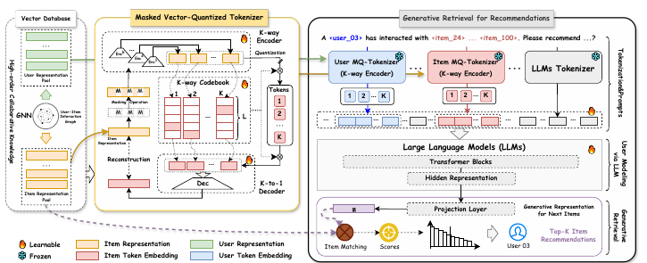

# TokenRec

*Learning to tokenize id for llm-based generative recommendations* — Qu et al. · TKDE’25

`I. Informativeness` · `Tokenization`

[Paper](https://arxiv.org/abs/2406.10450) · [Code](https://github.com/Quhaoh233/TokenRec) · [Matrix](../../README.md#i--tokenization)

Reading level: Overview (Level 1) · On this page: [At a Glance](#at-a-glance) · [2. How It Works](#2-how-it-works) · [3. Experimental Findings](#3-experimental-findings) · [5. Connections to Related Work](#5-connections-to-related-work)

| Representation | Tokenization | Backbone | Training | Inference |
| :-: | :-: | :-: | :-: | :-: |
| `CF` | **`Masked VQ`** | `Encoder` | `Fixed / Discrim.` | `Scoring` |

- `CF`: Collaborative filtering signal.
- `Fixed`: SIDs are built first and not changed while the generator trains.
- `Discrim.`: Scores items; does not generate SIDs.

### At a Glance

| Aspect | Summary |
| :-- | :-- |
| Research Problem | I. Informativeness: Do the SIDs, or the model reading them, carry the collaborative and multimodal signals recommendation needs? |
| Modified Stage | Tokenization |

### 2. How It Works

### 3. Experimental Findings

**Experimental setup**

- **Datasets**: LastFM (1,090 users / 3,646 items), MovieLens-1M (6,040 / 3,416), Amazon Beauty (22,363 / 12,101), Amazon Clothing (23,033 / 39,387 as printed); histories capped at 100 items. Filtering rules: not reported.
  - Source: Datasets and statistics: https://arxiv.org/html/2406.10450v3#S3.SS1.SSS1.p1 and https://arxiv.org/html/2406.10450v3#S3.T1.
- **Split**: Leave-one-out: all but the last observation for training; histories are randomly shuffled to give non-chronological lists (to match collaborative-filtering baselines). Separate study on Beauty and LastFM: the 5% of users with the least history are removed from training as unseen users, and all items they interacted with are excluded from training too.
  - Source: Leave-one-out with shuffled histories: https://arxiv.org/html/2406.10450v3#S3.SS1.SSS1.p1; unseen-user split: https://arxiv.org/html/2406.10450v3#S3.SS3.p2.
- **Candidates**: full catalog (scores all items in the item base and retrieves top-K). Training uses 1:1 negatives drawn at random from un-interacted items.
  - Source: Scores over all items for top-K retrieval; training negatives 1:1: https://arxiv.org/html/2406.10450v3#S2.SS4.SSS3.p3 and https://arxiv.org/html/2406.10450v3#S3.SS1.SSS4.p1.
- **Visibility**: Main: warm; no unseen-item protocol is defined. Unseen-user study: held-out users and every item they interacted with are excluded from the training split, so those items are unseen by the generator and the MQ-Tokenizer training (tokens for them are produced afterwards from their representations).
  - Source: Unseen-user study excludes those users' items from training: https://arxiv.org/html/2406.10450v3#S3.SS3.p2.
- **SID**: Masked vector-quantized tokenizer (MQ-Tokenizer) for both users and items: K parallel sub-encoders, each quantized against its own sub-codebook of L codes (K searched in 1-5, L in 128-1,024; prompt example uses K=3), over masked collaborative representations. Collision handling: not reported.
  - Source: K-way masked vector-quantized tokenizer, ranges: https://arxiv.org/html/2406.10450v3#S2.SS3.SSS3.p2, https://arxiv.org/html/2406.10450v3#S2.SS3.SSS3.p3, https://arxiv.org/html/2406.10450v3#S3.SS1.SSS4.p1.
- **Inference budget**: No beam search: the T5 output is projected and all items are scored for top-K. Table 5: average top-20 inference time per user of 5.76-8.43 ms versus 76-102 ms for P5, POD, CID, and TIGER; hardware and batch size: not reported.
  - Source: Generative retrieval by scoring instead of beam decoding: https://arxiv.org/html/2406.10450v3#S2.SS4.SSS3.p3; timing: https://arxiv.org/html/2406.10450v3#S3.T5.
- **Results from**: Tables 2-3 (LastFM, ML1M, Beauty, Clothing versus CF, sequential, and LLM-based baselines); Table 4 (seen versus unseen users); Table 5 (inference time); Table 6 (ablations).
  - Source: Main: https://arxiv.org/html/2406.10450v3#S3.T2 and https://arxiv.org/html/2406.10450v3#S3.T3; unseen users: https://arxiv.org/html/2406.10450v3#S3.T4; time: https://arxiv.org/html/2406.10450v3#S3.T5; ablation: https://arxiv.org/html/2406.10450v3#S3.T6.

## 旧卡片说明

迁自 `d61aa6c:papers/tokenrec.md`。保留方法说明、实验叙述与局限；本轮只对照现有记录处理明确冲突，未重新逐句核查原论文。分类和规格以页面上方由记录生成的表格为准。

### TokenRec：面向 LLM 生成推荐的 ID 分词

> TokenRec 用掩码向量量化 tokenizer 将用户和物品 ID 转为多 token 表示，增强 LLM 对协同结构的建模能力。

### 研究动机与问题定义

原子 ID 缺乏语义且词表规模随物品数增长，多 token 表示又需要合理分配协同信息。TokenRec 学习 LLM 兼容的 ID tokenization，用于推荐表示与检索。

### TL;DR（核心摘要）

`交互图与ID → 多码本量化 → 用户/物品 token → 序列编码 → 全物品评分`

方法用 K-way encoder 和掩码向量量化器学习物品 token，并用 K-to-1 decoder 重构原始表示；用户也可通过 MQ-tokenizer 表示。T5-small 编码用户表示，再与 GNN 物品表示计算余弦相似度，对全物品排序并取 Top-K。

### 输入与使用场景

| 方面 | 说明 |
|---|---|
| 使用信息 | 用户-物品交互与高阶协同结构 |
| 信息融入位置 | 向量数据库、tokenizer 和生成输入 |
| 语义标识结构 | K 个离散 token 的序列 |
| 适用场景 | LLM 生成式推荐与新物品泛化 |

### 方法设计

#### 2-A 记号与整体框架
TokenRec 将用户和物品表示为可组合的多 token code。用户 tokenizer 可将用户协同表示转成兼容 token；推荐模型使用这些表示完成检索。

#### 2-B 掩码向量量化 tokenizer
K-way encoder 为一个物品生成多个潜向量，掩码向量量化器从多个 codebook 中选择离散 token。K-to-1 decoder 重构原始表示，使不同 code 的组合仍保留协同信息，并通过高阶交互增强区分度。

#### 2-C 推荐检索
LLM（T5-small）编码用户表示，再与 GNN 物品表示计算余弦相似度，对全部物品排序取 Top-K，不逐码生成 SID（§II-D.3，p6，Eq. 17–19；§II-E.2，p7）。当前记录为 Encoder、Discrim.、Scoring。

#### 2-D 效率与泛化
论文分析新用户/物品、codebook 规模、效率和消融，重点说明多 token 表示相对原子 ID 的词表与泛化优势。

### 实验结论

- TokenRec 在多个数据集上改善了推荐效果。
- 多码本 tokenizer 带来更好的效率与泛化能力。

### 局限性与研究定位

#### 局限性
- 向量数据库与多码本维护增加工程依赖。
- 动态用户/物品更新和大规模在线延迟仍需更多验证。

#### 研究定位
TokenRec 的贡献是把协同 ID 学习为可组合 token，适合放在“LLM 物品分词与协同表示”章节。

### 标签

`多码本量化` · `ID分词` · `LLM推荐` · `生成式检索`

### 架构图来源

*图源：原论文，图2。图片使用许可待核实。*

---

### 旧总表补充

来源：`d61aa6c:tables/all-methods.md`。

- 核心贡献：学习可组合的协同ID token。
- 使用场景：LLM推荐。

### 5. Connections to Related Work

- **Competitor** · [TIGER](tiger.md): TIGER decodes RQ-VAE item IDs by beam search; TokenRec tokenizes users and items with a masked K-way quantizer and scores all items directly, about ten times faster.
  - Source: TokenRec v3, baselines: https://arxiv.org/html/2406.10450v3#S3.SS1.SSS2.p1; Tables 2-5: https://arxiv.org/html/2406.10450v3#S3.T2, https://arxiv.org/html/2406.10450v3#S3.T3, https://arxiv.org/html/2406.10450v3#S3.T4, https://arxiv.org/html/2406.10450v3#S3.T5.
- **Competitor** · [CID](cid.md): CID builds collaborative indices for P5-style text generation; TokenRec builds collaborative tokens for users and items and retrieves without decoding.
  - Source: TokenRec v3, baselines: https://arxiv.org/html/2406.10450v3#S3.SS1.SSS2.p1 and https://arxiv.org/html/2406.10450v3#S3.I2.i4.p1; Tables 2-5: https://arxiv.org/html/2406.10450v3#S3.T2 and https://arxiv.org/html/2406.10450v3#S3.T5.
- **Alternative** · [LC-Rec](lc-rec.md): LC-Rec decodes item indices autoregressively, which TokenRec avoids for speed and to limit hallucinated items.
  - Source: TokenRec v3, Section 2.4.3 cites Zheng et al. (2024): https://arxiv.org/html/2406.10450v3#S2.SS4.SSS3.p1.
- **Alternative** · [R3-VAE](r3-vae.md): R3-VAE later evaluates TokenRec's masked quantizer (MQ) as a tokenizer baseline and proposes reference-guided residual quantization.
  - Source: Evidence is from the later R3-VAE paper: baselines and Tables 1, 4: https://arxiv.org/html/2604.11440v3#S4.SS1.SSS2.p1, https://arxiv.org/html/2604.11440v3#S3.T1, https://arxiv.org/html/2604.11440v3#S4.T4.

[View all papers in this cell](../../README.md#i--tokenization)
