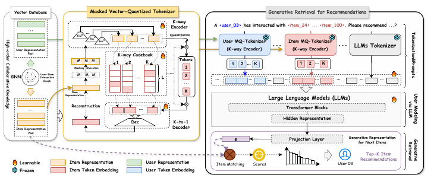

# TokenRec: Tokenrec: Learning to tokenize id for llm-based generative recommendations

[Back to Catalog](../../README.md) · [Paper (`https://arxiv.org/abs/2406.10450`)](https://arxiv.org/abs/2406.10450) · [Source Record (`data/papers/tokenrec.yaml`)](../../data/papers/tokenrec.yaml)

> **Summary**: Abstract: "challenges remain in efficiently capturing high-order collaborative knowledge into discrete tokens"; "difficulties in generalizing effectively to new/unseen users or items". Candidates: I / VI / V (rule: tie broken by the first new design).

## Taxonomy & Table 1 Specification

| Field | Value | Vocabulary Definition |
| :--- | :--- | :--- |
| **Authors & Year** | Qu et al. (2025) | Published / posted in `TKDE’25` |
| **Problem Band** | `I. Informativeness` | Do the SIDs, or the model reading them, carry the collaborative and multimodal signals recommendation needs? |
| **Primary Stage** | `Tokenization` | The primary design change sits in the Tokenization stage. |
| **Representation** | `CF` | Collaborative filtering signal. |
| **Tokenization** | `Masked VQ` |  |
| **Backbone** | `Encoder` |  |
| **Tokenizer Training** | `Fixed` | SIDs are built first and not changed while the generator trains. |
| **Training Objective** | `Discrim.` | Scores items; does not generate SIDs. |
| **Inference Decoding** | `Scoring` |  |
| **POI / Local-Life** | `false` | Point-of-interest / geographic recommendation indicator |
| **Code Repository** | Not reported | Official or public implementation link |

## Architecture

## Verbatim Evidence & Rationale

- **`problem`** (arXiv abstract): Abstract: "challenges remain in efficiently capturing high-order collaborative knowledge into discrete tokens"; "difficulties in generalizing effectively to new/unseen users or items". Candidates: I / VI / V (rule: tie broken by the first new design).

## 旧卡片说明

迁自 `d61aa6c:papers/tokenrec.md`。保留方法说明、实验叙述与局限；本轮只对照现有记录处理明确冲突，未重新逐句核查原论文。分类和规格以页面上方由记录生成的表格为准。

### TokenRec：面向 LLM 生成推荐的 ID 分词

> TokenRec 用掩码向量量化 tokenizer 将用户和物品 ID 转为多 token 表示，增强 LLM 对协同结构的建模能力。

### 研究动机与问题定义

原子 ID 缺乏语义且词表规模随物品数增长，多 token 表示又需要合理分配协同信息。TokenRec 学习 LLM 兼容的 ID tokenization，用于推荐表示与检索。

### TL;DR（核心摘要）

`交互图与ID → 多码本量化 → 用户/物品 token → 序列编码 → 全物品评分`

方法用 K-way encoder 和掩码向量量化器学习物品 token，并用 K-to-1 decoder 重构原始表示；用户也可通过 MQ-tokenizer 表示。T5-small 编码用户表示，再与 GNN 物品表示计算余弦相似度，对全物品排序并取 Top-K。

### 输入与使用场景

| 方面 | 说明 |
|---|---|
| 使用信息 | 用户-物品交互与高阶协同结构 |
| 信息融入位置 | 向量数据库、tokenizer 和生成输入 |
| 语义标识结构 | K 个离散 token 的序列 |
| 适用场景 | LLM 生成式推荐与新物品泛化 |

### 方法设计

#### 2-A 记号与整体框架
TokenRec 将用户和物品表示为可组合的多 token code。用户 tokenizer 可将用户协同表示转成兼容 token；推荐模型使用这些表示完成检索。

#### 2-B 掩码向量量化 tokenizer
K-way encoder 为一个物品生成多个潜向量，掩码向量量化器从多个 codebook 中选择离散 token。K-to-1 decoder 重构原始表示，使不同 code 的组合仍保留协同信息，并通过高阶交互增强区分度。

#### 2-C 推荐检索
LLM（T5-small）编码用户表示，再与 GNN 物品表示计算余弦相似度，对全部物品排序取 Top-K，不逐码生成 SID（§II-D.3，p6，Eq. 17–19；§II-E.2，p7）。当前记录为 Encoder、Discrim.、Scoring。

#### 2-D 效率与泛化
论文分析新用户/物品、codebook 规模、效率和消融，重点说明多 token 表示相对原子 ID 的词表与泛化优势。

### 实验结论

- TokenRec 在多个数据集上改善了推荐效果。
- 多码本 tokenizer 带来更好的效率与泛化能力。

### 局限性与研究定位

#### 局限性
- 向量数据库与多码本维护增加工程依赖。
- 动态用户/物品更新和大规模在线延迟仍需更多验证。

#### 研究定位
TokenRec 的贡献是把协同 ID 学习为可组合 token，适合放在“LLM 物品分词与协同表示”章节。

### 标签

`多码本量化` · `ID分词` · `LLM推荐` · `生成式检索`

### 架构图来源

*图源：原论文，图2。图片使用许可待核实。*

---

### 旧总表补充

来源：`d61aa6c:tables/all-methods.md`。

- 核心贡献：学习可组合的协同ID token。
- 使用场景：LLM推荐。

## Peer Methods in `I. Informativeness` × `Tokenization` (33 peers)

| Method | Venue | Representation | Tokenization | Backbone | Tokenizer | Objective | Inference |
| :--- | :--- | :--- | :--- | :--- | :--- | :--- | :--- |
| [CoST](cost.md) | RecSys’24 | `Text` | `C-RQ` | `Enc-Dec` | `Fixed` | `NTP` | `Beam` |
| [LETTER](letter.md) | CIKM’24 | `Text+CF` | `Learn. RQ` | `Enc-Dec` | `Fixed` | `NTP + Rank` | `C-Beam` |
| [LMIndexer](lmindexer.md) | ICML’24 | `Text` | `Self-Sup. ID` | `Enc-Dec` | `Fixed` | `NTP` | `C-Beam` |
| [ActionPiece](actionpiece.md) | ICML’25 | `Text` | `OPQ` | `Enc-Dec` | `Fixed` | `NTP` | `Ensemble` |
| [ADC-SID](adc-sid.md) | arXiv’25 | `Text+Img+CF` | `MoE-VQ` | `Enc-Dec` | `Fixed†` | `NTP` | `–` |
| [DAS](das.md) | CIKM’25 | `Text+CF` | `Dual RQ` | `Enc-Dec` | `Fixed` | `NTP` | `Beam` |
| [EAGER-LLM](eager-llm.md) | WWW’25 | `Text+CF` | `Dual H-KM` | `Dec-Only` | `Fixed` | `Multi-task NTP` | `Beam` |
| [FlexCode](flexcode.md) | arXiv’25 | `Text+CF` | `Dual RQ-VAE` | `–` | `Joint` | `NTP` | `–` |
| [GenSAR](gensar.md) | RecSys’25 | `Text+CF` | `Shared/Spec. RQ` | `Enc-Dec` | `Fixed` | `Multi-task NTP` | `C-Beam` |
| [GNPR-SID](gnpr-sid.md) | KDD’25 | `Attr+Geo+CF` | `RQ-VAE` | `Dec-Only` | `Fixed` | `NTP` | `–` |
| [GRAM](gram.md) | ACL’25 | `Text+CF` | `H-KM` | `Enc-Dec` | `Fixed` | `NTP` | `C-Beam` |
| [KGTB](kgtb.md) | arXiv’25 | `Attr+Geo+CF` | `KG-RQ` | `Dec-Only` | `Fixed` | `Multi-task NTP` | `–` |
| [MME-SID](mme-sid.md) | CIKM’25 | `Text+Img+CF` | `MM-RQ` | `Dec-Only` | `Fixed` | `NTP` | `Scoring` |
| [MQL4GRec](mql4grec.md) | ICLR’25 | `Text+Img` | `Dual RQ` | `Enc-Dec` | `Fixed` | `Multi-task NTP` | `Beam` |
| [PSRQ](psrq.md) | CIKM’25 | `Text+Img` | `Prog. RQ` | `Encoder` | `Fixed` | `Discrim.` | `Scoring` |
| [QT-Mob](qt-mob.md) | KDD’25 | `Text+Geo` | `RQ-VAE` | `Dec-Only` | `Fixed` | `Multi-task NTP` | `C-Beam` |
| [CapsID](capsid.md) | arXiv’26 | `Text+CF` | `Soft-RQ` | `Dec-Only` | `Fixed` | `NTP` | `C-Beam` |
| [ChronoID](chronoid.md) | arXiv’26 | `Text+Time` | `RQ-VAE / Par. VQ` | `Dec-Only†` | `Fixed` | `NTP` | `Beam†` |
| [GrIS (RecDMoN / RQ-GAE)](gris-recdmon-rq-gae.md) | CIKM’26 | `Text+CF` | `RecDMoN / RQ-VAE` | `Enc-Dec` | `Fixed` | `–` | `–` |
| [MACRec](macrec.md) | AAAI’26 | `Text+Img` | `Cross RQ` | `Enc-Dec` | `Fixed` | `NTP + Ctr.` | `C-Beam` |
| [MMGRec](mmgrec.md) | TOMM’26 | `Text+Img+CF` | `Graph RQ-VAE` | `Enc-Dec` | `Fixed` | `NTP` | `C-Beam` |
| [MMQ](mmq.md) | WSDM’26 | `Text+Img` | `MoE-VQ` | `HeterRec` | `Joint` | `MTP` | `–` |
| [MSCGRec](mscgrec.md) | arXiv’26 | `Text+Img+CF` | `RQ-VAE+DINO` | `Enc-Dec` | `Fixed†` | `NTP` | `Trie/C-Beam` |
| [PCR-CA](pcr-ca.md) | KDD’26 | `Text+CF` | `PC-AE` | `Disc.` | `Joint` | `Discrim.` | `Scoring` |
| [Pctx](pctx.md) | CIKM’26 | `Text+CF` | `RQ` | `Enc-Dec` | `Fixed` | `NTP` | `Beam+Agg.` |
| [ProGEO](progeo.md) | arXiv’26 | `Text+Geo` | `R-KM+Geo-CB` | `Dec-Only` | `Fixed` | `NTP` | `Beam+Geo-Filter` |
| [RoFiGR](rofigr.md) | arXiv’26 | `Text+Img+CF` | `CF-Aligned MM RQ` | `Enc-Dec` | `Fixed` | `NTP + Aux.` | `C-Beam` |
| [ROS](ros.md) | ACL’26 | `Text+Geo` | `Geo-Prefix+RQ-VAE` | `Dec-Only` | `Fixed` | `NTP → RL` | `CoT+C-Beam` |
| [SPRIG](sprig.md) | CIKM’26 Short | `Text / Audio` | `R-KM` | `Dec-Only` | `Fixed` | `NTP` | `Div. Beam` |
| [Tlow](tlow.md) | CIKM’26 Applied | `Text` | `Flow+PQ` | `Non-AR` | `Fixed` | `MTP + Rel.MSE` | `Scoring` |
| [UniRec](unirec.md) | arXiv’26 | `Text+CF` | `RQ` | `Dec-Only` | `Fixed` | `NTP → DPO` | `C-Beam` |
| [UniSID](unisid.md) | arXiv’26 | `Text+Img+Attr` | `Direct SID Heads` | `–` | `–` | `–` | `–` |
| [VarLenRec (TIGER)](varlenrec-tiger.md) | arXiv’26 | `Text` | `HARQ` | `Enc-Dec` | `Fixed` | `NTP + Aux.` | `C-Beam` |
